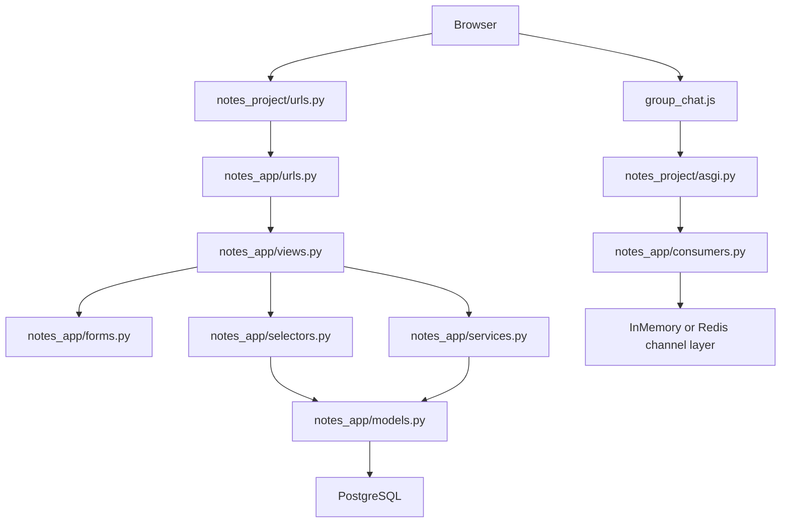

# Notes Chat App

[Українська](README.md) · **English**

An educational Django repository that takes a student from web foundations to a finished Django application with notes, lists, group access, and a WebSocket chat.

## About the project

`Notes Chat App` shows how a Django application grows:

- from URL routing and function-based views;
- to models, migrations, the ORM, and query optimization;
- to forms, templates, Bootstrap, and Crispy Forms;
- to services/selectors, authentication, permissions, and tests;
- to ASGI, Django Channels, and a WebSocket chat;
- to thinking about Docker, Redis, PostgreSQL, and deployment.

The project UI uses the name `CrispyNotes`. The Django project package is `notes_project`, and the Django app is `notes_app`.

## Features

| Area | Implementation |
| --- | --- |
| Notes | CRUD, search, notebooks, tags, priority, pinned |
| Todo lists | lists, items, toggle, direct sharing |
| Shopping lists | items, quantity, estimated price, sharing |
| Groups | creating groups, members, group-owned notes/shopping lists |
| Chat | real-time group chat via Django Channels |
| Auth | registration, login/logout, password change/reset templates |
| Tests | models, services, forms, views, consumers, Selenium |

## Technologies

- Python 3.12 in the audit environment.
- Django `>=5.2,<6.0`.
- Bootstrap 5 and Bootstrap Icons.
- `django-crispy-forms` + `crispy-bootstrap5`.
- Django Channels, Daphne, Uvicorn, `channels-redis`.
- PostgreSQL only: without `DATABASE_URL`, `settings.py` raises an exception (SQLite is not used).
- PostgreSQL and Redis via environment variables.
- Selenium, coverage, GitHub Actions.

## Quick start

```bash
git clone https://github.com/NikoriakViktot/notes_chat_app.git
cd notes_chat_app

python3 -m venv .venv
source .venv/bin/activate

python -m pip install --upgrade pip
pip install -r requirements.txt

python manage.py migrate
python manage.py createsuperuser
python manage.py runserver
```

Windows PowerShell:

```powershell
py -3.12 -m venv .venv
.\.venv\Scripts\Activate.ps1
python -m pip install --upgrade pip
pip install -r requirements.txt
python manage.py migrate
python manage.py runserver
```

## Main URLs

| URL | Purpose |
| --- | --- |
| `/` | home page |
| `/register/` | registration |
| `/accounts/login/` | login |
| `/notes/` | notes |
| `/todo/` | todo lists |
| `/shopping/` | shopping lists |
| `/groups/` | groups |
| `/groups/<pk>/chat/` | chat HTML page |
| `/ws/groups/<pk>/chat/` | WebSocket endpoint |
| `/admin/` | Django admin |

## Architecture



## Documentation

The documentation is built with [MkDocs + Material](https://squidfunk.github.io/mkdocs-material/).

**Online:** https://nikoriakviktot.github.io/notes_chat_app/

### Local preview

```bash
source .venv/bin/activate
pip install -r requirements-docs.txt
mkdocs serve
```

Open in your browser: **http://localhost:8000**

`mkdocs serve` automatically reloads whenever any `.md` file changes.

### Publishing to GitHub Pages

```bash
git add mkdocs.yml requirements-docs.txt docs/ .github/workflows/docs.yml
git commit -m "docs: update documentation"
git push
```

GitHub Actions automatically builds the site and deploys it to the `gh-pages` branch.
Status: https://github.com/NikoriakViktot/notes_chat_app/actions

> **First deploy:** go to **Settings → Pages**, choose Source = `gh-pages` / `/ (root)`, and click Save.

### Documentation structure

| Section | Description |
|--------|------|
| [Book](docs/00_getting_started/README.md) | 12 modules: Web → Django → DB → Forms → Frontend → Architecture → Auth → Testing → Async → Linux → Deploy |
| [Notes Chat App](docs/12_final_project/README.md) | Architecture, models, tests, and deployment of the final project |
| [Practice](docs/tutorials/README.md) | Tutorials and labs |
| [Reference](docs/reference/README.md) | Cheatsheets, glossary, troubleshooting |
| [For teachers](docs/TEACHING_GUIDE.md) | Teaching guide, learning path |

## Learning path

1. [Getting started](docs/00_getting_started/README.md)
2. [Web foundations](docs/01_web_foundations/README.md)
3. [Django core](docs/02_django_core/README.md)
4. [Database and ORM](docs/03_database_and_orm/README.md)
5. [Forms and validation](docs/04_forms_and_validation/README.md)
6. [Frontend and templates](docs/05_frontend_and_templates/README.md)
7. [Application architecture](docs/06_application_architecture/README.md)
8. [Auth and security](docs/07_auth_and_security/README.md)
9. [Testing and quality](docs/08_testing_and_quality/README.md)
10. [Async and realtime](docs/09_async_and_realtime/README.md)
11. [Linux and DevOps](docs/10_linux_and_devops/README.md)
12. [Deployment](docs/11_deployment/README.md)
13. [Final project](docs/12_final_project/README.md)

## Demo data (`seed_demo_data`)

This command fills the database with realistic examples for a quick start and for demonstrations.

### Commands

```bash
# Regular run (idempotent — does not duplicate data that already exists)
python manage.py seed_demo_data

# Delete all demo data and create it again
python manage.py seed_demo_data --reset

# Allow running with DEBUG=False (production-guard bypass)
python manage.py seed_demo_data --force

# Via Docker
docker compose run --rm web python manage.py seed_demo_data
docker compose run --rm web python manage.py seed_demo_data --reset
```

### Automatic run in Docker

`SEED_DEMO_DATA=1` in `docker-compose.yml` → the seeder runs automatically when the container starts, via `entrypoint.sh` with the `--force` flag (which bypasses the production guard when `DEBUG=False`).

### Demo users

Password for all of them: **`demo1234`**

The demo content itself is in Ukrainian (it is the real data created by the seeder), so the values below are kept as-is, with English glosses in parentheses.

| Login | Name | Email |
|-------|------|-------|
| `demo_alice` | Аліса Шевченко (Alisa Shevchenko) | alice@demo.example.com |
| `demo_bob` | Боб Коваленко (Bob Kovalenko) | bob@demo.example.com |
| `demo_carol` | Кароль Мельник (Karol Melnyk) | carol@demo.example.com |

### Demo groups

| Group name | Members |
|-------------|----------|
| Команда розробки (Development team) | demo_alice, demo_bob, demo_carol |
| Сімейний чат (Family chat) | demo_alice, demo_carol |

### What gets created

| Object | Count | Details |
|--------|-----------|--------|
| Users | 3 | alice, bob, carol |
| Groups | 2 | Команда розробки (Development team), Сімейний чат (Family chat) |
| Tags | 18 | 6 tags × 3 users (робота/work, особисте/personal, навчання/learning, важливо/important, ідеї/ideas, перечитати/re-read) |
| Notebooks | 9 | 3 notebooks × 3 users (Робочі нотатки/Work notes, Особисте/Personal, Навчання Python/Learning Python) |
| Notes | 30 | 10 notes × 3 users, with tags, priorities, and pinned notes |
| Reminders | 12 | 4 reminders × 3 users |
| Todo lists | 9 | 3 todo lists × 3 users, with items and sharing between users |
| Shopping lists | 9 | 3 shopping lists × 3 users, with prices and quantities |
| Chat messages | 30 | A realistic conversation in the «Команда розробки» (Development team) group |

### Tags (for every user)

`робота` · `особисте` · `навчання` · `важливо` · `ідеї` · `перечитати`

(work · personal · learning · important · ideas · re-read)

### Notes (10 topics, the same for all users)

- Архітектура нового модуля — New module architecture *(робота, важливо — pinned, shared with the group)*
- Docker Compose + PostgreSQL *(робота, навчання)*
- Django Channels: channel layer *(навчання — pinned)*
- Ідея: фільтрація нотаток за датою — Idea: filtering notes by date *(ідеї, робота)*
- Книги до прочитання — Books to read *(навчання, перечитати)*
- Конспект: asyncio event loop — Notes: asyncio event loop *(навчання)*
- Зворотний зв'язок після демо — Feedback after the demo *(робота, shared with the group)*
- Рефакторинг selectors.py — Refactoring selectors.py *(робота, важливо)*
- Плани на вихідні — Weekend plans *(особисте)*
- WebSocket: оптимізація history — WebSocket: history optimization *(ідеї, навчання — pinned, shared with the group)*

### Idempotency

Running `seed_demo_data` again (without `--reset`) **does not duplicate** data — it uses `update_or_create` keyed by username / title. It is safe to run multiple times.

To fully reset the demo data (only `demo_*` objects, without touching real users' data):

```bash
python manage.py seed_demo_data --reset
```

## ngrok — public access from outside

[ngrok](https://ngrok.com) creates a secure tunnel from a public URL to your local port 80 (nginx).
It is handy for showing the project without deploying it, or for testing webhooks.

Your static domain: **`https://fawn-natural-mayfly.ngrok-free.app`**

### Option 1: via Docker Compose (recommended)

Add to `.env`:

```env
NGROK_AUTHTOKEN=your_ngrok_authtoken_here
NGROK_DOMAIN=fawn-natural-mayfly.ngrok-free.app
```

> **Important:** if ngrok is already running locally (`ngrok http 80`), stop it before `docker compose up`. A single static domain cannot be active twice (error `ERR_NGROK_334`).

Start it:

```bash
docker compose up -d
```

The ngrok service starts automatically and opens a tunnel to nginx:80.
ngrok web interface: **http://localhost:4040**

**Network architecture:** all services live in a single explicit Docker network, `app-net`. ngrok starts only after nginx passes its health check (`GET /accounts/login/ → 200`), which eliminates the `ERR_NGROK_8012` error (it could not resolve the hostname `nginx`).

### Option 2: locally (without Docker)

First start the stack (`docker compose up -d`), then in a separate terminal:

#### Linux

```bash
# Installation
curl -sSL https://ngrok-agent.s3.amazonaws.com/ngrok.asc \
  | sudo tee /etc/apt/trusted.gpg.d/ngrok.asc >/dev/null \
  && echo "deb https://ngrok-agent.s3.amazonaws.com bookworm main" \
  | sudo tee /etc/apt/sources.list.d/ngrok.list \
  && sudo apt update && sudo apt install ngrok

# Authentication
ngrok config add-authtoken YOUR_AUTHTOKEN

# Start
ngrok http --url=fawn-natural-mayfly.ngrok-free.app 80
```

#### macOS

```bash
# Installation
brew install ngrok

# Authentication
ngrok config add-authtoken YOUR_AUTHTOKEN

# Start
ngrok http --url=fawn-natural-mayfly.ngrok-free.app 80
```

#### Windows

```powershell
# Installation via winget
winget install ngrok

# Authentication
ngrok config add-authtoken YOUR_AUTHTOKEN

# Start
ngrok http --url=fawn-natural-mayfly.ngrok-free.app 80
```

> You can find the token in [ngrok Dashboard → Your Authtoken](https://dashboard.ngrok.com/get-started/your-authtoken). Keep it as safe as a password and never commit it to git.

## Tests

```bash
docker compose run --rm web python manage.py check
docker compose run --rm web python manage.py test
```

The async HTTP demo modules are not present in the current working tree and are not described as an active feature. The real async component of the project is the WebSocket chat via ASGI, Channels, and `GroupChatConsumer`.

## Docker stack

The full stack runs via `docker compose up --build`:

| Service | Role |
|--------|------|
| `db` (PostgreSQL 16) | database |
| `redis` (Redis 7) | channel layer for WebSocket and Celery broker |
| `web` (Uvicorn/ASGI) | Django application on port 8001 |
| `nginx` (1.27) | reverse proxy on port 80, serves staticfiles |
| `celery-worker` | Celery worker for background tasks (`notes_app/tasks.py`) |
| `celery-beat` | Celery beat, the periodic task scheduler |
| `ngrok` | public tunnel → nginx:80 (profile `tunnel`) |
| `selenium` | Chrome for E2E tests (profile `test`) |
| `selenium-tests` | one-off run of the Selenium E2E tests (profile `test`) |

All services are connected to the shared bridge network `app-net`. The dependency chain with health checks: `db` → `redis` → `web` → `nginx` → `ngrok`.

## Future development

- Move `SECRET_KEY` and `ALLOWED_HOSTS` into environment variables.
- Add production-ready logging and monitoring.
- If the async HTTP demo needs to come back, restore `async_views.py`, `async_selectors.py`, and `async_services.py` together with their routes.
