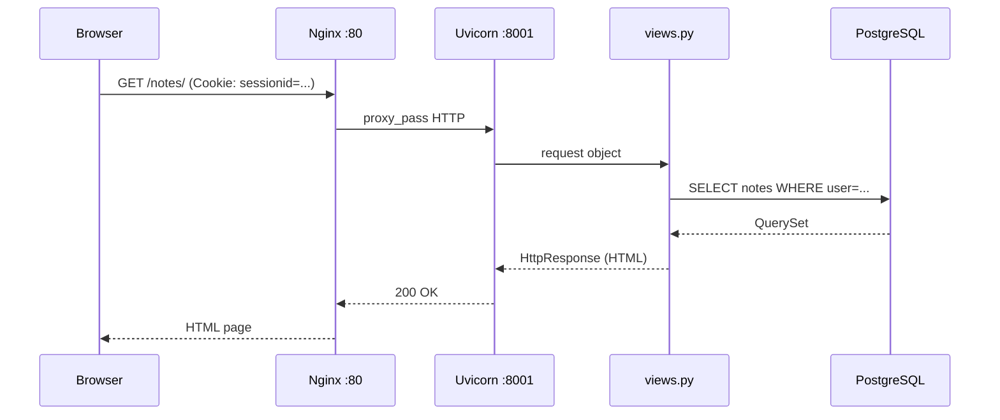

# Part I. Web Foundation

Django is a library on top of HTTP. Without understanding HTTP, Django looks like magic. This part builds the foundation: TCP/IP, DNS, HTTP request/response, the browser and the server.

**Prerequisites:** basic Python.
**Level:** Foundation.

---

## Chapters

| Document | What we will learn |
|----------|-----------|
| [Network foundation](network_foundation_full.md) | IP, TCP, DNS, ports, packets — the physical basis of the internet |
| [HTTP and HTTPS](http_https.md) | request/response, methods (GET/POST/PUT/DELETE), headers, status codes, TLS |
| [HTTP Requests: architecture](http_requests_docs.md) | request structure, body, query params, cookie, content-type |
| [Browser ↔ Server](browser_server_lifecycle.md) | the full lifecycle: entering a URL → DNS → TCP → HTTP → HTML |
| [Web servers and the kernel](server.md) | socket, bind, accept, synchronous and asynchronous connection handling |
| [Network diagrams](network_mermaid_full.md) | Mermaid diagrams of the OSI stack, TLS handshake, request/response flow |

---

## Key concepts

```
URL → DNS lookup → TCP handshake → (TLS handshake) → HTTP request
                                                    ← HTTP response
```

| Concept | Essence |
|---------|------|
| HTTP methods | `GET` — reading (safe, idempotent); `POST` — changing state; `PUT`/`PATCH`/`DELETE` — REST |
| Status codes | 200 OK · 201 Created · 301/302 Redirect · 400 Bad Request · 403 Forbidden · 404 Not Found · 500 Server Error |
| Stateless | every HTTP request is independent — a session is emulated via `Cookie: sessionid=...` |
| HTTPS | TLS encrypts traffic between the browser and the server; a certificate confirms identity |
| DNS | domain name → IP address (for example `notes.example.com` → `93.184.216.34`) |

**Why Django is stateless:** when the browser makes a GET `/notes/`, Django does not know "who this is". It reads `Cookie: sessionid=abc123` → looks up the session → finds out `request.user`.

---

## Where this is in Notes Chat App

| File | What it shows |
|------|-----------|
| `notes_project/urls.py` | the first level of Django routing after an HTTP request arrives |
| `notes_app/views.py` | functions that handle `GET`/`POST` and return `HttpResponse`/`redirect` |
| `nginx/nginx.conf` | reverse proxy: accepts HTTP on :80, passes it to Uvicorn (`web`) on :8001 |
| `notes_project/settings.py` | `CSRF_TRUSTED_ORIGINS`, `SESSION_COOKIE_SECURE`, `SECURE_SSL_REDIRECT` |

**Mermaid: a request to Notes Chat App**



---

## How it connects pedagogically

```text
HTTP request lifecycle   (Part I)
  → Django URL dispatcher (Part II)
    → View function → HttpResponse
      → ORM query → PostgreSQL (Part III)
        → Template render → HTML (Part V)
```

**Zero to Hero:** Step 1 (hello_project) — the first `HttpResponse`. The student sees HTTP first-hand through `manage.py runserver`.

---

## Practice

1. Open DevTools → Network → make a GET request to any site. Find: Request Headers, Response Headers, Status Code, Cookie.
2. Submit a POST through a login form — find the Request Body (`username=...&password=...&csrfmiddlewaretoken=...`).
3. Run `docker compose up` and inspect the request to `/notes/` in DevTools.

---

## Self-check questions

- What does stateless mean and why does it make authentication harder? How does Django solve this problem?
- What is the difference between `200 OK` and `302 Found`? When does Django return `302`?
- Why do we need DNS? Why doesn't the browser go directly to an IP?
- What is a TLS handshake and when does it happen? What gets encrypted?
- Why does Django need `CSRF_TRUSTED_ORIGINS` when working through ngrok or a reverse proxy?
- What is the difference between `GET` and `POST`? Why does a login form use `POST`?

---

**Next →** [Part II. Django Core](../02_django_core/README.md) — where Python meets HTTP.
