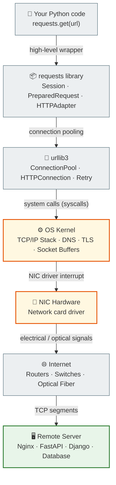
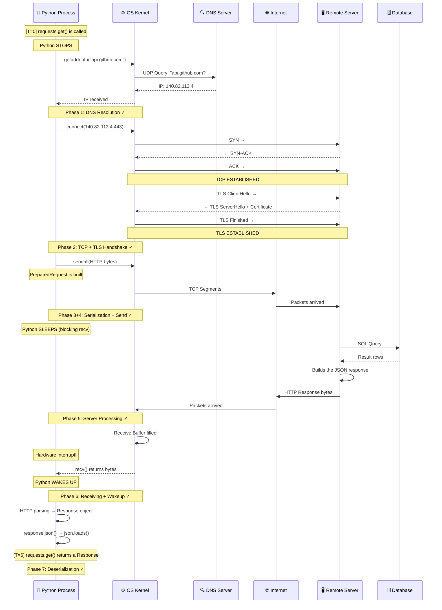
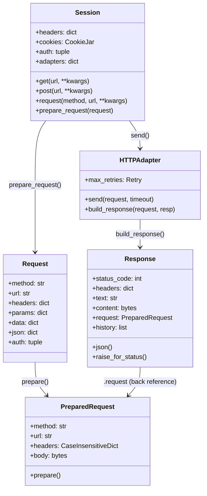
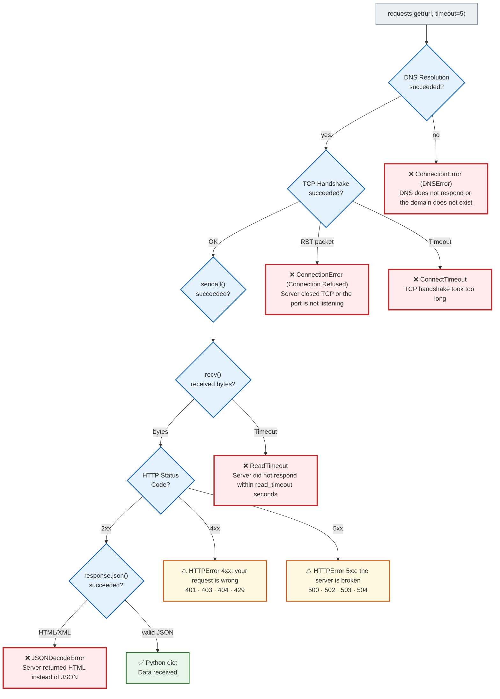
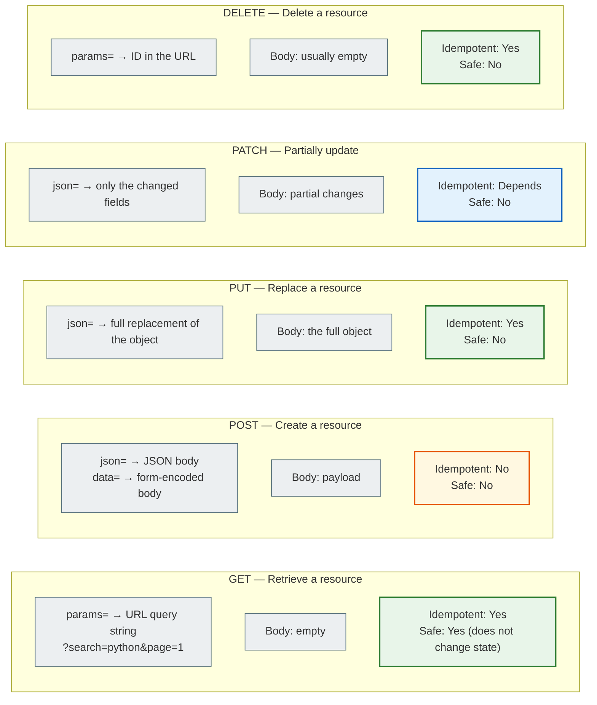
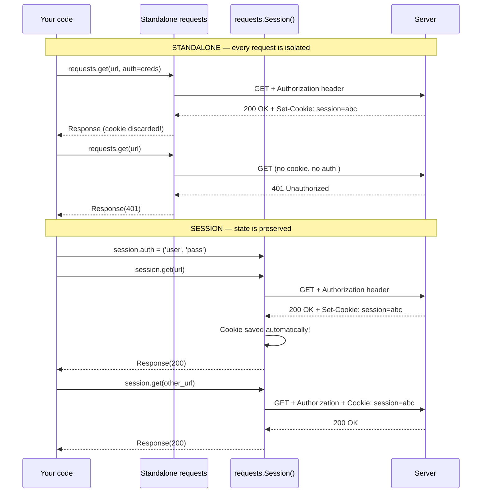
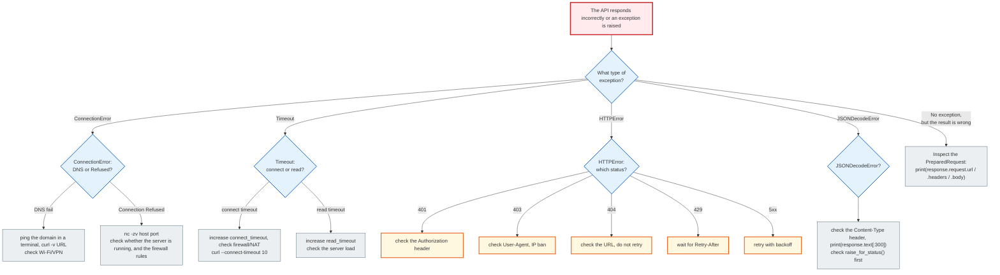

# Lesson 31 — HTTP Requests: Documentation and Architecture Diagrams

**Module 4 · Network & Concurrent Systems**

> This file is a reference and architectural companion to `note_lesson_31_http_requests.ipynb`.
> It contains Mermaid diagrams, in-depth explanations and production patterns.

---

## Contents

1. [What is HTTP](#1-what-is-http)
2. [Layers of the network stack](#2-layers-of-the-network-stack)
3. [The 7 phases of an HTTP request](#3-the-7-phases-of-an-http-request)
4. [requests: Internal architecture](#4-requests-internal-architecture)
5. [Error types and their sources](#5-error-types-and-their-sources)
6. [HTTP Methods and semantics](#6-http-methods-and-semantics)
7. [Session vs Standalone Requests](#7-session-vs-standalone-requests)
8. [Production Patterns](#8-production-patterns)
9. [Debugging Flowchart](#9-debugging-flowchart)

---

## 1. What is HTTP

### Definition

HTTP (HyperText Transfer Protocol) is a text-based application-layer (L7) protocol
that defines the format of requests and responses between a client and a server.

### Key properties

| Property | Explanation |
| ----------- | --------- |
| **Stateless** | The server does not remember previous requests |
| **Text-based** | Messages are formatted ASCII text |
| **Request-Response** | The client always initiates, the server responds |
| **TCP-based** | Runs on top of TCP (reliable delivery) |
| **Layered** | HTTP knows nothing about TCP details; TCP knows nothing about HTTP |

### Anatomy of an HTTP Request

```
GET /users/octocat HTTP/1.1\r\n         ← Request Line
Host: api.github.com\r\n                 ← Headers (the envelope)
User-Agent: python-requests/2.28.1\r\n
Authorization: Bearer token123\r\n
Accept: application/json\r\n
\r\n                                     ← Empty line = end of headers
                                         ← Body (empty for GET)
```

### Anatomy of an HTTP Response

```
HTTP/1.1 200 OK\r\n                      ← Status Line
Content-Type: application/json\r\n       ← Headers
Content-Length: 135\r\n
X-RateLimit-Remaining: 59\r\n
\r\n                                     ← Empty line
{"login": "octocat", "id": 1, ...}       ← Body (JSON)
```

---

## 2. Layers of the Network Stack



**Key principle:** Python works only at level A and partly at level B.
Everything below is the OS Kernel and hardware. `requests` hides this complexity,
but when errors happen it "leaks" back to you as an exception.

---

## 3. The 7 Phases of an HTTP Request

### Sequence Diagram: The Full Lifecycle



### The phases in detail

| Phase | Time | Where Python is | Who does the work |
| ---- | --- | --------- | ------------------- |
| DNS Resolution | T=0 | Stopped | OS Kernel → DNS Server |
| TCP + TLS Handshake | T=1 | Stopped | OS Kernel ↔ Remote OS |
| HTTP Serialization | T=2 | Active | `requests` library |
| Send + Long Sleep | T=3 | **Sleeping** | OS Kernel → NIC → Internet |
| Server Processing | T=4 | **Sleeping** | Remote Server + DB |
| Receive + Wakeup | T=5 | Waking up | OS Kernel (interrupt) |
| Deserialization | T=6 | Active | `json.loads()` in RAM |

---

## 4. requests: Internal Architecture



### Data flow inside requests

```mermaid
flowchart LR
    A["requests.get(url,<br>params=..., headers=..., json=..., timeout=...)"]

    B["Request object<br>(not prepared)"]

    C["PreparedRequest: method='GET'<br>url='https://...?q=python', headers={...}, body=b'{...}'"]

    D["HTTPAdapter.send()<br>urllib3 ConnectionPool"]

    E["OS Socket<br>sendall() + recv()"]

    F["HTTP Response bytes<br>HTTP/1.1 200 OK ..."]

    G["Response object<br>.status_code=200, .headers={...}, .text='...'"]

    A -->|"Session.request()"| B
    B -->|"prepare_request()"| C
    C -->|"adapter.send()"| D
    D -->|"socket syscall"| E
    E -->|"raw bytes"| F
    F -->|"build_response()"| G

    classDef step     fill:#eceff1,stroke:#546e7a,stroke-width:1px;
    classDef success  fill:#e8f5e9,stroke:#2e7d32,stroke-width:2px;
    classDef warning  fill:#fff8e1,stroke:#e65100,stroke-width:2px;

    class A,B,D,F step;
    class C,E warning;
    class G success;
```



---

## 5. Error Types and Their Sources



### Table: Exception → Cause → Action

| Exception | Layer | Cause | Action |
| --------- | ------ | ------- | --- |
| `ConnectionError` (DNS) | L3-L4 | Domain not found | Check DNS: `ping domain.com` |
| `ConnectionError` (Refused) | L4 | Port closed, RST | Check whether the server is running |
| `ConnectTimeout` | L4 | Handshake hung | Increase connect_timeout or check the firewall |
| `ReadTimeout` | L7 | Server is slow | Increase read_timeout or retry |
| `SSLError` | L4-L7 | Invalid certificate | Update the CA bundle or `verify=False` (dangerous!) |
| `HTTPError 401` | L7 | No authorization | Add an `Authorization` header |
| `HTTPError 403` | L7 | Blocked (WAF/bot) | Check `User-Agent`, IP ban |
| `HTTPError 404` | L7 | Resource does not exist | Check the URL, do not retry |
| `HTTPError 429` | L7 | Rate limit | Wait `Retry-After` seconds |
| `HTTPError 5xx` | L7 | Server is broken | Retry with backoff |
| `JSONDecodeError` | Python | HTML instead of JSON | Check the `Content-Type` header |
| `TooManyRedirects` | L7 | Redirect loop | `allow_redirects=False`, check the URL |

---

## 6. HTTP Methods and Semantics



### Where the data goes — a clear comparison

| Kwargs | HTTP part | Method | Example |
| ------ | ------------ | ----- | ------- |
| `params={'q': 'py'}` | URL: `?q=py` | GET | search, filtering |
| `headers={'Auth': '...'}` | HTTP Headers | any | tokens, content-type |
| `data={'key': 'val'}` | Body (form-encoded) | POST | HTML forms |
| `json={'key': 'val'}` | Body (JSON) | POST/PUT/PATCH | REST API |
| `files={'file': ...}` | Body (multipart) | POST | file uploads |
| `auth=('user','pass')` | Authorization header | any | Basic Auth |

---

## 7. Session vs Standalone Requests



### What a Session keeps between requests

```python
session = requests.Session()
session.headers['User-Agent'] = 'MyApp/1.0'     # every request will have this User-Agent
session.auth = ('user', 'pass')                  # Basic Auth in every request
session.cookies.set('tracking', 'value')         # cookie in every request
session.verify = False                           # disable SSL verification (dangerous!)
```

---

## 8. Production Patterns

### 8.1. Basic Production Pattern

```python
import requests
from typing import Any

def safe_api_call(
    url: str,
    method: str = 'GET',
    **kwargs: Any
) -> dict:
    """
    Production-grade HTTP request with full error handling.
    """
    kwargs.setdefault('timeout', (3.05, 10))

    try:
        response = requests.request(method, url, **kwargs)
        response.raise_for_status()
        return response.json()

    except requests.exceptions.ConnectTimeout:
        raise RuntimeError(f"TCP handshake timeout: {url}")

    except requests.exceptions.ReadTimeout:
        raise RuntimeError(f"Server response timeout: {url}")

    except requests.exceptions.ConnectionError as e:
        raise RuntimeError(f"Network unreachable (DNS/TCP): {e}")

    except requests.exceptions.HTTPError as e:
        status = e.response.status_code
        body = e.response.text[:500]
        raise RuntimeError(f"HTTP {status} from {url}: {body}")

    except ValueError:
        raise RuntimeError(f"Invalid JSON from {url}: {response.text[:200]}")
```

### 8.2. Session with Retry and Backoff

```python
import requests
from requests.adapters import HTTPAdapter
from urllib3.util.retry import Retry


def build_session(
    retries: int = 3,
    backoff_factor: float = 1.0,
    token: str = '',
) -> requests.Session:
    """
    Production session with retry, backoff and authorization.
    """
    retry_strategy = Retry(
        total=retries,
        backoff_factor=backoff_factor,   # 1s → 2s → 4s between attempts
        status_forcelist=[429, 500, 502, 503, 504],
        allowed_methods=['GET', 'POST', 'PUT'],
        respect_retry_after_header=True,
    )

    adapter = HTTPAdapter(max_retries=retry_strategy)

    session = requests.Session()
    session.mount('https://', adapter)
    session.mount('http://', adapter)

    if token:
        session.headers['Authorization'] = f'Bearer {token}'

    return session


# Usage
session = build_session(
    retries=3,
    backoff_factor=1.0,
    token='my_api_token_here'
)

response = session.get(
    'https://httpbin.org/get',
    params={'q': 'python'},
    timeout=(3.05, 10)
)
response.raise_for_status()
data = response.json()
```

### 8.3. Debugging Helper

```python
import requests

def inspect_request(response: requests.Response) -> None:
    """Full diagnostics of the sent request and the received response."""

    req = response.request

    print("── SENT ─────────────────────────────")
    print(f"  {req.method} {req.url}")
    for k, v in req.headers.items():
        print(f"  {k}: {v}")
    if req.body:
        print(f"\n  Body: {req.body[:200]}")

    print("\n── RECEIVED ─────────────────────────")
    print(f"  HTTP {response.status_code} {response.reason}")
    for k, v in response.headers.items():
        print(f"  {k}: {v}")
    print(f"\n  Body (first 300 characters):")
    print(f"  {response.text[:300]}")

    if response.history:
        print(f"\n── REDIRECTS ({len(response.history)}) ────────────")
        for r in response.history:
            print(f"  {r.status_code} → {r.headers.get('Location')}")
```

---

## 9. Debugging Flowchart



### General Debug Checklist

```
Step 1: Check status_code
    → 2xx? Continue
    → 4xx? Your request is wrong
    → 5xx? The server is broken, retry

Step 2: Check Content-Type
    → application/json? You can call response.json()
    → text/html? The server returned an HTML error page

Step 3: Look at the first 300 characters of the body
    → response.text[:300]

Step 4: Check what Python sent
    → response.request.url
    → response.request.headers
    → response.request.body

Step 5: Bypass Python
    → curl -v "https://..." in a terminal
    → ping domain.com
    → telnet host port
```

---

## Glossary

| Term | Definition |
| ------ | ---------- |
| **HTTP** | HyperText Transfer Protocol — a text-based L7 protocol |
| **Stateless** | Every request is isolated; the server does not remember previous ones |
| **TCP Handshake** | 3-way (SYN-SYN/ACK-ACK) connection establishment |
| **TLS** | Transport Layer Security — HTTPS encryption |
| **DNS** | Domain Name System — converting a domain into an IP |
| **PreparedRequest** | An internal requests object: a ready HTTP byte string |
| **Blocking I/O** | `recv()` stops the Python process until the response arrives |
| **Serialization** | Python dict → JSON string → bytes |
| **Deserialization** | bytes → JSON string → Python dict |
| **Timeout tuple** | `(connect_timeout, read_timeout)` in seconds |
| **raise_for_status()** | Raises `HTTPError` if status_code >= 400 |
| **Session** | An object that keeps headers/cookies/auth between requests |
| **Retry / Backoff** | Repeated attempts with a growing pause between them |
| **Rate Limiting** | The server limits the number of requests (429 Too Many Requests) |
| **Thundering Herd** | All retries fire at the same time → server overload |
| **Circuit Breaker** | A pattern: after N errors — fail immediately, do not retry |

---

*Documentation for Lesson 31 · Module 4 · Python Networking Course*
