# Network Foundation — Mermaid Diagrams

> All diagrams in this file visualize concepts from [`network_foundation_full.md`](network_foundation_full.md).
> They render in any Markdown viewer with Mermaid support (GitHub, Obsidian, VSCode).

---

## 1. Overview of the Internet — from the browser to the server

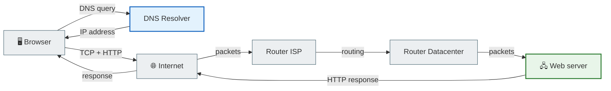

---

## 2. The full request route: Client → Router → ISP → Server

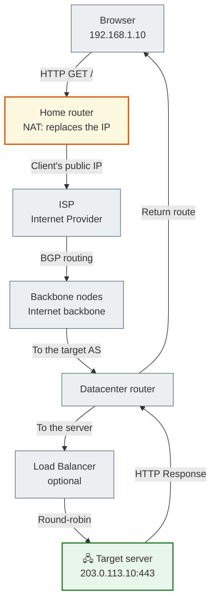

---

## 3. DNS resolution — step by step

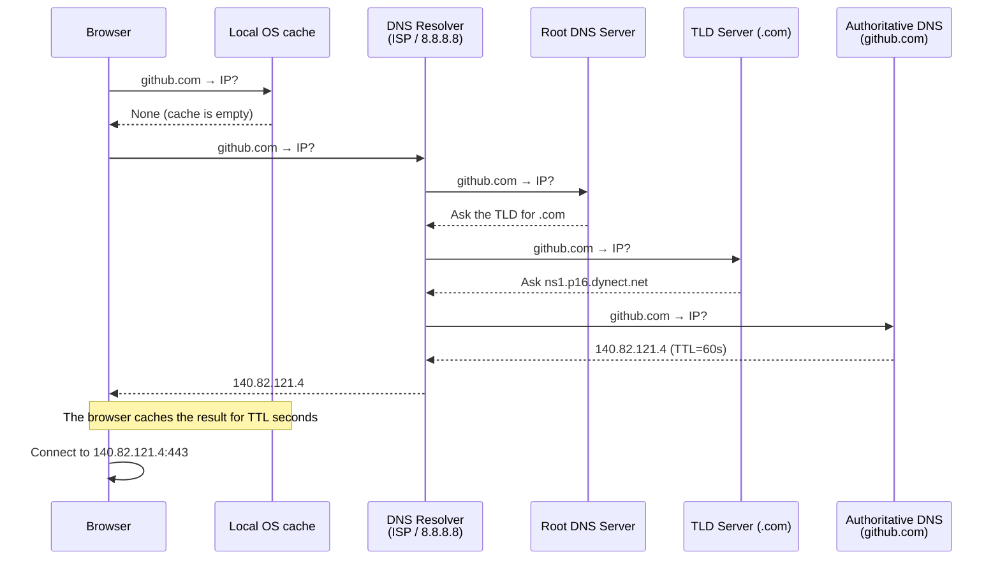

---

## 4. TCP — Three-Way Handshake + HTTP + Teardown

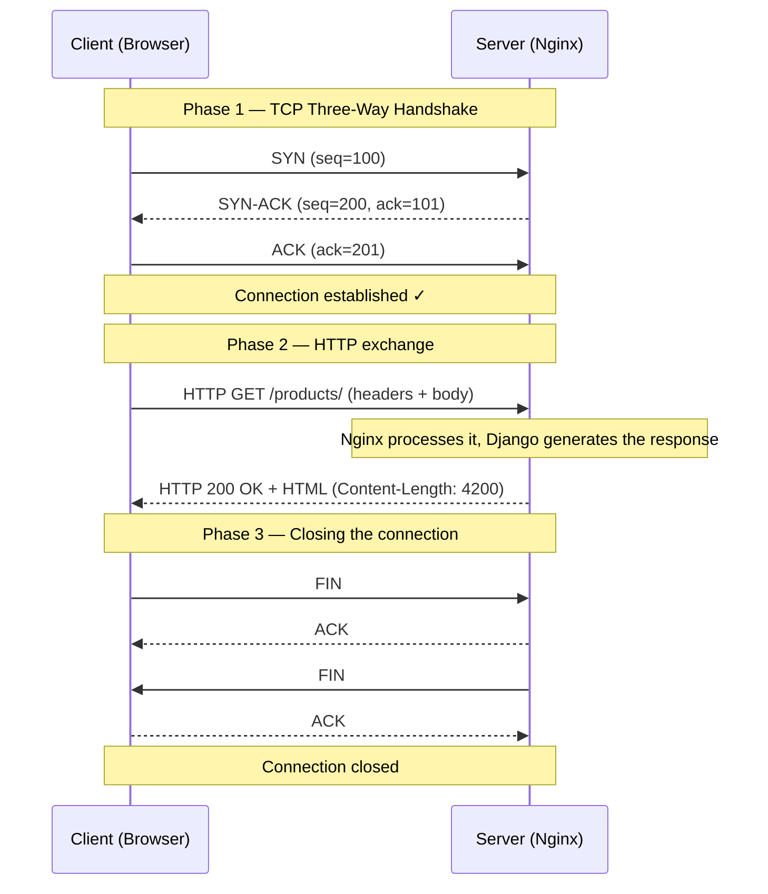

---

## 5. HTTP Request/Response Lifecycle

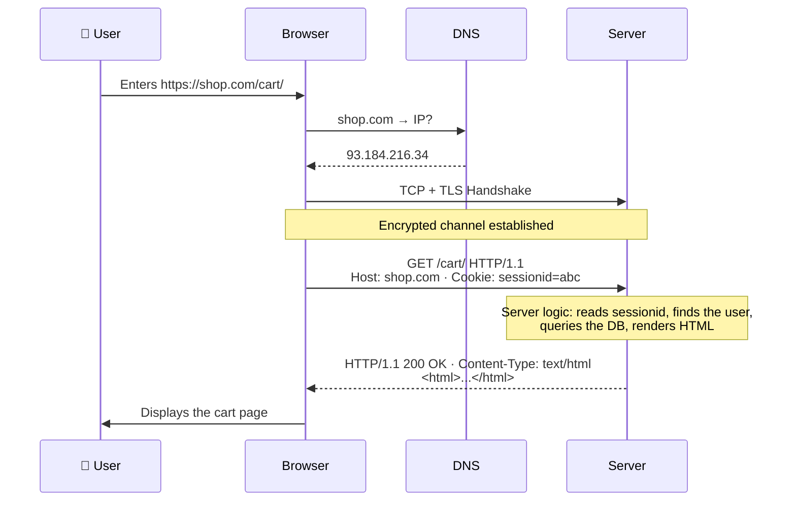

---

## 6. HTTPS / TLS Handshake

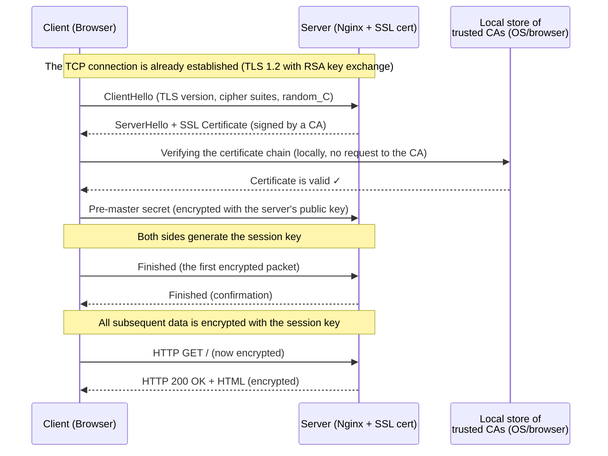

---

## 7. Browser → Backend → Database (the full stack)

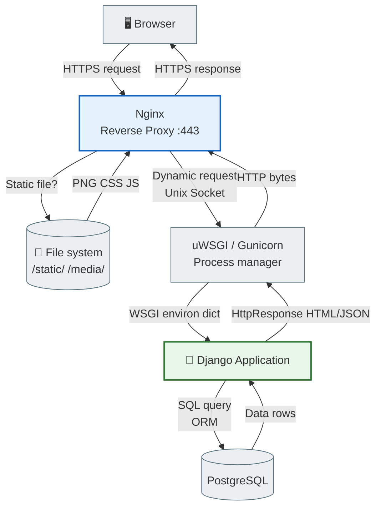

---

## 8. Socket communication

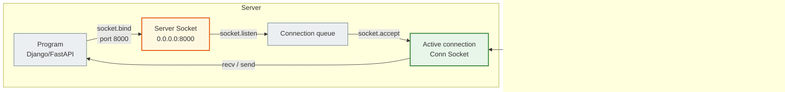

---

## 9. REST API Flow — the full cycle

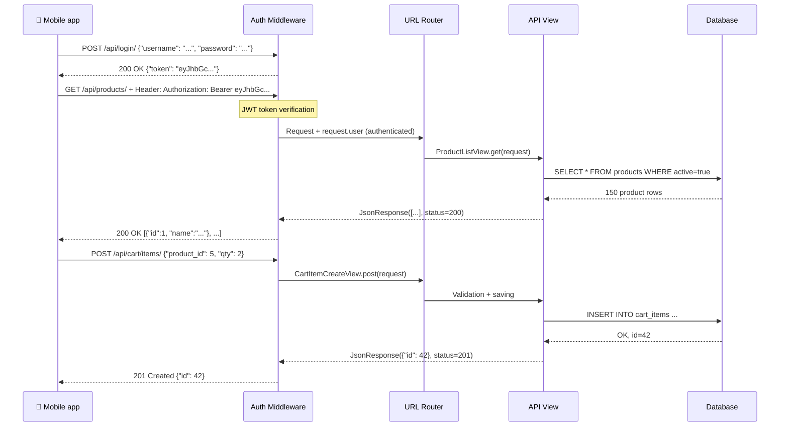

---

## 10. Client-server architecture — a conceptual overview

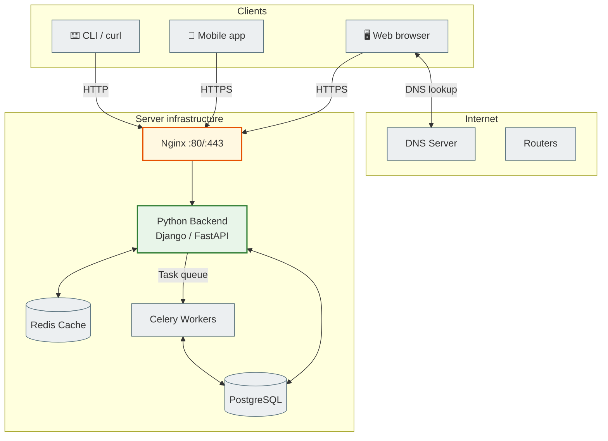

---

## 11. Packets and IP routing

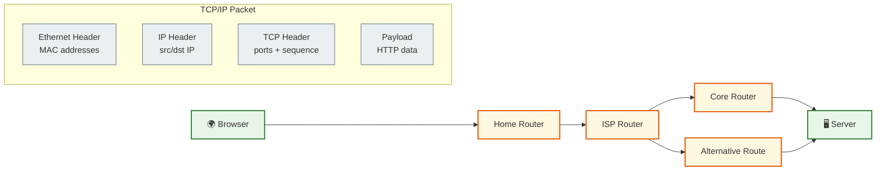

---

## Protocol reference table

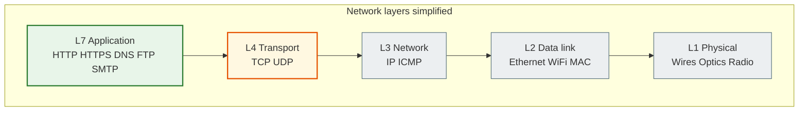
