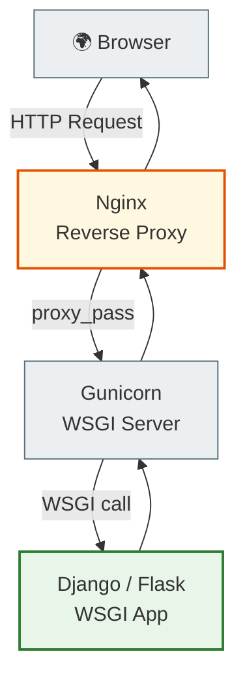
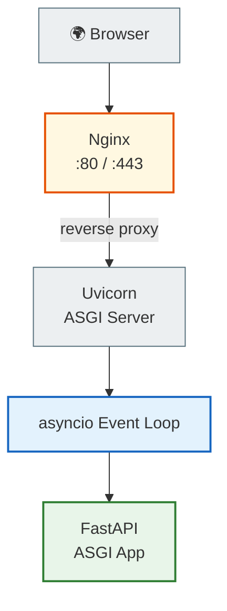
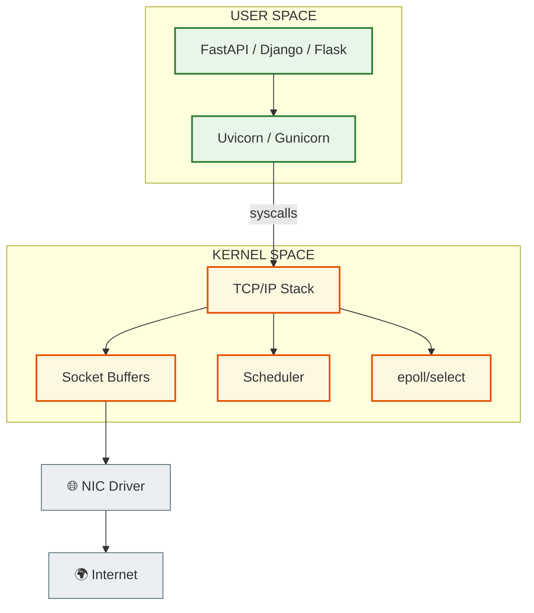
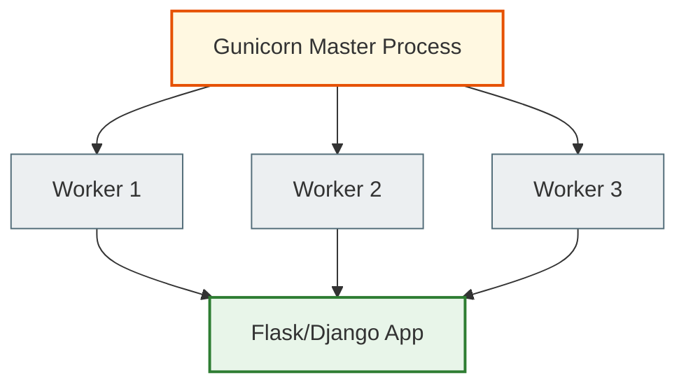
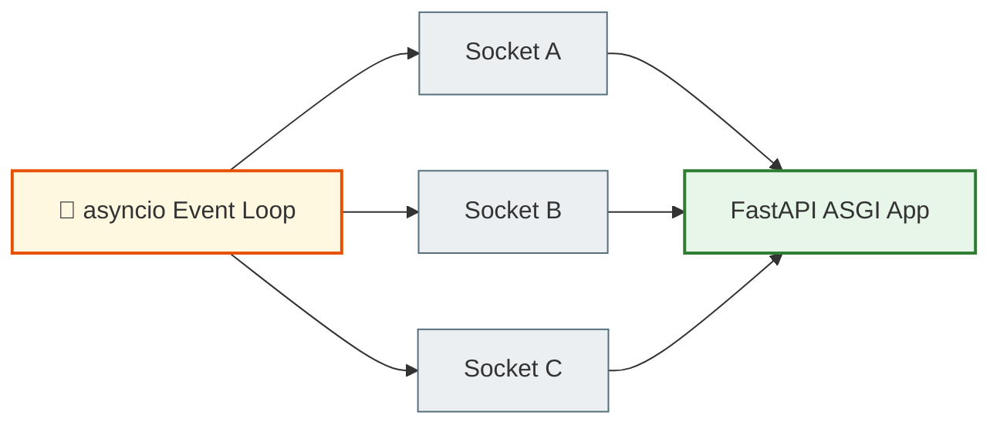
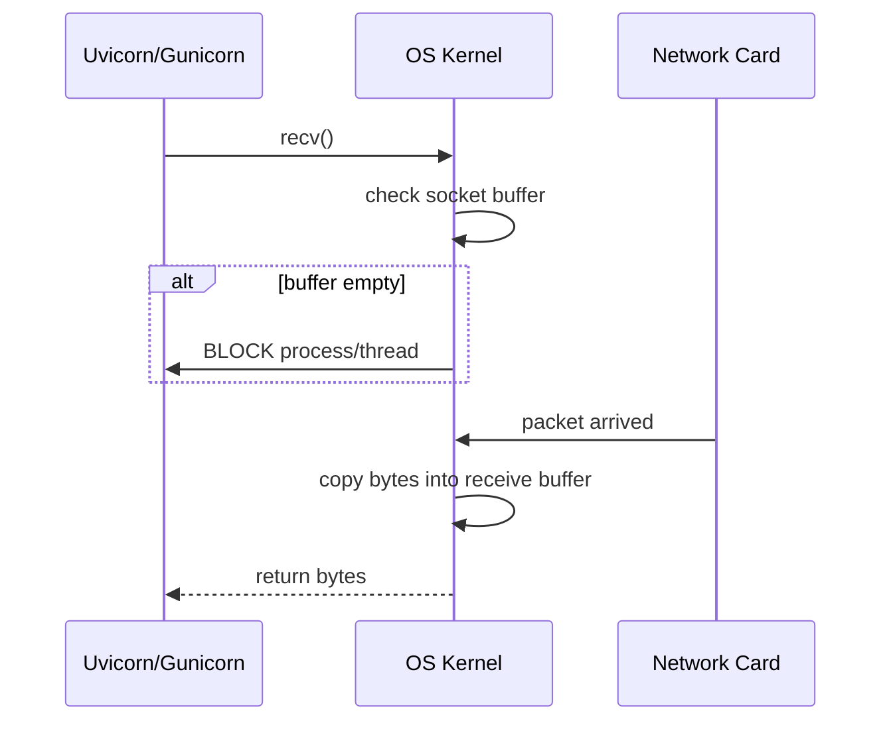
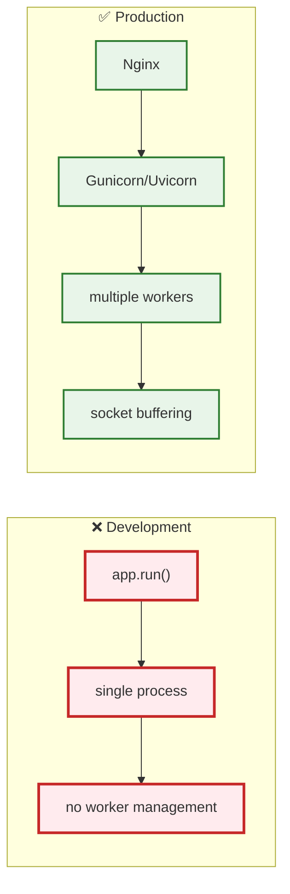
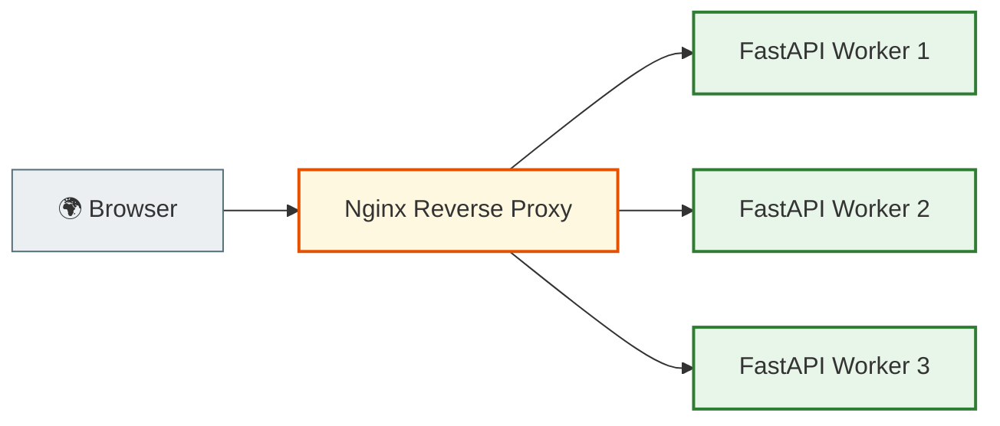
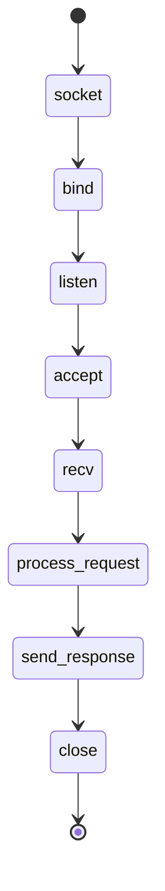

# Python Web Servers, the Kernel and Production Networking

---

# The main idea

Most beginners think that:

```python
from fastapi import FastAPI
```

or:

```python
from flask import Flask
```

is already a:

```text
web server
```

But that is NOT the case.

---

# Framework ≠ Server

FastAPI, Flask, Django —
are:

```text
application frameworks
```

They:
- describe routes,
- business logic,
- request handlers,
- middleware.

But they do NOT:
- open TCP sockets directly,
- do NOT call accept(),
- do NOT manage epoll/select,
- do NOT work with the kernel networking stack directly.

---

# Who actually works with the network?

The real networking is done by:

- Gunicorn
- Uvicorn
- Hypercorn
- uWSGI
- Daphne

They are the ones that:
- open sockets,
- bind() to a port,
- listen(),
- accept(),
- recv(),
- send().

---

# Architecturally

```text
Python App
    ↓
WSGI / ASGI
    ↓
Python Server
    ↓
OS Kernel
    ↓
TCP/IP Stack
    ↓
Network
```

---

# What is WSGI?

WSGI =
```text
Web Server Gateway Interface
```

The old synchronous standard for Python web.

---

# The WSGI model

```text
HTTP Request
↓
1 worker/thread/process
↓
Framework handles request
↓
HTTP Response
```

---

# Frameworks that work through WSGI

| Framework | Type |
|---|---|
| Flask | minimal WSGI |
| Django (classic) | full-stack WSGI |

---

# What is ASGI?

ASGI =
```text
Asynchronous Server Gateway Interface
```

The new async Python standard.

---

# ASGI supports

- asyncio
- WebSocket
- long connections
- streaming
- async I/O
- event loops

---

# Frameworks that work through ASGI

| Framework | Type |
|---|---|
| FastAPI | modern ASGI |
| Starlette | lightweight ASGI |
| Quart | async Flask |
| aiohttp | async HTTP |
| modern Django async | hybrid |

---

# The most important systems-thinking point

The framework:
```text
defines the application logic
```

The server:
```text
defines the networking model
```

---

# What does Gunicorn actually do?

Gunicorn:
- socket()
- bind()
- listen()
- fork workers
- accept()
- recv()
- passes the request to the Flask/Django app

---

# Gunicorn lifecycle

```text
socket()
↓
bind()
↓
listen()
↓
fork workers
↓
accept()
↓
recv()
↓
WSGI app
↓
response
```

---

# What does Uvicorn actually do?

Uvicorn
is an async ASGI server.

It:
- uses an event loop,
- epoll/select,
- non-blocking sockets,
- asyncio tasks.

---

# Uvicorn lifecycle

```text
socket()
↓
epoll/select
↓
event loop
↓
async tasks
↓
ASGI app
↓
await recv/send
```

---

# Production Architecture

A typical production setup for FastAPI:

```text
                 INTERNET
                      │
══════════════════════╪══════════════════════
                      ▼
               ┌────────────┐
               │   Nginx    │
               │ :80 / :443 │
               └─────┬──────┘
                     │ reverse proxy
                     ▼
          ┌─────────────────────┐
          │     Uvicorn         │
          │   ASGI Server       │
          └─────┬──────┬────────┘
                │      │
         Worker 1   Worker 2
                │      │
                ▼      ▼
             FastAPI App
```

---

# For Django

```text
Browser
↓
Nginx
↓
Gunicorn
↓
Django
```

---

# What does Nginx do?

Nginx:
- listens on 80/443,
- TLS/HTTPS,
- reverse proxy,
- buffering,
- static files,
- load balancing,
- keep-alive connections.

---

# Why NOT run FastAPI/Flask directly?

Because:

```python
app.run()

```

is a:

```text
development server
```

---

# A development server does NOT properly handle

- multiprocessing
- worker management
- graceful shutdown
- production buffering
- efficient concurrency
- load balancing
- advanced socket handling

---

# The full Mental Model

```text
        USER SPACE
═══════════════════════════════════

 FastAPI / Django / Flask
            │
            ▼
    Uvicorn / Gunicorn
            │
            ▼
════════ syscall boundary ════════

         OS KERNEL
═══════════════════════════════════

 TCP Stack
 Socket Buffers
 Scheduler
 epoll/select
 File Descriptors

═══════════════════════════════════

        NETWORK LAYER
═══════════════════════════════════

 TCP/IP
 Ethernet
 Wi-Fi
 Routers
 Internet
```

---

# What does recv() mean in a production server?

When Uvicorn or Gunicorn does:

```python
sock.recv(1024)
```

it means:

```text
crossing the syscall boundary into the kernel
```

---

# Then the kernel:

- checks the receive buffer,
- if there are bytes → returns the data,
- if there are no bytes → blocks the thread/process.

---

# Blocking Model

```text
Python Process
↓
recv()
↓
Kernel checks socket buffer
↓
buffer empty
↓
process asleep
↓
packet arrives
↓
kernel wakeup
↓
recv() returns bytes
```

---

# The most important conclusion

A Python framework
is only the application layer.

The real networking:
- sockets,
- TCP,
- buffers,
- event loops,
- epoll/select,
- scheduler,
- kernel wakeups

is done by:
- Gunicorn,
- Uvicorn,
- the kernel networking stack.

# 🔥 1. Flask / Django (WSGI) Architecture



---

# 🔥 2. FastAPI + Uvicorn (ASGI)



---

# 🔥 3. Full Production Networking Stack



---

# 🔥 4. Gunicorn Worker Model



---

# 🔥 5. Uvicorn Event Loop Model



---

# 🔥 6. recv() Through Kernel Boundary



---

# 🔥 7. Development Server vs Production Server



---

# 🔥 8. Reverse Proxy Architecture



---

# 🔥 9. Socket Lifecycle in Production Server



