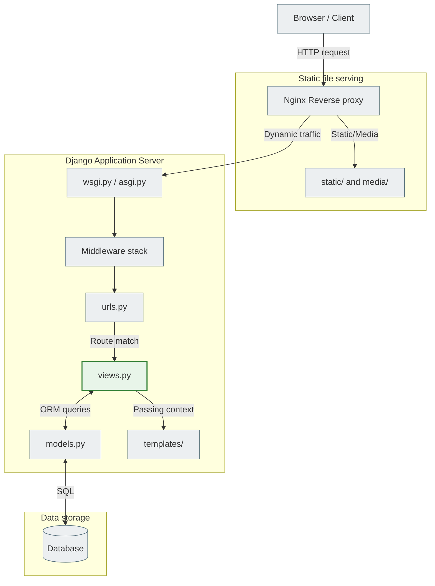
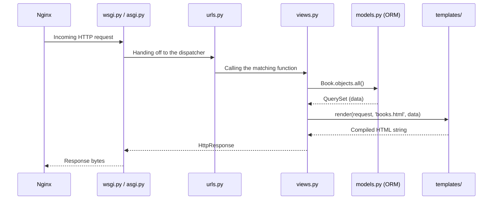
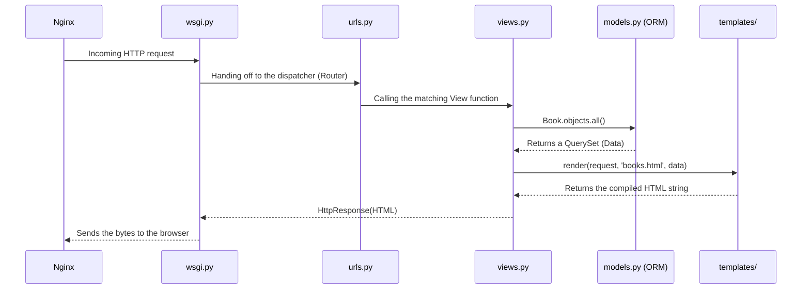

# Django Project Structure

## Standard file hierarchy

```text
my_project/                 # Root directory (container for the whole project)
├── manage.py               # ⚙️ Command-line orchestrator
├── my_project/             # 🛠 MAIN CONFIGURATION PACKAGE (System Level)
│   ├── __init__.py
│   ├── settings.py         # 🎛 Central settings hub
│   ├── urls.py             # 🔀 Main router (Root URLconf)
│   ├── asgi.py             # ⚡️ Asynchronous gateway (WebSockets / Async)
│   └── wsgi.py             # 🌐 Synchronous gateway (HTTP)
├── my_app/                 # 📦 MODULAR APP (App Level)
│   ├── __init__.py
│   ├── admin.py            # 🛡 Back-office configuration
│   ├── apps.py             # 📝 App registration
│   ├── models.py           # 🗄 Database schema (Data Layer)
│   ├── views.py            # 🧠 HTTP orchestrator (delegates to services/selectors)
│   ├── urls.py             # 🔀 App routes
│   ├── forms.py            # 📋 Django Forms / ModelForms
│   ├── tests.py            # ✅ Tests
│   └── migrations/         # 🕰 History of the DB's evolution
│       ├── __init__.py
│       └── 0001_initial.py
├── templates/              # 🎨 GLOBAL TEMPLATES (Presentation Layer)
│   └── base.html
└── static/                 # 🖼 STATIC ASSETS
    ├── css/
    ├── js/
    └── images/
```

---

## Architecture and execution flow

### High-level backend architecture



### HTTP request lifecycle



---

## Detailed component breakdown

### System level — orchestration

#### `manage.py`

| Aspect | Description |
|--------|------|
| **Purpose** | Command-line orchestrator for the whole project |
| **Internal role** | Sets `DJANGO_SETTINGS_MODULE` and runs Django commands |
| **In the request lifecycle** | No part at all — does not handle live web traffic |
| **In CI/CD** | Runs tests, collects static files, applies migrations |

**Mental model:** A foreman on a construction site — you give him orders, he delegates to the framework.

> **Mistake:** Thinking that `manage.py` runs the production server. In production this file is ignored when handling traffic.

---

#### `settings.py`

| Aspect | Description |
|--------|------|
| **Purpose** | Central configuration hub |
| **Internal role** | A Python module with global variables (DB, installed apps, security keys) |
| **In the request lifecycle** | Loaded into memory **once** when the server starts |
| **External services** | PostgreSQL, Redis, AWS S3, Celery — all connected here |

**Mental model:** The main electrical panel and control board for the whole building.

```python
# Critical settings
INSTALLED_APPS = ['django.contrib.auth', 'myapp']
DATABASES = {'default': {'ENGINE': 'django.db.backends.postgresql', ...}}
MIDDLEWARE = ['django.middleware.security.SecurityMiddleware', ...]
```

> **Mistake:** Trying to change `settings.py` dynamically for different users at runtime. Settings are global and static.

---

#### `wsgi.py` and `asgi.py`

| Aspect | Description |
|--------|------|
| **Purpose** | Entry points for application servers (Gunicorn, Uvicorn) |
| **Internal role** | Provides the standard `application` object for talking to Django |
| **In the request lifecycle** | The first line of Django code when an HTTP request arrives |
| **`wsgi.py`** | Synchronous protocol — traditional HTTP requests |
| **`asgi.py`** | Asynchronous protocol — WebSockets, Server-Sent Events |

**Mental model:** An interpreter's desk — turns "raw" network HTTP bytes into Python dictionaries.

> **Mistake:** Thinking that Django listens to the Internet on its own. Traffic always goes through a WSGI/ASGI server first.

---

### App level — logic and routing

#### `urls.py`

| Aspect | Description |
|--------|------|
| **Purpose** | URL dispatcher |
| **Internal role** | The `urlpatterns` list — maps URL strings to Python functions |
| **Algorithm** | Searches **top to bottom**, stops at the **first** match |
| **For APIs** | Defines the endpoint contract |

**Mental model:** A mail sorter — reads the address and hands the envelope to the right courier.

> **Mistake:** Expecting Django to find the "best" match. It takes the first one — static routes must come before dynamic ones.

---

#### `views.py`

| Aspect | Description |
|--------|------|
| **Purpose** | HTTP orchestrator — a thin layer between the network and the business domain |
| **Internal role** | Accepts an `HttpRequest`, calls serializer → service/selector, returns an `HttpResponse` |
| **In the request lifecycle** | Parses the request, delegates logic, formats the response |
| **Can return** | HTML, JSON, PDF, CSV, Redirect |

**Mental model:** A dispatcher — takes the call, connects it to the right specialist and passes the answer back. It decides nothing on its own.

```python
# A view in clean architecture — as thin as possible
class FloodEventCreateAPIView(APIView):

    def post(self, request):
        serializer = FloodEventInputSerializer(data=request.data)  # validation
        serializer.is_valid(raise_exception=True)

        event = flood_event_create(**serializer.validated_data)    # business logic in a service

        return Response(FloodEventOutputSerializer(event).data, status=201)
```

| A view must NOT | A view MUST |
|-----------------|--------------|
| ❌ contain SQL or ORM queries | ✅ validate via an `InputSerializer` |
| ❌ contain business logic | ✅ call a `service` (mutations) |
| ❌ orchestrate transactions | ✅ call a `selector` (reads) |
| ❌ compute or transform data | ✅ format via an `OutputSerializer` |
| ❌ know about Celery tasks directly | ✅ return a `Response` |

> **Mistake in the standard architecture:** `views.py` is described as the place for "business logic". In clean/production architecture, a view is only the HTTP layer. All the logic lives in `services.py` and `selectors.py`.

---

#### `apps.py`

| Aspect | Description |
|--------|------|
| **Purpose** | Configuration of a specific app |
| **Internal role** | An `AppConfig` subclass — initialization when Django starts (for example, connecting Signals) |
| **In the request lifecycle** | No part at all — runs only once when the framework starts |

> **Mistake:** Writing business logic or DB queries here — it will cause a failure at startup.

---

### Data Layer

#### `models.py`

| Aspect | Description |
|--------|------|
| **Purpose** | Defining the database schema |
| **Internal role** | Python classes (subclasses of `models.Model`) → SQL tables |
| **Single source of truth** | The data structure is described here — not in SQL scripts |
| **In the request lifecycle** | Used by `views.py` for reading/writing |

**Mental model:** The architectural blueprints of the database.

> **Mistake:** Adding a field and thinking the DB will update itself. You need `makemigrations` + `migrate`.

---

#### `migrations/`

| Aspect | Description |
|--------|------|
| **Purpose** | Version control for the database schema |
| **Internal role** | Automatically generated Python scripts of schema changes |
| **In the request lifecycle** | No part at all |
| **In CI/CD** | The foundation of safe deployment — guarantees an identical schema on all servers |

**Mental model:** Git commits for DB tables — every schema change is recorded as a version.

> **Dangerous mistake:** Deleting migration files "to keep things clean" after they have been applied — this breaks the dependency graph and synchronization with the DB.

---

#### `admin.py`

| Aspect | Description |
|--------|------|
| **Purpose** | Configuration of the built-in admin interface |
| **Internal role** | Registers models on `admin.site` → CRUD via `/admin/` |
| **In the request lifecycle** | Handles only requests to `/admin/` paths |
| **Saves** | Hundreds of hours of developing internal dashboards |

**Mental model:** A store's back office — for trusted staff only.

> **Mistake:** Using the admin panel as the frontend for regular customers.

---

### Presentation Layer

#### `templates/`

| Aspect | Description |
|--------|------|
| **Purpose** | HTML structure with dynamic data |
| **Internal role** | DTL (Django Template Language) — `{{ variables }}`, `` |
| **In the request lifecycle** | Called at the end of a view to generate an HTML string |
| **In modern SPAs** | Replaced by a JSON response if the frontend is React/Vue |

**Mental model:** A document form with blank fields to fill in.

> **Mistake:** Writing full-blown Python code in templates. DTL is intentionally limited — business logic belongs in `views.py`.

---

#### `static/`

| Aspect | Description |
|--------|------|
| **Purpose** | Unchanging assets (CSS, JS, fonts, images) |
| **Internal role** | Sent to the client "as is", without Python processing |
| **In the request lifecycle** | In production it bypasses Django completely — Nginx serves it directly |
| **`collectstatic`** | Collects all static files from apps into `STATIC_ROOT` |

**Mental model:** The paint, furniture and decorations of the building.

> **Mistake:** Expecting Django to serve static files automatically on a real server without Nginx.

---

## How files interact during a request



---

## Modern production architecture of a Django project

The standard `my_project/my_app/` structure is fine for learning and small apps. Medium and large systems use a different approach — a **bounded context** structure.

### Production project structure

```text
project/
│
├── config/                      ← Configuration (instead of my_project/)
│   ├── settings/                ← Split settings: base.py, local.py, prod.py
│   ├── urls.py
│   ├── asgi.py
│   └── wsgi.py
│
├── apps/                        ← All business domains
│   │
│   ├── users/                   ← One bounded context = one app
│   │   ├── models.py
│   │   ├── views.py
│   │   ├── urls.py
│   │   ├── services.py          ← Business logic (mutations)
│   │   ├── selectors.py         ← Reading data (SELECT)
│   │   ├── serializers.py       ← HTTP validation + serialization
│   │   ├── permissions.py       ← DRF permissions
│   │   ├── tasks.py             ← Celery tasks (transport, not logic)
│   │   ├── validators.py        ← Complex domain validation
│   │   ├── filters.py           ← django-filter
│   │   ├── admin.py
│   │   ├── tests/
│   │   └── migrations/
│   │
│   ├── flood/                   ← A separate business domain
│   ├── dem/
│   ├── ml/
│   └── papers/
│
├── shared/                      ← Shared abstractions between apps
│   ├── exceptions/              ← Custom DRF exception handler
│   ├── middleware/
│   ├── auth/
│   ├── utils/
│   └── logging/
│
├── infrastructure/              ← Integrations with the outside world
│   ├── redis/
│   ├── s3/
│   ├── email/
│   ├── celery/
│   └── external_apis/
│
├── requirements/
├── docker/
├── scripts/
└── manage.py
```

---

### The main rule: app = bounded context

An app is not a technical module but a **separate business domain**.

```
✅ Correct            ❌ Wrong
apps/users/           models/          ← global for everything
apps/payments/        views/           ← global for everything
apps/flood/           utils/           ← global for everything
apps/papers/
```

Each app encapsulates the whole stack for its domain: models, logic, queries, serializers, tasks.

---

### New files inside an app

Compared with the standard `my_app/`, new files appear in the production architecture:

| File | Role | Detailed documentation |
|------|------|-----------------------|
| `services.py` | Business logic: mutations, transactions, side effects | [DJANGO_SERVICES.md](../06_application_architecture/django_services_full.md) |
| `selectors.py` | Reading data: named queries, ORM optimizations | [DJANGO_SELECTORS.md](../06_application_architecture/django_selectors_full.md) |
| `serializers.py` | HTTP ↔ domain: InputSerializer, OutputSerializer | [DJANGO_SERIALIZERS.md](../06_application_architecture/django_serializers_full.md) |
| `tasks.py` | Celery tasks — a transport layer, delegating to services | — |
| `validators.py` | Complex domain validation (`validate_dem_resolution()`) | — |
| `permissions.py` | DRF permissions (`IsOwner`, `IsAdminOrReadOnly`) | — |
| `filters.py` | `django-filter` FilterSet for dynamic filtering | — |

#### `services.py`

```python
# BAD — business logic in the model
class FloodEvent(models.Model):
    def run_ml_pipeline(self):
        ...

# GOOD — business logic in a service
# services.py
def flood_event_process(*, event: FloodEvent) -> FloodEvent:
    ...
```

More details: [DJANGO_SERVICES.md](../06_application_architecture/django_services_full.md)

#### `selectors.py`

```python
# BAD — ORM right in the view, duplicated across the whole project
FloodEvent.objects.filter(is_active=True, region_id=region_id)

# GOOD — a named query in a selector
# selectors.py
def flood_events_get_for_region(*, region_id: int) -> QuerySet:
    return FloodEvent.objects.filter(is_active=True, region_id=region_id)
```

More details: [DJANGO_SELECTORS.md](../06_application_architecture/django_selectors_full.md)

#### `tasks.py`

```python
# BAD — business logic in a Celery task
@shared_task
def calculate_everything(event_id):
    event = FloodEvent.objects.get(id=event_id)
    event.status = 'done'
    event.save()
    send_email(event.user.email, ...)

# GOOD — the task only transports the call into a service
@shared_task
def process_flood_task(event_id: int):
    event = flood_event_get_by_id(event_id=event_id)
    flood_event_process(event=event)
```

#### `views.py` in the production architecture

A view should be as thin as possible:

```python
# A view must NOT:         A view MUST:
# ❌ contain SQL           ✅ validate via a serializer
# ❌ contain ML            ✅ call a service
# ❌ orchestrate logic     ✅ return a Response
# ❌ compute metrics

class FloodEventCreateAPIView(APIView):

    def post(self, request):
        serializer = FloodEventInputSerializer(data=request.data)
        serializer.is_valid(raise_exception=True)
        event = flood_event_create(**serializer.validated_data, created_by=request.user)
        return Response(FloodEventOutputSerializer(event).data, status=201)
```

---

### `shared/` — shared abstractions

`shared/` contains code used by **several apps** that does not belong to any specific domain.

| Folder | What's inside |
|-------|--------------|
| `shared/exceptions/` | Custom DRF exception handler (mapping `DjangoValidationError` → HTTP 400) |
| `shared/middleware/` | Middleware for logging, correlation ID, rate limiting |
| `shared/auth/` | Shared authentication logic between apps |
| `shared/utils/` | Small utilities with no business domain |
| `shared/logging/` | Structured logging configuration |

```python
# shared/exceptions/handlers.py — registered once in settings.py
# and automatically catches errors in all apps
REST_FRAMEWORK = {
    'EXCEPTION_HANDLER': 'shared.exceptions.handlers.custom_exception_handler',
}
```

---

### `infrastructure/` — integrations with the outside world

`infrastructure/` contains **adapters to external services**. The key idea:

```
Business Layer     →   WHAT the system does
Infrastructure     →   HOW the system talks to the outside world
```

| Folder | What's inside |
|-------|--------------|
| `infrastructure/redis/` | Redis client, cache configuration |
| `infrastructure/s3/` | AWS S3 / MinIO client for file storage |
| `infrastructure/email/` | Email backend (SendGrid, SES) |
| `infrastructure/celery/` | Celery configuration, task routing |
| `infrastructure/external_apis/` | Clients for external APIs (SlideRule NASA, OpenWeather, etc.) |

```python
# infrastructure/s3/client.py
# S3 is neither the flood domain nor the dem domain.
# It is an external storage service, isolated in infrastructure/.
class S3Client:
    def upload_file(self, file_path: str, bucket: str) -> str:
        ...
```

Apps **import** from infrastructure, but infrastructure **does not know** about the apps.

---

### Comparison: learning vs production structure

| Aspect | Learning (standard) | Production |
|--------|----------------------|------------|
| Configuration | `my_project/settings.py` | `config/settings/base.py` + `local.py` + `prod.py` |
| Apps | `my_app/` in the root | `apps/users/`, `apps/flood/` |
| Business logic | In `views.py` | In `services.py` |
| ORM queries | In `views.py` or `models.py` | In `selectors.py` |
| Serialization | `ModelSerializer` | `InputSerializer` + `OutputSerializer` |
| External services | Directly in `views.py` | `infrastructure/` |
| Shared code | `utils.py` in the root | `shared/` |

> The learning structure is the right one for studying Django. The production structure is right when the project grows and a team works on it.
