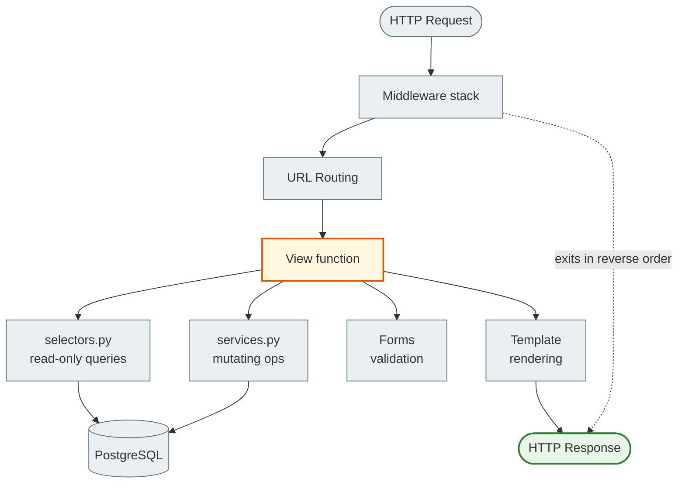

# Django Request Lifecycle

> When an HTTP request reaches Django, it passes through several layers before coming back as a response.
> Understanding these layers means understanding where to look for bugs and how to organize your code.

---

## Overview



---

## Step by step

### 1. Middleware stack — inbound

Every request passes through the `MIDDLEWARE` list from top to bottom:

```python
# notes_project/settings.py
MIDDLEWARE = [
    'django.middleware.security.SecurityMiddleware',
    'whitenoise.middleware.WhiteNoiseMiddleware',
    'django.contrib.sessions.middleware.SessionMiddleware',    # ← reads the session cookie
    'django.middleware.common.CommonMiddleware',               # ← /notes → /notes/
    'django.middleware.csrf.CsrfViewMiddleware',              # ← checks the CSRF token
    'django.contrib.auth.middleware.AuthenticationMiddleware', # ← sets request.user
    'django.contrib.messages.middleware.MessageMiddleware',
    'django.middleware.clickjacking.XFrameOptionsMiddleware',
]
```

**What each middleware does:**

| Middleware | Input | What it adds to the request |
|-----------|------|---------------------|
| `SecurityMiddleware` | request | HTTP→HTTPS redirect (prod) |
| `SessionMiddleware` | request | `request.session` dict |
| `CsrfViewMiddleware` | POST request | checks `csrftoken` cookie == POST param |
| `AuthenticationMiddleware` | request + session | `request.user` (User or AnonymousUser) |
| `MessageMiddleware` | request | `request._messages` storage |

**Order matters:** `AuthenticationMiddleware` must come AFTER `SessionMiddleware`, because it reads `request.session['_auth_user_id']`.

### 2. URL Routing

The middleware hands the request to the URLconf:

```python
# notes_project/urls.py
urlpatterns = [
    path('admin/', admin.site.urls),
    path('accounts/', include('django.contrib.auth.urls')),
    path('', include('notes_app.urls', namespace='notes_app')),
]
```

Django iterates over `urlpatterns` from top to bottom, comparing `request.path` with each pattern. The first match wins.

```python
# notes_app/urls.py
app_name = 'notes_app'

urlpatterns = [
    path('', views.home, name='home'),                              # GET /
    path('notes/', views.note_list, name='note_list'),              # GET /notes/
    path('notes/new/', views.note_create, name='note_create'),      # GET/POST /notes/new/
    path('notes/<int:pk>/', views.note_detail, name='note_detail'), # GET /notes/42/
    path('notes/<int:pk>/edit/', views.note_update, name='note_update'),
    path('notes/<int:pk>/delete/', views.note_delete, name='note_delete'),
    ...
]
```

If no pattern matches → 404 Not Found.

### 3. View function

URL routing calls the view with two kinds of arguments: `request` and the URL parameters:

```python
# notes_app/views.py

@login_required  # ← a middleware-like decorator: if AnonymousUser → redirect /login/
def note_detail(request, pk):   # pk from the URL pattern <int:pk>
    # 1. Get the data (via a selector)
    note = selectors.get_note_for_user(pk=pk, user=request.user)
    if note is None:
        raise Http404   # → 404 response

    # 2. Process the form (if POST)
    if request.method == 'POST':
        # handling a comment or another action
        ...
        return redirect('notes_app:note_detail', pk=pk)   # PRG pattern

    # 3. Render the template
    return render(request, 'notes_app/note_detail.html', {
        'note': note,
    })
```

**A view has THREE responsibilities — and only three:**
1. Take data from the request
2. Coordinate selectors/services/forms
3. Return a response (render or redirect)

### 4. Selector — reading from the DB

```python
# notes_app/selectors.py

def get_note_for_user(pk: int, user) -> Note | None:
    """Returns the note if the user has access. None if not, or if it does not exist."""
    user_groups = user.groups.all()
    return Note.objects.filter(
        Q(pk=pk) &
        (Q(user=user) | Q(group__in=user_groups))
    ).select_related('user', 'notebook').prefetch_related('tags').first()
```

A selector is **read-only**. Never `save()`, never `delete()`, never `create()`.

### 5. Service — mutations

```python
# notes_app/services.py

def update_note(*, note: Note, title: str, content: str, priority: int, ...) -> Note:
    """Updates the note and returns it."""
    note.title = title
    note.content = content
    note.priority = priority
    note.save()
    return note
```

A service does **mutations only**. It is called after form validation.

### 6. Template rendering

```python
return render(request, 'notes_app/note_detail.html', {
    'note': note,
    'tags': note.tags.all(),
})
```

Django finds the template in `TEMPLATES[0]['DIRS']` and, with `APP_DIRS = True`, also looks in `notes_app/templates/`.

### 7. Middleware stack — outbound (reverse order)

The response passes through the middleware in **reverse order**:

```
Response ← XFrameOptions ← Messages ← Auth ← Csrf ← Common ← Session ← Whitenoise ← Security
```

`SecurityMiddleware` adds the HSTS header, `XFrameOptionsMiddleware` adds `X-Frame-Options: DENY`.

---

## Where things break

| Symptom | Where to look |
|---------|-----------|
| `403 Forbidden` on POST | `CsrfViewMiddleware` — a form without `` |
| `403 Forbidden` on login | `SessionMiddleware` — the cookie is blocked (HTTPS only?) |
| `404` for a valid URL | URL order in `urlpatterns` — check for conflicting patterns |
| `redirect loop /login/ → /login/` | `@login_required` + `LOGIN_URL` points to itself |
| The view returns another user's data | The selector does not filter by `user` |
| `500 SynchronousOnlyOperation` | ORM in an async view without `sync_to_async` |

---

## 403 CSRF: the most common form error

```
Forbidden (403): CSRF verification failed. Request aborted.
```

**Cause:** `CsrfViewMiddleware` checks that the POST contains a token matching the cookie. If the form has no ``:

```html
<!-- WRONG — you will get a 403 -->
<form method="post">
  <input type="text" name="title">
  <button type="submit">Зберегти</button>
</form>

<!-- CORRECT -->
<form method="post">
     ← generates <input type="hidden" name="csrfmiddlewaretoken" value="...">
  <input type="text" name="title">
  <button type="submit">Зберегти</button>
</form>
```

---

## Checking in the shell

```bash
docker compose exec web python manage.py shell
```

```python
# Simulate the request lifecycle manually
from django.test import RequestFactory, Client

# Client — the full lifecycle with middleware
client = Client()
client.login(username='demo_alice', password='demo1234')
response = client.get('/notes/')
print(response.status_code)    # 200
print(response.context['notes'].count())

# RequestFactory — without middleware (for unit tests)
from django.contrib.auth.models import User
from django.test import RequestFactory
from notes_app import views

factory = RequestFactory()
request = factory.get('/notes/')
request.user = User.objects.get(username='demo_alice')
response = views.note_list(request)
```

---

## In the book

- [Browser Lifecycle](../01_web_foundations/browser_server_lifecycle.md) — from URL to Django
- [HTTP and HTTPS](../01_web_foundations/http_https.md) — HTTP methods, status codes
- [Part VI. Architecture](../06_application_architecture/README.md) — services, selectors, thin views

---

## Official documentation

- [Django: How Django processes a request](https://docs.djangoproject.com/en/5.2/topics/http/urls/#how-django-processes-a-request) — steps 1-4
- [Django: Middleware](https://docs.djangoproject.com/en/5.2/topics/http/middleware/) — writing and ordering
- [Django: URL dispatcher](https://docs.djangoproject.com/en/5.2/topics/http/urls/) — path(), include(), re_path()
- [Django: View functions](https://docs.djangoproject.com/en/5.2/topics/http/views/) — shortcuts, errors
