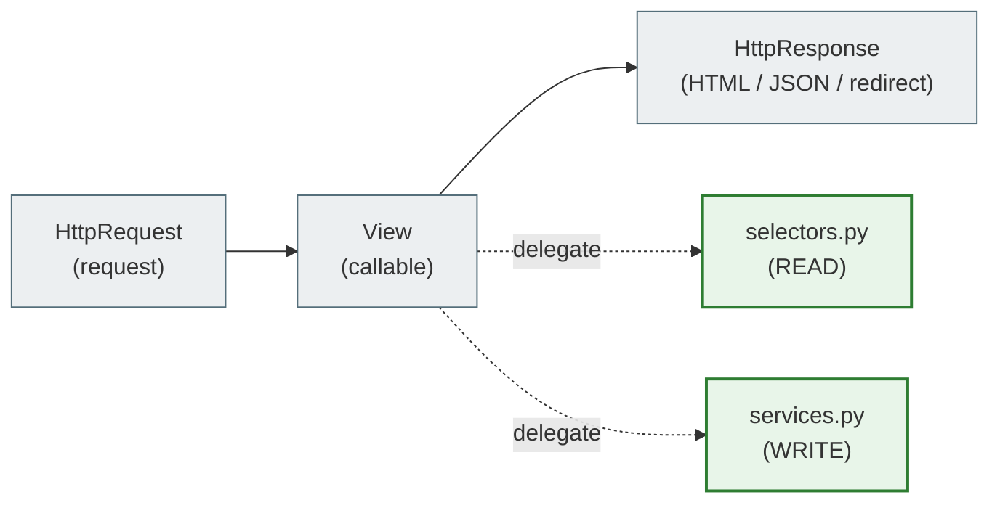
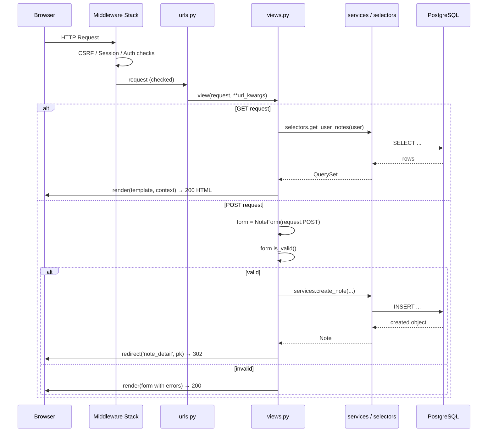
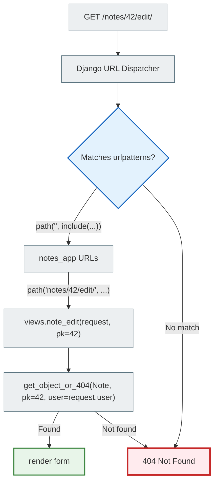
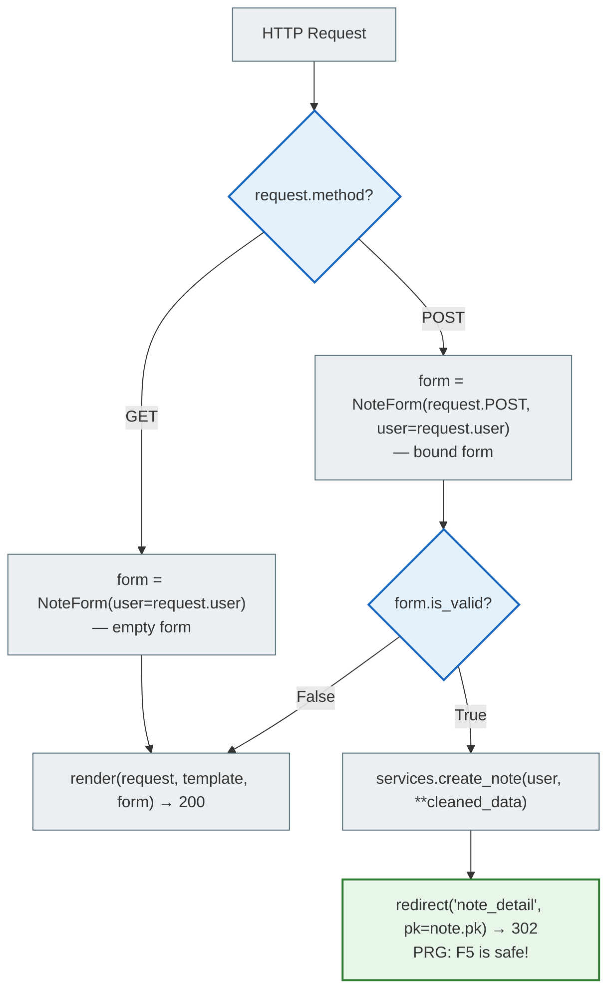
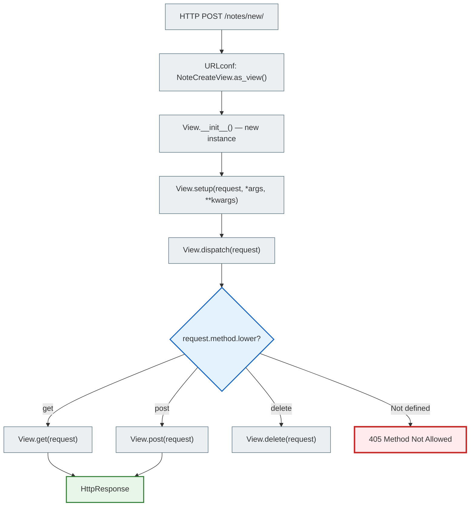
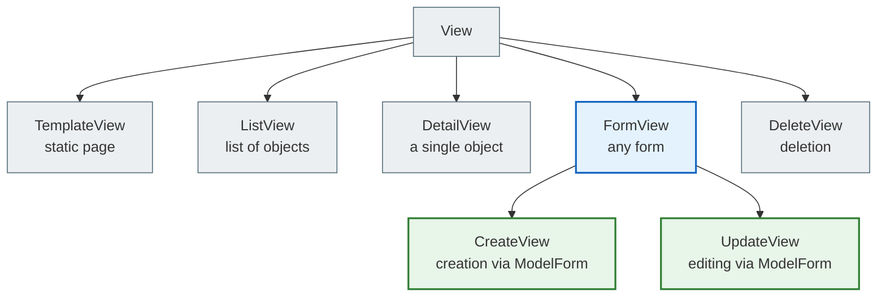
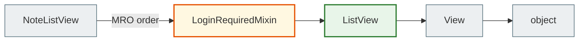
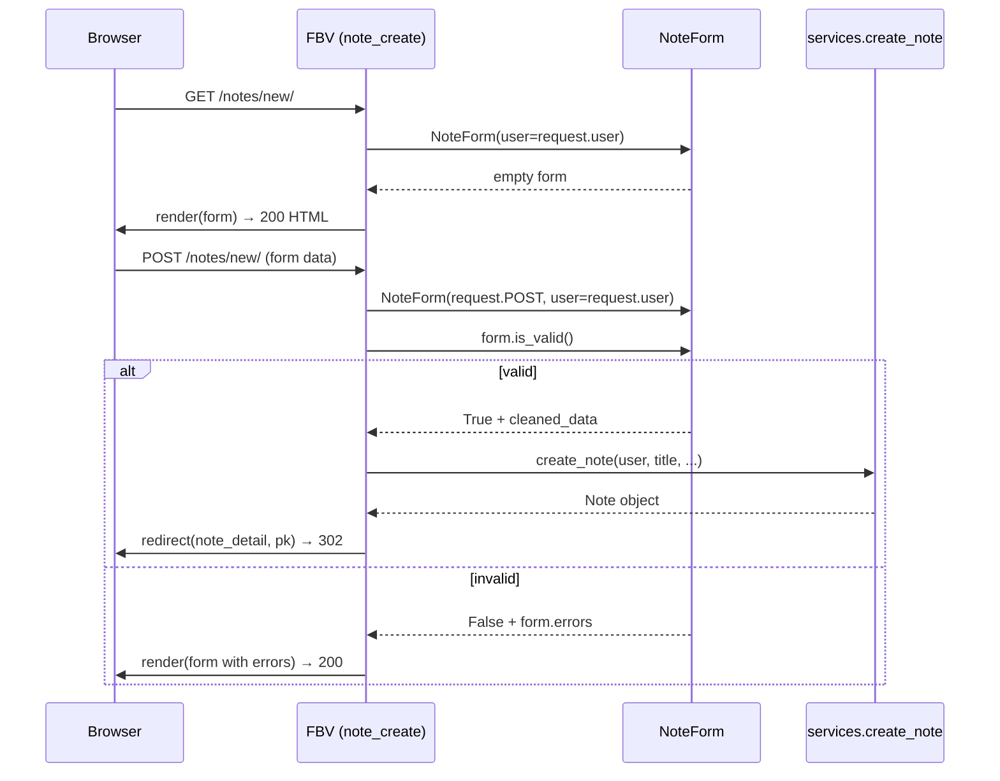
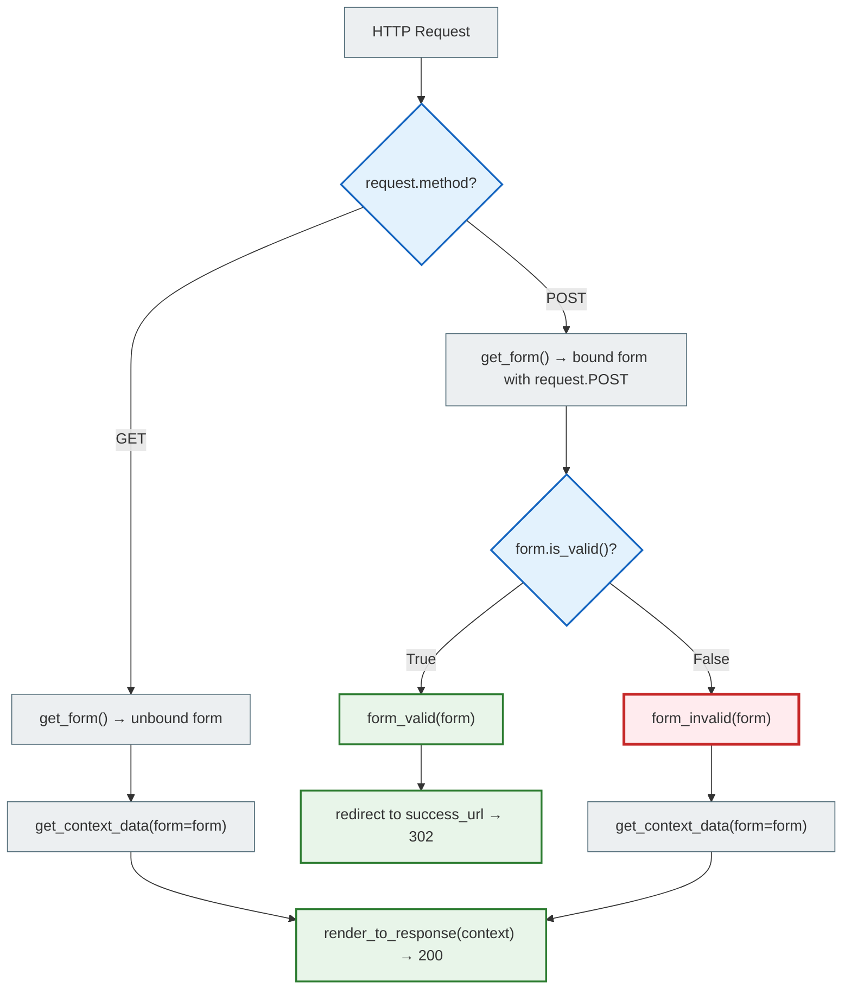
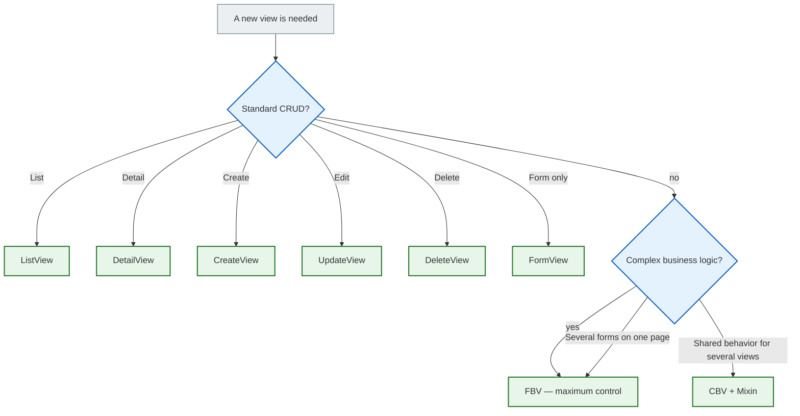

# Django Views — FBV and CBV

> **Where you are in the knowledge map:**
> `RELATIONAL_DB_FOUNDATIONS` → `DJANGO_ORM_DEEP` → `DJANGO_FORMS` → **`DJANGO_VIEWS`** ← you are here
>
> A view is the point where an HTTP request meets your business logic.
> Django receives a request and returns a response. Everything else is implementation detail.

---

## Navigation

| Section | What's inside |
|--------|--------------|
| [1. The view contract](#1-the-view-contract) | HttpRequest → callable → HttpResponse |
| [2. Request lifecycle](#2-request-lifecycle) | URL dispatch → View → Response |
| [3. FBV — function-based views](#3-fbv--function-based-views) | def view, GET/POST, forms, decorators |
| [4. CBV — class-based views](#4-cbv--class-based-views) | dispatch(), as_view(), class attributes |
| [5. Generic Views](#5-generic-views) | ListView, DetailView, CreateView, UpdateView, DeleteView |
| [6. Mixins](#6-mixins) | LoginRequiredMixin, UserPassesTestMixin, custom ones |
| [7. Forms in views](#7-forms-in-views) | FBV + Form, FormView, CreateView |
| [8. Decorating CBVs](#8-decorating-cbvs) | method_decorator, LoginRequiredMixin vs @decorator |
| [9. Choosing FBV vs CBV](#9-choosing-fbv-vs-cbv) | When to use which |
| [10. Anti-patterns](#10-anti-patterns) | Fat View, ORM in the view, logic in the template |

---

## 1. The view contract

A Django view is a **Python callable** (a function or a class method) that follows a single contract:

```
HttpRequest  →  [ callable ]  →  HttpResponse
```

That is the whole contract. Django requires nothing more.

```python
from django.http import HttpRequest, HttpResponse

# The smallest possible view — a function:
def hello(request: HttpRequest) -> HttpResponse:
    return HttpResponse("Hello!")

# The class equivalent:
from django.views import View

class HelloView(View):
    def get(self, request: HttpRequest) -> HttpResponse:
        return HttpResponse("Hello!")
```

> **Key idea:** A view knows nothing about SQL, knows nothing about business logic and holds no state.
> A view only: (1) receives the request, (2) delegates the work to a selector/service, (3) returns a response.



---

## 2. Request lifecycle

### The full path from the browser to the response



### URL dispatch — how Django finds the view

```python
# notes_project/urls.py  — the main router
from django.contrib import admin
from django.urls import path, include

urlpatterns = [
    path('admin/', admin.site.urls),
    path('', include('notes_app.urls', namespace='notes_app')),
]

# notes_app/urls.py  — the app-level router
from django.urls import path
from . import views

app_name = 'notes_app'

urlpatterns = [
    path('notes/',                 views.note_list,   name='note_list'),
    path('notes/new/',             views.note_create, name='note_create'),
    path('notes/<int:pk>/',        views.note_detail, name='note_detail'),
    path('notes/<int:pk>/edit/',   views.note_edit,   name='note_edit'),
    path('notes/<int:pk>/delete/', views.note_delete, name='note_delete'),
]
```



---

## 3. FBV — Function-Based Views

An FBV is a plain Python function. It accepts a `request` and returns an `HttpResponse`.

### 3.1 Basic anatomy of an FBV

```python
# notes_app/views.py
from django.shortcuts import render, redirect, get_object_or_404
from django.contrib.auth.decorators import login_required
from django.contrib import messages

from .models import Note
from .forms import NoteForm
from . import selectors, services


@login_required                             # ← decorator: checks authentication
def note_list(request):
    """
    GET /notes/  → list of notes with filters.

    The view does exactly three things:
    1. Reads parameters from the request
    2. Delegates to a selector
    3. Renders the template
    """
    # 1. Parameters from the URL query string: /notes/?q=python&tag=5
    search = request.GET.get('q', '').strip()
    tag_id = request.GET.get('tag')

    # 2. Reading via a selector — not raw ORM in the view!
    notes     = selectors.get_user_notes(request.user, search=search or None)
    notebooks = selectors.get_user_notebooks(request.user)
    tags      = selectors.get_user_tags(request.user)

    # 3. Render: the QuerySet is still lazy — the SQL runs here during rendering
    return render(request, 'notes_app/note_list.html', {
        'notes':     notes,
        'notebooks': notebooks,
        'tags':      tags,
        'search':    search,
    })
```

### 3.2 GET/POST branching and the PRG pattern



```python
@login_required
def note_create(request):
    """
    GET  /notes/new/ → show an empty form
    POST /notes/new/ → process and save

    PRG (Post / Redirect / Get) is the standard pattern for forms.
    """
    if request.method == 'POST':
        form = NoteForm(request.POST, user=request.user)

        if form.is_valid():
            note = services.create_note(
                user=request.user,
                title=form.cleaned_data['title'],
                content=form.cleaned_data.get('content', ''),
                priority=form.cleaned_data.get('priority', 1),
                tag_ids=[t.id for t in form.cleaned_data.get('tags', [])],
            )
            messages.success(request, f'Нотатку "{note.title}" створено!')
            return redirect('notes_app:note_detail', pk=note.pk)  # ← PRG!
        # is_valid=False → fall through to render below (form with errors)

    else:
        form = NoteForm(user=request.user)    # GET: empty form

    return render(request, 'notes_app/note_form.html', {
        'form':   form,
        'action': 'Створити',
        'title':  'Нова нотатка',
    })
```

### 3.3 get_object_or_404 and permission checks

```python
@login_required
def note_edit(request, pk):
    # get_object_or_404:
    #   if not found → 404 Not Found (not 500 Internal Server Error)
    #   user=request.user → we check that this is OUR note (not someone else's!)
    note = get_object_or_404(Note, pk=pk, user=request.user)

    if request.method == 'POST':
        form = NoteForm(request.POST, instance=note, user=request.user)
        if form.is_valid():
            services.update_note(
                note,
                title=form.cleaned_data['title'],
                content=form.cleaned_data.get('content', ''),
            )
            return redirect('notes_app:note_detail', pk=note.pk)
    else:
        # instance=note → the form is pre-filled with the current data
        form = NoteForm(instance=note, user=request.user)

    return render(request, 'notes_app/note_form.html', {
        'form':   form,
        'note':   note,
        'action': 'Зберегти',
        'title':  f'Редагувати: {note.title}',
    })


@login_required
def note_delete(request, pk):
    """
    GET  /notes/42/delete/ → confirmation page
    POST /notes/42/delete/ → deletion → redirect

    Why only POST for deletion?
    Browsers, bots and search engines follow GET links automatically.
    GET /notes/42/delete/ on clicking a link → the note disappears without confirmation!
    """
    note = get_object_or_404(Note, pk=pk, user=request.user)

    if request.method == 'POST':
        title = note.title
        services.delete_note(note)
        messages.warning(request, f'Нотатку "{title}" видалено.')
        return redirect('notes_app:note_list')

    return render(request, 'notes_app/note_confirm_delete.html', {'note': note})
```

### 3.4 Decorators for FBVs

```python
from django.contrib.auth.decorators import login_required, permission_required
from django.views.decorators.http import require_POST, require_http_methods

# @login_required: if not logged in → redirect to the login page
@login_required
def note_list(request): ...

# @require_POST: allows only POST → 405 Method Not Allowed for anything else
@login_required
@require_POST
def note_delete_api(request, pk):
    note = get_object_or_404(Note, pk=pk, user=request.user)
    services.delete_note(note)
    return redirect('notes_app:note_list')

# Several methods:
@require_http_methods(["GET", "POST"])
def note_form_view(request): ...

# @permission_required: checks a specific Django permission
@permission_required('notes_app.can_moderate')
def moderation_view(request): ...
```

---

## 4. CBV — Class-Based Views

### 4.1 Why CBVs exist

FBVs have a problem: **boilerplate logic gets repeated**. Every CRUD view has the same structure:

```python
# FBV for List — always the same:
def note_list(request):
    qs = Note.objects.filter(user=request.user)
    return render(request, 'note_list.html', {'notes': qs})

# FBV for Detail — almost the same:
def note_detail(request, pk):
    note = get_object_or_404(Note, pk=pk)
    return render(request, 'note_detail.html', {'note': note})

# FBV for Delete — the same structure again...
def note_delete(request, pk):
    note = get_object_or_404(Note, pk=pk)
    if request.method == 'POST':
        note.delete()
        return redirect('note_list')
    return render(request, 'confirm_delete.html', {'note': note})
```

CBVs solve this with **OOP**: inheritance, method overriding, mixins.

### 4.2 dispatch() — the heart of a CBV

When a request reaches a CBV, Django calls `dispatch()`. It is an **HTTP method router**:

```
HTTP Request → as_view() → dispatch() → get() / post() / put() / delete()
```

```python
# Simplified internal implementation of View.dispatch():
class View:
    http_method_names = ['get', 'post', 'put', 'patch', 'delete', 'head', 'options']

    @classmethod
    def as_view(cls, **initkwargs):
        """Returns a wrapper function for urls.py."""
        def view(request, *args, **kwargs):
            self = cls(**initkwargs)         # ← a new instance for every request!
            self.setup(request, *args, **kwargs)
            return self.dispatch(request, *args, **kwargs)
        return view

    def dispatch(self, request, *args, **kwargs):
        """Routes to the matching class method based on the HTTP method."""
        method_name = request.method.lower()
        if method_name in self.http_method_names:
            handler = getattr(self, method_name, self.http_method_not_allowed)
        else:
            handler = self.http_method_not_allowed
        return handler(request, *args, **kwargs)
```



### 4.3 FBV → CBV: comparison

```python
# ─── FBV ─────────────────────────────────────────────────────────────
def note_list(request):
    if not request.user.is_authenticated:
        return redirect('/login/')
    if request.method == 'GET':
        notes = selectors.get_user_notes(request.user)
        return render(request, 'note_list.html', {'notes': notes})
    return HttpResponseNotAllowed(['GET'])


# ─── CBV (base View) ──────────────────────────────────────────────────
from django.views import View
from django.contrib.auth.mixins import LoginRequiredMixin

class NoteListView(LoginRequiredMixin, View):
    template_name = 'note_list.html'     # ← class attribute

    def get(self, request):              # ← a separate method for GET
        notes = selectors.get_user_notes(request.user)
        return render(request, self.template_name, {'notes': notes})
    # POST → 405 automatically (there is no post() method)
    # auth → LoginRequiredMixin (no if is_authenticated)
```

### 4.4 as_view() — connecting to a URL

```python
# urls.py
from django.urls import path
from .views import NoteListView, NoteDetailView

urlpatterns = [
    # FBV — pass the function directly:
    path('notes/', views.note_list, name='note_list'),

    # CBV — you must call .as_view():
    path('notes/', NoteListView.as_view(), name='note_list'),

    # as_view() accepts class attributes as kwargs:
    path('notes/', NoteListView.as_view(template_name='custom_list.html')),
    #                                    ↑ overrides the attribute for this URL
]
```

### 4.5 Overriding class attributes

```python
# Inheritance lets you change behavior without editing the parent class:

class BaseUserView(LoginRequiredMixin, View):
    """Base class for all views that need filtering by user."""
    model = None

    def get_queryset(self):
        return self.model.objects.filter(user=self.request.user)


class NoteListView(BaseUserView):
    model = Note
    template_name = 'note_list.html'

    def get_queryset(self):
        # Extend the parent — + optimization
        return super().get_queryset().select_related('notebook').prefetch_related('tags')

    def get(self, request):
        return render(request, self.template_name, {'notes': self.get_queryset()})


class NotebookListView(BaseUserView):
    model = Notebook
    template_name = 'notebook_list.html'

    def get(self, request):
        return render(request, self.template_name, {'notebooks': self.get_queryset()})
```

---

## 5. Generic Views

Django provides built-in CBVs for the most common CRUD operations.
They do **80% of the work automatically** — you only configure them.

### Generic Views hierarchy



### 5.1 ListView

```python
from django.views.generic import ListView
from django.contrib.auth.mixins import LoginRequiredMixin

class NoteListView(LoginRequiredMixin, ListView):
    model = Note
    template_name = 'notes_app/note_list.html'
    context_object_name = 'notes'           # ← name in the template (default: object_list)
    paginate_by = 20                         # ← pagination automatically!
    ordering = ['-is_pinned', '-updated_at']

    def get_queryset(self):
        """
        Override the default queryset (Model.objects.all())
        to filter by user and add optimization.
        """
        qs = Note.objects.filter(
            user=self.request.user,
            is_archived=False,
        ).select_related('notebook').prefetch_related('tags')

        search = self.request.GET.get('q')
        if search:
            qs = qs.filter(title__icontains=search)

        return qs

    def get_context_data(self, **kwargs):
        """Add extra data to the context."""
        context = super().get_context_data(**kwargs)   # ← 'notes' is already here!
        context['notebooks'] = selectors.get_user_notebooks(self.request.user)
        context['tags']      = selectors.get_user_tags(self.request.user)
        context['search']    = self.request.GET.get('q', '')
        return context

# ListView automatically:
# 1. Calls get_queryset()
# 2. Puts the result into context[context_object_name]
# 3. Handles paginate_by → adds page_obj to the context
# 4. Renders template_name
```

### 5.2 DetailView

```python
from django.views.generic import DetailView

class NoteDetailView(LoginRequiredMixin, DetailView):
    model = Note
    template_name = 'notes_app/note_detail.html'
    context_object_name = 'note'

    def get_queryset(self):
        """Filter by user → automatic 404 for other people's notes."""
        return Note.objects.filter(
            user=self.request.user
        ).select_related('notebook', 'user').prefetch_related('tags', 'reminders')

# DetailView automatically:
# 1. Takes pk or slug from the URL kwargs
# 2. Calls get_queryset().get(pk=pk) → either the object or 404
# 3. Puts the object into context[context_object_name]
# 4. Renders template_name
```

### 5.3 CreateView

```python
from django.views.generic.edit import CreateView
from django.urls import reverse_lazy

class NoteCreateView(LoginRequiredMixin, CreateView):
    model = Note
    form_class = NoteForm                              # ← our form
    template_name = 'notes_app/note_form.html'
    success_url = reverse_lazy('notes_app:note_list') # ← after success

    def get_form_kwargs(self):
        """Pass user into the form (to filter the queryset in fields)."""
        kwargs = super().get_form_kwargs()
        kwargs['user'] = self.request.user
        return kwargs

    def form_valid(self, form):
        """Called when form.is_valid() == True."""
        # Use a Service instead of form.save():
        note = services.create_note(
            user=self.request.user,
            title=form.cleaned_data['title'],
            content=form.cleaned_data.get('content', ''),
            priority=form.cleaned_data.get('priority', 1),
            tag_ids=[t.id for t in form.cleaned_data.get('tags', [])],
        )
        messages.success(self.request, f'Нотатку "{note.title}" створено!')
        return redirect('notes_app:note_detail', pk=note.pk)

    def form_invalid(self, form):
        """Called when form.is_valid() == False."""
        messages.error(self.request, 'Виправ помилки у формі.')
        return super().form_invalid(form)

    def get_context_data(self, **kwargs):
        context = super().get_context_data(**kwargs)
        context['action'] = 'Створити'
        context['title'] = 'Нова нотатка'
        return context

# CreateView automatically:
# GET  → get_form() → render with an empty form
# POST → get_form(request.POST) → is_valid():
#          True  → form_valid(form)  → success_url redirect
#          False → form_invalid(form) → render with errors
```

### 5.4 UpdateView

```python
from django.views.generic.edit import UpdateView

class NoteUpdateView(LoginRequiredMixin, UpdateView):
    model = Note
    form_class = NoteForm
    template_name = 'notes_app/note_form.html'

    def get_queryset(self):
        # Only your own notes — other people's → 404
        return Note.objects.filter(user=self.request.user)

    def get_form_kwargs(self):
        kwargs = super().get_form_kwargs()
        kwargs['user'] = self.request.user
        return kwargs

    def form_valid(self, form):
        services.update_note(
            self.object,
            title=form.cleaned_data['title'],
            content=form.cleaned_data.get('content', ''),
        )
        return redirect('notes_app:note_detail', pk=self.object.pk)

    def get_context_data(self, **kwargs):
        context = super().get_context_data(**kwargs)
        context['action'] = 'Зберегти'
        context['title'] = f'Редагувати: {self.object.title}'
        return context

# UpdateView ≈ CreateView, but:
# - get_queryset().get(pk=pk) to find the object
# - GET → the form is pre-filled with instance=self.object
```

### 5.5 DeleteView

```python
from django.views.generic.edit import DeleteView

class NoteDeleteView(LoginRequiredMixin, DeleteView):
    model = Note
    template_name = 'notes_app/note_confirm_delete.html'
    success_url = reverse_lazy('notes_app:note_list')

    def get_queryset(self):
        return Note.objects.filter(user=self.request.user)

    def form_valid(self, form):
        """Override to use a Service and a message."""
        title = self.object.title
        services.delete_note(self.object)
        messages.warning(self.request, f'Нотатку "{title}" видалено.')
        return redirect(self.success_url)

# DeleteView automatically:
# GET  → renders the confirmation page
# POST → self.object.delete() → redirect success_url
```

### What Generic Views do automatically

| Generic View | Automatically | Usually overridden |
|---|---|---|
| `ListView` | `all()`, paginate, render | `get_queryset()` — filtering by user |
| `DetailView` | `get(pk=pk)` → 404, render | `get_queryset()` — access permissions |
| `CreateView` | GET form, POST validation, `form.save()` | `form_valid()` if a Service is needed |
| `UpdateView` | GET pre-filled form, POST update | `get_queryset()` + `form_valid()` |
| `DeleteView` | GET confirmation, POST deletion | `get_queryset()` + `form_valid()` |

---

## 6. Mixins

A mixin is a class that provides **one specific behavior** and is not a standalone view.
It is combined through **multiple inheritance**.

### 6.1 Built-in auth mixins

```python
from django.contrib.auth.mixins import (
    LoginRequiredMixin,
    PermissionRequiredMixin,
    UserPassesTestMixin,
)

# LoginRequiredMixin: if not logged in → redirect to login
class NoteListView(LoginRequiredMixin, ListView):
    login_url = '/accounts/login/'       # ← where to redirect (default: settings.LOGIN_URL)
    redirect_field_name = 'next'         # ← ?next=/notes/ to come back after login
    model = Note
    ...


# PermissionRequiredMixin: checks a specific permission
class AdminNoteView(PermissionRequiredMixin, ListView):
    permission_required = 'notes_app.can_moderate'
    model = Note


# UserPassesTestMixin: arbitrary check logic
class OwnerOnlyNoteView(UserPassesTestMixin, DetailView):
    model = Note

    def test_func(self):
        """Returns True → access allowed, False → 403 Forbidden."""
        note = self.get_object()
        return self.request.user == note.user
```

### 6.2 Correct MRO order

```python
# ✅ CORRECT: Mixin FIRST, Generic View LAST
class NoteListView(LoginRequiredMixin, ListView):
    ...

# ❌ WRONG: putting the Generic View first breaks the MRO
class NoteListView(ListView, LoginRequiredMixin):
    ...
```



> **Why:** Python's MRO (C3 linearization) goes from left to right.
> `dispatch()` from `LoginRequiredMixin` must run BEFORE `dispatch()` from `View`.
> That is why the mixin always comes first.

### 6.3 A custom mixin

```python
class UserQuerySetMixin:
    """
    Automatically filters the queryset by the current user.
    Plugs into any Generic View that has get_queryset().
    """
    def get_queryset(self):
        return super().get_queryset().filter(user=self.request.user)


# Usage — one line instead of get_queryset() in every view:
class NoteListView(LoginRequiredMixin, UserQuerySetMixin, ListView):
    model = Note        # get_queryset() filters by user automatically!

class NoteDetailView(LoginRequiredMixin, UserQuerySetMixin, DetailView):
    model = Note

class NoteDeleteView(LoginRequiredMixin, UserQuerySetMixin, DeleteView):
    model = Note
    success_url = reverse_lazy('notes_app:note_list')
```

### 6.4 Limitation: one Generic View parent

```python
# ❌ WILL NOT WORK: two Generic Views in one class
class BadView(ListView, CreateView):
    # The get() and post() methods conflict between ListView and CreateView
    # The MRO will not resolve it — behavior is unpredictable
    ...

# ✅ Solution 1: separate classes
class NoteListView(LoginRequiredMixin, ListView): ...
class NoteCreateView(LoginRequiredMixin, CreateView): ...

# ✅ Solution 2: an FBV for complex combinations (list + form on one page)
@login_required
def note_list_and_create(request):
    notes = selectors.get_user_notes(request.user)
    form = NoteForm(request.POST or None, user=request.user)
    if request.method == 'POST' and form.is_valid():
        services.create_note(user=request.user, **form.cleaned_data)
        return redirect('notes_app:note_list')
    return render(request, 'note_list_create.html', {'notes': notes, 'form': form})
```

---

## 7. Forms in Views

### 7.1 FBV + Form — the standard pattern



```python
# The standard structure of an FBV with a form — memorize it for good:
@login_required
def note_create(request):
    if request.method == 'POST':
        form = NoteForm(request.POST, user=request.user)    # ← bound form
        if form.is_valid():
            note = services.create_note(user=request.user, ...)
            return redirect('notes_app:note_detail', pk=note.pk)  # ← PRG
    else:
        form = NoteForm(user=request.user)                  # ← unbound form

    return render(request, 'template.html', {'form': form})
```

### 7.2 FormView — a CBV for any form

```python
from django.views.generic.edit import FormView
from django.urls import reverse_lazy

class NoteCreateFormView(LoginRequiredMixin, FormView):
    template_name = 'notes_app/note_form.html'
    form_class = NoteForm
    success_url = reverse_lazy('notes_app:note_list')

    def get_form_kwargs(self):
        """Add user to the form kwargs."""
        kwargs = super().get_form_kwargs()
        kwargs['user'] = self.request.user
        return kwargs

    def form_valid(self, form):
        """Called automatically when form.is_valid() == True."""
        services.create_note(
            user=self.request.user,
            title=form.cleaned_data['title'],
        )
        return super().form_valid(form)  # ← redirect to success_url
```

### 7.3 How FormView works internally



### 7.4 FBV vs CBV for forms — comparison

| | FBV | FormView | CreateView |
|---|---|---|---|
| GET form | `form = Form()` → render | automatic | automatic |
| POST bind | `form = Form(POST)` | automatic | automatic |
| is_valid | `if form.is_valid()` | automatic | automatic |
| success redirect | `redirect(...)` | `success_url` | `success_url` |
| Flexibility | maximum | medium | minimal |
| Readability | explicit | OO style | declarative |

---

## 8. Decorating CBVs

FBVs are decorated with `@decorator`. CBVs are trickier, because they are classes, not functions.

### Option 1: via the URLconf (a single instance)

```python
# urls.py
from django.contrib.auth.decorators import login_required
from django.views.generic import TemplateView

urlpatterns = [
    # The decorator applies only to this URL:
    path('secret/', login_required(TemplateView.as_view(template_name='secret.html'))),
]
# ⚠️ Does not decorate the whole class — only this specific URL
```

### Option 2: method_decorator on dispatch (the whole class)

```python
from django.utils.decorators import method_decorator
from django.contrib.auth.decorators import login_required
from django.views.decorators.cache import never_cache
from django.views.generic import TemplateView

# One decorator — on the class:
@method_decorator(login_required, name='dispatch')
class ProtectedView(TemplateView):
    template_name = 'secret.html'

# Several decorators — a list:
decorators = [never_cache, login_required]

@method_decorator(decorators, name='dispatch')
class ProtectedView(TemplateView):
    template_name = 'secret.html'
# Execution order: never_cache → login_required (left to right)

# Or decorate a specific method (not dispatch):
class NoteDetailView(DetailView):
    @method_decorator(login_required)
    def get(self, request, *args, **kwargs):
        return super().get(request, *args, **kwargs)
```

### Option 3: LoginRequiredMixin (recommended for auth)

```python
# The cleanest way for auth:
from django.contrib.auth.mixins import LoginRequiredMixin

class NoteListView(LoginRequiredMixin, ListView):
    model = Note
    # LoginRequiredMixin overrides dispatch() automatically — cleaner than a decorator
```

### Comparing decoration approaches

| Approach | Code | When to use |
|--------|-----|---------------------|
| URLconf decorator | `login_required(View.as_view())` | Quick, for a single URL |
| `@method_decorator` | `@method_decorator(dec, name='dispatch')` | Non-standard decorators (cache, vary_on) |
| Mixin | `LoginRequiredMixin` | Auth/permissions — always better |

---

## 9. Choosing: FBV vs CBV



| Situation | Recommendation |
|----------|-------------|
| CRUD with standard templates | Generic CBV |
| Complex POST logic | FBV or CBV + form_valid() |
| Several forms on one page | FBV |
| Shared behavior is needed | CBV + Mixin |
| API endpoint (JSON) | FBV or DRF APIView |
| Learning / readability | FBV |

---

## 10. Anti-patterns

| Anti-pattern | What's wrong | Fix |
|-----------|-----------|------------|
| ORM directly in the view | `Note.objects.filter(...)` in `views.py` | Move it to `selectors.py` |
| Business logic in the view | `if note.priority > 3: note.is_pinned = True` | Move it to `services.py` |
| Logic in the template | `` | Logic → View / Service |
| Fat View | 200+ lines in a view function | Split into Selector + Service + forms |
| `.get()` without 404 | `Note.objects.get(pk=pk)` → 500 if missing | `get_object_or_404()` |
| DELETE via GET | `GET /notes/delete/?pk=5` | Only POST for destructive operations |
| `print()` in production | `print(request.POST)` | Django logging + Debug Toolbar |
| `request.POST[key]` in the ORM | Directly in `Note.objects.create(title=request.POST['title'])` | Through a form → `cleaned_data` |

---

## Quick cheat sheet

```python
# === FBV template ===
@login_required
def my_view(request, pk):
    obj = get_object_or_404(MyModel, pk=pk, user=request.user)

    if request.method == 'POST':
        form = MyForm(request.POST, instance=obj)
        if form.is_valid():
            services.update_my_object(obj, **form.cleaned_data)
            return redirect('my_app:detail', pk=obj.pk)
    else:
        form = MyForm(instance=obj)

    return render(request, 'template.html', {'form': form, 'obj': obj})


# === CBV (ListView) ===
class MyListView(LoginRequiredMixin, ListView):
    model = MyModel
    template_name = 'my_list.html'
    context_object_name = 'objects'
    paginate_by = 20

    def get_queryset(self):
        return MyModel.objects.filter(user=self.request.user)

    def get_context_data(self, **kwargs):
        ctx = super().get_context_data(**kwargs)
        ctx['extra'] = 'data'
        return ctx


# === URL registration ===
urlpatterns = [
    # FBV:
    path('',       views.my_view,            name='my_view'),
    # CBV:
    path('list/',  views.MyListView.as_view(), name='my_list'),
]
```

---

## Connection to the rest of the documentation

| Topic | File |
|------|------|
| Forms (Trust Boundary, Validation Pipeline) | [DJANGO_FORMS.md](../04_forms_and_validation/django_forms_full.md) |
| Services (business logic, atomic, on_commit) | [DJANGO_SERVICES.md](../06_application_architecture/django_services_full.md) |
| Selectors (reading data, N+1) | [DJANGO_SELECTORS.md](../06_application_architecture/django_selectors_full.md) |
| ORM: QuerySet, select_related, prefetch_related | [DJANGO_ORM_DEEP.md](../03_database_and_orm/django_orm_deep_full.md) |
| Practical project (notes_chat_app) | [notes_chat_app/README.md](../../README.md) |
