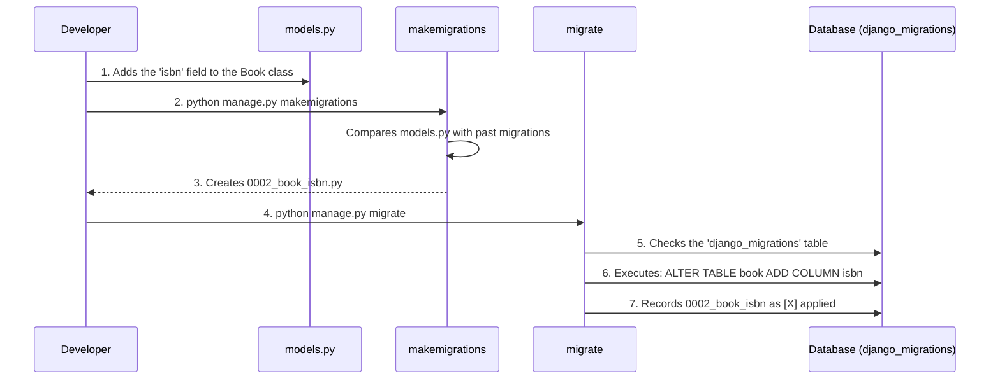
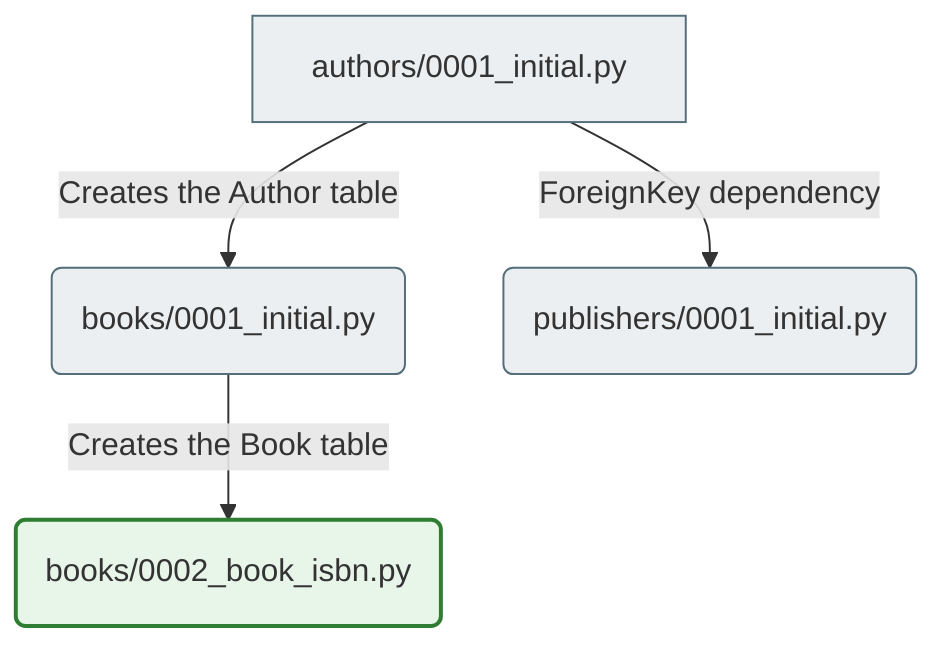

# Django Project Architecture and Database Evolution

This guide reveals the deep internals of how Django works, focusing on how Django manages database evolution through migrations.

## Part 1: Orchestrating Database Evolution (Migrations and the ORM)

### 1. The Core Mechanism: Why Migrations Exist

Databases require raw SQL (for example, `CREATE TABLE` or `ALTER TABLE`) to change their structure. At the same time, Django models are written in Python. **Migrations serve as the bridge between them**, acting as a version control system for your database schema. They ensure that as your Python code evolves, the database structure safely evolves along with it without losing user data.

### 2. The Execution Flow: `makemigrations` vs `migrate`

* **`makemigrations`**: Django reads your `models.py` files and compares them with an in-memory representation of the historical database schema. It then generates a new Python file on your hard drive (for example, `0001_initial.py`). This file contains a declarative list of operations (what changed) and dependencies (what must happen first). **This command makes no changes to the database itself.**
* **`migrate`**: Django connects to the database and checks a special internal table called `django_migrations` to find out which files have already been applied. For any unapplied files, Django converts the Python operations into database-specific SQL and executes them, irreversibly changing the database structure.

### 3. Mental Model: The Architect and the Builders

Imagine that `makemigrations` is the **architect** who draws the blueprint of a new floor plan. And `migrate` is the **construction crew** that reads the blueprint and actually knocks down walls and pours concrete.

### 4. Migration Dependencies

Migrations are not executed in alphabetical order; they are executed based on a **dependency graph**. If your `books` app adds a `ForeignKey` field pointing to the `authors` app, the migration file for `books` will automatically add a dependency on the `authors` migration. This guarantees that the authors table is created before the database tries to create a constraint that references it.

#### Visualization: Schema Evolution Timeline

#### Visualization: Migration Dependency Graph

### Practical Application

#### 5. Common Beginner Problems with Migrations

* **The Non-Nullable Field:** If you add a new field to an existing model (for example, `age = models.IntegerField()`) without providing a default value, the database panics because it does not know what to write into the already existing rows. Django will intercept `makemigrations` and ask you in the terminal to provide a one-off default value.
* **Inconsistent History:** Deleting a migration file from the hard drive after it has already been applied via `migrate` breaks the dependency graph. Django will refuse to run future migrations until the history is fixed manually.

#### 6. Debugging Intuition

If you want to know exactly what changes Django plans to make to the system right now, run `python manage.py sqlmigrate <app_name> <migration_number>`. This command does not change the database; it simply prints the exact "raw" SQL statements (for example, `CREATE INDEX` or `ALTER TABLE`) that Django plans to execute to the terminal.

#### 7. Relevance for Production Deployment

Migration files are committed to your Git repository along with the Python code. When your code is deployed to a production server, the CI/CD pipeline automatically runs `python manage.py migrate`. Because the dependency graph is clearly defined in the files, the production database updates its schema in exactly the same sequence you used on your local machine.

---
