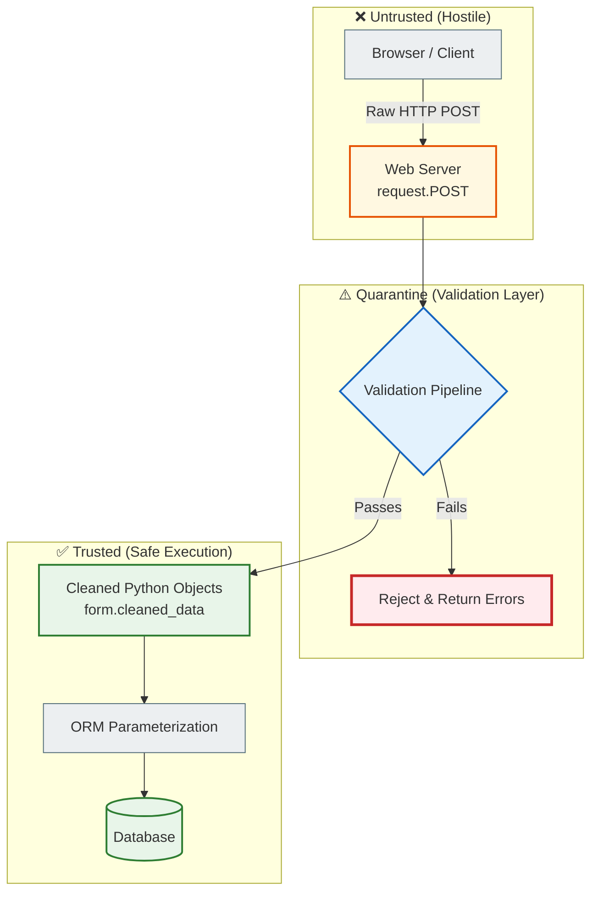
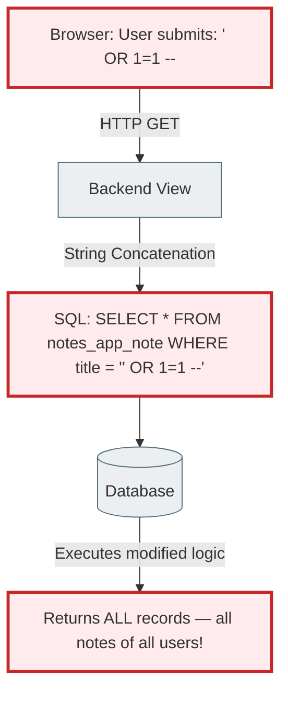
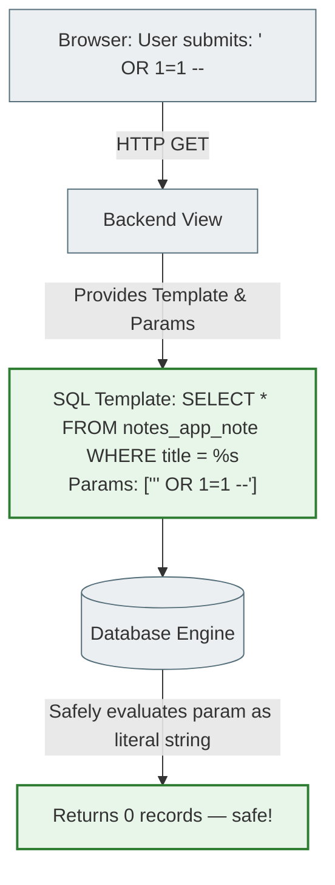
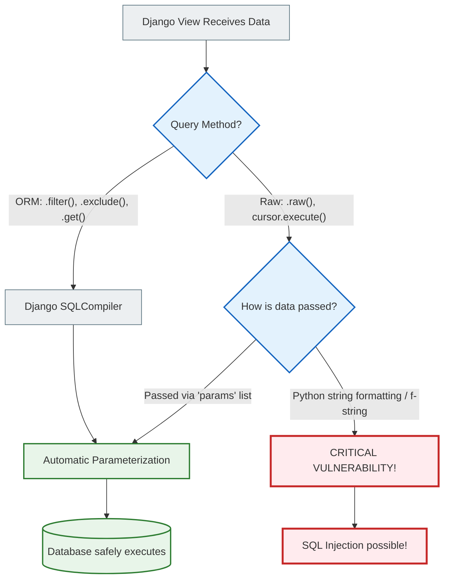

# Relational Foundations and SQL

> This document is the theoretical foundation you need before working with any ORM.
> Understand this → Django ORM, SQLAlchemy and Hibernate become transparent.
> Don't understand it → you write queries by "trial and error", without knowing why they are slow.

---

> 🔬 **From theory to practice:**
> [`docs/reference/legacy_source/orm_laboratory_reference.md`](../reference/legacy_source/orm_laboratory_reference.md)
>
> After reading this file, open the notebook and run:
>
> | Concept from this file | Notebook section |
> |------------------------|-----------------|
> | Primary Key, Foreign Key, SELECT | `## 2. 🔍 Lazy Methods` → filter/get |
> | JOIN via `__` lookup | `## 4. 🔗 Relationship Traversal` |
> | GROUP BY / aggregation | `## 7. 📊 Aggregation & Annotation` |
> | SQL Injection protection | `## 14. 🧪 Raw SQL` |
> | Query Execution Plan | `## 11. 🔬 SQL Inspection` → `queryset.explain(analyze=True)` |


> **🧠 Mental model:** A relational database is not "a folder of Excel spreadsheets". It is a **mathematical system** based on relational algebra (Edgar Codd, 1970). Every table is a **relation** between entities. SQL is the language for querying these relations. An ORM is a layer that lets you write these queries in Python instead of SQL.
>
> **📚 Why DBMSs exist:** Before databases, systems stored data in flat files (CSV, txt). Try to imagine a thousand users editing one file at the same time — a disaster. A DBMS solves four problems: **concurrent access** (thousands of simultaneous queries), **integrity** (it is impossible to write a row without a required field), **search** (finding a record by a condition among billions takes milliseconds), **recovery** (a failure doesn't mean data loss, thanks to the WAL).
>
> **🌐 How this relates to Django:** Each of your models (`class Note(models.Model)`) is a table. Each `QuerySet` is an SQL query. Django ORM generates SQL for you, but if you don't understand SQL, you won't understand why some queries are slow and others are not. `select_related` and `prefetch_related` only make sense if you understand what a JOIN is.
>
> **❌ Common beginner mistake:** Believing that ORM = "I no longer write SQL". In reality, ORM = "I write SQL through Python". You still need to understand SQL — you just need to write it by hand less often.

---

## 0. The big picture: from data to the program

Before diving into the details, look at the big picture. How data "travels" from Python code to disk and back:

```
Python Code (Django View)
    │  QuerySet.filter(status='published')
    ▼
Django ORM (SQLCompiler)
    │  Translates Python → SQL
    ▼
psycopg2 (Database Adapter)
    │  Sends SQL over TCP
    ▼
PostgreSQL Postmaster
    │  Accepts the connection
    ▼
Parser → Planner → Optimizer → Executor
    │  Reads data from disk into memory
    ▼
Disk (Data Pages)
    │  Row data
    ▼
(back up the chain)
    │  Python objects (Model instances)
    ▼
Django Template (rendering)
    │  HTML
    ▼
HTTP Response → Browser
```

Every step of this path will be explained in detail in this and the following documents.

---

## 1. Why databases exist

---
> **🧠 Mental model:** A database is not just "a place to store things". It is a **contract**: the system guarantees that data will survive even failures, that two parallel queries won't corrupt each other, and that you will find any record in milliseconds among billions. No file can give such guarantees.
>
> **📚 Why not just files:** Imagine an online store: 1000 shoppers press "Buy" on the last item in stock at the same time. If the data is stored in a file, all 1000 read `stock=1`, all 1000 decrement it by 1 and save `stock=0`. The item is sold 1000 times instead of once. A database, through transactions and locking, guarantees that only one operation succeeds.
>
> **🌐 How this works in Django:** `transaction.atomic()` + `select_for_update()` are Python wrappers over database mechanisms. They are not "Django magic" — they translate to the SQL commands `BEGIN`, `SELECT FOR UPDATE`, `COMMIT`.
>
> **❌ Common mistake:** Thinking that `Note.objects.create(...)` is simply "writing to a file". In reality it is: open a connection → start a transaction → check constraints → write to disk via WAL → commit the transaction → return the object with an id.
---

A **DBMS (Database Management System)** exists to solve four problems:

| Problem | Without a DBMS | With a DBMS |
|----------|---------|--------|
| **Concurrency** | Two processes corrupt one file | MVCC, transactions, locking |
| **Integrity** | You can save an email without @, price = -100 | Constraints, CHECK, FOREIGN KEY |
| **Search** | Read the whole file for every search | B-Tree indexes, O(log N) |
| **Recovery** | Failure = data loss | WAL (Write-Ahead Log), replicas |

**Tables, Rows and Columns**

A relational database organizes data into **two-dimensional tables**:
- **Columns** — define the data type (`VARCHAR`, `INTEGER`, `BOOLEAN`) and impose constraints
- **Rows (tuples)** — individual records
- **Table (relation)** — a set of rows with the same structure

```
Table: notes_app_note
┌────┬──────────────────────┬───────────────┬─────────────┬────────────┐
│ id │ title                │ status        │ views_count │ user_id    │
├────┼──────────────────────┼───────────────┼─────────────┼────────────┤
│  1 │ Django ORM in depth  │ published     │          42 │         5  │ ← row (tuple)
│  2 │ PostgreSQL MVCC      │ draft         │           0 │         5  │
│  3 │ CSS Flexbox          │ published     │         128 │         8  │
└────┴──────────────────────┴───────────────┴─────────────┴────────────┘
  ↑
  Column of type BIGSERIAL (auto-increment INTEGER)
```

---

## 2. Primary Key and Foreign Key

---
> **🧠 Mental model:** A Primary Key is a row's passport. Like a passport number: unique, immutable, mandatory. A Foreign Key is a reference in one table to the passport of a record in another. Like in a hospital: a patient's chart contains the doctor's number — not a copy of all the information about the doctor, only a reference to it.
>
> **📚 Why not copy the data:** If `Note` stored `author_name` instead of `user_id`, what happens when the user changes their name? You have to update thousands of rows. With a Foreign Key → you update 1 row in `auth_user`, and all notes automatically "see" the new name via JOIN.
>
> **🌐 How this works in Django:** `ForeignKey(User, on_delete=CASCADE)` → Django generates the column `user_id INTEGER NOT NULL REFERENCES auth_user(id) ON DELETE CASCADE`. This is plain SQL — Django just helps you write it the Pythonic way.
>
> **❌ Common mistake:** Storing `username` as a string instead of a `ForeignKey`. Then the username changes → the data gets out of sync. Always store a reference (id), not a copy of the data.
---

### Primary Key (PK)

A **Primary Key** is a unique identifier of a row in a table. It guarantees:
- Every row is identified unambiguously (no duplicate rows)
- The value cannot be NULL
- The value cannot repeat

Django automatically adds `id` as the PK if you have not defined your own:

```python
# This:
class Note(models.Model):
    title = models.CharField(max_length=200)

# Generates SQL:
# CREATE TABLE notes_app_note (
#     id BIGSERIAL PRIMARY KEY,   ← automatically!
#     title VARCHAR(200) NOT NULL
# );
```

PK types:
```
SERIAL / BIGSERIAL   → auto-increment integer (1, 2, 3, ...)
UUID                 → 550e8400-e29b-41d4-a716-446655440000 (globally unique)
```

### Foreign Key (FK)

A **Foreign Key** is a column that stores the PK of another row (in another table or the same one). It is a **structural relationship**.

```
auth_user              notes_app_note
┌────┬──────────┐      ┌────┬────────────────┬─────────┐
│ id │ username │      │ id │ title          │ user_id │
├────┼──────────┤      ├────┼────────────────┼─────────┤
│  5 │ alice    │ ←──┐ │  1 │ Django ORM     │    5    │ ←FK
│  8 │ bob      │    └─┤  2 │ PostgreSQL      │    5    │ ←FK (same user)
└────┴──────────┘      │  3 │ CSS Flexbox    │    8    │ ←FK
                       └────┴────────────────┴─────────┘

user_id = 5 → refers to the row id=5 in auth_user (alice)
```

```python
# Django:
class Note(models.Model):
    user = models.ForeignKey(User, on_delete=models.CASCADE)

# Generates SQL:
# user_id BIGINT NOT NULL REFERENCES auth_user(id) ON DELETE CASCADE
```

---

## 3. Constraints and Data Integrity

---
> **🧠 Mental model:** Constraints are the guards at the database gates. It doesn't matter where the data came from: a Django form, a Python script or a direct SQL query in the terminal — a constraint checks it the SAME way. It is the last line of defense against bad data.
>
> **📚 Why not only Python validation:** `clean()` and `full_clean()` in Django live at the Python level. But if someone writes directly to the database via psql, or an old part of the code bypasses the form, Python validation won't run. `CheckConstraint` and `UniqueConstraint` at the SQL level always fire.
>
> **🌐 How PostgreSQL checks constraints:** On every INSERT or UPDATE, PostgreSQL checks all constraints ATOMICALLY — either they all pass, or the whole operation is rolled back. There is no such thing as a "partially valid" record.
>
> **❌ Common mistake:** Setting `unique=True` only at the model level (`models.CharField(unique=True)`) and thinking that's enough. Yes, Django generates a UNIQUE constraint in the database. But `UniqueConstraint(fields=['user', 'slug'])` — composite uniqueness — has to be declared explicitly in `Meta.constraints`.
---

| Constraint | SQL | Django | What it checks |
|------------|-----|--------|--------------|
| `NOT NULL` | `name NOT NULL` | (default) | Value is required |
| `UNIQUE` | `UNIQUE(email)` | `unique=True` | No duplicates |
| `PRIMARY KEY` | `id BIGSERIAL PK` | automatic | NOT NULL + UNIQUE |
| `FOREIGN KEY` | `REFERENCES user(id)` | `ForeignKey(...)` | The referenced row exists |
| `CHECK` | `CHECK(price > 0)` | `CheckConstraint(...)` | Arbitrary condition |

```python
class Note(models.Model):
    views_count = models.PositiveIntegerField(default=0)
    user = models.ForeignKey(User, ...)
    slug = models.SlugField(max_length=200)

    class Meta:
        constraints = [
            # Composite UNIQUE: slug is unique per user
            # (alice can have /notes/python/, so can bob — but alice can't have it twice)
            models.UniqueConstraint(
                fields=['user', 'slug'],
                name='unique_note_slug_per_user'
            ),

            # CHECK: views_count cannot be negative
            # Checked at the PostgreSQL level — even with direct SQL
            models.CheckConstraint(
                condition=models.Q(views_count__gte=0),
                name='note_views_non_negative'
            ),
        ]
```

---

## 4. Normalization — architecture without duplication

---
> **🧠 Mental model:** Normalization is like refactoring code. Duplication in code = a DRY violation. Duplication in a database schema = a violation of the normal forms. If changing one value requires updating thousands of rows, the schema violates normalization. "A single source of truth" is a principle that applies to databases just as well.
>
> **📚 Why it matters in practice:** Imagine an `orders` table with the fields `customer_name`, `customer_email`, `customer_city` in every row. The customer changes their email — you have to UPDATE thousands of orders. Miss even one and you get an update anomaly. Normalization solves this by moving the data into a separate table.
>
> **🌐 How this works in Django:** Every separate model (`Category`, `UserProfile`, `Tag`) is the result of normalization. Instead of duplicating `category_name` in every note, we store one record in `Category` and an FK in `Note`.
>
> **❌ Common mistake:** "Denormalization for performance" as the answer to any slowness. Denormalization is a deliberate architectural trade-off for specific bottlenecks (counters for analytics), not a default solution.
---

### Anomalies that arise without normalization

```
❌ BAD schema (denormalized):
┌────┬──────────┬────────────────────────┬──────────────┬────────────────────┐
│ id │ customer │ customer_email         │ product      │ category_name      │
├────┼──────────┼────────────────────────┼──────────────┼────────────────────┤
│  1 │ Alice    │ alice@example.com      │ Django Book  │ Programming Books  │
│  2 │ Alice    │ alice@example.com      │ Python Book  │ Programming Books  │
│  3 │ Bob      │ bob@example.com        │ Django Book  │ Programming Books  │
└────┴──────────┴────────────────────────┴──────────────┴────────────────────┘

Problems:
- Alice changed her email → UPDATE of thousands of rows
- Miss even one → the data is out of sync
- The category "Programming Books" repeats → renaming it means another mass UPDATE
```

```
✅ NORMALIZED schema:
customers:   id | name  | email
orders:      id | customer_id FK | product_id FK
products:    id | name  | category_id FK
categories:  id | name

Alice changed her email → UPDATE of 1 row in customers. All orders automatically "see" the new email via JOIN.
```

### 1NF — First Normal Form: atomic values

**Rule:** Every field contains only one indivisible value.

```python
# ❌ 1NF violation: an array in a column
class Post(models.Model):
    tags = models.CharField(max_length=200)  # "python, django, orm"
    # Impossible to filter efficiently by a single tag!

# ✅ 1NF: a separate table
class Tag(models.Model):
    name = models.CharField(max_length=50)

class Post(models.Model):
    tags = models.ManyToManyField(Tag)  # Django generates a junction table
```

### 2NF — Second Normal Form: dependency on the whole PK

**Rule:** Every non-key attribute depends on the **whole** Primary Key (relevant for a composite PK).

```
❌ 2NF violation (composite PK = order_id + product_id):
order_items: order_id | product_id | quantity | product_name | product_category
                                                ↑              ↑
                              product_name depends on product_id, not on the whole PK!

✅ 2NF:
order_items: order_id | product_id | quantity    ← depends on both
products:    product_id | name | category         ← product_name → separate table
```

### 3NF — Third Normal Form: no transitive dependencies

**Rule:** Non-key fields do not depend on other non-key fields.

```
❌ 3NF violation:
employees: id | dept_id | dept_name | dept_location
                          ↑
              dept_name depends on dept_id (not on id!)
              If the department moves → UPDATE of thousands of employees rows

✅ 3NF:
employees:   id | dept_id FK | salary
departments: id | name | location    ← dept_name → separate table
```

---

## 5. Relationship Systems

---
> **🧠 Mental model:** Relationships between tables are not an "option" of relational databases. They are the ESSENCE. The word "relational" comes from "relation". The three relationship types correspond to three different real-world situations: "one is paired with one" (doctor→patient), "one has many" (category→articles), "many are linked to many" (student→courses).
>
> **📚 Why M:N needs a junction table:** Relational databases physically store data in two-dimensional tables. It is impossible to store a "list of tags" in one `Note` row and at the same time a "list of notes" in one `Tag` row. A junction table is the only way.
>
> **🌐 How Django implements this:** `ManyToManyField(Tag)` → Django automatically creates the table `notes_app_note_tags` with two FKs. You never see this table in Python, but it exists in the database. `note.tags.add(tag)` → INSERT into the junction table.
>
> **❌ Common mistake:** Not knowing where the FK "lives". **The rule is always the same:** the FK is always on the "many" side. Category→Notes: `note.category_id` (FK in Note, because there can be many notes). Not `category.note_ids` — that violates the relational model.
---

### One-to-One (1:1)

One record in table A corresponds to exactly one record in B. It is used for **vertical partitioning** — splitting a wide table into two narrower ones.

**Why:** if `User` has 5 fields (username, email, ...) + 20 profile fields (bio, city, ...), every query to `User` loads 25 columns. Better: 5 core fields in `User`, 20 extra ones in `UserProfile`. Queries that don't need the profile read only `User`.

```python
class UserProfile(models.Model):
    # OneToOneField = ForeignKey + UNIQUE constraint on the FK
    user = models.OneToOneField(User, on_delete=models.CASCADE, related_name='profile')
    bio = models.TextField(blank=True)
    city = models.CharField(max_length=100, blank=True)

# SQL:
# user_id BIGINT NOT NULL UNIQUE REFERENCES auth_user(id) ON DELETE CASCADE
#                         ↑ UNIQUE makes this 1:1 (not 1:N)
```

```
auth_user         user_profiles
┌────┬───────┐    ┌────┬─────────┬────────────────────────┐
│ id │ name  │    │ id │ user_id │ bio          | city     │
├────┼───────┤    ├────┼─────────┼────────────────────────┤
│  1 │ Alice │◄───│  1 │    1    │ "Django dev" | Kyiv     │
│  2 │ Bob   │◄───│  2 │    2    │ "ML engineer"| Lviv     │
└────┴───────┘    └────┴─────────┴────────────────────────┘
                          ↑
                   UNIQUE: one user → at most one profile
```

### One-to-Many (1:N) — the most common type

One record in A can have many records in B. The FK is **always on side B (Many)**.

```
categories              notes
┌────┬──────────────┐   ┌────┬──────────────────┬─────────────┐
│ id │ name         │   │ id │ title            │ category_id │
├────┼──────────────┤   ├────┼──────────────────┼─────────────┤
│  1 │ Programming  │◄──│  1 │ Django ORM       │      1      │
│  2 │ Design       │◄──│  2 │ Python Tips      │      1      │
│    │              │ ←─│  3 │ CSS Grid         │      2      │
└────┴──────────────┘   └────┴──────────────────┴─────────────┘

1 Category → N Notes. The FK is in Notes (the Many side).
```

```python
class Note(models.Model):
    category = models.ForeignKey(
        Category,
        on_delete=models.SET_NULL,
        null=True, blank=True,
        related_name='notes'   # category.notes.all() → all notes in the category
    )
```

### Many-to-Many (M:N)

A record in A can be related to many records in B, and vice versa. **Requires a Junction Table**.

```
notes              note_tags (junction)    tags
┌────┬──────────┐  ┌─────────┬────────┐   ┌────┬──────────┐
│ id │ title    │  │ note_id │ tag_id │   │ id │ name     │
├────┼──────────┤  ├─────────┼────────┤   ├────┼──────────┤
│  1 │ Django   │──│    1    │   10   │──►│ 10 │ python   │
│  2 │ CSS tips │  │    1    │   11   │──►│ 11 │ orm      │
│    │          │  │    2    │   10   │──►│    │          │
└────┴──────────┘  └─────────┴────────┘   └────┴──────────┘

Note(1)="Django" has the tags python(10) and orm(11)
Note(2)="CSS tips" has the tag python(10)
Tag(10)="python" is in notes 1 and 2
```

```python
class Note(models.Model):
    tags = models.ManyToManyField(Tag, blank=True, related_name='notes')
    # Django automatically creates: notes_app_note_tags (note_id FK, tag_id FK)

# Usage:
note.tags.add(tag)           # INSERT INTO notes_app_note_tags (note_id, tag_id)
note.tags.remove(tag)        # DELETE FROM notes_app_note_tags WHERE...
note.tags.all()              # SELECT * FROM notes_app_tag JOIN notes_app_note_tags...
tag.notes.all()              # reverse query via related_name
```

### on_delete — what to do when the parent is deleted

This is one of the most important decisions in schema design. Choosing the wrong on_delete can lead to "orphan records" (records without a parent) or to losing related data.

```
Scenario: we delete User alice
          alice has 50 notes
          What should happen to the notes?

CASCADE   → delete the 50 notes together with alice
            ✓ If notes without an author make no sense
            ✗ Risk of losing important data

SET_NULL  → note.user_id = NULL (the notes stay)
            ✓ If notes have value even without an author
            ✗ Requires null=True on the field

RESTRICT  → forbid deleting alice while she has notes
            ✓ Strict protection against data loss
            ✗ You must delete all the notes manually first

SET_DEFAULT → note.user_id = default_id
              ✓ There is a "system" user or an archive account
```

```python
# Each on_delete solves a different situation:
user = models.ForeignKey(User, on_delete=models.CASCADE)      # delete the notes too
category = models.ForeignKey(Cat, on_delete=models.SET_NULL, null=True)  # keep the notes
parent = models.ForeignKey('self', on_delete=models.SET_NULL, null=True) # keep the replies
```

---

## 6. SQL — the query language

---
> **🧠 Mental model:** SQL is a **declarative** language. You describe **WHAT** you want to get, not **HOW**. `SELECT * FROM notes_app_note WHERE status='published'` — you don't say "read the file row by row and check each one". You say "give me the published notes". The DBMS decides by itself how to do it most efficiently — via an index, a cache or a sequential scan.
>
> **📚 Why understanding SQL matters even with an ORM:** Django ORM generates SQL. Sometimes it generates inefficient SQL (for example, several queries instead of one JOIN). To notice and fix this, you need to understand SQL. `print(queryset.query)` shows you exactly what the ORM generated.
>
> **🌐 How the ORM translates Python into SQL:** `Note.objects.filter(status='published').order_by('-created_at')` → `SELECT * FROM notes_app_note WHERE status = 'published' ORDER BY created_at DESC`. Every QuerySet method corresponds to a specific SQL keyword.
>
> **❌ Common mistake:** Never looking at the generated SQL. `print(qs.query)` is a command you need to know and use. If a page loads slowly, look at the SQL — the problem is often obvious.
---

### SELECT — the basis of everything

```sql
-- Basic syntax
SELECT columns FROM table WHERE condition ORDER BY field LIMIT n;

-- Simple examples
SELECT id, title, status FROM notes_app_note;
SELECT * FROM notes_app_note WHERE status = 'published';
SELECT title, views_count FROM notes_app_note WHERE views_count > 100 ORDER BY views_count DESC LIMIT 10;
```

```python
# Python → SQL mapping:
Note.objects.all()
# → SELECT * FROM notes_app_note

Note.objects.filter(status='published')
# → SELECT * FROM notes_app_note WHERE status = 'published'

Note.objects.filter(views_count__gt=100).order_by('-views_count')[:10]
# → SELECT * FROM notes_app_note WHERE views_count > 100 ORDER BY views_count DESC LIMIT 10
```

### JOIN — combining tables

JOIN is the most important operation in relational databases. It combines rows of two tables by a condition (usually by FK).

```
Without JOIN:
  Query 1: SELECT * FROM notes_app_note WHERE id=1         → {id:1, title:'Django', user_id:5}
  Query 2: SELECT * FROM auth_user WHERE id=5          → {id:5, username:'alice'}
  = 2 queries (this is exactly the N+1 problem!)

With JOIN:
  SELECT n.*, u.username FROM notes_app_note n
  INNER JOIN auth_user u ON n.user_id = u.id
  WHERE n.id=1
  → {id:1, title:'Django', user_id:5, username:'alice'}
  = 1 query
```

| JOIN type | Behavior | When |
|----------|-----------|------|
| `INNER JOIN` | Only rows that match in both tables | When you need only related records |
| `LEFT JOIN` | All rows from the left + matches from the right (or NULL) | When you need all records, even without a related one |
| `RIGHT JOIN` | All rows from the right + matches from the left | Rarely; usually a LEFT JOIN with the tables swapped is better |
| `FULL JOIN` | All rows from both | Very rarely |

```sql
-- INNER JOIN: only notes with a category (no NULL category)
SELECT n.title, c.name AS category_name
FROM notes_app_note n
INNER JOIN notes_app_category c ON n.category_id = c.id
WHERE n.status = 'published';

-- LEFT JOIN: all notes, even without a category
SELECT n.title, c.name AS category_name
FROM notes_app_note n
LEFT JOIN notes_app_category c ON n.category_id = c.id;
-- Notes without a category: category_name = NULL
```

```python
# Django ORM:
# INNER JOIN (only notes where category is not NULL):
Note.objects.select_related('category').filter(category__isnull=False)

# LEFT JOIN (all notes including category=None):
Note.objects.select_related('category').all()
# select_related always generates a LEFT JOIN for a nullable FK
```

### GROUP BY and Aggregations

Aggregations let you count, sum, and find the minimum/maximum **by groups**.

```sql
-- How many notes are in each category
SELECT c.name, COUNT(n.id) AS note_count, AVG(n.views_count) AS avg_views
FROM notes_app_category c
LEFT JOIN notes_app_note n ON n.category_id = c.id
GROUP BY c.id, c.name
HAVING COUNT(n.id) > 3          -- filter AFTER grouping (WHERE before, HAVING after)
ORDER BY note_count DESC;
```

```python
# Django ORM (annotate = GROUP BY in SQL):
from django.db.models import Count, Avg

categories = Category.objects.annotate(
    note_count=Count('notes'),
    avg_views=Avg('notes__views_count')
).filter(note_count__gt=3).order_by('-note_count')

# Generates the same SQL as above
```

---

## 7. Query Execution Flow

---
> **🧠 Mental model:** PostgreSQL is not "a program that reads a file". It is a complex system that includes a parser, an optimizer, a planner and an executor. When you send a query, it goes through 4 phases before touching the disk. Each phase exists for a specific reason.
>
> **📚 Why the Query Planner is so important:** The same SQL can execute differently depending on the data in the database. On a table with 100 rows, a sequential scan is more efficient than an index. On a table with a million rows, it's the opposite. The planner collects statistics and decides. `EXPLAIN ANALYZE` shows which decision the planner made for a specific query.
>
> **🌐 How this relates to Django:** `qs.explain(analyze=True)` is a Django method that sends `EXPLAIN ANALYZE` to PostgreSQL and returns the plan. If you see "Seq Scan" on a large table, you need an index. If you see "Index Scan", all is well.
>
> **❌ Common mistake:** Thinking that PostgreSQL "just reads rows in order". In reality, even a simple `SELECT * WHERE id=42` on a large table WITHOUT an index = scanning the ENTIRE table. A million rows without an index → 1 million comparisons. With an index → log₂(1,000,000) ≈ 20 comparisons.
---

### The four execution phases

```
Raw SQL: "SELECT * FROM notes_app_note WHERE user_id=5 ORDER BY created_at DESC"
            │
            ▼
    ┌─── 1. PARSING ──────────────────────────────────────────────────────┐
    │  The lexer tokenizes: SELECT, *, FROM, notes_app_note, WHERE, ...    │
    │  The parser checks the syntax                                        │
    │  Builds an Abstract Syntax Tree (AST)                                │
    └─────────────────────────────────────────────────────────────────────┘
            │
            ▼
    ┌─── 2. SEMANTIC ANALYSIS ────────────────────────────────────────────┐
    │  Checks: does the table notes_app_note exist?                        │
    │  Does the column user_id exist?                                      │
    │  Does the current user have SELECT privileges?                       │
    │  (All from the system catalog — PostgreSQL metadata)                 │
    └─────────────────────────────────────────────────────────────────────┘
            │
            ▼
    ┌─── 3. QUERY PLANNER & OPTIMIZER ───────────────────────────────────┐
    │  Looks at table statistics (row count, value distribution)          │
    │  Considers several execution plans:                                  │
    │    Plan A: Sequential Scan (read the whole table)                   │
    │    Plan B: Index Scan on user_id (if there is an index)             │
    │  Computes the "cost" of each plan (estimated disk I/O)              │
    │  Chooses the plan with the lowest cost                               │
    └─────────────────────────────────────────────────────────────────────┘
            │
            ▼
    ┌─── 4. EXECUTION ────────────────────────────────────────────────────┐
    │  Reads blocks from disk into Shared Buffers (memory)                │
    │  Applies WHERE filters                                               │
    │  Sorts the result (ORDER BY)                                         │
    │  Returns rows to the client (psycopg2 → Django)                     │
    └─────────────────────────────────────────────────────────────────────┘
```

### Predicate Pushdown — filter optimization

PostgreSQL **automatically** moves filters (WHERE) as close as possible to where the data is read. This reduces the number of rows processed by the JOIN.

```
❌ Naive execution (without optimization):
   1. CARTESIAN PRODUCT: 100,000 students × 500 departments = 50,000,000 rows
   2. Then the filter: WHERE major='Math'
   → 50 million rows processed to find 200

✅ After Predicate Pushdown:
   1. Filter FIRST: WHERE major='Math' → 200 students
   2. Then JOIN with departments: 200 × 500 = 100,000 rows
   → 500 times less work!
```

```python
# Django ORM automatically generates efficient SQL
# The planner decides the order of operations itself
qs = Note.objects.filter(
    user__username='alice',  # filter across the JOIN
    status='published'       # filter on Note
).select_related('user')
print(qs.query)
# The PostgreSQL planner applies pushdown automatically
```

### JOIN algorithms

When PostgreSQL performs a JOIN, it chooses an algorithm depending on the size of the tables and the presence of indexes:

```
Nested Loop Join:
  FOR EACH row in the outer table:
      FOR EACH row in the inner table:
          IF JOIN condition: add to the result
  Complexity: O(N×M)
  When: small tables, there is an index on the inner table

Hash Join:
  1. Build a hash table from the smaller table (in memory)
  2. For each row of the larger one → look it up in the hash table
  Complexity: O(N+M)
  When: large tables, no index, memory is available

Merge Join:
  1. Both tables sorted by the JOIN key
  2. One pass through both at the same time
  Complexity: O(N log N + M log M)
  When: both tables are already sorted or there is an index
```

---

## 8. ACID and PostgreSQL guarantees

---
> **🧠 Mental model:** ACID is the 4 guarantees PostgreSQL gives for every transaction. Imagine a bank transfer: withdraw $100 from account A and add it to account B. What if the server crashes between these two operations? ACID guarantees: either BOTH operations are performed, or NEITHER.
>
> **📚 Why this matters for Django:** `transaction.atomic()` is a Python wrapper over SQL `BEGIN`/`COMMIT`/`ROLLBACK`. Django does not implement ACID itself — it uses PostgreSQL's ACID through the right SQL commands.
>
> **🌐 Isolation in PostgreSQL:** By default PostgreSQL uses `READ COMMITTED` — each query sees only committed data. This protects against "dirty reads" (reading uncommitted changes). For stricter guarantees there are `REPEATABLE READ` and `SERIALIZABLE`.
>
> **❌ Common mistake:** Believing that `save()` is an atomic operation. `Note.objects.create(title=...) + NoteRevision.objects.create(...)` are TWO separate queries, TWO separate transactions. If an error occurs between them, the Note is saved but the Revision is not. You need `transaction.atomic()`.
---

| Property | What it guarantees | Implementation in PostgreSQL |
|-------------|-------------|------------------------|
| **Atomicity** | "All or nothing" — there are no partial changes | `BEGIN`/`COMMIT`/`ROLLBACK` |
| **Consistency** | The database moves from one valid state to another | Constraints, triggers |
| **Isolation** | Parallel transactions don't see each other's unfinished changes | MVCC (multi-version concurrency control) |
| **Durability** | After `COMMIT`, data is persisted even if there is a failure | WAL (Write-Ahead Log) |

```python
# Atomicity in Django:
from django.db import transaction

# WITHOUT atomic: two separate INSERTs, may execute partially
note = Note.objects.create(title='New Note', user=user)
revision = NoteRevision.objects.create(note=note, ...)  # if it fails here → Note exists, Revision doesn't

# WITH atomic: either both INSERTs or neither
with transaction.atomic():
    note = Note.objects.create(title='New Note', user=user)
    revision = NoteRevision.objects.create(note=note, ...)
# If any step raises an exception → ROLLBACK of both
```

---

## 9. SQLite vs PostgreSQL — why the difference matters

---
> **🧠 Mental model:** SQLite is like a notepad. Handy for notes at home, not suitable for a team in an office. PostgreSQL is like a corporate document management system: version control, concurrent access, permissions, backups. Functionally similar for simple queries, fundamentally different under load.
>
> **📚 Why Django uses SQLite by default:** For development you don't need to install anything. SQLite = one file, `db.sqlite3`. That is the right choice for getting started. But before deployment — always PostgreSQL.
>
> **🌐 Where SQLite falls short:** A database-level write lock. That is, only ONE process can write to the database at a time. With two simultaneous requests, one waits. In production with 100+ concurrent users this = a bottleneck. PostgreSQL, through MVCC, handles thousands of parallel writes without blocking.
>
> **❌ Common mistake:** Deploying Django with SQLite to production. You **must not** do this for real projects. The official Django documentation says: "SQLite is not suitable for production use".
---

| Characteristic | SQLite | PostgreSQL |
|----------------|--------|------------|
| **Architecture** | Serverless, a file on disk | Client-server, a separate process |
| **Concurrency** | Database-level write lock | MVCC — thousands of parallel writes |
| **DDL in transactions** | Limited | Full support (`ALTER TABLE` in a transaction) |
| **Data types** | Limited (TEXT, INTEGER, REAL, BLOB) | Full set + JSONB, UUID, Arrays, hstore |
| **Constraints** | Basic | Full + deferred checks, exclusion |
| **Full-text search** | Basic | GIN + tsvector, trigram |
| **Usage** | Development, tests, embedded | Production, always |

```python
# settings.py for development (SQLite is fine to start with):
DATABASES = {
    'default': {
        'ENGINE': 'django.db.backends.sqlite3',
        'NAME': BASE_DIR / 'db.sqlite3',
    }
}

# settings.py for production (PostgreSQL is mandatory):
DATABASES = {
    'default': {
        'ENGINE': 'django.db.backends.postgresql',
        'NAME': config('DB_NAME'),
        'USER': config('DB_USER'),
        'PASSWORD': config('DB_PASSWORD'),
        'HOST': config('DB_HOST', default='localhost'),
        'PORT': config('DB_PORT', default='5432'),
    }
}
```

---

## 10. Prediction Exercises — test yourself

### Exercise 1: Primary Key

```python
class Article(models.Model):
    title = models.CharField(max_length=200)
```

**Question:** How many columns are in the SQL table?

> Answer: **2 columns** — `id` (automatic) + `title`.
> Django always adds `id BIGSERIAL PRIMARY KEY` if you have not defined your own PK.

### Exercise 2: on_delete

```python
class Comment(models.Model):
    note = models.ForeignKey(Note, on_delete=models.CASCADE)
    parent = models.ForeignKey('self', on_delete=models.SET_NULL, null=True)
```

**Question:** If a Note is deleted, what happens to the comments? If a parent Comment is deleted, what happens to the replies?

> Answer:
> - Deleting the Note → **all comments are deleted** (CASCADE)
> - Deleting the parent Comment → **the replies remain**, but `parent=NULL` (SET_NULL)

### Exercise 3: Junction Table

```python
class Note(models.Model):
    tags = models.ManyToManyField(Tag)
```

**Question:** How many SQL tables will Django create for this?

> Answer: for the `tags` field Django creates **one extra table**, the junction `notes_app_note_tags` (`note_id`, `tag_id`).
> In total the schema has **3 tables**: `notes_app_note` (the Note model), `notes_app_tag` (the separate Tag model) and `notes_app_note_tags`.

### Exercise 4: SQL JOIN

```sql
SELECT n.title, u.username
FROM notes_app_note n
LEFT JOIN auth_user u ON n.user_id = u.id
WHERE u.username = 'alice'
```

**Question:** Is this a LEFT JOIN or effectively an INNER JOIN?

> Answer: **Effectively an INNER JOIN**. Even though it says LEFT JOIN, the condition `WHERE u.username = 'alice'` excludes rows where `u` = NULL. If you need a real LEFT JOIN, the condition on the right table must go in `ON`, not in `WHERE`.

---

## SQL Injection and Trust Boundary Architecture

---
> **🧠 Mental model:** SQL injection is when data crosses a boundary and becomes a command. Imagine a restaurant: the waiter (backend) takes an order (user input) and passes it to the kitchen (database). If a guest says: "Bring me borscht. And fire all the cooks!" — and the waiter passes it on word for word, the kitchen will carry out both "orders". SQL injection = the guest smuggled a command inside the order.
>
> **📚 Why this is critical:** SQL injection has been one of the most common vulnerabilities for 25+ years. Leaked passwords, dropped tables, bypassed authorization — all through a single line of code.
>
> **❌ Common mistake:** Thinking "I validate input, so I'm protected". Form validation ≠ protection against SQL injection. You need query parameterization.
---

### Concept: Trust Boundary

A Trust Boundary is the architectural border between the **untrusted** external environment and the **safe** internal context.

```
┌─────────────────────────────────────────────────────────────────────┐
│ DATA SECURITY STATES:                                               │
│                                                                     │
│  🔴 HOSTILE (untrusted):                                           │
│     Browser / Client → Raw HTTP POST → request.POST                │
│     Everything that comes from the network = potentially dangerous!│
│                                                                     │
│  🟡 QUARANTINE:                                                    │
│     Django Forms / Serializers → Validation Pipeline               │
│     Here the data is checked and cleaned.                          │
│                                                                     │
│  🟢 TRUSTED (safe):                                                │
│     form.cleaned_data → ORM Parameterization → Database            │
│     The data is typed, validated, ready to be saved.               │
└─────────────────────────────────────────────────────────────────────┘
```



---

### SQL Injection: A Broken Boundary

SQL injection happens when data crosses the boundary and becomes a command.

#### How the attack works

```python
# Scenario: a form for searching notebooks by title
user_input = "'; DROP TABLE notes_app_note; --"
# This is what the user types into the search field!

# ❌ DANGEROUS: string concatenation (Inline SQL)
# Never do this!
query = f"SELECT * FROM notes_app_notebook WHERE title = '{user_input}'"
# What you get:
# SELECT * FROM notes_app_notebook WHERE title = ''; DROP TABLE notes_app_note; --'
#                                           ↑ end of the first query
#                                                     ↑ A SECOND QUERY!
#                                                                    ↑ comment

cursor.execute(query)  # The database will execute DROP TABLE!
```



#### The safe approach: Parameterization

```python
# ✅ SAFE: a parameterized query
# Data and command are passed SEPARATELY!
cursor.execute(
    "SELECT * FROM notes_app_notebook WHERE title = %s",
    [user_input]   # ← data as a separate parameter (not in the SQL string!)
)
# The DB driver (psycopg2) escapes user_input:
# user_input → ''''; DROP TABLE...; --' (escaped apostrophe)
# SQL: WHERE title = ''''; DROP TABLE...; --'
# DB: searches for a row with this literal text — does not execute it!
```



---

### Django ORM: automatic protection

Django ORM **automatically uses parameterization** for all standard queries:

```python
# ✅ SAFE: Django ORM
user_input = "'; DROP TABLE notes_app_note; --"

# filter() parameterizes automatically
Note.objects.filter(title=user_input)
# Generated SQL: SELECT ... WHERE title = %s
# params: ["'; DROP TABLE..."]
# psycopg2 escapes → safe!

# ✅ SAFE: get(), exclude(), order_by()
Note.objects.get(id=pk, user=request.user)
Note.objects.exclude(is_archived=True).filter(user=user_input)
# All ORM methods → automatic parameterization!
```

#### Django ORM Protection Flowchart



---

### When Django ORM does NOT protect you

The ORM is not a magic shield. There are cases where you need to be careful:

```python
# ❌ DANGEROUS: raw SQL with an f-string
user_input = "'; DROP TABLE notes_app_note; --"

# NEVER DO THIS:
Note.objects.raw(f"SELECT * FROM notes_app_note WHERE title = '{user_input}'")
# or:
cursor.execute(f"SELECT * FROM notes_app_note WHERE title = '{user_input}'")
# The f-string inserts the data directly into the SQL string → SQL injection!

# ✅ CORRECT: pass it via params
Note.objects.raw(
    "SELECT * FROM notes_app_note WHERE title = %s",
    [user_input]    # ← params: a separate argument, NOT in the SQL string!
)
cursor.execute(
    "SELECT * FROM notes_app_note WHERE title = %s",
    [user_input]    # ← OK: psycopg2 escapes it
)

# ❌ DANGEROUS: don't put quotes around %s in SQL!
cursor.execute("SELECT * FROM notes_app_note WHERE title = '%s'", [user_input])
# '%s' → quotes in SQL break parameterization → vulnerability!
# Correct: %s (without quotes), psycopg2 adds the necessary quotes itself

# ❌ DANGEROUS: extra() with user input
Note.objects.extra(where=[f"title = '{user_input}'"])
# extra() does not parameterize strings in where!
# Safe: Note.objects.extra(where=["title = %s"], params=[user_input])
```

---

### Common misconceptions

| Myth | Reality |
|-----|-----------|
| "I validate input, so I'm protected from SQLi" | Form validation ≠ parameterization. HTML5 `required` is easily bypassed with curl |
| "Only login forms are vulnerable" | Any field that reaches the database: search, filters, URL parameters, JSON payload |
| "SQLi only drops tables" | The main risks are exfiltration (data theft) and privilege escalation |
| "Manual escaping is enough" | Home-made escaping = bugs. Only the DB driver knows all the edge cases |
| "ORM = full protection" | The ORM protects standard queries. raw() + f-string = vulnerability |

---

### The Principle of Least Privilege

Even if an SQL injection happens, minimal privileges limit the damage:

```sql
-- ❌ DANGEROUS: Django connects as a superuser
-- If SQLi → the attacker can: DROP TABLE, CREATE USER, read all databases!

-- ✅ SAFE: a separate user just for Django
CREATE USER notes_app_user WITH PASSWORD 'secure_pass';
GRANT CONNECT ON DATABASE notes_db TO notes_app_user;
GRANT SELECT, INSERT, UPDATE, DELETE ON ALL TABLES IN SCHEMA public
    TO notes_app_user;
-- NO GRANT for DROP TABLE, CREATE TABLE, SUPERUSER!
-- If SQLi → the attacker can read/write, but cannot drop the schema!
```

```python
# settings.py: connect as a restricted user
DATABASES = {
    'default': {
        'ENGINE': 'django.db.backends.postgresql',
        'NAME': 'notes_db',
        'USER': 'notes_app_user',  # ← NOT the postgres superuser!
        'PASSWORD': 'secure_pass',
        'HOST': 'localhost',
        'PORT': '5432',
    }
}
```

---

### Connection to Django Forms (the Trust Boundary in practice)

```
request.POST           form.is_valid()    form.cleaned_data     ORM
(strings, dangerous) → (validation) → (typed objects)     → (params)
        ↑                  ↑                   ↑                 ↑
  HOSTILE zone       QUARANTINE zone      TRUSTED zone      DB layer
```

```python
# The full safe cycle:
def note_create(request):
    if request.method == 'POST':
        # 1. request.POST — HOSTILE (strings from the network)
        form = NoteForm(request.POST)

        # 2. is_valid() — QUARANTINE (checking and cleaning)
        if form.is_valid():
            # 3. cleaned_data — TRUSTED (safe Python objects)
            # Django ORM parameterizes automatically:
            Note.objects.create(
                user=request.user,
                title=form.cleaned_data['title'],  # str (validated, escaped)
                priority=form.cleaned_data['priority'],  # int (type-coerced)
            )
            # SQL: INSERT INTO note (title, priority, ...) VALUES (%s, %s, ...)
            # params: ['My title', 2, ...]
            # psycopg2: escapes the parameters → SQL injection is impossible!
```

---

## Self-check questions

1. What is a Primary Key and why can't it be NULL?
2. Where does the Foreign Key "live" in a 1:N relationship? What is the rule?
3. What is normalization and what problems does it solve?
4. What is the difference between INNER JOIN and LEFT JOIN?
5. What is GROUP BY and when do you need HAVING instead of WHERE?
6. What 4 phases does an SQL query go through in PostgreSQL?
7. Why is `transaction.atomic()` important and what happens without it with two related INSERTs?
8. Why is SQLite not suitable for production?
9. What is Predicate Pushdown and why is it needed?
10. Django executes `Note.objects.filter(user__username='alice')` — how many SQL queries will be executed?
11. What is SQL injection and why does it happen?
12. Why does form validation NOT protect against SQL injection?
13. What is a parameterized query and how does it protect against SQLi?
14. When does Django ORM NOT automatically protect against SQL injection?
15. What is the Principle of Least Privilege and how does it relate to databases?
