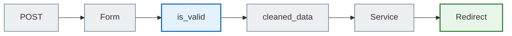

# Django Forms and Crispy Forms

> A Django Form validates data; Crispy Forms describes the Bootstrap layout without duplicating HTML.

## What the student will learn

- the basic mental model of the topic;
- how the topic works in Django;
- where to see it in the final project;
- how to check that the understanding is not just theoretical.

## Prerequisites

- Be able to open the repository.
- Understand that all paths in the documentation are relative to the `notes_chat_app` root.

## Pipeline

## In the project

`NoteForm` accepts `user` so that the dropdown does not show other people's notebooks, tags and groups. This is a security requirement, not just a UI detail.

`TodoItemForm` and `ShopItemForm` use `form_tag=False` because they are embedded in a template form.

## Where to find it in the final project

| File | What to look at |
| --- | --- |
| `notes_app/forms.py` | forms and FormHelper layouts |
| `notes_app/templates/notes_app/note_form.html` | crispy rendering |

## Practical exercise

Add a validation rule to the form and a test that checks invalid input.

## Review questions

- What is the input to this process?
- What result is expected?
- Where does an error most often occur?
- Which command or test helps verify the change?

## Next

Next: [Frontend and templates](../05_frontend_and_templates/README.md).
