# DJANGO FORMS — From Raw Data to the Database

> **Where you are in the knowledge map:**
> `RELATIONAL_DB_FOUNDATIONS` → `DJANGO_ORM_DEEP` → **`DJANGO_FORMS`** ← you are here
>
> Forms are the bridge between the browser and the ORM. They turn unsafe HTTP strings
> into typed Python objects that are ready to be written to the database.

---

> 🔬 **QuerySets in forms — in the notebook:**
> [`docs/reference/legacy_source/orm_laboratory_reference.md`](../reference/legacy_source/orm_laboratory_reference.md)
>
> ⚠️ The notebook itself is not part of this repository: the linked file only explains that. The section names in the table below point to the notebook's original structure, they are not anchors. You can run the same queries yourself in `python manage.py shell` or in the [ORM lab](../labs/orm_lab.md).
>
> | Forms concept | Notebook section |
> |---------------|-----------------|
> | ModelForm + FK choices (queryset for the choices) | `## 2. 🔍 Lazy Methods` → filter() |
> | `form.cleaned_data` → ORM (Trust Boundary) | `## 14. 🧪 Raw SQL` — safe parameters |
> | PRG pattern after POST | `README.md` → section `03 · WRITE flow` |


## 1. Core Mechanism — What Is a Django Form on the Inside?

### 🧠 Mental model

Picture a customs checkpoint on the border between two countries:

```
┌─────────────────────────────────────────────────────────────────────────┐
│                           TRUST BOUNDARY                                │
│                                                                         │
│  🌐 Browser (unsafe zone)         ║     🔒 Django + DB (safe zone)      │
│  ─────────────────────────────    ║    ──────────────────────────────   │
│  request.POST["title"] = "..."    ║    form.cleaned_data["title"]       │
│  request.POST["price"] = "abc"    ║    (typed str, int, Decimal)        │
│  (THESE ARE JUST STRINGS, nothing ║    (validated, safe objects)        │
│   more)                           ║                                     │
│                           [  FORM  ]                                    │
│                      customs at the border                              │
└─────────────────────────────────────────────────────────────────────────┘
```

**A Django form is a Python class** that defines:
- Which fields are expected (structure)
- How to validate each field (validation)
- How to convert an HTTP string into a Python type (coercion)
- How to render HTML for the browser (widget)

### 📚 Why does this exist?

HTTP is a text protocol. The browser sends *everything* as strings:
```
POST /notes/create/ HTTP/1.1

title=My+Note&priority=2&price=abc
```

Without a form you would have to:
1. Manually get `request.POST.get("priority")`
2. Manually check whether it is a number: `try: int(value) except ...`
3. Manually check the range: `if 1 <= priority <= 4`
4. Manually escape it against XSS before displaying it
5. Manually protect against SQL injection

A form does **all of this automatically and safely**.

### ❌ Common mistake

```python
# ❌ UNSAFE: straight from POST into the ORM — never do this!
Note.objects.create(
    title=request.POST["title"],   # may contain "<script>alert(1)</script>"
    priority=request.POST["priority"],  # may be "abc", None, "-999"
)

# ✅ CORRECT: through a form
form = NoteForm(request.POST)
if form.is_valid():
    Note.objects.create(**form.cleaned_data)
```

---

## 2. Form Lifecycle — The Sequence of Form States

### 📚 Step 0: Browser Submission → request.POST (QueryDict)

Before a Django form receives the data, it passes through the HTTP layer:

```
Browser → URL encode → HTTP POST body → Django parses → QueryDict

HTML:  <input name="title" value="Моя нотатка">
       <input name="priority" value="2">
       <input name="csrfmiddlewaretoken" value="abc123...">

HTTP body: title=My+Note&priority=2&csrfmiddlewaretoken=abc123...

Django:
request.POST = QueryDict({
    'title': ['Моя нотатка'],       # ← always a list of strings!
    'priority': ['2'],              # ← the string "2", not the int 2!
    'csrfmiddlewaretoken': ['abc123...'],
})

request.POST['title']     → 'Моя нотатка'   (a single string)
request.POST.getlist('tags') → ['1', '3', '5']  # M:N: multiple values
```

**Key fact:** `QueryDict` is immutable, and all values are strings.
The form converts these strings into typed Python objects.

### 🧠 Mental model

A form goes through **7 clear states**. Like an assembly line in a factory:

```
Browser                    Django View                      Database
   │                            │                               │
   │──── HTTP POST ─────────────►│                               │
   │                            │                               │
   │              form = NoteForm(request.POST)                  │
   │                    │ STATE: bound                          │
   │                            │                               │
   │              form.is_valid()                               │
   │                    │ → runs the validation pipeline        │
   │                            │                               │
   │              ┌─────────────┴──────────────┐               │
   │              │ is_valid=True               │ is_valid=False │
   │              │                             │               │
   │              ▼                             ▼               │
   │     form.cleaned_data             form.errors              │
   │     (typed objects)               (dict of errors)         │
   │              │                             │               │
   │              ▼                             ▼               │
   │     services.create_note(...)      render(request,         │
   │              │                     template, {'form':form}) │
   │              ▼                             │               │
   │     return redirect(...)           HTTP 200 with the form ◄┘
   │◄─── HTTP 302 ──────────────         (fields with errors)
```

### 📚 Why exactly this sequence?

**Why redirect after success (the PRG pattern)?**

```
WITHOUT A REDIRECT:
  POST /notes/create/ → 200 OK (HTML page)
  User presses F5 → browser asks "Resubmit POST?" → duplicate note!

WITH A REDIRECT:
  POST /notes/create/ → 302 Redirect → GET /notes/42/ → 200 OK
  User presses F5 → browser repeats the GET → safe, no duplicate
```

**Why is the form shown again with errors?**

So the user does not lose the data they entered! A bound form keeps the values already entered
in `form.data` (that is, `request.POST`) and puts them back into the HTML when it re-renders.

### 🌐 Sequence Diagram: both paths (success + validation failure)

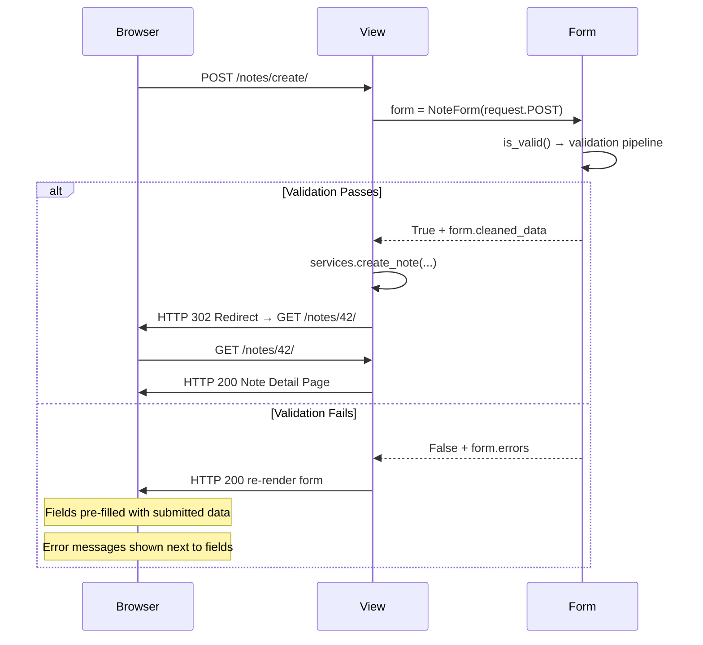

**Why HTTP 200 on errors (not 400)?**
Django returns 200 so the browser can display the form with errors normally.
HTTP 400 (Bad Request) would be more semantically correct, but in practice
most Django applications use 200 to re-render a form.

### ❌ Common mistake

```python
# ❌ Wrong: no redirect after POST
def note_create(request):
    form = NoteForm(request.POST)
    if form.is_valid():
        note = Note.objects.create(...)
        return render(request, 'note_detail.html', {'note': note})
        # F5 = repeated POST = duplicate!

# ✅ Correct: PRG (Post/Redirect/Get)
def note_create(request):
    form = NoteForm(request.POST)
    if form.is_valid():
        note = services.create_note(...)
        return redirect('notes_app:note_detail', pk=note.pk)  # ← 302!
```

---

## 3. Mental Models — Three Ways to Think About Forms

### 🧠 Mental model 1: Trust Boundary

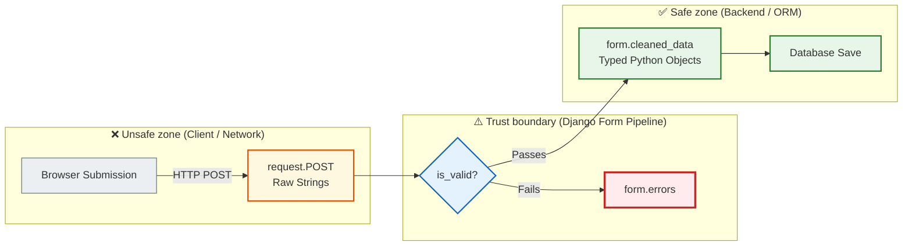

**Everything to the left of `is_valid()` is unsafe strings. Everything to the right is safe objects.**

### 🧠 Mental model 2: Validation Pipeline (a chain of filters)

A form is not just HTML, it is a chain of filters:

```
Raw string
    │
    ▼
[to_python()]     → "2" → int(2)     "abc" → ValidationError!
    │
    ▼
[validate()]      → int(2), min=1, max=4 → OK   int(99) → Error!
    │
    ▼
[run_validators()] → custom functions → OK or Error
    │
    ▼
[clean_<field>()]  → your business logic → OK or Error
    │
    ▼
[clean()]          → cross-field validation
    │
    ▼
cleaned_data["priority"] = 2    ← Python int, guaranteed 1–4
```

### 🧠 Mental model 3: HTML ↔ Python Bridge (a two-way bridge)

```
GET request (displaying the form):
  Model / initial data
        │
        ▼
    Form Field ──► Widget ──► HTML <input value="...">
    (Python)                  (Text for the browser)

POST request (processing the response):
  HTML <input value="...">
        │
        ▼
    Form Field ──► cleaned_data ──► ORM save()
    (Text→Python)  (Python object)  (SQL INSERT/UPDATE)
```

---

## 4. HTML Forms vs Django Forms

### 📚 Why is server-side validation mandatory?

HTML5 attributes such as `required`, `maxlength`, `type="email"` are convenient UX,
but **not protection**. Anyone can bypass the browser check:

```bash
# An attacker bypasses HTML5 validation with curl:
curl -X POST http://localhost:8000/notes/create/ \
  -d "title=&priority=999&content=<script>alert(1)</script>"

# Browser required="required" → has no effect with curl
# priority=999 → outside the allowed range
# <script> → XSS attack
```

**Django's server-side validation catches all of this:**

```python
form = NoteForm(request.POST)  # POST: priority=999, title=""
form.is_valid()  # → False
form.errors
# {
#   'title': ['Це поле обов'язкове.'],
#   'priority': ['Значення 999 не є допустимим вибором.']
# }
# content with <script> is safely escaped by the Django template engine
```

### 🌐 How does Django handle it?

| HTML5 attribute | Django equivalent | Where it is checked |
|---------------|---------------|------------------|
| `required` | `blank=False` (model) or `required=True` (field) | Server |
| `maxlength="200"` | `max_length=200` on a CharField | Server |
| `type="email"` | `EmailField()` | Server |
| `min="1" max="4"` | `MinValueValidator(1)` | Server |
| No equivalent | `clean_<field>()` (business logic) | Server only |

---

## 5. Django Forms Internals — The Architecture on the Inside

### 🧠 Mental model: Field vs Widget

These are two independent components with different responsibilities:

```
CharField (field)                   TextInput (widget)
───────────────────────────         ──────────────────────────────
Responsible for:                    Responsible for:
  • Data type (str)                   • HTML rendering
  • max_length validation             • attrs (class, placeholder)
  • the required check                • <input type="text">
  • to_python() conversion            • reading the value from POST
```

**One field → several different widgets:**

```python
# A CharField can be rendered as:
CharField(widget=TextInput)    # → <input type="text">
CharField(widget=Textarea)     # → <textarea>
CharField(widget=HiddenInput)  # → <input type="hidden">
CharField(widget=PasswordInput)# → <input type="password">

# One field — the same data type, but different HTML!
```

### 📚 Why are Field and Widget separated?

**The Single Responsibility principle**: the field knows about data, the widget knows about HTML.
This lets you change the presentation without changing the validation logic:

```python
class NoteForm(forms.ModelForm):
    class Meta:
        model = Note
        fields = ['title', 'content']
        widgets = {
            # We change the widget — the CharField validation stays the same!
            'content': forms.Textarea(attrs={
                'class': 'form-control',
                'rows': 8,
                'placeholder': 'Текст нотатки...',
            }),
        }
```

### 🌐 Error Collection — How errors are collected

```python
# After form.is_valid() == False:
form.errors
# {
#   'title': ['Це поле обов'язкове.'],
#   'priority': ['Значення 5 не є допустимим вибором.'],
#   '__all__': ['Помилка між полями']  # non_field_errors
# }

# In the template:
# {{ form.title.errors }}   → errors for a specific field
# {{ form.non_field_errors }} → cross-validation errors
# {{ form.errors }}          → all errors together
```

---

## 6. ModelForms Internals — Auto-generation from the Model

### 🧠 Mental model: Model introspection

`ModelForm` reads the model through `Meta.model` and generates fields automatically:

```
Model Field                    →    Form Field
─────────────────────────────       ─────────────────
CharField(max_length=200)      →    CharField(max_length=200)
TextField(blank=True)          →    CharField(widget=Textarea, required=False)
PositiveSmallIntegerField(     →    TypedChoiceField(choices=...,
    choices=PRIORITY_CHOICES)           coerce=int)
ForeignKey(Notebook)           →    ModelChoiceField(queryset=Notebook.objects.all())
ManyToManyField(Tag, blank=T)  →    ModelMultipleChoiceField(queryset=Tag.objects.all())
BooleanField(default=False)    →    BooleanField(widget=CheckboxInput)
```

### 📚 Why does `save(commit=False)` exist?

The classic scenario: a note requires a `user`, but `user` is not in the form:

```python
class NoteForm(forms.ModelForm):
    class Meta:
        model = Note
        fields = ['title', 'content']  # user is NOT in the form (security!)
        # If user were in the form, anyone could substitute someone else's user.id

def note_create(request):
    form = NoteForm(request.POST)
    if form.is_valid():
        # commit=False → creates the Note object in memory but does NOT write it to the DB
        note = form.save(commit=False)
        note.user = request.user  # ← add the user from the session (safe!)
        note.save()               # ← now save it to the DB
        note.tags.set(form.cleaned_data['tags'])  # M:N after save()!
```

### 🌐 Sequence Diagram: the full cycle POST → ModelForm → DB

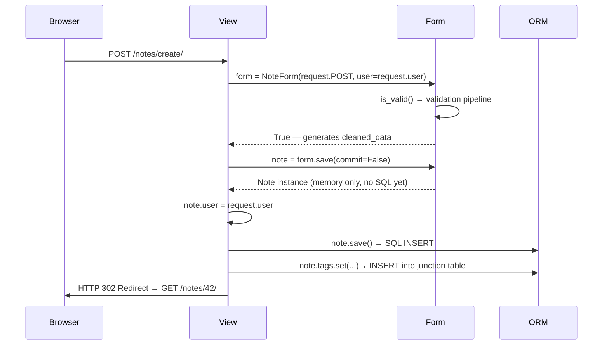

**`save(commit=False)` stops after the Python object has been created.**
The SQL `INSERT` happens only when you call `note.save()` yourself.
This lets you safely add `user` or any other server-side data before saving.

### ❌ Common mistake

```python
# ❌ M:N fields after commit=False require a separate save!
note = form.save(commit=False)
note.user = request.user
note.save()
# form.save_m2m() ← FORGOTTEN! The tags were not saved!

# ✅ Correct: always call save_m2m() after commit=False when there are M:N fields
note = form.save(commit=False)
note.user = request.user
note.save()
form.save_m2m()  # ← saves the ManyToMany fields

# Or better: through Services (as in our notes_chat_app)
note = services.create_note(
    user=request.user,
    title=form.cleaned_data['title'],
    tag_ids=[t.id for t in form.cleaned_data['tags']],
)
```

---

## 7. Widgets Architecture — Rendering HTML

### 🧠 Mental model: a Widget as an HTML generator

Every Widget is an object that knows how to turn a Python value into HTML:

```python
# Widget.render(name, value, attrs) → HTML string
TextInput().render('title', 'Моя нотатка', {'class': 'form-control'})
# → '<input type="text" name="title" value="Моя нотатка" class="form-control">'

Textarea().render('content', 'Текст...', {'rows': '8'})
# → '<textarea name="content" rows="8">Текст...</textarea>'

Select().render('priority', 2, {}, choices=[(1,'Низький'),(2,'Середній')])
# → '<select name="priority"><option value="1">Низький</option>
#     <option value="2" selected>Середній</option></select>'
```

### 🌐 Customizing attrs

```python
class NoteForm(forms.ModelForm):
    class Meta:
        model = Note
        fields = ['title', 'content', 'priority', 'notebook', 'tags', 'is_pinned']
        widgets = {
            'title': forms.TextInput(attrs={
                'class': 'form-control',           # Bootstrap class
                'placeholder': 'Назва нотатки...', # hint
                'autofocus': True,                  # focus on open
            }),
            'content': forms.Textarea(attrs={
                'class': 'form-control',
                'rows': 8,
            }),
            'priority': forms.Select(attrs={
                'class': 'form-select',             # Bootstrap 5 select
            }),
            'tags': forms.CheckboxSelectMultiple(attrs={
                'class': 'list-unstyled',
            }),
            'is_pinned': forms.CheckboxInput(attrs={
                'class': 'form-check-input',
            }),
            # HTML5 color picker!
            'color': forms.TextInput(attrs={
                'type': 'color',
                'class': 'form-control form-control-color',
            }),
        }
```

### 🌐 Architecture: Widget CSS Injection

How it goes backend → CSS class → HTML rendering:

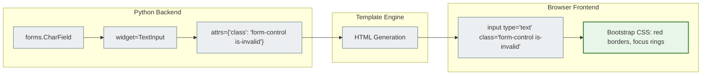

### 🌐 Form Rendering Pipeline

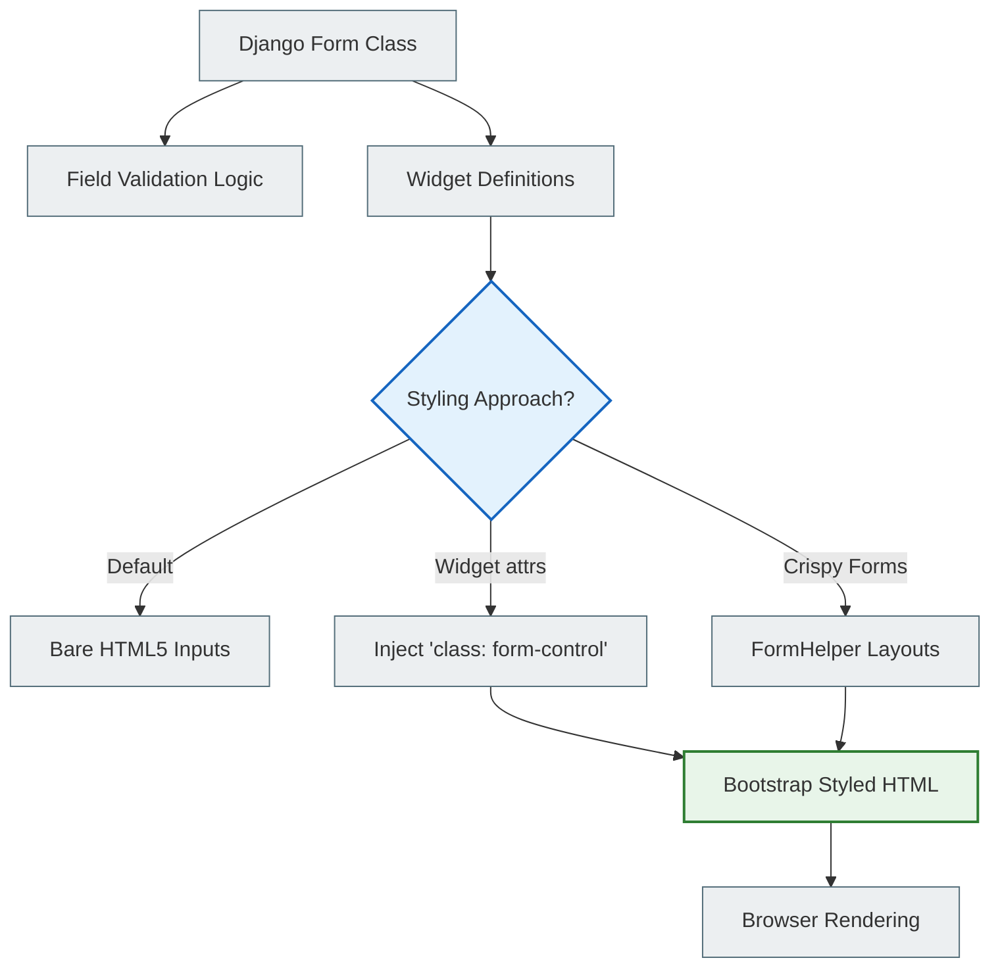

**Bootstrap classes for Django widgets:**

| Bootstrap class | Where it is used | Django widget |
|----------------|---------------------|---------------|
| `form-control` | TextInput, Textarea, Select | `attrs={'class': 'form-control'}` |
| `form-select` | Select, SelectMultiple | `attrs={'class': 'form-select'}` |
| `form-check-input` | CheckboxInput | `attrs={'class': 'form-check-input'}` |
| `form-control-color` | Color picker | `type="color"` + `form-control-color` |
| `is-invalid` | A field with an error | added dynamically through Python/template |
| `invalid-feedback` | Error container | `<div class="invalid-feedback">{{ field.errors }}</div>` |

### 📚 The enterprise approach: django-crispy-forms

In large projects, `crispy-forms` is used instead of manual `attrs`:

```python
# Without crispy: manually adding a class to every widget
# With crispy: an automatic Bootstrap layout
from crispy_forms.helper import FormHelper
from crispy_forms.layout import Layout, Row, Column, Submit

class NoteForm(forms.ModelForm):
    def __init__(self, *args, **kwargs):
        super().__init__(*args, **kwargs)
        self.helper = FormHelper()
        self.helper.form_method = 'POST'          # ← <form method="post">
        self.helper.layout = Layout(
            Row(Column('title', css_class='col-md-8'),
                Column('priority', css_class='col-md-4')),
            'content',
            Row(Column('notebook'), Column('tags')),
            Submit('submit', 'Зберегти', css_class='btn btn-primary'),
        )
        # In the template, simply:   
        # crispy-forms renders the whole Bootstrap grid automatically!
```

### 🌐 Crispy Forms Integration Flowchart

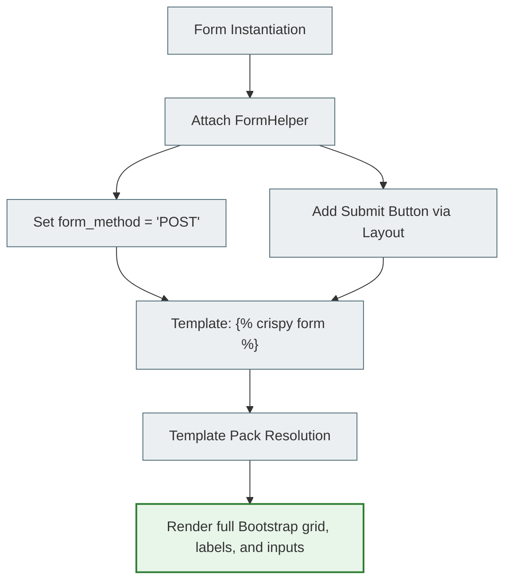

**Why you break the DRY principle without crispy-forms:**
```
WITHOUT crispy: 10 forms × 5 fields × 3 attributes = 150 lines of attrs={'class': ...}
WITH crispy:    CRISPY_TEMPLATE_PACK = 'bootstrap5' → automatic for all forms
```

---

## 8. Validation System — The Validation Pipeline (in detail)

### 🧠 Mental model: 5 levels of checks

```
for field in form.fields:
    │
    ├─ 1. to_python()
    │      "2026-05-24" → datetime.date(2026, 5, 24)
    │      "abc"        → raises ValidationError("Введіть коректну дату")
    │
    ├─ 2. validate()
    │      datetime.date(2026, 5, 24) → emptiness check, BaseValidator
    │
    ├─ 3. run_validators()
    │      MinValueValidator(1)(value)
    │      MaxValueValidator(4)(value)
    │      EmailValidator()(value)    ← for EmailField
    │
    ├─ 4. clean_<fieldname>()         ← your method, if defined
    │      def clean_title(self):
    │          value = self.cleaned_data['title']
    │          if 'spam' in value.lower():
    │              raise forms.ValidationError("Спам заборонено!")
    │          return value.strip()   # ← always return the value!
    │
    └─ FIELD SUCCEEDED → cleaned_data['fieldname'] = typed_value

after all fields:
    └─ 5. clean()                     ← cross-validation between fields
           def clean(self):
               title = self.cleaned_data.get('title')
               priority = self.cleaned_data.get('priority')
               # 'is_pinned' may be missing if that field failed!
               # → always .get(), never ['key']!
               ...
               return self.cleaned_data
```

### 🌐 Diagram: Validation Execution Order

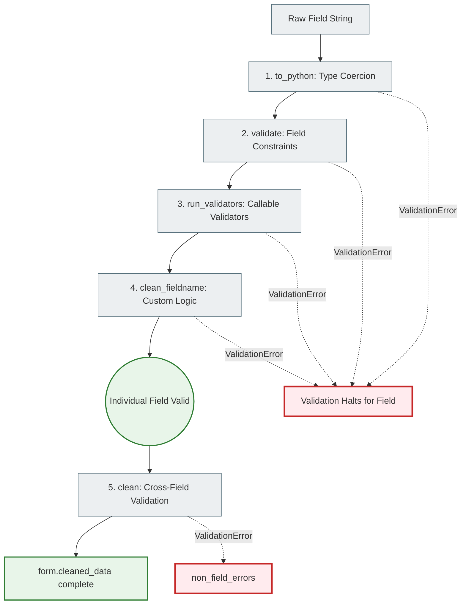

### 🌐 Practical example: clean_<fieldname>

```python
class NoteForm(forms.ModelForm):
    class Meta:
        model = Note
        fields = ['title', 'content', 'priority', 'notebook', 'tags', 'is_pinned']

    def clean_title(self):
        """
        Runs after to_python() and validate().
        self.cleaned_data['title'] is already a str (not the raw string from POST).
        """
        title = self.cleaned_data['title']

        # Business rule: do not allow titles that are empty after strip()
        title = title.strip()
        if not title:
            raise forms.ValidationError("Заголовок не може бути порожнім або пробілами.")

        # Business rule: minimum length
        if len(title) < 3:
            raise forms.ValidationError(
                "Заголовок надто короткий (мінімум %(min)s символів).",
                code='min_length',
                params={'min': 3},
            )

        return title  # ← ALWAYS return the value!

    def clean(self):
        """
        Cross-validation: runs after clean_<field> for all fields.
        Fields that failed validation → are missing from cleaned_data!
        So always use .get(), never []
        """
        cleaned = super().clean()  # ← runs the parent clean()

        priority = cleaned.get('priority')
        is_pinned = cleaned.get('is_pinned')

        # Only high-priority notes can be pinned
        if is_pinned and priority and priority < Note.PRIORITY_HIGH:
            raise forms.ValidationError(
                "Закріплювати можна лише нотатки з пріоритетом 'Високий' або 'Терміново'.",
                code='pin_priority_mismatch',
            )

        return cleaned
```

### ❌ Common mistake in clean()

```python
def clean(self):
    # ❌ UNSAFE: KeyError if the field failed validation!
    priority = self.cleaned_data['priority']    # → KeyError if priority is invalid!
    is_pinned = self.cleaned_data['is_pinned']  # → KeyError!

    # ✅ CORRECT: always .get()
    priority = self.cleaned_data.get('priority')   # → None if missing
    is_pinned = self.cleaned_data.get('is_pinned') # → None if missing
    if priority is None or is_pinned is None:
        return self.cleaned_data  # one of the fields already has an error, skip
```

---

## 9. Trust Boundaries (extended) — Unsafe → Safe Pipeline

### 🧠 Mental model: a map of unsafe zones

```
┌──────────────────────────────────────────────────────────────────┐
│ UNSAFE ZONE — never trust this data                              │
│                                                                  │
│   request.POST                  request.GET                      │
│   request.FILES                 request.META                     │
│   request.COOKIES               URL kwargs (pk=... can be too!) │
│   (everything from the network is strings)                       │
└──────────────────────────────────────────────────────────────────┘
                          │
                    [Django Form]
                    is_valid() = True
                          │
┌──────────────────────────────────────────────────────────────────┐
│ SAFE ZONE — cleaned, typed Python objects                        │
│                                                                  │
│   form.cleaned_data['title']    → str (stripped, validated)     │
│   form.cleaned_data['priority'] → int (1–4, guaranteed)         │
│   form.cleaned_data['tags']     → QuerySet[Tag] (valid objects) │
│   form.cleaned_data['notebook'] → Notebook | None               │
└──────────────────────────────────────────────────────────────────┘
```

### 🌐 Error Propagation Lifecycle

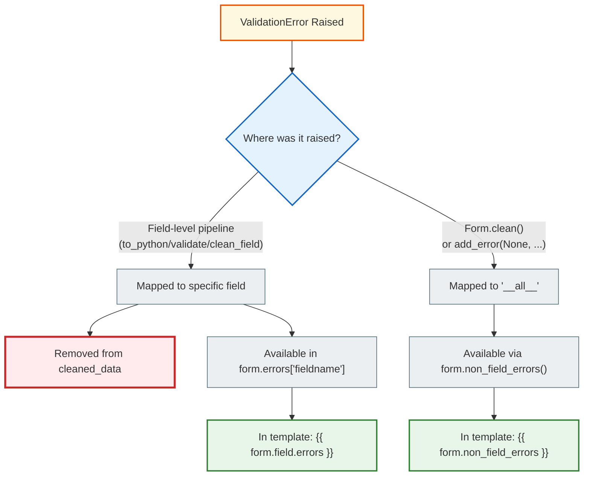

### 📚 add_error() — adding errors programmatically

```python
def clean(self):
    cleaned = super().clean()
    title = cleaned.get('title', '')

    # Check the DB: does this user already have a note with this title?
    # IMPORTANT: self.instance.pk — for edit forms we skip the current object
    if Note.objects.filter(
        user=self.user,
        title__iexact=title
    ).exclude(pk=getattr(self.instance, 'pk', None)).exists():
        # Add the error to a specific field (not non_field_errors)
        self.add_error('title', 'У вас вже є нотатка з таким заголовком.')

    return cleaned
```

---

## 10. Form Rendering Pipeline — Templates

### 🧠 Mental model: two rendering directions

```
GET request (empty form or an instance):
    NoteForm(instance=note) → initial values → HTML with the current data

POST request with errors:
    NoteForm(request.POST) → form.errors → HTML with errors + the entered data
    (Django restores the entered values automatically!)
```

### 🌐 Rendering in the template (3 levels of control)

**Level 1 — minimal (auto-render):**
```html
<!-- Renders all fields automatically -->
{{ form.as_p }}         {# each field in a <p> #}
{{ form.as_table }}     {# a <tr><th><td> table #}
{{ form.as_div }}       {# each field in a <div> #}
```

**Level 2 — django-bootstrap5 (recommended for the course):**
```html


<form method="post" novalidate>
    
           {# Bootstrap 5 styles automatically #}
    
</form>
```

**Level 3 — full control (field by field):**
```html
<form method="post" novalidate>
    

    {# Cross-field errors (non_field_errors) #}
    
        <div class="alert alert-danger">
            {{ form.non_field_errors }}
        </div>
    

    {# The title field by hand #}
    <div class="mb-3">
        <label for="{{ form.title.id_for_label }}" class="form-label">
            {{ form.title.label }}
            <span class="text-danger">*</span>
        </label>
        {{ form.title }}   {# renders the <input> through the Widget #}
        
            <div class="invalid-feedback d-block">
                {{ form.title.errors }}
            </div>
        
        
            <div class="form-text text-muted">{{ form.title.help_text }}</div>
        
    </div>

    {# The tags field — M:N checkboxes #}
    <div class="mb-3">
        <label class="form-label">{{ form.tags.label }}</label>
        
            <div class="form-check">
                {{ checkbox.tag }}
                <label class="form-check-label" for="{{ checkbox.id_for_label }}">
                    {{ checkbox.choice_label }}
                </label>
            </div>
        
    </div>

    <button type="submit" class="btn btn-primary">Зберегти</button>
</form>
```

---

## 11. CSRF & Security — Protection Against Attacks

### 🧠 Mental model: a CSRF attack

```
Attack scenario without CSRF protection:

  1. Alice is logged in to bank.com (she has a session cookie)
  2. Alice visits evil.com
  3. evil.com contains:
     <form action="http://bank.com/transfer" method="post">
       <input type="hidden" name="to" value="hacker">
       <input type="hidden" name="amount" value="10000">
     </form>
     <script>document.forms[0].submit()</script>
  4. Alice's browser automatically sends a POST request to bank.com
     (with cookies! — the browser always attaches the domain's cookies)
  5. bank.com thinks this is Alice and transfers the money!

Django protection:
  1. When  is rendered, Django issues a secret in the csrftoken cookie
     (by default it lives in a cookie; in the session only with CSRF_USE_SESSIONS = True)
  2. The same secret (in masked form) goes into the form as a hidden field
  3. On POST Django checks: does the token from POST match the secret from the cookie?
  4. evil.com does not know the token (Same-Origin Policy) → 403 Forbidden!

  ⚠️ CsrfViewMiddleware checks only "unsafe" methods (POST, PUT, PATCH, DELETE).
     It won't stop a GET attack like ,
     so a GET must never change data.
```

### 🌐 How Django implements CSRF

```html
<!-- REQUIRED in the form: -->
<form method="post">
    
    <!--
    Django renders:
    <input type="hidden" name="csrfmiddlewaretoken"
           value="8XkqABC123...unique token...XYZ">
    -->
    ...
</form>
```

```python
# settings.py — CsrfViewMiddleware checks every POST:
MIDDLEWARE = [
    'django.middleware.security.SecurityMiddleware',
    'django.contrib.sessions.middleware.SessionMiddleware',
    'django.middleware.csrf.CsrfViewMiddleware',  # ← checks the token
    ...
]

# If the token is missing or wrong → 403 Forbidden automatically
# Without any code in the View!
```

### ❌ Common mistake

```html
<!-- ❌ Forgot csrf_token → 403 Forbidden on POST -->
<form method="post">
    {{ form.as_p }}
    <button type="submit">Зберегти</button>
</form>

<!-- ✅ Always add csrf_token to every POST form -->
<form method="post">
    
    {{ form.as_p }}
    <button type="submit">Зберегти</button>
</form>
```

---

## 12. Common Misconceptions

### ❌ Myth 1: "request.POST is safe"

```python
# ❌ CHANGE THIS: request.POST is NEVER safe!
Note.objects.create(
    title=request.POST["title"],     # what if title = "DROP TABLE notes;"?
    priority=request.POST["priority"] # what if priority = "hacked"?
)

# ✅ RULE: always through a form → cleaned_data
form = NoteForm(request.POST)
if form.is_valid():
    # Now cleaned_data['title'] = str (max 200 chars, validated)
    # cleaned_data['priority'] = int (1-4, guaranteed by choices)
    services.create_note(user=request.user, **form.cleaned_data)
```

### ❌ Myth 2: "Client-side validation is enough"

```
Client-side (browser):  required, maxlength, type=email  → easy to bypass
Server-side (Django):   ValidationError, clean(), is_valid() → mandatory!

Rule: client-side validation = a UX improvement.
      Server-side validation = security and data integrity.
```

### ❌ Myth 3: "Forms are only for HTML"

```python
# Django forms can be used without HTTP at all!
# For example: validating data from a CSV file

class ImportNoteForm(forms.Form):
    title = forms.CharField(max_length=200)
    priority = forms.IntegerField(min_value=1, max_value=4)

# Validating a CSV row:
for row in csv_reader:
    form = ImportNoteForm(data={'title': row[0], 'priority': row[1]})
    if form.is_valid():
        Note.objects.create(user=admin_user, **form.cleaned_data)
    else:
        log_error(f"Рядок {row}: {form.errors}")
```

### ❌ Myth 4: "cleaned_data always exists"

```python
# ❌ cleaned_data does not exist before is_valid() is called!
form = NoteForm(request.POST)
title = form.cleaned_data['title']  # AttributeError: 'NoteForm' has no attribute 'cleaned_data'

# ✅ Always check is_valid() before cleaned_data
form = NoteForm(request.POST)
if form.is_valid():
    title = form.cleaned_data['title']  # OK!
```

---

## 13. Edge Cases

### 🌐 Empty POST (a missing field)

```python
# POST: {'content': 'Текст'}  # title is missing entirely!
form = NoteForm({'content': 'Текст'})
form.is_valid()  # → False
form.errors
# {'title': ['Це поле обов'язкове.']}
# A missing field = the same as an empty one for required=True fields
```

### 🌐 Double Submit

```python
# Problem: the user clicks Submit twice in a row
# → two POST requests → two notes with the same title

# Solution 1: the PRG pattern (redirect after POST)
return redirect('notes_app:note_detail', pk=note.pk)

# Solution 2: Idempotency key (a unique UUID from the client)
class Note(models.Model):
    idempotency_key = models.UUIDField(unique=True, default=uuid.uuid4)

# Solution 3: JavaScript disables the button after the first click
# <button onclick="this.disabled=true; this.form.submit()">Зберегти</button>
```

### 🌐 File Upload forms

```python
class NoteWithAttachmentForm(forms.ModelForm):
    attachment = forms.FileField(required=False)

    class Meta:
        model = Note
        fields = ['title', 'content']

# View: you must pass request.FILES together with request.POST!
def note_create(request):
    if request.method == 'POST':
        form = NoteWithAttachmentForm(request.POST, request.FILES)  # ← FILES!
        # ...

# HTML: enctype="multipart/form-data" is required!
# <form method="post" enctype="multipart/form-data">
```

---

## 14. Debugging Intuition — How to Debug Forms

### 🧠 Mental model: 3 inspection points

```python
def note_create(request):
    if request.method == 'POST':
        # Point 1: What came from the browser?
        print("=== request.POST ===")
        print(request.POST)
        # QueryDict: <QueryDict: {'title': ['Моя нотатка'], 'priority': ['2'],
        #             'csrfmiddlewaretoken': ['abc...']}>

        form = NoteForm(request.POST, user=request.user)

        # Point 2: Why is the form not valid?
        if not form.is_valid():
            print("=== form.errors ===")
            print(form.errors)
            # <ul class="errorlist"><li>title<ul class="errorlist">
            #   <li>Це поле обов'язкове.</li></ul></li></ul>
            print(form.errors.as_json())
            # {"title": [{"message": "Це поле обов'язкове.", "code": "required"}]}

        # Point 3: What is in cleaned_data?
        if form.is_valid():
            print("=== form.cleaned_data ===")
            print(form.cleaned_data)
            # {'title': 'Моя нотатка', 'priority': 2, 'tags': <QuerySet []>}
```

### 🌐 Quick debugging in the template

```html
<!-- Temporarily: show all form errors in the template -->

    <pre style="background:#fee;padding:1rem;border-radius:4px">
    {{ form.errors }}
    </pre>

```

---

## 15. Visualization — Complete Diagrams

### Form Lifecycle (the full cycle)

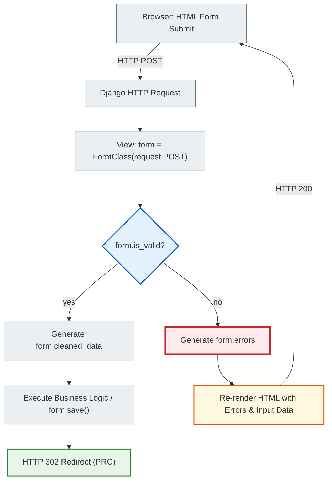

### Validation Pipeline

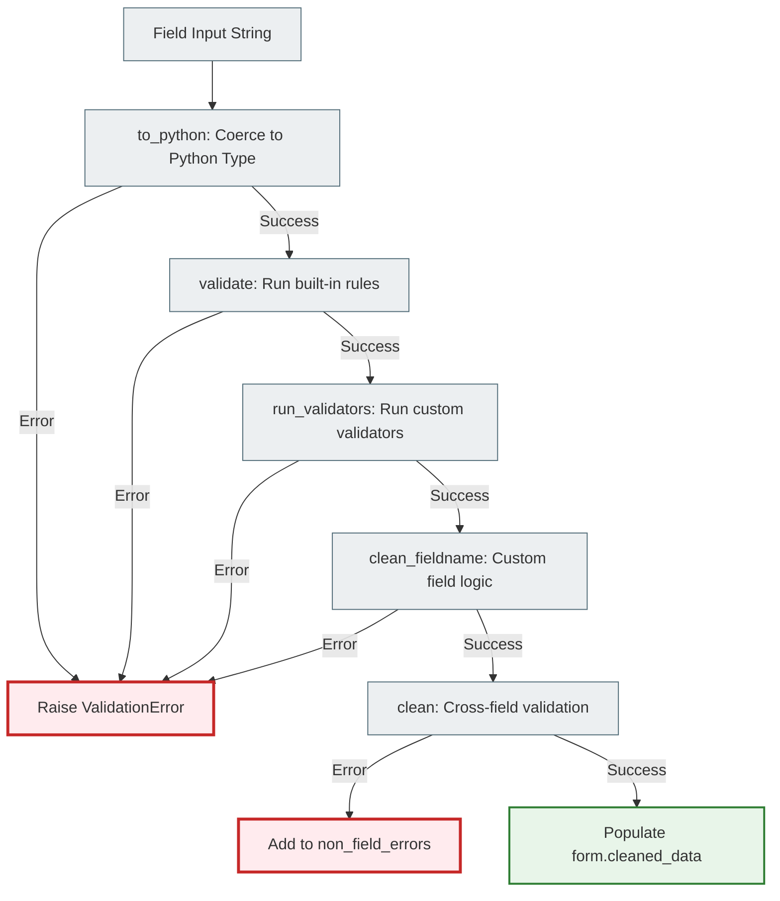

### HTML ↔ Django ↔ ORM (a two-way bridge)

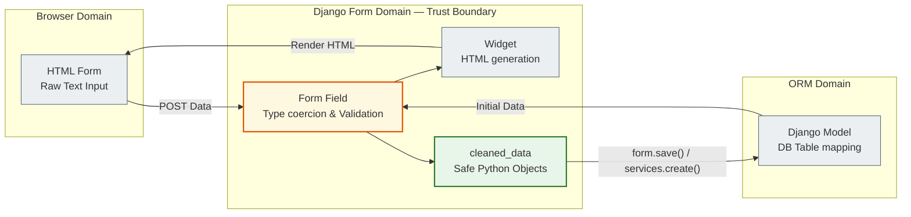

### Trust Zones


---

## 16. Real-World Engineering Relevance

### 📚 Where forms are used in production

| Area | Example | Why forms are critical |
|-------|---------|---------------------|
| CMS | A WordPress-like article editor | Complex content + media files + M:N tags |
| Auth | Login/Registration | Password hashing, unique email check |
| E-commerce | Checkout | Cross-validation: address + payment + coupon |
| API | DRF Serializer (= a Form for JSON) | Validating incoming JSON data |
| Admin panel | Django Admin | A ModelForm for every model |
| Import | CSV/Excel import | Batch validation without HTTP |

### 🌐 ModelForm + transaction.atomic() + M:N

The most complex real-world scenario is a form with Many-to-Many inside a transaction:

```python
# services.py (our approach in notes_chat_app)
def create_note(*, user, title, content='', notebook=None, priority=1, tag_ids=None):
    """
    An atomic operation: note + M:N tags in a single transaction.
    If note.tags.set() fails → note.objects.create() is rolled back too!
    """
    with transaction.atomic():
        note = Note.objects.create(
            user=user, title=title, content=content,
            notebook=notebook, priority=priority
        )
        if tag_ids:
            # Check that the tags belong to this particular user!
            valid_tags = Tag.objects.filter(id__in=tag_ids, user=user)
            note.tags.set(valid_tags)  # INSERT into the junction table
    return note

# views.py — the view is thin, HTTP only
def note_create(request):
    if request.method == 'POST':
        form = NoteForm(request.POST, user=request.user)
        if form.is_valid():
            tags = form.cleaned_data.get('tags', [])
            note = services.create_note(
                user=request.user,
                title=form.cleaned_data['title'],
                content=form.cleaned_data.get('content', ''),
                priority=form.cleaned_data.get('priority', 1),
                notebook=form.cleaned_data.get('notebook'),
                tag_ids=[t.id for t in tags],
            )
            messages.success(request, f'Нотатку "{note.title}" створено!')
            return redirect('notes_app:note_detail', pk=note.pk)
    else:
        form = NoteForm(user=request.user)
    return render(request, 'notes_app/note_form.html', {'form': form})
```

---

## Self-check

**Predict the result before running it:**

```python
# 1. What will form.is_valid() return?
form = NoteForm({'title': '', 'priority': '999'})
# → ___?

# 2. Where will the error be?
form.errors
# → ___?

# 3. What will this code print?
form2 = NoteForm({'title': 'Нотатка', 'priority': '2'}, user=some_user)
if form2.is_valid():
    print(type(form2.cleaned_data['priority']))
# → ___?

# 4. What will happen?
form3 = NoteForm({'title': 'Test'})
print(form3.cleaned_data)  # before is_valid()!
# → ___?
```

<details>
<summary>Answers</summary>

1. `False` — title is empty (required), priority=999 is not in the choices
2. `{'title': ['Це поле обов\'язкове.'], 'priority': ['Значення 999 не є допустимим вибором.']}`
3. `<class 'int'>` — cleaned_data['priority'] is a Python int, not a str!
4. `AttributeError` — cleaned_data does not exist before is_valid() is called

</details>

---

> **Key takeaway:**
> A Django form is not just HTML markup. It is an **architectural boundary**
> between the unsafe HTTP space and the safe ORM space.
> Every byte that passes through `is_valid()` → `cleaned_data`
> is typed, validated, and safe to write to the database.
