# Design Foundations for Django Projects

> **User interface architecture in Django applications**
>
> To build scalable, maintainable and user-friendly Django applications, a developer has to
> change their mindset: not "drawing pages" but designing systematic frontend architectures.
> A professional Django interface is based on a clear separation of structure, presentation
> and data — with active use of components and predictable information hierarchies.

---

## Contents

- [1. Design Thinking and UX Principles](#1-design-thinking-and-ux-principles)
- [2. Information Architecture (IA)](#2-information-architecture-ia)
- [3. Layout Systems and Examples](#3-layout-systems-and-examples)
- [4. Design Systems and the Bootstrap Philosophy](#4-design-systems-and-the-bootstrap-philosophy)
- [5. Django Template Architecture](#5-django-template-architecture)
- [6. Form Design and Data Presentation](#6-form-design-and-data-presentation)
- [7. Dashboard Design](#7-dashboard-design)
- [8. Common Beginner Mistakes](#8-common-beginner-mistakes)
- [9. Organizing Large Django Projects](#9-organizing-large-django-projects)
- [10. Tailwind CSS vs Bootstrap in Django](#10-tailwind-css-vs-bootstrap-in-django)
- [11. Static Files in Django](#11-static-files-in-django)
- [12. Integrating React with Django](#12-integrating-react-with-django)
- [13. Detailed Django Template Architecture](#13-detailed-django-template-architecture)
- [14. Detailed Crispy Forms Architecture](#14-detailed-crispy-forms-architecture)

---

## 1. Design Thinking and UX Principles

### "Don't Make Me Think" (Steve Krug)

The main UX principle is **"Don't make me think"** (Steve Krug, the classic book on usability). Users don't read pages — they **scan** them, looking for visual landmarks. They "satisfice" — they choose the first acceptable option instead of analyzing all possible alternatives.

Your architecture should embody the key UX qualities:
**Useful, Usable, Findable, Credible, Desirable, Accessible, Valuable.**

**Practical consequences:**
- Every page should have **one obvious action**
- Clickable elements should look clickable
- Button labels: "Save note", not "OK"
- If a logged-in user ends up on the login page, redirect them automatically

### CRAP design principles

**CRAP** is an acronym for four fundamental design principles described by Robin Williams in "The Non-Designer's Design Book":

| Principle | Description |
|---------|------|
| **C** — Contrast | If two elements are not the same, make them **very different** to avoid confusion |
| **R** — Repetition | Visual elements repeat throughout the design — color, font, shape, buttons |
| **A** — Alignment | Every element is visually connected to others. Avoid placing things "by eye" |
| **P** — Proximity | Related elements are grouped together. More space *between* groups, less *inside* them |

### Consistency and Conventions

Standardized patterns (conventions) reduce cognitive load. If you use a standard shopping cart or profile icon, users instantly understand the function without any explanation.

### Error Prevention and Feedback

A good interface is "error-tolerant". It limits the possibility of doing something wrong (for example, it allows only digits in a credit card field) and provides immediate, clear feedback after every action.

### Simplicity and Openness

Always start designing with the core function, not with the surrounding shell. Establish a clear **visual hierarchy** — the most important elements should be the most noticeable, naturally guiding the user's eye.

### Visual Hierarchy and Weight

Not every element can be "important". If everything shouts, nothing is heard. Build a hierarchy through:
- **Size**: large → small
- **Color**: bright → muted
- **Weight**: Bold → Regular → Light
- **Position**: the top left attracts attention first
- **Whitespace**: an isolated element is perceived as more important

### Typography on Screen

- Body text: **16px minimum** (less eye strain)
- Line height: **1.5–1.6** for readability
- Line length: **45–75 characters** ideally (neither too narrow nor too wide)
- A maximum of **2–3 fonts** in one design
- Bootstrap scale: `.fs-1` (2.5rem) → `.fs-6` (1rem)

---

## 2. Information Architecture (IA)

Information architecture is the structural design of an application's shared information environments, balancing business goals, user needs and content.

### Page Hierarchy

Applications use both a "top-down" architecture (the home page anticipates the main needs) and a "bottom-up" one (users arrive directly from deep links or search results).

### Persistent Navigation

Global navigation should stay in the same place on every page — this creates a sense of "where am I". It should contain:
- Logo (site identifier)
- Main sections (primary links)
- Utilities (Help, Login)
- Search

### Breadcrumb Navigation

For deep applications, "breadcrumbs" show the path from the home page to the current location, providing an obvious way to go back up the hierarchy.

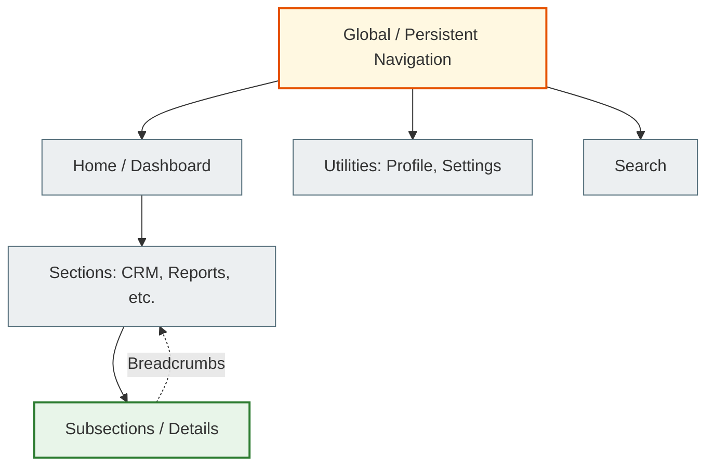

---

## 3. Layout Systems and Examples

Professional web applications usually use a sectioned layout — like a control panel with separate functional frames.

### Admin Panels and Dashboards

They usually use a fixed sidebar for primary navigation, a top header for utilities (search, profile) and a fluid content area.

### SaaS and CRM

They rely on responsive grid systems, where complex data is presented in the main content area, switching to a single-column view on mobile devices.

### E-commerce and Blogs

They usually use top navigation, a hero section for the value proposition and a grid of cards for products or articles.

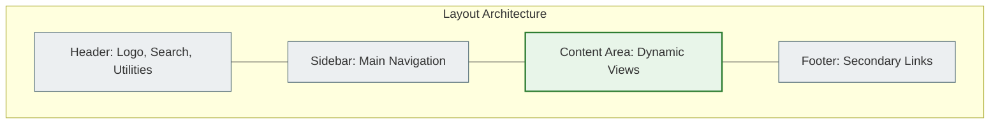

---

## 4. Design Systems and the Bootstrap Philosophy

Frontend frameworks like Bootstrap exist as an abstraction layer for standardizing design, eliminating the chaos of custom CSS and speeding up interface creation.

### Constraining Choice

A design system limits your options (for example, specific font sizes, a defined spacing scale and a color palette). This prevents "choice paralysis" and guarantees consistency. Instead of guessing between 120px and 125px, you use a predefined spacing scale based on 16px.

### Grid Systems

Built on a 12-column mobile-first flexbox system:
- **Containers** limit the width and center the content
- **Rows** act as wrappers with negative margins
- **Columns (Col)** define percentage widths

### Utility Classes

Classes for margins (`m-3`), padding (`p-4`) and display (`d-none`, `d-md-block`) let you change rendering and responsive behavior right in the HTML without writing custom CSS.

### Ready-made Components

Elements like buttons, cards and alerts are predefined abstractions. By combining these components, you quickly create a complex UI without duplication.

---

## 5. Django Template Architecture

Design systems map perfectly onto Django's template inheritance system. By breaking the UI into blocks, you follow the DRY principle (Don't Repeat Yourself).

- `base.html` — the main shell: the `<html>` structure, `<head>` (CSS/JS), persistent navigation, footer.
- **Template inheritance**: child templates `` insert specific UI into ``.
- **Partials/Components**: small UI elements (a KPI card, a menu, alerts) are stored in `components/` and included via ``.

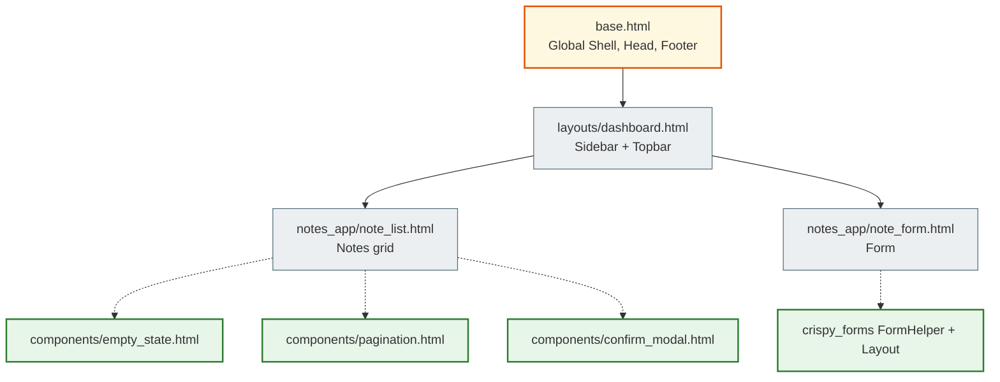

### 3-Level Template Hierarchy (the SaaS Dashboard Pattern)

```
templates/
├── base.html                   ← HTML5 shell, Bootstrap CDN,  slots
├── layouts/
│   ├── dashboard.html          ← base + sidebar + topbar (extends base.html)
│   ├── auth.html               ← base + centered card (login/registration)
│   └── landing.html            ← base + marketing navigation
├── components/
│   ├── pagination.html         ← reusable Bootstrap pagination
│   ├── empty_state.html        ← "No items yet" with a CTA
│   └── confirm_modal.html      ← Delete confirmation dialog
└── notes_app/
    ├── note_list.html          ← extends layouts/dashboard.html
    ├── note_form.html          ←  — ONE TAG!
    └── note_detail.html        ← extends layouts/dashboard.html
```

---

## 6. Form Design and Data Presentation

### Visual Hierarchy of Forms

Forms should clearly communicate the relationships between elements. Avoid over-relying on semantic HTML headings (`<h1>`, `<h2>`) if they visually overpower the form's content. Separate the visual hierarchy from the document hierarchy.

### Labels and Feedback

Don't hide field labels and don't rely on placeholders alone — this harms accessibility. Forms should provide **immediate feedback** through colored states (green — success, red — error) and clear helper text.

**Form errors in Bootstrap:** Django automatically adds the `is-invalid` CSS class to fields with errors — crispy-forms wires this up automatically.

### Three Levels of Form Rendering in Django

| Approach | Template code | Lines | Result |
|--------|--------------|--------|-----------|
| Plain Django | `{{ form.as_p }}` | 1 | No styles |
| Manual Bootstrap | `<div class="mb-3">...` for every field | 60+ | Bootstrap style |
| `django-bootstrap5` | `` | 1 | Bootstrap style |
| **Crispy Forms** | **``** | **1** | **Bootstrap + custom layout** |

### Tables

For presenting data, use `.table-responsive` to avoid horizontal scrolling on mobile. Improve readability with contextual classes (`.table-striped`, `.table-hover`).

---

## 7. Dashboard Design

Dashboards should turn complex data into an easy-to-scan format.

### Organizing Information

Dashboards often use a sectioned layout — navigation, filters and legends are placed in side panels.

### KPIs and Charts

Key metrics are placed at the top (a card component). Choose the right chart type (pie, bar, line, scatter) depending on the comparison you need (time series, correlation, item).

### Empty States

Don't ignore empty states. When a user opens a CRM for the first time and there is no data, use an empty state with a clear **Call to Action** (CTA): "Add your first contact" instead of an empty or broken table.

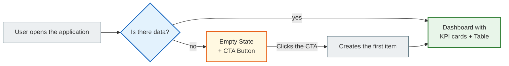

---

## 8. Common Beginner Mistakes

### Architectural Mistakes

#### Giant Templates

Putting thousands of lines of HTML into one file instead of using `` components.

**Solution:** Move repeating UI blocks into a `components/` or `partials/` directory.

#### Logic in Templates

Writing `` in templates.

**Solution:** Move it into a custom template filter or the service layer. Keep templates "dumb".

#### Duplicated HTML

Copying the header/footer/navbar into every template file.

**Solution:** Mandatory template inheritance via ``.

---

### UI/UX Mistakes

#### Too Much Stuff (Clutter/Noise)

Too many elements on one screen without a clear hierarchy. Three colors, five different font sizes, buttons everywhere.

**Solution:** A maximum of **3 hierarchy levels** in one view. One primary action (`.btn-primary`), secondary ones — `.btn-outline-secondary`.

#### Weak Contrast

Gray text on a white background, "soft" buttons that look like text.

**Solution:** Minimum WCAG contrast: **4.5:1** for normal text. Check it with the [Colour Contrast Checker](https://colourcontrast.cc/).

#### Wrong Alignment and Centering

Placing elements "by eye", over-centering everything — a centered left navigation sidebar, a centered data table.

**Solution:** Bootstrap grid + Flexbox + `text-start` alignment for data, `text-center` only for headings/icons.

#### Form Design Mistakes

- A placeholder instead of a label (hides the hint after the first character is typed)
- A "Cancel" button in the same color as "Save"
- No delete confirmation

**Solution:**
```html
{# BAD — label inside the input #}
<input placeholder="Enter email" type="email">

{# GOOD — a separate label #}
<label for="email" class="form-label">Email</label>
<input id="email" type="email" class="form-control" placeholder="you@example.com">
```

#### Relying on Color Alone

Using only color to indicate status (red/green) doesn't work for people with color vision deficiency.

**Solution:**
```html
{# BAD: color only #}
<span class="badge bg-success"></span>

{# GOOD: color + icon + text #}
<span class="badge bg-success"><i class="bi bi-check-circle me-1"></i>Active</span>
```

#### Missing Empty States

Showing an empty table or page when there is no data.

**Solution:** Always render an `empty_state.html` component with a useful CTA.

---

## 9. Organizing Large Django Projects

To keep production Django applications scalable:

```
my_project/
├── templates/                  ← Global layouts (base.html, layouts/)
│   ├── base.html
│   ├── layouts/
│   │   ├── dashboard.html
│   │   └── auth.html
│   └── components/             ← Reusable UI elements
│       ├── pagination.html
│       ├── empty_state.html
│       └── confirm_modal.html
│
├── my_app/
│   ├── templates/my_app/       ← App-specific page templates
│   │   ├── note_list.html      ← extends layouts/dashboard.html
│   │   └── note_form.html      ← 
│   ├── static/my_app/
│   │   ├── css/app.css         ← Custom overrides (minimal!)
│   │   └── js/app.js
│   ├── models.py
│   ├── services.py             ← Business logic (INSERT/UPDATE/DELETE)
│   ├── selectors.py            ← Read queries (SELECT)
│   ├── views.py                ← HTTP layer only
│   └── forms.py                ← FormHelper + Layout (crispy)
│
└── static/                     ← collectstatic output (production)
```

**Rule:** Avoid writing custom CSS for layout if the grid system (Bootstrap) already handles it. Custom CSS should override only **branding** (colors, fonts), not layout.

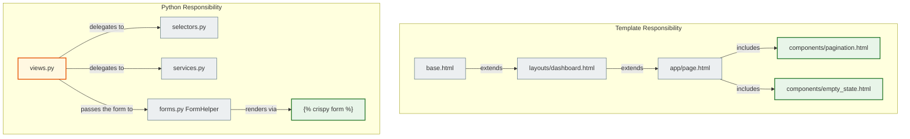

---

## 10. Tailwind CSS vs Bootstrap in Django

### Bootstrap in Django

**Pros:**
- Ready-made components "out of the box" (cards, modals, navbar)
- `django-crispy-forms` + `crispy-bootstrap5` — excellent integration
- Gentler learning curve
- Easy to include via a CDN

**Cons:**
- The "Bootstrap look" — sites look alike without customization
- A larger CSS file (even with purge)
- Less flexibility for unique designs

### Tailwind CSS in Django

**Pros:**
- Unique design — there is no "Tailwind look"
- Atomic CSS classes — a smaller final file (after purge)
- Full control over styles without writing custom CSS

**Cons:**
- Requires `django-tailwind` + Node.js for the build
- `crispy-tailwind` is less mature than `crispy-bootstrap5`
- Steeper learning curve
- No ready-made components (you need Flowbite, Headless UI, etc.)

### Integrating Tailwind with Django

```python
# settings.py
INSTALLED_APPS = [
    ...
    'tailwind',
    'theme',  # generated by django-tailwind
]
TAILWIND_APP_NAME = 'theme'
NPM_BIN_PATH = '/usr/local/bin/npm'

# Running in development:
# python manage.py tailwind start
```

### When to choose which

| Situation | Recommendation |
|----------|-------------|
| Educational project / prototype | Bootstrap (CDN, no build) |
| SaaS with unique branding | Tailwind |
| Admin panel / back office | Bootstrap + django-unfold |
| Public site with a designer-made design | Tailwind |
| The team knows Bootstrap well | Bootstrap |

---

## 11. Static Files in Django

### Configuring `settings.py`

```python
# URL for accessing static files in development
STATIC_URL = '/static/'

# Directories with static files OUTSIDE the apps (project-level)
STATICFILES_DIRS = [
    BASE_DIR / 'static',        # project/static/css/global.css
]

# Directory for production (collectstatic)
STATIC_ROOT = BASE_DIR / 'staticfiles'
```

### Directory Structure

```
my_project/
├── static/                     ← project-level (STATICFILES_DIRS)
│   ├── css/
│   │   └── global.css
│   └── js/
│       └── global.js
│
└── my_app/
    └── static/
        └── my_app/             ← namespace (important!)
            ├── css/
            │   └── app.css
            └── js/
                └── app.js
```

**Namespacing:** Always put files in a subfolder named after the app (`static/my_app/`) to avoid conflicts between apps during `collectstatic`.

### Using Them in Templates

```html


{# Loading CSS #}
<link rel="stylesheet" href="">

{# Loading JS #}
<script src=""></script>

{# Image #}

```

### Production Commands

```bash
# Collects all static files into STATIC_ROOT
python manage.py collectstatic

# Checking the configuration
python manage.py findstatic css/global.css
```

### Serving in Production

Django **does not serve** static files in production (DEBUG=False).
Use Nginx, WhiteNoise or a CDN:

```python
# WhiteNoise (the simplest option for Heroku/Railway)
MIDDLEWARE = [
    'whitenoise.middleware.WhiteNoiseMiddleware',
    ...
]
# Django 4.2+ (STATICFILES_STORAGE was removed in Django 5.1):
STORAGES = {
    'default': {'BACKEND': 'django.core.files.storage.FileSystemStorage'},
    'staticfiles': {'BACKEND': 'whitenoise.storage.CompressedManifestStaticFilesStorage'},
}
```

---

## 12. Integrating React with Django

### Approach 1: Embedded Widget

One or more Django pages render HTML in which React is mounted into a specific `<div>`.
The rest of the application consists of regular Django templates.

```html
{# Django template #}


  <!-- React is mounted here -->
  <div id="react-root"
       data-notes="{{ notes_json|escapejs }}"
       data-user="{{ user.pk }}">
  </div>



  <script src=""></script>

```

**When to use it:** One complex component (for example, an interactive map or a text editor), while the rest of the site is Django SSR.

### Approach 2: SPA + API (Full Separation)

Django provides only a REST API (DRF or API Views), and React is a separate application built with Vite/CRA.

```
backend/   ← Django REST API (port 8000)
├── api/
│   ├── views.py     ← APIView or ViewSet
│   └── serializers.py
└── settings.py      ← CORS_ALLOWED_ORIGINS = ['http://localhost:5173']

frontend/  ← React + Vite (port 5173)
├── src/
│   ├── api/         ← axios/fetch clients
│   └── components/
└── vite.config.js
```

**Configuring CORS for Django:**
```python
# pip install django-cors-headers
INSTALLED_APPS = [..., 'corsheaders']
MIDDLEWARE = ['corsheaders.middleware.CorsMiddleware', ...]
CORS_ALLOWED_ORIGINS = ['http://localhost:5173', 'https://my-app.com']
```

### Comparing the Approaches

| Criterion | Embedded Widget | SPA + API |
|----------|------------------|-----------|
| Setup complexity | Low | High |
| SEO | Django SSR (excellent) | Requires SSR/SSG |
| Django authentication | Built in (cookies/sessions) | Requires JWT or a token |
| API reuse | Limited | Yes (mobile, partners) |
| Time to MVP | Fast | Slower |
| When to choose | One complex component | A full-fledged SPA |

---

## 13. Detailed Django Template Architecture

### The SSR Concept and the Role of the Template

Django templates are a powerful **Server-Side Rendering (SSR)** system that strictly separates business logic from presentation. In a proper backend architecture:

- The **View** acts as the controller: it fetches data from the ORM and prepares it
- The **Template Engine** has a single job: take the data (the context) and insert it into HTML

Django deliberately restricts the Django Template Language (DTL) to prevent arbitrary Python code from being executed in templates. This architectural constraint forces you to keep complex business logic, database queries and mutations exclusively in the View or Model.

### The Template Rendering Pipeline

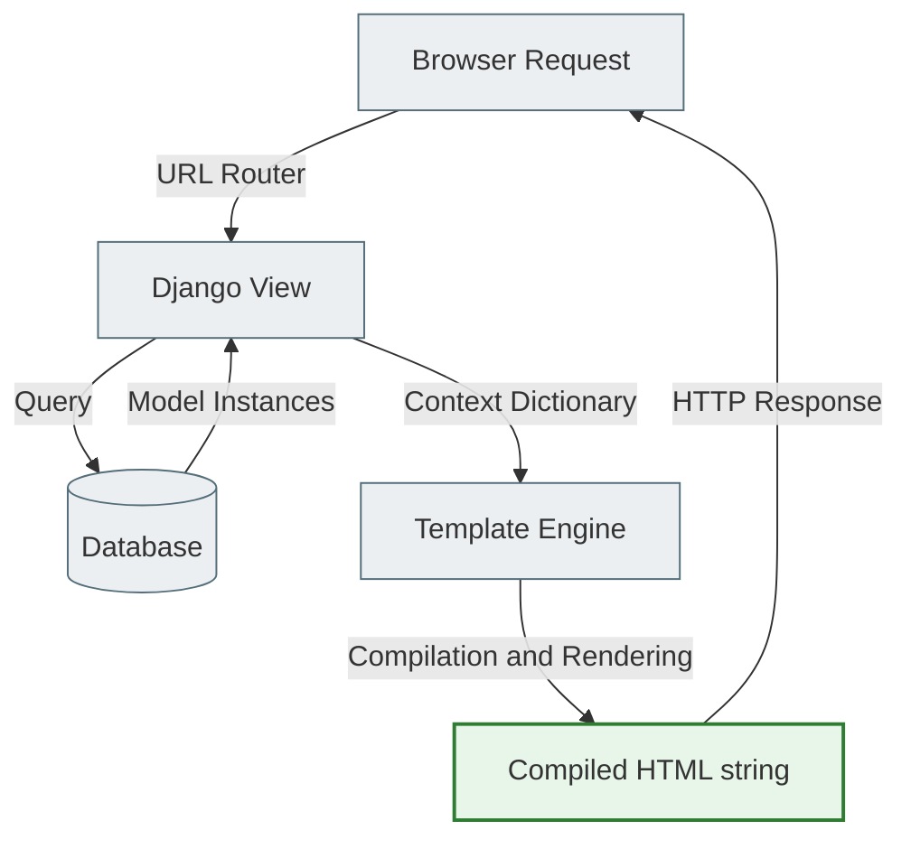

**Pipeline steps:**

1. **Request** — the browser initiates an HTTP request, which is routed to a Django View
2. **View Logic** — the View processes the request, runs database queries and builds the `context` dictionary
3. **Template Compilation** — the Template Engine parses the HTML file and compiles it into an AST (a tree of nodes) in the server's memory
4. **Context Interpolation** — the engine walks the AST, substitutes template variables and executes tags
5. **Response Generation** — the engine joins the results into the final HTML string and returns an `HttpResponse`

### Template Inheritance

Inheritance is the **architectural foundation of DRY UI systems** in Django. Instead of copying `<head>`, the navigation and the footer into every file, you create a base "skeleton" template (`base.html`) with `` tags. Child templates inherit the whole skeleton and override only the blocks they need.

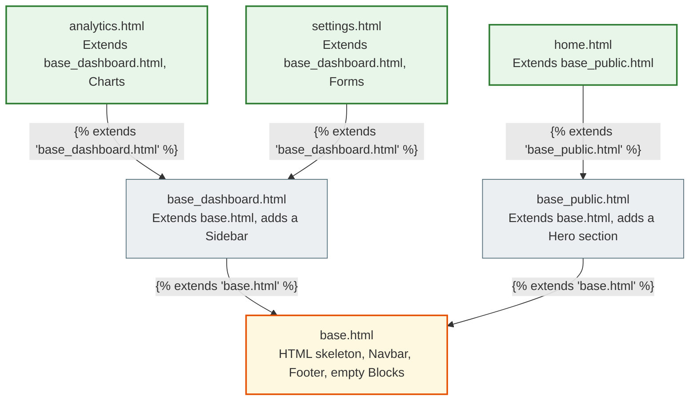

### Template Composition ()

Inheritance builds pages **top-down**, composition builds them **bottom-up**. A complex UI is broken into isolated micro-templates (cards, pagination, forms) that are included via ``.

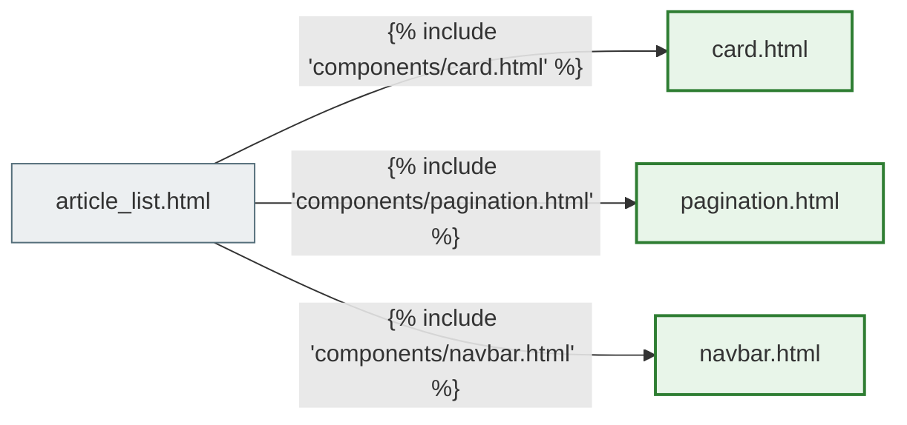

### Advanced DTL Tags

| Tag | Purpose |
|-----|------------|
| `` / `` | The core pair for inheritance trees |
| `` | Inserting a sub-template |
| `` | Caching a complex variable or passing isolated arguments to a component |
| `` | Resolving named URL routes into absolute paths |
| `` | Inserting a hidden input with the CSRF security token |
| `` | Loading tag/filter libraries (for example, `static`, `crispy_forms_tags`) |

### Template Filters

Filters transform context data right before rendering it into HTML, using the `|` syntax:

| Filter | Example | Result |
|--------|---------|-----------|
| `default` | `{{ value\|default:"Не вказано" }}` | Fallback if the value is False |
| `length` | `{{ list\|length }}` | Size of a list or string |
| `truncatechars` | `{{ text\|truncatechars:50 }}` | Truncates a string to N characters |
| `date` | `{{ dt\|date:"d.m.Y" }}` | Formats a `datetime` |
| `safe` | `{{ html\|safe }}` | ⚠️ Disables HTML escaping (only for trusted HTML!) |
| `lower` / `upper` | `{{ name\|lower }}` | String case |

### Architectural Mistakes in Templates

| Mistake | Consequence | Solution |
|---------|----------|---------|
| Business logic in templates (filtering QuerySets, database queries) | Violates MVT, impossible to test | All data preparation goes into the View or selectors.py |
| Copying HTML (a navbar in every file) | A design change = editing dozens of files | `` |
| Monolithic templates (2000+ lines of HTML) | Impossible to maintain | `` components |
| Abusing `\|safe` on untrusted input | XSS vulnerabilities | Never use `\|safe` for user data |

---

## 14. Detailed Crispy Forms Architecture

### The Core Concept

Standard Django Forms are excellent at **data validation and security**, but they deliberately leave the HTML layout unstructured. The `as_p()` and `as_table()` methods generate raw HTML without Bootstrap classes.

**Django Crispy Forms** solves this by acting as a powerful **UI abstraction layer**. It intercepts Django's standard rendering and programmatically injects framework-specific styles **directly from Python code**, keeping the UI architecture DRY and drastically reducing boilerplate.

### The Form Rendering Pipeline

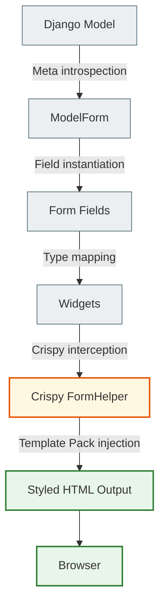

**Without Crispy Forms**, the pipeline stops at Widgets — you get raw HTML without Bootstrap classes.
**With Crispy Forms**, the FormHelper intercepts rendering and, via `CRISPY_TEMPLATE_PACK`, automatically adds all the required classes.

### Crispy Forms Architecture

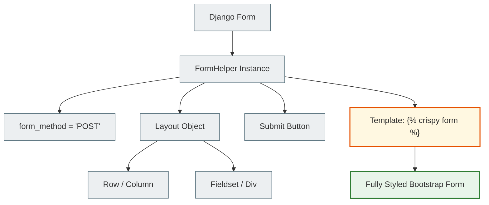

### FormHelper Components

**FormHelper** is the orchestrator attached to the form; it defines:
- The attributes of the `<form>` tag (method, id, class, action)
- The HTTP method (GET/POST)
- The overall Layout structure

**FormHelper does NOT affect:**
- Validation (`is_valid()` works identically)
- `cleaned_data` (unchanged)
- Business logic

### Layout Components

| Component | HTML rendering | Purpose |
|-----------|-----------------|-------------|
| `Fieldset('назва', ...)` | `<fieldset><legend>назва</legend>` | Grouping related fields |
| `Row(...)` | `<div class="row">` | A Bootstrap grid row |
| `Column('поле', css_class='col-md-6')` | `<div class="col-md-6">` | A Bootstrap column |
| `Field('поле', placeholder='...')` | `<input class="form-control" ...>` | A field with HTML attributes |
| `Div('поле', css_class='custom')` | `<div class="custom">` | An arbitrary container |
| `Submit('submit', 'Зберегти')` | `<button type="submit" class="btn">` | A submit button |
| `HTML('<hr>')` | An arbitrary HTML string | Inserting any HTML |
| `ButtonHolder(...)` | `<div class="form-group">` | Grouping buttons |

### Integration with Bootstrap 5

With `CRISPY_TEMPLATE_PACK = 'bootstrap5'` set, Crispy Forms automatically:
- Wraps inputs in the Bootstrap grid
- Injects the required `.form-control` class into text fields
- Dynamically applies `.is-invalid` together with Bootstrap validation error messages

### The Validation Pipeline

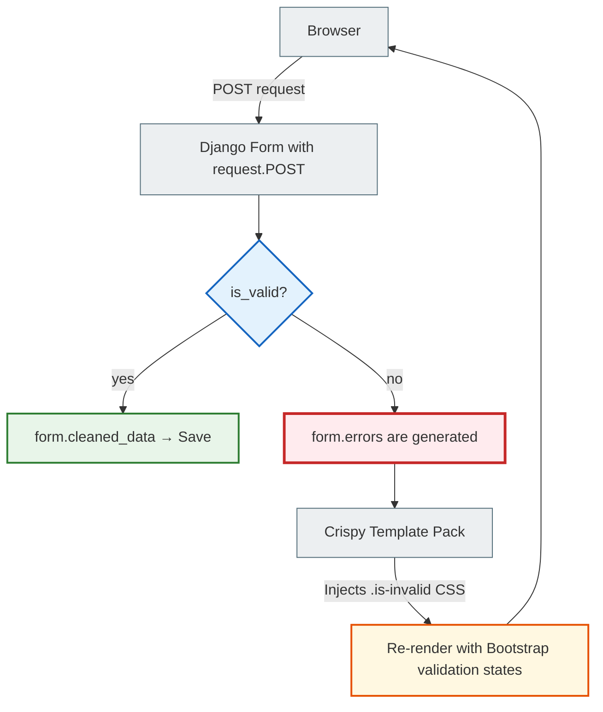

### The Advanced Layout System

```python
# Example of a complex Layout — pure Python, no HTML in the template!
self.helper.layout = Layout(
    Fieldset(
        'Основна інформація',          # → <legend>
        Field('title', autofocus=True), # → <input class="form-control" autofocus>
        Row(
            Column('priority', css_class='col-md-4'),  # → <div class="col-md-4">
            Column('notebook', css_class='col-md-8'),  # → <div class="col-md-8">
        ),
    ),
    Fieldset(
        'Зміст',
        Field('content', rows=8),
    ),
    HTML('<hr class="my-4">'),
    Submit('submit', 'Зберегти', css_class='btn btn-primary me-2'),
    HTML('<a href="javascript:history.back()" class="btn btn-outline-secondary">Скасувати</a>'),
)
```

### Common Misconceptions

| Misconception | Truth |
|---------------|--------|
| Crispy Forms is validation | No. Crispy affects only **presentation**. Validation is exclusively Django's job |
| Crispy replaces Django Forms | No. It is an enhancing wrapper. You still define fields and `Meta` as usual |
| Crispy changes the data | No. It only transforms the HTML output: `<form>` tags, CSRF tokens, CSS classes |

### Comparison: Before vs After

**BEFORE — manual Bootstrap (the earlier variant; the `NoteForm` docstring in `notes_app/forms.py` shows it):**
```python
class NoteFormManual(forms.ModelForm):
    class Meta:
        widgets = {
            'title': forms.TextInput(attrs={'class': 'form-control', 'placeholder': '...'}),
            'content': forms.Textarea(attrs={'class': 'form-control', 'rows': 8}),
            'priority': forms.Select(attrs={'class': 'form-select'}),
            # ... repeat for EVERY field!
        }
# Template: 60+ lines of Bootstrap HTML
```

**AFTER — Crispy Forms (the current `notes_app/forms.py`, simplified):**
```python
class NoteForm(forms.ModelForm):
    def __init__(self, *args, **kwargs):
        super().__init__(*args, **kwargs)
        self.helper = FormHelper()
        self.helper.layout = Layout(
            Row(Column('title'), Column('priority')),
            'content',
            Submit('submit', 'Зберегти'),
        )
# Template:  — 1 line!
```

---

## Related Files

| File | What it shows |
|------|-----------|
| [BOOTSTRAP_5.md](bootstrap_5_full.md) | Grid system, breakpoints, utility classes |
| [DJANGO_TEMPLATES_BOOTSTRAP.md](django_templates_bootstrap_full.md) | Template inheritance, DTL syntax, SSR |
| [ADVANCED_TEMPLATES.md](advanced_templates_full.md) §3 | crispy-forms FormHelper + Layout — theory |
| [ADVANCED_TEMPLATES.md](advanced_templates_full.md) §5 | SaaS Dashboard architecture — 3-level hierarchy |
| [CRISPY_FORMS.md](../04_forms_and_validation/crispy_forms_full.md) | A short reference for django-crispy-forms |
| `notes_app/forms.py` + `notes_app/templates/notes_app/note_form.html` | **A practical demonstration** of all the concepts above in the project code |

---

> **Learning path:** Read this file → study `ADVANCED_TEMPLATES.md §3 + §5` → open `notes_app/forms.py` (the `NoteForm` docstring compares BEFORE and AFTER) → look at `notes_app/templates/notes_app/note_form.html`
