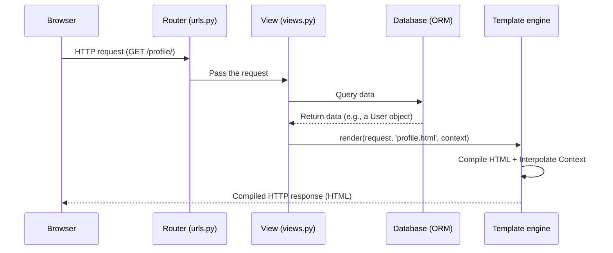

# Django Templates

This material covers the Presentation Layer in Django from a system architecture perspective. Django templates are not just HTML files; they are a powerful mechanism for processing and interpolating data.

## 1. Core Mechanism

When the `render()` function is called, Django does not simply read a file. It loads a "raw" HTML string, **compiles it into a tree of `Node` objects** in memory, and maps your Python context dictionary onto those nodes. The template engine evaluates variables, replaces placeholders with real data, and returns a fully compiled HTML byte stream.

### Internals of the Template Engine

Template processing is an internal two-stage process:

1. **Compiling:** Django splits the raw template text into a list of `Node` objects.
2. **Rendering:** Django calls the `render()` method on each `Node`, using the provided Context. The results are joined into the final string.

## 2. Execution Flow



> **Mental model:**
> Think of a template as a **document form with blanks**. The View is the cook who gathers ingredients (data) from the pantry (the database). The template engine is the "plating" process that arranges the raw data on the plate so it looks appealing to the customer.

## 3. The Context System

The context is a Python dictionary that maps variable names to Python objects. In templates, Django uses **dot notation** to look up values.

When you write `{{ foo.bar }}`, Django tries the following in order:

1. Dictionary key lookup (`foo['bar']`).
2. Attribute or method lookup (`foo.bar`).
3. List index lookup (`foo[bar]`).

### Accessing Data and Object Attributes

| Object and attribute | Technical description |
| --- | --- |
| `{{ post.title }}` | Getting the title of a model object |
| `{{ post.author }}` | Accessing a related object (Foreign Key) |
| `{{ post.pk }}` | Accessing the primary key (Primary Key) |
| `{{ row.first_name }}` | Accessing data from Raw SQL (if `dictfetchall` or `namedtuplefetchall` is used) |

## 4. Security and Edge Cases

### Security Intuition (Preventing XSS)

To prevent cross-site scripting (XSS) attacks, Django **automatically escapes** dangerous characters (for example, `<`, `>`, and `&`) when outputting variables.

* **Scenario:** An attacker enters the name `<script>alert('XSS')</script>`.
* **Result:** Django safely renders it as text: `&lt;script&gt;alert('XSS')&lt;/script&gt;`, and the browser does not execute the malicious code.

### Edge Cases (Silent Failure)

If a template references a variable that is **not** in the context dictionary, Django does not raise an error (Error/Exception). It works silently and outputs an empty string. This prevents the site from crashing, but sometimes makes it harder to track down missing data.

> **Debugging intuition:** If the page loads but data is missing from it, the problem is almost always in the Context dictionary in `views.py`, not in the HTML. Use Django Debug Toolbar to inspect the context that was passed.

## 5. Syntax Reference (DTL Dictionary)

The Django Template Language (DTL) deliberately limits logic to enforce separation of concerns: presentation belongs to the template, and business logic belongs to `views.py`.

### Core Tags (``)

* ``: Template inheritance (must be the first line in the file).
* `...`: Defines areas that can be overridden.
* `......`: A loop for iterating over a QuerySet or lists. `` fires if the list is empty.
* `.........`: Conditional branching.
* ``: Safe link generation based on route names from `urls.py`.
* ``: A mandatory security token for any HTML form that uses a POST request.
* ``: Loads static files (CSS, JS). Used as ``.

### Core Filters (`{{ var|filter }}`)

* `|lower`, `|upper`, `|capfirst`: Changing text case.
* `|date:"Y-m-d"`: Formatting date and time objects (for example, `{{ post.published_date|date:"d.m.Y" }}`).
* `|default:"Unknown"`: A default value if the variable is empty or `None`.
* `|length`: Counting the number of items in a list.
* `|safe`: Disables automatic escaping (use with caution, only for trusted HTML).
* `|truncatewords:30`: Truncating long text.

---

## 6. Practical Code Examples

### Logic (views.py)

Here we create the data (the Context) and pass it to the template engine.

```python
from django.shortcuts import render
from .models import Post

def post_list(request):
    # Fetch all posts from the database
    posts = Post.objects.all()
    # Build the context dictionary
    context = {
        "username": request.user.username,
        "posts": posts
    }
    # Compile and render
    return render(request, "blog/post_list.html", context)

```

### Presentation Skeleton (base.html)

Django uses object-oriented template inheritance. You create a base skeleton file (`base.html`) that contains the common elements (navigation, footer, stylesheet links).

```html
<!DOCTYPE html>
<html lang="uk">
<head>
    <meta charset="UTF-8">
    <title>My Blog</title>
    <!-- Load static files -->
    
    <link rel="stylesheet" href="">
</head>
<body>
    <header>
        <nav>Site navigation</nav>
    </header>

    <main class="container mt-4">
        <!-- Block that child templates will replace -->
        
        
    </main>

    <footer>&copy; 2026 All rights reserved</footer>
</body>
</html>

```

### Child Template (post_list.html)

A child template states which template it inherits from and fills in only the `` sections it needs. This prevents code duplication across hundreds of pages.

```html


Post list


    <h1>Hi, {{ username|capfirst }}! Here are the latest posts:</h1>
    
    <div class="row">
        
            <div class="col-md-4 mb-3">
                <div class="card">
                    <div class="card-body">
                        <!-- Dynamic URL generation -->
                        <h5 class="card-title">
                            <a href="">
                                {{ post.title }}
                            </a>
                        </h5>
                        
                        <!-- Date formatting -->
                        
                            <h6 class="text-muted">{{ post.published_date|date:"d.m.Y" }}</h6>
                        
                        
                        <!-- Text truncation -->
                        <p class="card-text">{{ post.text|truncatewords:20 }}</p>
                    </div>
                </div>
            </div>
        
            <div class="col-12">
                <p class="alert alert-warning">There are no posts yet.</p>
            </div>
        
    </div>


```

## 7. Real-World Relevance

Server-Side Rendering (SSR), which Django provides, is ideal for SEO and fast initial page loads. In modern hybrid architectures, Django generates the initial HTML for speed, while frontend frameworks (such as Vue or React) use progressive enhancement to add interactivity.

You can use Django's `` tag to stop the engine from processing certain blocks, letting React/Vue work with their own `{{ }}` syntax inside the HTML.

## Reflection Questions

1. If you need to change the date format for a specific locale, should you format it in Python (`views.py`) or use a template filter in the HTML? Why?
2. Why must the `` tag be the very first tag in a child template?
