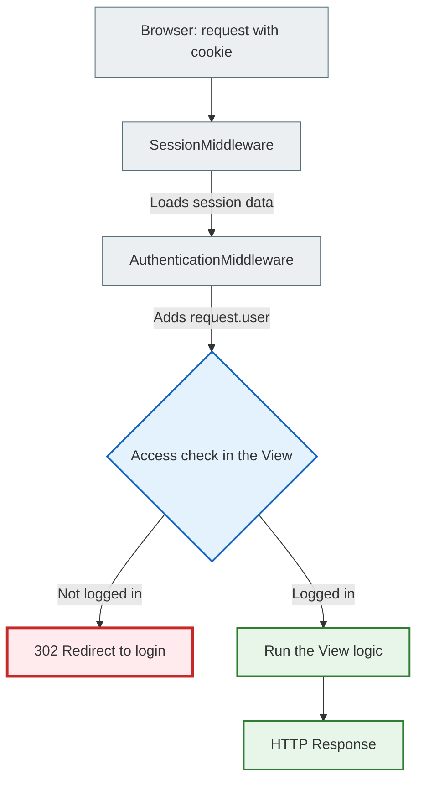
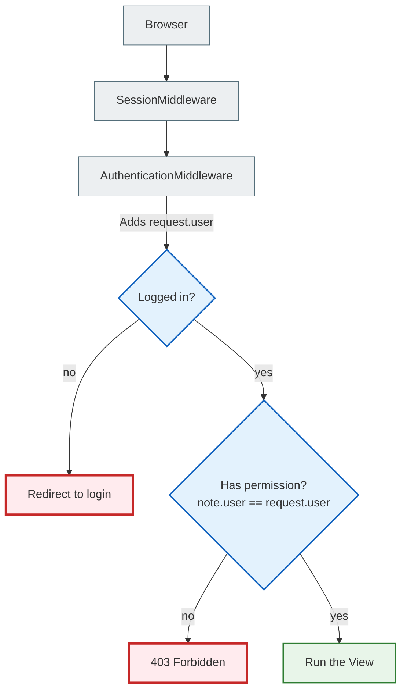

# Authentication vs Authorization — The Basics

> **Audience:** Students learning web application security in Django for the first time.
> **Project:** `crispy_notes_chat_app` (lesson_Django_authentication_and_security)

---

## 1. What are Authentication and Authorization?

These are two completely different concepts that are often confused. Remember:

| Concept | Question | Example |
|---------|-----------|---------|
| **Authentication** | **Who are you?** | Checking the username and password |
| **Authorization** | **What are you allowed to do?** | Do you have the right to delete this note? |

**A real-life analogy:**
- You arrive at work and show your ID badge to the security guard → this is **authentication** (who you are)
- The guard checks whether you have access to the server room → this is **authorization** (what you are allowed to do)

> In real systems these processes are strictly separated. A user can successfully **authenticate** (log in) but not have **authorization** to view other people's notes.

---

## 2. Django's authentication architecture

Django has a built-in authentication system. Here are its key components:

### `User` — the core model
```python
from django.contrib.auth.models import User

# Every registered user is a User object:
user = User.objects.get(username='alice')
print(user.username)      # 'alice'
print(user.is_authenticated)  # True
```

### `request.user` — who is visiting the page right now
```python
# Every view has request.user:
def my_view(request):
    if request.user.is_authenticated:
        # The user is logged in
        print(f"Hello, {request.user.username}!")
    else:
        # An anonymous visitor
        print("Please log in")
```

Django automatically adds `request.user` to every request through **Middleware**.

### `authenticate()` and `login()` / `logout()`

```python
from django.contrib.auth import authenticate, login, logout

# Checks the username and password:
user = authenticate(request, username='alice', password='secret')
# If the password is correct → returns a User object
# If it's wrong → returns None

if user is not None:
    login(request, user)   # Stores the user ID in the session (cookie)
    # Now request.user == user
    
# Logging out:
logout(request)  # Deletes the session. request.user becomes AnonymousUser
```

---

## 3. The HTTP request lifecycle and the role of Middleware

**The problem:** HTTP is a **stateless protocol**. Each request is independent; the server doesn't "remember" previous ones.

**The solution:** Cookies and sessions. When Alice logs in, the server:
1. Stores her ID in the database (a session record)
2. Sends the browser a cookie with a **session ID** (a unique string)
3. On the next request, the browser automatically sends this cookie
4. The server finds the session and knows it's Alice

### How Middleware processes each request

**Middleware** is like a set of filters every request passes through before it reaches your `view`:

```
The browser sends a request
       ↓
SecurityMiddleware      ← checks HTTPS, security headers
       ↓
SessionMiddleware       ← reads the cookie, loads the session from the DB
       ↓
CsrfViewMiddleware      ← checks the CSRF token for POST requests
       ↓
AuthenticationMiddleware ← finds the user ID in the session, sets request.user
       ↓
Your View              ← request.user already holds the correct user here
```

### Lifecycle diagram



---

## 4. A practical example: @login_required

The `@login_required` decorator is the simplest way to protect a view:

```python
from django.contrib.auth.decorators import login_required

@login_required  # If not logged in → redirect to /accounts/login/
def note_list(request):
    # Here request.user.is_authenticated == True is guaranteed
    notes = Note.objects.filter(user=request.user)  # ← ALWAYS filter!
    return render(request, 'note_list.html', {'notes': notes})
```

**Important:** `@login_required` only checks that the user is logged in; it does NOT check whether the notes belong to this particular user. That's why you must always filter the queryset by `user=request.user`.

---

## 5. Full authentication and authorization diagram



---

## Where is this in our project?

| Where | What happens |
|----|-----------------|
| `settings.py` → MIDDLEWARE | Middleware order: SessionMiddleware → AuthenticationMiddleware |
| `notes_app/views.py` | `@login_required` on every protected view |
| `selectors.py` | `Note.objects.filter(user=user)` — filtering by owner |
| `settings.py` | `LOGIN_URL`, `LOGIN_REDIRECT_URL` — where to redirect |
