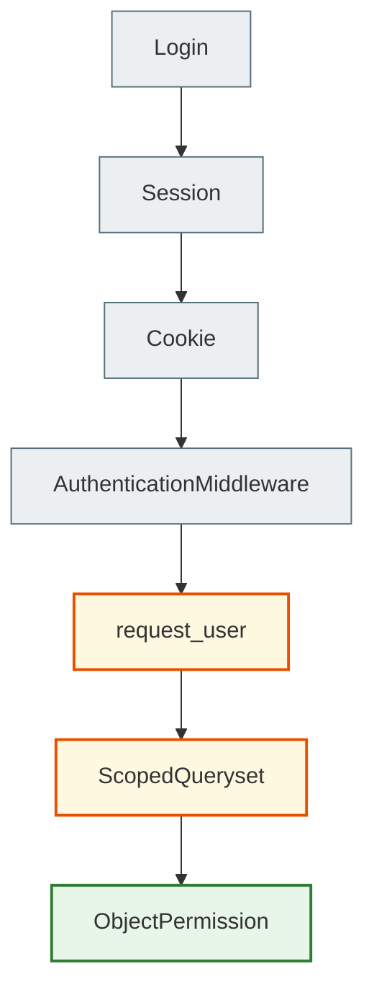

# Authentication, Sessions and Permissions

> Authentication answers the question "who are you", authorization answers "what are you allowed to do".

## What the student will learn

- the basic mental model of the topic;
- how the topic works in Django;
- where to see it in the final project;
- how to check that the understanding is not merely theoretical.

## Prerequisites

- Be able to open the repository.
- Understand that all paths in the documentation are relative to the `notes_chat_app` root.

## Flow

## IDOR

You must not fetch an object by `pk` alone. You need a scope: owner, shared user or group membership.

## In the project

- Notes are visible to the owner or to group members.
- Editing someone else's group note is not allowed.
- The chat consumer checks membership on connect.

## Where to find it in the final project

| File | What to look at |
| --- | --- |
| `notes_app/views.py` | owner/group checks |
| `notes_app/selectors.py` | scoped querysets |
| `notes_app/consumers.py` | membership check |

## Practical task

Write a test that proves a user cannot see someone else's object.

## Review questions

- What is the input to this process?
- What result is expected?
- Where does an error most often occur?
- Which command or test helps verify the change?

## Next

Next: [Testing and quality](../08_testing_and_quality/README.md).
