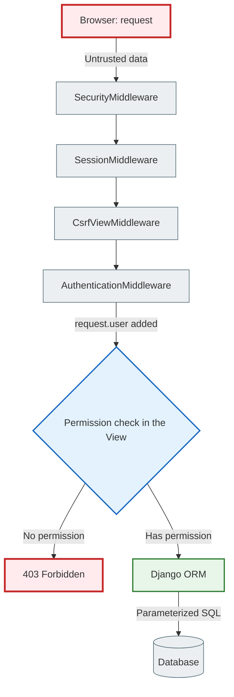
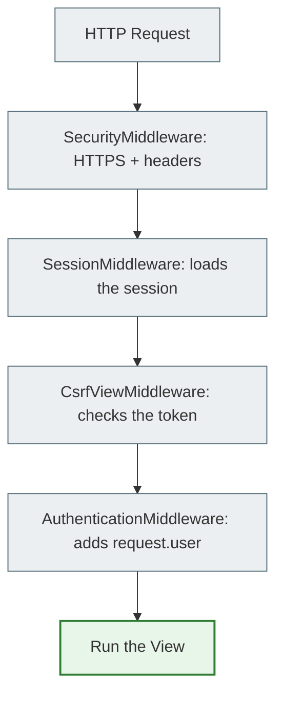
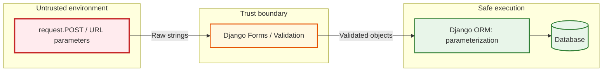

# Django Security Architecture

> Django follows a **"secure by default"** philosophy.
> This means the framework itself protects against most common attacks —
> you only need to use it correctly and not switch the protections off.

---

## 1. The lifecycle of a secure request

When a user sends data (clicks a button, submits a form), the request passes through a strict chain of protections:

```
1. Browser         → sends an HTTP request (untrusted data)
2. SecurityMiddleware → checks HTTPS, adds protective headers
3. SessionMiddleware  → reads the cookie, loads the session from the DB
4. CsrfViewMiddleware → checks the CSRF token for POST requests
5. AuthenticationMiddleware → finds the user in the session, sets request.user
6. Your View       → checks permissions: may request.user do this?
7. Django ORM      → builds a parameterized SQL query (protection against SQL injection)
8. Database        → executes the safe query
```



---

## 2. Middleware order — why it's critical

Middleware is like a row of security guards that every request passes through. Their order in `settings.py` matters:

```python
MIDDLEWARE = [
    "django.middleware.security.SecurityMiddleware",    # 1. HTTPS, headers
    "django.contrib.sessions.middleware.SessionMiddleware",  # 2. Load the session
    "django.middleware.common.CommonMiddleware",         # 3. URL normalization
    "django.middleware.csrf.CsrfViewMiddleware",         # 4. Check CSRF
    "django.contrib.auth.middleware.AuthenticationMiddleware",  # 5. Find the user
    "django.contrib.messages.middleware.MessageMiddleware",     # 6. Flash messages
    "django.middleware.clickjacking.XFrameOptionsMiddleware",   # 7. X-Frame-Options
]
```

### What each Middleware does for security:

**SecurityMiddleware** — adds HTTP headers:
- `Strict-Transport-Security (HSTS)` → the browser always uses HTTPS
- `X-Content-Type-Options: nosniff` → the browser doesn't guess the file type

**SessionMiddleware** → reads `sessionid` from the cookie and loads the session data from the database. *Must come before AuthenticationMiddleware.*

**CsrfViewMiddleware** → checks the secret CSRF token in POST/PUT/DELETE requests. *Protects against forged forms from other sites.*

**XFrameOptionsMiddleware** → adds the `X-Frame-Options: DENY` header. *Protects against clickjacking — when your site is embedded in an invisible `<iframe>` on a malicious site.*



---

## 3. Authentication, Sessions and Password Hashing

### How does Django store passwords?

**Django NEVER stores a password in plain text.** Instead:

```
Password: "mypassword123"
         ↓
PBKDF2 + SHA256 + salt (a random string) + 1,000,000 iterations
         ↓
"pbkdf2_sha256$1000000$abc123salt$XyZ..." ← only this is stored in the DB
```

**Why this way?**
- `salt` — unique for every user. Even if two users have the same password, their hashes differ.
- `1,000,000 iterations` — even if an attacker gets the DB, brute-forcing takes years.
- An attacker cannot recover the original password from the hash.

### Sessions — how Django "remembers" the user

```
1. Alice enters her username/password → POST /login/
2. Django checks: authenticate(username='alice', password='secret')
3. The password is correct → create a session in the DB: session_id = 'abc123xyz'
4. Response with a cookie: Set-Cookie: sessionid=abc123xyz; HttpOnly
5. Alice's next request: the browser automatically sends the cookie
6. SessionMiddleware finds the session_id → loads the session data
7. AuthenticationMiddleware: request.user = Alice
```

**SESSION_COOKIE_HTTPONLY = True** → JavaScript cannot read `document.cookie`. This protects against XSS attacks where JS tries to steal the session token.

---

## 4. Authorization and Django Admin security

### Model-level permissions

Django automatically creates 4 permissions for every model:

```python
# The Note model automatically has:
'notes_app.add_note'     # Can create notes
'notes_app.view_note'    # Can view
'notes_app.change_note'  # Can edit
'notes_app.delete_note'  # Can delete

# Checking in a view:
from django.contrib.auth.decorators import permission_required

@permission_required('notes_app.delete_note')
def note_delete(request, pk):
    # Only users with the delete_note permission get here
    pass
```

### Django Admin: is_staff vs is_superuser

```python
user.is_staff = True       # Can log in to /admin/, but has no permissions by default
user.is_superuser = True   # Automatically has ALL permissions (bypasses any checks!)

# RULE: Never use a superuser for everyday work!
# Reason: has_perm() is always True for a superuser →
#           you may not notice authorization bugs in your code
```

---

## 5. The ORM and protection against SQL injection

### How the ORM protects against SQL injection

**SQL injection** is an attack where the attacker inserts SQL code into a query.

```python
# Classic SQL injection (without the ORM):
username = "alice' OR '1'='1"
query = f"SELECT * FROM users WHERE username = '{username}'"
# Result: SELECT * FROM users WHERE username = 'alice' OR '1'='1'
# The attacker gets ALL users!

# Django ORM — SAFE:
User.objects.filter(username=username)
# The ORM builds: SELECT * FROM users WHERE username = %s
# It substitutes: ('alice\' OR \'1\'=\'1',)  ← a safely escaped string
```



**SQL injection is possible only if you bypass the ORM:**

```python
# DANGEROUS — string concatenation with user input:
User.objects.raw(f"SELECT * FROM users WHERE name = '{user_input}'")

# SAFE — a parameterized query:
User.objects.raw("SELECT * FROM users WHERE name = %s", [user_input])

# BEST — just use the ORM:
User.objects.filter(username=user_input)  # automatically safe
```

---

## 6. Protection against CSRF and XSS

### CSRF (Cross-Site Request Forgery)

**Attack scenario:**
1. Alice is logged in to `mybank.com`
2. Alice visits `evil.com`
3. `evil.com` contains a hidden tag: `<form action="mybank.com/transfer" method="POST">`
4. Alice's browser automatically sends the cookie to `mybank.com` → the transfer goes through!

**Django's protection:**
```html
<!-- Every form MUST have a csrf_token: -->
<form method="post">
    
    <!-- Django generates a hidden token tied to the session -->
    <!-- evil.com cannot know this token → the attack fails -->
</form>
```

### XSS (Cross-Site Scripting) — injecting a malicious script

**Scenario:** An attacker saves `<script>alert('hacked')</script>` as a note title. When another user views the page, the script runs.

**Django's protection — automatic escaping:**
```html
<!-- The Django template engine automatically converts: -->
{{ note.title }}
<!-- "<script>alert('hacked')</script>" → "&lt;script&gt;alert(&#x27;hacked&#x27;)&lt;/script&gt;" -->
<!-- The browser displays it as text instead of executing it as code -->

<!-- DANGEROUS — never do this with user input: -->
{{ note.content|safe }}      <!-- disables the protection! -->
...
```

---

## 7. File upload security

**The problem:** An attacker uploads a file `virus.html` disguised as `photo.png`. If the server displays it, the browser executes the HTML code.

**Protection:**
- Limit the maximum file size in nginx (protection against DoS)
- Store and serve user files from a **separate domain** (not from the main site):

```
# Correct:
myapp.com             ← main site (Django)
usercontent.myapp.com ← users' media files (a separate domain!)

# Why: same-origin policy → JS from usercontent.myapp.com
#       has no access to myapp.com cookies
```

---

## 8. Secure settings.py configuration

```python
# ── CRITICAL for production ──────────────────────────────────────────────────
DEBUG = False                           # NEVER True in production!
# DEBUG = True: shows stack traces, env variables, all SQL queries → a gift for a hacker

SECRET_KEY = os.environ['DJANGO_SECRET_KEY']   # Keep it in .env, NOT in the code!
# SECRET_KEY: protects the signing of sessions and tokens. A leak → forged sessions!

ALLOWED_HOSTS = ['mysite.com', 'www.mysite.com']   # Define it STRICTLY
# Without this: Host header poisoning → domain spoofing in emails and redirects

# ── HTTPS ─────────────────────────────────────────────────────────────────────
SECURE_SSL_REDIRECT = True          # Force HTTP → HTTPS
SECURE_HSTS_SECONDS = 31536000      # HSTS: the browser "remembers" HTTPS for a year

# ── Cookies ───────────────────────────────────────────────────────────────────
SESSION_COOKIE_SECURE = True        # Cookie over HTTPS only
SESSION_COOKIE_HTTPONLY = True      # JS cannot read sessionid
SESSION_COOKIE_SAMESITE = "Lax"    # CSRF protection for cookies

CSRF_COOKIE_SECURE = True           # CSRF cookie over HTTPS only

# ── Headers ───────────────────────────────────────────────────────────────────
X_FRAME_OPTIONS = "DENY"            # Protection against clickjacking
SECURE_CONTENT_TYPE_NOSNIFF = True  # Protection against MIME sniffing
```

> **Why all this?** Imagine your site is a house. `DEBUG=True` in production is like leaving every door open and hanging a sign saying "There's a safe here, and here's its code".
