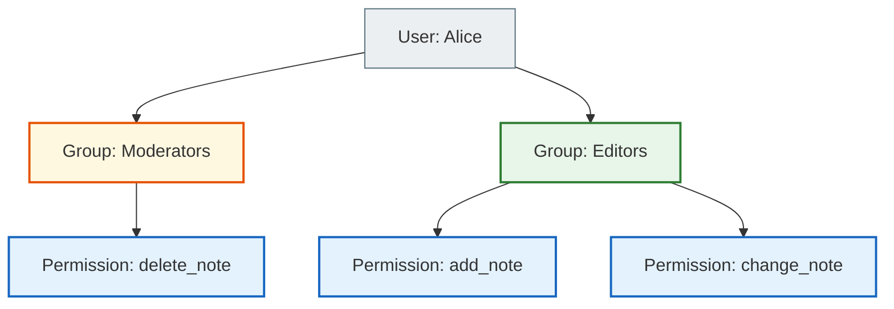
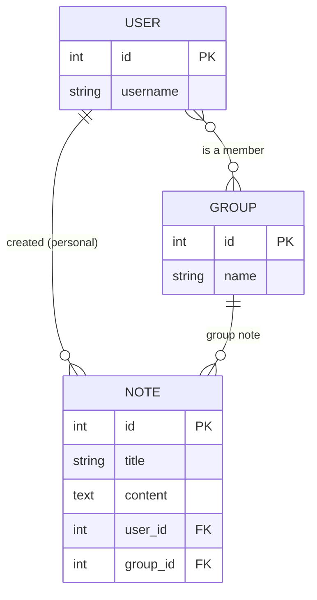

# Permissions and Groups — Permissions & Groups

> **Audience:** Students learning how to control access to resources in Django.
>
> **The main question of this document:** How do we make sure Alice can edit only **her own** notes, and not Bob's?

---

## 1. What are Permissions?

Django automatically creates 4 basic permissions for every model:

```python
# For the Note model Django automatically creates:
'notes_app.add_note'     # can create notes
'notes_app.view_note'    # can view
'notes_app.change_note'  # can edit
'notes_app.delete_note'  # can delete

# Usage example:
from django.contrib.auth.decorators import permission_required

@permission_required('notes_app.delete_note')  # ← checks the permission
def admin_delete_note(request, pk):
    # Only users with an explicit delete_note permission get here
    note = get_object_or_404(Note, pk=pk)
    note.delete()
```

---

## 2. Object-Level Permissions — Checking at the level of a specific object

**The problem:** `@permission_required('notes_app.change_note')` only checks *"can this user edit notes at all"*. It does not check *"does this particular note belong to them"*.

```python
# DANGEROUS — IDOR (Insecure Direct Object Reference):
@login_required
def note_edit(request, pk):
    note = get_object_or_404(Note, pk=pk)   # pk=42 → Alice edits Bob's note!
    # ...

# SAFE — we check the owner:
@login_required
def note_edit(request, pk):
    note = get_object_or_404(Note, pk=pk, user=request.user)   # pk=42 and user=Alice?
    # If note 42 belongs to Bob → Django returns 404 for Alice ✓
```

**What is IDOR (Insecure Direct Object Reference)?**

> Alice knows that a note's URL is `/notes/42/edit/`.
> She changes the number to `/notes/43/edit/` and tries to edit Bob's note.
> If the view doesn't check the owner, the attack succeeds!

```python
# Rule: always add user=request.user to get_object_or_404

# For OWN objects:
note = get_object_or_404(Note, pk=pk, user=request.user)

# For SHARED objects (your own OR in a group):
from django.core.exceptions import PermissionDenied
from django.db.models import Q

note = get_object_or_404(Note, pk=pk)
user_groups = request.user.groups.all()
has_access = (note.user == request.user) or (note.group and note.group in user_groups)
if not has_access:
    raise PermissionDenied   # → 403 Forbidden
```

---

## 3. Groups — managing access through roles

**The problem:** You have 50 moderators. Assigning 10 permissions to each of them by hand is a bad idea. When the rules change, you have to update 50 users.

**The solution:** Groups.

```
Instead of:
  Alice → [can_delete_note, can_edit_note, can_view_reports, ...]
  Bob   → [can_delete_note, can_edit_note, can_view_reports, ...]
  ...

Better:
  Group "Moderators" → [can_delete_note, can_edit_note, can_view_reports]
  Alice → Group "Moderators"
  Bob   → Group "Moderators"
  
  When permissions change → you update only the group ✓
```

### Groups and permissions architecture



---

## 4. Groups in our project — Shared access to notes

In `crispy_notes_chat_app` we use Django's built-in `Group` model **not for permissions**, but for **shared access to notes and shopping lists**.

**The idea:** Alice creates a group "Family" and adds Bob. When Alice creates a note and selects the "Family" group, Bob sees that note too.

```python
# models.py
from django.contrib.auth.models import Group

class Note(models.Model):
    user = models.ForeignKey(User, on_delete=models.CASCADE)  # personal owner
    group = models.ForeignKey(                                  # optional group
        Group, on_delete=models.SET_NULL, null=True, blank=True
    )
    title = models.CharField(max_length=200)
    content = models.TextField(blank=True)
```

**selectors.py** — the query "show all notes of the user and of their groups":
```python
from django.db.models import Q

def get_user_notes(user):
    user_groups = user.groups.all()
    return Note.objects.filter(
        Q(user=user) |                   # own notes
        Q(group__in=user_groups)         # group notes
    ).distinct()
    # Alice is in the "Family" and "Work" groups → she sees both her own and group notes
```

---

## 5. Managing groups — Group Views

The project has views for managing groups:

| URL | View | Action |
|-----|------|-----|
| `/groups/` | `group_list` | The user's list of groups |
| `/groups/new/` | `group_create` | Create a new group |
| `/groups/<pk>/` | `group_detail` | View members, add/remove them |
| `/groups/<pk>/delete/` | `group_delete` | Delete the group |

**Example: creating the "Family" group:**
```python
# services.py
def create_group(*, name, creator):
    group = Group.objects.create(name=name)
    group.user_set.add(creator)   # ← the creator automatically becomes the first member
    return group

# Adding a member:
def add_user_to_group(group, username):
    from django.contrib.auth.models import User
    try:
        user = User.objects.get(username=username)
    except User.DoesNotExist:
        return False, f'Юзера «{username}» не знайдено.'
    group.user_set.add(user)
    return True, ''
```

---

## 6. ER diagram: User, Group, Note



**Reading the diagram:**
- `USER ||--o{ NOTE` → one user can have many notes (`||` = one, `o{` = many or zero)
- `GROUP ||--o{ NOTE` → one group can have many notes
- `USER }o--o{ GROUP` → a user can be in several groups, and a group can have several users (M:N)

---

## Where is this in our project?

| File | What is implemented |
|------|----------------|
| `notes_app/models.py` | `Note.group FK`, `ShoppingList.group FK` |
| `notes_app/views.py` | `group_list`, `group_create`, `group_detail`, `group_delete` |
| `notes_app/services.py` | `create_group`, `add_user_to_group`, `remove_user_from_group` |
| `notes_app/selectors.py` | `get_user_notes` (Q filter), `get_user_groups`, `get_group_with_members` |
| `notes_app/forms.py` | `GroupCreateForm`, `GroupAddMemberForm` |
| `notes_app/templates/notes_app/` | `group_list.html`, `group_form.html`, `group_detail.html` |
