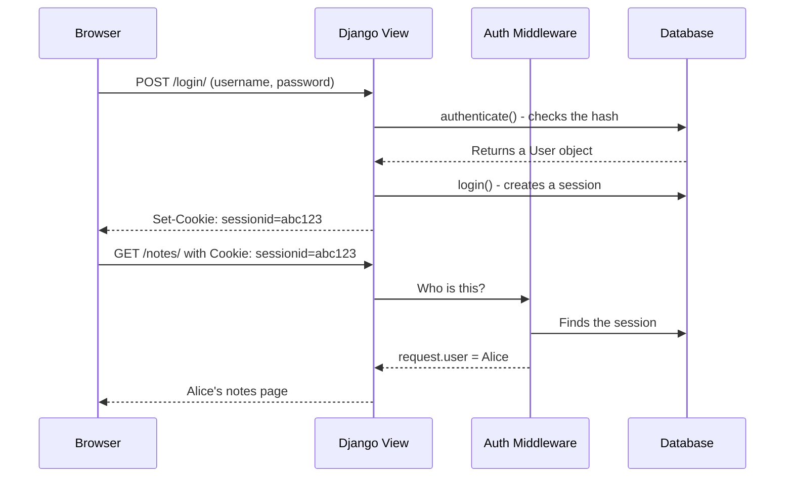
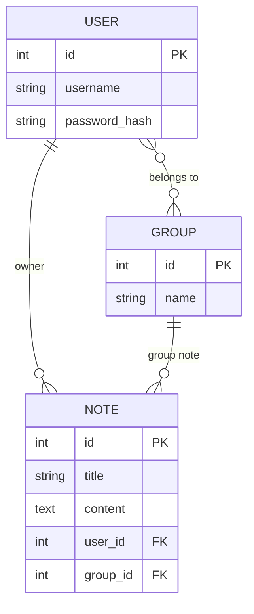

# Sessions, Login/Logout and Data Ownership

> **Audience:** Students learning how Django "remembers" a logged-in user between requests.

---

## 1. Why doesn't HTTP "remember" the user?

HTTP is a **stateless protocol**. Every request is like the first one. The server doesn't know who sent a request unless you tell it.

**Analogy:** Imagine a shop where the shop assistant forgets you every time. You have to show your passport again and again. Inconvenient? Django solves this with **sessions and cookies**.

---

## 2. How Django solves the problem: Cookies + Sessions

**Step 1: Login**
```
Alice → POST /login/ { username: 'alice', password: 'secret' }
               ↓
Django: authenticate('alice', 'secret') → checks the password hash → OK
               ↓
Django: login() → creates a session record in the database:
        | session_id         | user_id | created_at |
        | 'xK9mPq...'       |    42   | 2025-01-15 |
               ↓
Response: HTTP 302 Redirect
Headers: Set-Cookie: sessionid=xK9mPq...; HttpOnly; SameSite=Lax
```

**Step 2: Alice's next request**
```
The browser automatically sends: Cookie: sessionid=xK9mPq...
               ↓
SessionMiddleware: finds the session in the DB → loads it
               ↓
AuthenticationMiddleware: user_id=42 → request.user = User(id=42, username='alice')
               ↓
View: request.user already "knows" this is Alice ✓
```

**Step 3: Logout**
```
POST /accounts/logout/ (with a CSRF token)
               ↓
Django logout(): deletes the session from the DB
               ↓
Response: Set-Cookie: sessionid=; expires=Thu, 01 Jan 1970...
               ↓
The browser deletes the cookie. Alice becomes an AnonymousUser.
```

### Login/logout diagram



---

## 3. Data ownership and safe filtering

**The main security rule:** Every user sees ONLY their own data.

```python
# DANGEROUS — Alice sees the notes of all users:
def note_list(request):
    notes = Note.objects.all()   # ← A critical mistake!
    return render(request, 'notes.html', {'notes': notes})

# SAFE — Alice sees only her own notes:
@login_required
def note_list(request):
    notes = Note.objects.filter(user=request.user)   # ← Always filter!
    return render(request, 'notes.html', {'notes': notes})
```

### ER diagram: A user and their notes



**Explaining the relationships:**
- `user_id FK` — every note has an owner (required)
- `group_id FK` — a note may belong to a group (optional, null allowed)
- If `group_id = NULL` → a personal note
- If `group_id = 5` → a group note, visible to all members of group 5

---

## 4. URL routing and Django's built-in Views

Django provides ready-made views for login/logout — you don't need to write them yourself:

```python
# notes_project/urls.py
from django.contrib.auth import views as auth_views

urlpatterns = [
    # Django's built-in views for auth:
    path('accounts/', include('django.contrib.auth.urls')),
    # This includes:
    # /accounts/login/           → LoginView
    # /accounts/logout/          → LogoutView
    # /accounts/password_change/ → PasswordChangeView
    # /accounts/password_reset/  → PasswordResetView
    # ... and others
]
```

**settings.py** — redirect settings:
```python
LOGIN_URL = '/accounts/login/'         # where to redirect users who aren't logged in
LOGIN_REDIRECT_URL = '/notes/'         # where to go after a successful login
LOGOUT_REDIRECT_URL = '/accounts/login/'  # where to go after logout
```

---

## 5. Password Reset Flow

The full password reset cycle (already implemented in the project):

```
1. /accounts/password_reset/
   → Email entry form (password_reset_form.html)
   
2. POST email → Django looks for a user with this email
   → Generates a unique token (single-use, valid for 3 days by default — PASSWORD_RESET_TIMEOUT)
   → Sends an email with a link
   
   [DEV: the email is printed to the console — EMAIL_BACKEND = console]
   
3. /accounts/password_reset/done/
   → A "check your mail" message (password_reset_done.html)
   
4. /accounts/reset/<uidb64>/<token>/
   → New password form (password_reset_confirm.html)
   → Django checks the token. If it's invalid → an error message
   
5. Successful change → /accounts/reset/done/ (password_reset_complete.html)
```

---

## Where is this in our project?

| Concept | File | Line |
|-----------|------|--------|
| login/logout URLs | `notes_project/urls.py` | `include('django.contrib.auth.urls')` |
| Password reset templates | `templates/registration/password_reset_*.html` | all 5 files |
| Password change templates | `templates/registration/password_change_*.html` | 2 files |
| The "Забули пароль?" ("Forgot password?") link | `templates/registration/login.html` | `` |
| The "Змінити пароль" ("Change password") link | `templates/layouts/dashboard.html` | dropdown menu |
| EMAIL_BACKEND | `notes_project/settings.py` | `console.EmailBackend` |
