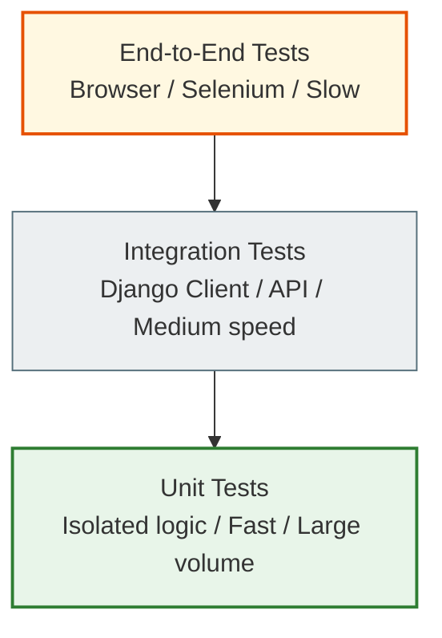
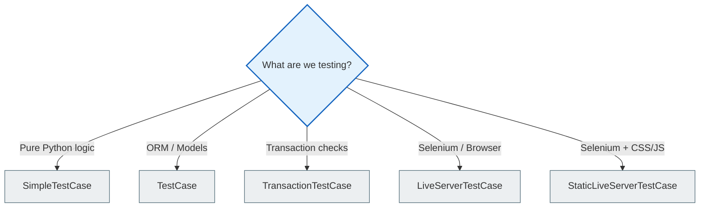
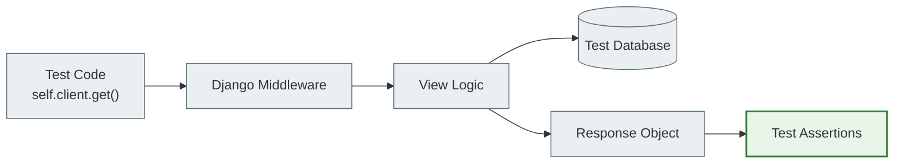
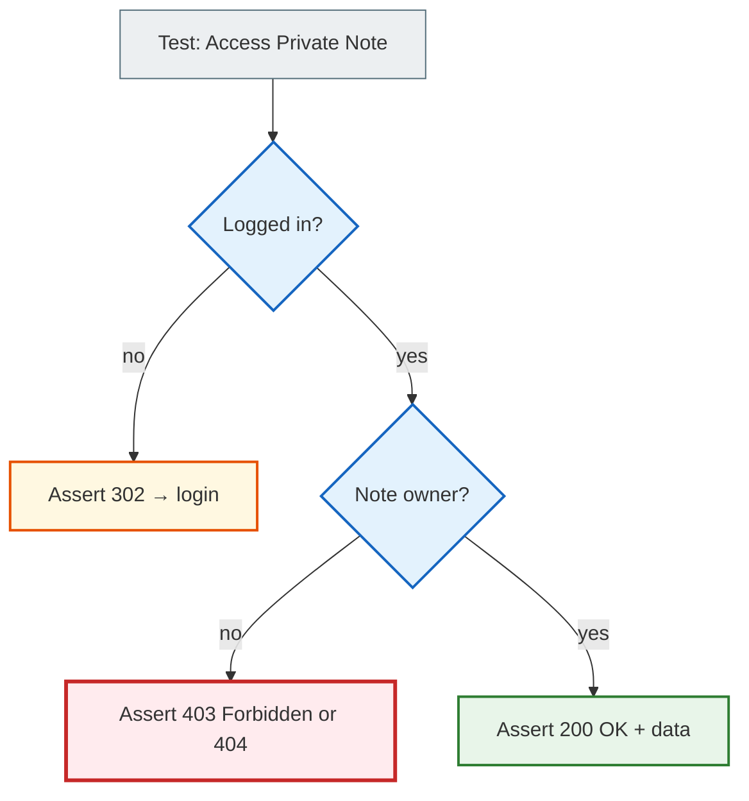
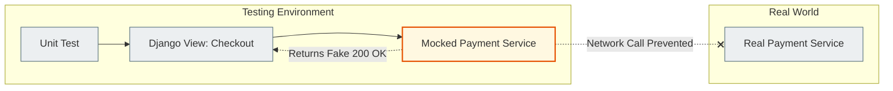
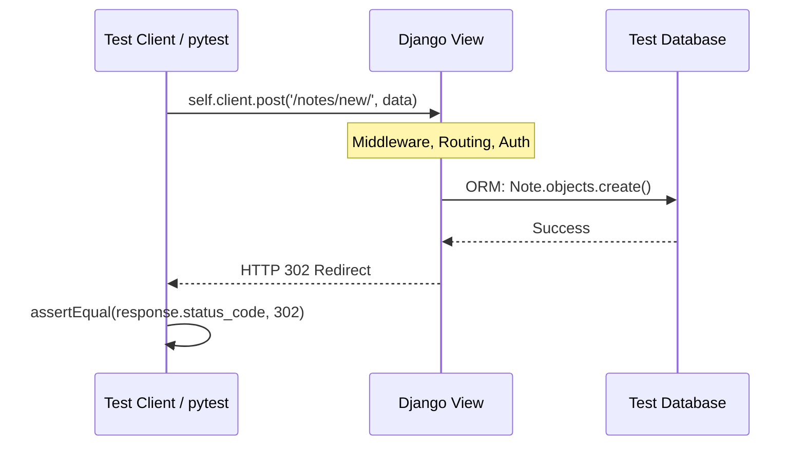
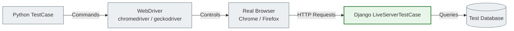
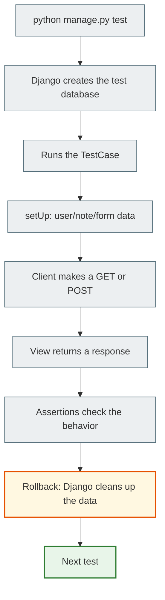

# Testing a Django application: the complete reference

> After this file you will be able to write Django tests with `TestCase`, understand the test database, check models/forms/views/URLs, test authorization, mock external services, write Selenium E2E tests, and read the results of `python manage.py test`.

---

## 1. Why testing exists

In backend development, bugs are inevitable — an application is a complex abstract model of the real world. Every time you make a change, you create risk. Changing one field in a model can break views, serializers, and templates across the whole project.

Testing exists as a **confidence mechanism**. By writing tests, you teach the application to check itself.

How experienced developers think about tests:

| Mental model | What it means |
|---|---|
| **Insurance policy** | Tests raise the alarm before a bug reaches production |
| **Contract** | A test pins down exactly what a function or endpoint promises to do |
| **Experiment** | You form a hypothesis ("invalid data → 400") and run the code to prove it |
| **Regression protection** | A bug fixed once never comes back |

**Limitation:** tests only check the scenarios you have explicitly described. They do not magically protect the application and do not catch unknown edge cases.

Django provides a test runner:

```bash
python manage.py test
```

It:

1. finds the tests;
2. creates a separate test database;
3. runs the checks;
4. cleans up the data;
5. shows the result.

---

## 2. Mental model: the test database

Django tests are a training copy of your application.

A real project has a production database. Tests must not touch it.

Django creates a separate test database:

```text
real database      -> do not touch
test database      -> create, populate, clean up
```

That's why in a test you can freely do:

```python
Note.objects.create(...)
```

This data exists only during the test and is fully isolated.

---

## 3. Types of tests



| Type | What it checks | Speed | Share |
|---|---|---|---|
| **Unit** | One function or method in isolation | Very fast | ~70% of tests |
| **Integration** | Interaction of components (view + DB + form) | Medium | ~20% of tests |
| **Functional** | API endpoint behavior: HTTP codes, JSON payload | Medium | — |
| **E2E** | The whole path from the browser to the DB | Slow | ~10% of tests |
| **Regression** | Reproduces a specific bug so it does not come back | Depends | — |

---

## 4. Django Testing Architecture

Django extends Python's `unittest` for web-specific scenarios.



| Class | Database | What for |
|---|---|---|
| `SimpleTestCase` | No access | URL tests, simple views without a DB |
| `TestCase` | Test database, rollback between tests | The most common choice (90% of cases) |
| `TransactionTestCase` | Real transaction behavior | `commit`, `rollback`, `select_for_update()` |
| `LiveServerTestCase` | Test DB + live HTTP server | Selenium |
| `StaticLiveServerTestCase` | Live server + static files | Selenium with CSS/JS |

---

## 5. A minimal notes example

Let's imagine a `notes` app.

`notes/models.py`:

```python
from django.conf import settings
from django.db import models


class Note(models.Model):
    owner = models.ForeignKey(
        settings.AUTH_USER_MODEL,
        on_delete=models.CASCADE,
        related_name="notes",
    )
    title = models.CharField(max_length=120)
    content = models.TextField()
    is_archived = models.BooleanField(default=False)
    created_at = models.DateTimeField(auto_now_add=True)

    def __str__(self):
        return self.title

    def archive(self):
        self.is_archived = True
        self.save(update_fields=["is_archived"])
```

What is worth testing here:

| Part | Test it? | Why |
|---|---|---|
| `CharField` stores a string | No | That tests Django itself |
| `__str__` returns the title | Yes | This is our behavior |
| `archive()` changes `is_archived` | Yes | This is our business logic |
| `owner` is a ForeignKey | Usually not | It is a model declaration |

---

## 6. Model tests

Structure:

```text
notes/
└── tests/
    └── test_models.py
```

```python
# notes/tests/test_models.py
from django.contrib.auth import get_user_model
from django.test import TestCase

from notes.models import Note


User = get_user_model()


class NoteModelTest(TestCase):
    def setUp(self):
        self.user = User.objects.create_user(username="student", password="pw")

    def test_note_str_returns_title(self):
        note = Note.objects.create(
            owner=self.user,
            title="First note",
            content="Hello",
        )

        self.assertEqual(str(note), "First note")

    def test_archive_marks_note_as_archived(self):
        note = Note.objects.create(
            owner=self.user,
            title="First note",
            content="Hello",
        )

        note.archive()
        note.refresh_from_db()  # re-read from the DB, not from memory

        self.assertTrue(note.is_archived)

    def test_note_creation_and_ownership(self):
        note = Note.objects.create(
            owner=self.user,
            title="My note",
            content="Testing models"
        )

        self.assertEqual(note.owner, self.user)
        self.assertFalse(note.is_archived)
```

Why `refresh_from_db()`?

The `archive()` method saves the changes to the database. `refresh_from_db()` re-reads the object from the DB and verifies that the change was really saved, not just made in Python's memory.

---

## 7. Form tests

`notes/forms.py`:

```python
from django import forms

from notes.models import Note


class NoteForm(forms.ModelForm):
    class Meta:
        model = Note
        fields = ["title", "content"]

    def clean_title(self):
        title = self.cleaned_data["title"].strip()

        if title.lower() == "admin":
            raise forms.ValidationError("Title cannot be admin.")

        return title
```

Tests:

```python
# notes/tests/test_forms.py
from django.test import TestCase

from notes.forms import NoteForm


class NoteFormTest(TestCase):
    def test_form_is_valid_with_title_and_content(self):
        form = NoteForm(data={"title": "My note", "content": "Hello"})
        self.assertTrue(form.is_valid())

    def test_form_is_invalid_without_title(self):
        form = NoteForm(data={"title": "", "content": "Hello"})
        self.assertFalse(form.is_valid())
        self.assertIn("title", form.errors)

    def test_form_strips_title_spaces(self):
        form = NoteForm(data={"title": "  My note  ", "content": "Hello"})
        self.assertTrue(form.is_valid())
        self.assertEqual(form.cleaned_data["title"], "My note")

    def test_form_rejects_reserved_title(self):
        form = NoteForm(data={"title": "admin", "content": "Hello"})
        self.assertFalse(form.is_valid())
        self.assertIn("title", form.errors)
```

What matters:

- in a form test we pass "raw" data, as if from an HTML form (a dictionary);
- then we call `form.is_valid()`;
- after a valid form you can inspect `cleaned_data`;
- after an invalid form we inspect `form.errors`.

---

## 8. URL tests

```python
# notes/tests/test_urls.py
from django.test import SimpleTestCase
from django.urls import resolve, reverse

from notes.views import note_list


class NoteUrlsTest(SimpleTestCase):
    def test_note_list_url_resolves_to_note_list_view(self):
        match = resolve(reverse("note_list"))
        self.assertEqual(match.func, note_list)

    def test_note_create_url_resolves_to_note_create_view(self):
        from notes.views import note_create
        match = resolve(reverse("note_create"))
        self.assertEqual(match.func, note_create)
```

No database is needed here, so we use `SimpleTestCase`.

---

## 9. View tests with the Django Client

Django's `self.client` is not a real browser. It is a fast test HTTP client.



It can:

- make a GET/POST request;
- go through URL routing, middleware, and the view;
- return a response with a status code, template, and context.

It **cannot**:

- execute JavaScript;
- check the real CSS layout;
- click a button like a browser does.

View:

```python
# notes/views.py
from django.contrib.auth.decorators import login_required
from django.shortcuts import render

from notes.models import Note


@login_required
def note_list(request):
    notes = Note.objects.filter(owner=request.user, is_archived=False)
    return render(request, "notes/note_list.html", {"notes": notes})
```

Test:

```python
# notes/tests/test_views.py
from django.contrib.auth import get_user_model
from django.test import TestCase
from django.urls import reverse

from notes.models import Note


User = get_user_model()


class NoteListViewTest(TestCase):
    def setUp(self):
        self.user = User.objects.create_user(username="student", password="pw")

    def test_anonymous_user_is_redirected_to_login(self):
        response = self.client.get(reverse("note_list"))
        self.assertEqual(response.status_code, 302)

    def test_logged_user_can_open_note_list(self):
        self.client.login(username="student", password="pw")
        response = self.client.get(reverse("note_list"))

        self.assertEqual(response.status_code, 200)
        self.assertTemplateUsed(response, "notes/note_list.html")

    def test_note_list_shows_only_current_user_notes(self):
        other_user = User.objects.create_user(username="other", password="pw")
        own_note = Note.objects.create(owner=self.user, title="Mine", content="Hello")
        Note.objects.create(owner=other_user, title="Not mine", content="Secret")

        self.client.login(username="student", password="pw")
        response = self.client.get(reverse("note_list"))

        notes = list(response.context["notes"])
        self.assertIn(own_note, notes)
        self.assertEqual(len(notes), 1)
```

The last test is important: it checks **ownership** — User A cannot see User B's notes.

---

## 10. POST tests: creating a note

```python
# notes/tests/test_views.py
class NoteCreateViewTest(TestCase):
    def setUp(self):
        self.user = User.objects.create_user(
            username="student",
            email="student@example.com",
            password="pw",
        )

    def test_logged_user_can_create_note(self):
        self.client.login(username="student", password="pw")

        response = self.client.post(reverse("note_create"), {
            "title": "Created from test",
            "content": "Hello",
        })

        self.assertEqual(response.status_code, 302)
        self.assertTrue(Note.objects.filter(title="Created from test").exists())

    def test_created_note_belongs_to_current_user(self):
        self.client.login(username="student", password="pw")

        self.client.post(reverse("note_create"), {
            "title": "Owner test",
            "content": "Hello",
        })

        note = Note.objects.get(title="Owner test")
        self.assertEqual(note.owner, self.user)

    def test_invalid_form_does_not_create_note(self):
        self.client.login(username="student", password="pw")

        response = self.client.post(reverse("note_create"), {
            "title": "",
            "content": "Hello",
        })

        self.assertEqual(response.status_code, 200)  # the form again — no redirect
        self.assertFalse(Note.objects.exists())
```

What we checked:

- a POST request with valid data → the note is saved + redirect;
- the owner is taken from `request.user`, not from the form;
- an invalid POST → the form is returned back (no redirect).

---

## 11. Testing authorization and ownership

The most important class of tests for a notes app — we check that User A cannot read/modify User B's data.



```python
# notes/tests/test_views.py
class NoteAuthorizationTest(TestCase):
    def setUp(self):
        self.alice = User.objects.create_user(username="alice", password="pw")
        self.bob   = User.objects.create_user(username="bob",   password="pw")
        self.alice_note = Note.objects.create(
            owner=self.alice,
            title="Alice's Secret",
            content="Private",
        )

    def test_anonymous_access_redirects_to_login(self):
        response = self.client.get(f"/notes/{self.alice_note.id}/edit/")
        self.assertEqual(response.status_code, 302)
        self.assertIn("/accounts/login/", response["Location"])

    def test_alice_can_edit_her_own_note(self):
        self.client.login(username="alice", password="pw")
        response = self.client.post(
            f"/notes/{self.alice_note.id}/edit/",
            {"title": "Updated", "content": "Changed"},
        )
        self.assertEqual(response.status_code, 302)

    def test_bob_cannot_edit_alice_note(self):
        self.client.login(username="bob", password="pw")
        response = self.client.post(
            f"/notes/{self.alice_note.id}/edit/",
            {"title": "Hacked", "content": "By bob"},
        )
        # 403 Forbidden or 404 depending on the view implementation
        self.assertIn(response.status_code, [403, 404])
        # The note has NOT changed
        self.alice_note.refresh_from_db()
        self.assertEqual(self.alice_note.title, "Alice's Secret")
```

`force_login()` vs `login()`:

| Method | How it works | When to use |
|---|---|---|
| `self.client.login(username=, password=)` | Checks the password via the auth backend | When you test the login process itself |
| `self.client.force_login(user)` | Sets up the session immediately | In 95% of tests — faster |

---

## 12. Django Test Client: useful assertions

| Assertion | What it checks | Example |
|---|---|---|
| `assertEqual(a, b)` | Equality | `self.assertEqual(response.status_code, 200)` |
| `assertTrue(x)` | Truth | `self.assertTrue(form.is_valid())` |
| `assertFalse(x)` | Falsity | `self.assertFalse(form.is_valid())` |
| `assertIn(a, b)` | Membership | `self.assertIn("title", form.errors)` |
| `assertTemplateUsed` | Template | `self.assertTemplateUsed(response, "notes/list.html")` |
| `assertRedirects` | Redirect | `self.assertRedirects(response, reverse("note_list"))` |
| `assertContains` | Text in the HTML | `self.assertContains(response, "Alice's Note")` |
| `assertNotContains` | Text is absent | `self.assertNotContains(response, "Bob's Secret")` |
| `assertNumQueries` | Number of SQL queries | `with self.assertNumQueries(2): ...` |

An `assertRedirects` example:

```python
def test_create_note_redirects_to_list(self):
    self.client.login(username="student", password="pw")

    response = self.client.post(reverse("note_create"), {
        "title": "Redirect test",
        "content": "Hello",
    })

    self.assertRedirects(response, reverse("note_list"))
```

---

## 13. Checking for N+1 with `assertNumQueries`

The N+1 problem: a page makes one query for the list and then one more for each object.

For 10 notes — 11 queries. For 1000 — 1001 queries. This kills performance.

```python
def test_note_list_query_count_is_stable(self):
    for index in range(10):
        Note.objects.create(
            owner=self.user,
            title=f"Note {index}",
            content="Hello",
        )

    self.client.login(username="student", password="pw")

    with self.assertNumQueries(3):
        self.client.get(reverse("note_list"))
```

The number `3` must be determined after an actual run. The goal is for the number of queries not to grow as the number of notes grows.

---

## 14. Mocking external services

A mock replaces a real object or function with a fake for the duration of a single test.

**Why:** if the application sends emails, charges credit cards, or calls an external API, during tests we **do not want** to actually contact those services. It is slow, expensive, and makes tests unreliable.



`notes/services.py`:

```python
from django.core.mail import send_mail


def send_note_created_email(email, title):
    send_mail(
        subject="Note created",
        message=f"Your note '{title}' was created.",
        from_email="noreply@example.com",
        recipient_list=[email],
    )
```

A test with `@patch`:

```python
# notes/tests/test_services.py
from unittest.mock import patch
from django.test import SimpleTestCase

from notes.services import send_note_created_email


class NoteEmailServiceTest(SimpleTestCase):
    @patch("notes.services.send_mail")
    def test_send_note_created_email_calls_send_mail(self, mock_send_mail):
        send_note_created_email("student@example.com", "My note")

        mock_send_mail.assert_called_once_with(
            subject="Note created",
            message="Your note 'My note' was created.",
            from_email="noreply@example.com",
            recipient_list=["student@example.com"],
        )
```

A view test + mock:

```python
# notes/tests/test_views.py
from unittest.mock import patch

class NoteCreateViewTest(TestCase):
    ...

    @patch("notes.views.send_note_created_email")  # mock it where it is used
    def test_logged_user_can_create_note(self, mock_send_email):
        self.client.login(username="student", password="pw")

        response = self.client.post(reverse("note_create"), {
            "title": "Created from test",
            "content": "Hello",
        })

        self.assertRedirects(response, reverse("note_list"))
        mock_send_email.assert_called_once_with(
            "student@example.com",
            "Created from test",
        )

    @patch("notes.views.send_note_created_email")
    def test_invalid_form_does_not_send_email(self, mock_send_email):
        self.client.login(username="student", password="pw")

        self.client.post(reverse("note_create"), {
            "title": "",
            "content": "Hello",
        })

        mock_send_email.assert_not_called()
```

Why `patch("notes.views.send_note_created_email")` and not `patch("notes.services.send_note_created_email")`?

Because the view imports and **uses** this name in the file `notes/views.py`. We mock the place where it is used, not where it is defined.

---

## 15. Sequence diagram: request lifecycle



---

## 16. Coverage

Installation:

```bash
pip install coverage
```

Running:

```bash
coverage run manage.py test
coverage report
coverage html
```

How to read it:

```text
Name                    Stmts   Miss  Cover
-------------------------------------------
notes/models.py            18      0   100%
notes/forms.py             20      2    90%
notes/views.py             45      8    82%
```

What coverage shows:

- which lines were executed during the tests;
- which files are barely touched;
- where the "dark zones" are.

What coverage **does not show**:

- whether the assertions are correct;
- whether important business scenarios are tested;
- whether you are accidentally testing nonsense.

> 80% meaningful coverage is better than 100% from tests that check nothing important.

---

## 17. pytest for Django

Python's `unittest` (on which `TestCase` is built) is a proven system. But modern backends often use **pytest**.

| Aspect | unittest (Django TestCase) | pytest |
|---|---|---|
| Style | OOP: `class MyTest(TestCase)`, `self.assertEqual()` | Functional: `def test_...`, plain `assert` |
| Fixtures | `setUp()` / `tearDown()` — run before every test | `@pytest.fixture` — injected only into the tests that need it |
| The same test with different data | A separate method for each scenario | `@pytest.mark.parametrize` |
| Failure messages | Standard | Assertion rewriting — shows the exact values |
| Django integration | Built in | The `pytest-django` plugin |

An `@pytest.mark.parametrize` example:

```python
import pytest
from notes.forms import NoteForm


@pytest.mark.parametrize("title,valid", [
    ("My note", True),
    ("", False),
    ("admin", False),
    ("  ", False),
])
def test_note_form_title_validation(title, valid):
    form = NoteForm(data={"title": title, "content": "Hello"})
    assert form.is_valid() == valid
```

Instead of 4 separate test functions — one parametrized function.

Fixtures for a DRY setUp:

```python
# conftest.py
import pytest
from django.contrib.auth.models import User


@pytest.fixture
def alice(db):
    return User.objects.create_user(username="alice", password="pw")


@pytest.fixture
def alice_note(alice):
    from notes.models import Note
    return Note.objects.create(owner=alice, title="Alice's Note", content="Hello")
```

```python
# test_views.py
def test_note_owner_can_view(client, alice, alice_note):
    client.force_login(alice)
    response = client.get(f"/notes/{alice_note.id}/")
    assert response.status_code == 200
```

---

## 18. E2E tests: Selenium

While unit and integration tests prove that isolated backend components work with mathematical precision, **E2E tests** prove that the whole system works as a single product.

E2E tests open a real browser, click buttons, fill in forms, and check that the final HTML is exactly what a real user would see.



Selenium vs the Django Test Client:

| | Django Test Client | Selenium |
|---|---|---|
| Browser | No (Python HTTP) | Yes (real Chrome/Firefox) |
| JavaScript | Not executed | Executed |
| CSS rendering | Not checked | Checked |
| Speed | Very fast | Slow (~3–15s per test) |
| Access to `response.context` | Yes | No |
| When to use | 95% of view tests | Critical user flows |

### Basic structure

```python
# notes/tests/test_e2e.py
import unittest
from django.contrib.auth import get_user_model
from django.contrib.staticfiles.testing import StaticLiveServerTestCase

try:
    from selenium import webdriver
    from selenium.webdriver.common.by import By
    from selenium.webdriver.chrome.options import Options as ChromeOptions
    from selenium.webdriver.support.ui import WebDriverWait
    from selenium.webdriver.support import expected_conditions as EC
    SELENIUM_AVAILABLE = True
except ImportError:
    SELENIUM_AVAILABLE = False


User = get_user_model()


def _make_headless_driver():
    options = ChromeOptions()
    options.add_argument("--headless=new")
    options.add_argument("--no-sandbox")
    options.add_argument("--disable-dev-shm-usage")
    return webdriver.Chrome(options=options)  # Selenium Manager auto-downloads chromedriver


@unittest.skipUnless(SELENIUM_AVAILABLE, "selenium not installed — pip install selenium")
class NoteAppE2ETest(StaticLiveServerTestCase):
    @classmethod
    def setUpClass(cls):
        super().setUpClass()
        if SELENIUM_AVAILABLE:
            cls.driver = _make_headless_driver()
            cls.driver.implicitly_wait(5)

    @classmethod
    def tearDownClass(cls):
        if SELENIUM_AVAILABLE:
            cls.driver.quit()
        super().tearDownClass()

    def setUp(self):
        self.user = User.objects.create_user(
            username="student",
            email="student@example.com",
            password="password123",
        )

    def test_login_and_create_note(self):
        login_url = f"{self.live_server_url}/accounts/login/"
        self.driver.get(login_url)

        self.driver.find_element(By.NAME, "username").send_keys("student")
        self.driver.find_element(By.NAME, "password").send_keys("password123")
        self.driver.find_element(By.CSS_SELECTOR, "[type='submit']").click()

        # Wait for the redirect — click() is asynchronous
        WebDriverWait(self.driver, 5).until(EC.url_changes(login_url))

        self.assertIn("/notes/", self.driver.current_url)
```

### Waiting strategies

Pages load dynamically. Selenium may click an element before it appears in the DOM.

| Strategy | How | When |
|---|---|---|
| Implicit wait | `driver.implicitly_wait(5)` | Globally for all `find_element` calls |
| Explicit wait | `WebDriverWait(driver, 5).until(condition)` | For a specific condition (URL change, element clickable) |
| `time.sleep()` | DO NOT use it | Needlessly slow or unreliable |

```python
# Explicit wait: wait until the button becomes clickable
confirm_btn = WebDriverWait(self.driver, 5).until(
    EC.element_to_be_clickable((By.ID, "confirm-delete"))
)
confirm_btn.click()

# Explicit wait: wait for the URL to change after login
WebDriverWait(self.driver, 5).until(
    EC.url_changes(f"{self.live_server_url}/accounts/login/")
)
```

### The session cookie trick

Instead of filling in the login form in the browser (slow and dependent on the form's state), use the session cookie:

```python
def _login_via_cookie(self, user):
    # 1. Log in via the Django Test Client
    self.client.force_login(user)
    session_cookie = self.client.cookies["sessionid"]

    # 2. Open any page of the domain (the browser needs an open page)
    self.driver.get(f"{self.live_server_url}/")

    # 3. Pass the session cookie to Selenium
    self.driver.add_cookie({
        "name":  "sessionid",
        "value": session_cookie.value,
        "path":  "/",
    })
```

### Selecting elements

| Method | Example | Reliability |
|---|---|---|
| `By.ID` | `By.ID, "login-btn"` | The most reliable |
| `By.NAME` | `By.NAME, "username"` | Excellent for forms |
| `By.CSS_SELECTOR` | `By.CSS_SELECTOR, ".note-card > h2"` | Powerful |
| `By.XPATH` | `By.XPATH, "//button[text()='Delete']"` | Useful, but brittle |

Add `id` or `data-test-id` attributes to the HTML specifically for tests:

```html
<button id="submit-note" type="submit">Save</button>
<a id="create-note-link" href="">Create note</a>
```

### Common Selenium mistakes

| Error | Cause | Fix |
|---|---|---|
| `NoSuchElementException` | Wrong selector or the page hasn't loaded yet | Check the selector + implicit wait |
| `StaleElementReferenceException` | The DOM was updated after the element was found | Re-find the element after the DOM update |
| The test fails intermittently (flaky) | Animation or AJAX | `WebDriverWait` instead of `time.sleep()` |
| ChromeDriver mismatch | chromedriver version != Chrome | Selenium Manager resolves it automatically |

---

## 19. Selenium in Docker/CI

A CI server has no monitor. There are three strategies:

### A — headless Chrome in the Dockerfile

```dockerfile
RUN apt-get update && apt-get install -y chromium chromium-driver \
    && rm -rf /var/lib/apt/lists/*
```

```python
options = ChromeOptions()
options.add_argument("--headless=new")
options.add_argument("--no-sandbox")
options.add_argument("--disable-dev-shm-usage")
driver = webdriver.Chrome(options=options)
```

### B — official Selenium Docker images

```yaml
# docker-compose.yml
services:
  web:
    build: .
    command: python manage.py test
    environment:
      - SELENIUM_REMOTE_URL=http://selenium:4444/wd/hub
    depends_on:
      selenium:
        condition: service_healthy

  selenium:
    image: selenium/standalone-chrome:latest
    shm_size: "2gb"
    healthcheck:
      test: ["CMD", "curl", "-f", "http://localhost:4444/status"]
      interval: 5s
      retries: 5
```

```python
import os

SELENIUM_REMOTE_URL = os.environ.get("SELENIUM_REMOTE_URL")

def _make_driver():
    if SELENIUM_REMOTE_URL:
        return webdriver.Remote(
            command_executor=SELENIUM_REMOTE_URL,
            options=webdriver.ChromeOptions(),
        )
    options = ChromeOptions()
    options.add_argument("--headless=new")
    return webdriver.Chrome(options=options)
```

### C — GitHub Actions

```yaml
services:
  selenium:
    image: selenium/standalone-chrome:latest
    options: --shm-size=2gb
    ports:
      - 4444:4444

steps:
  - name: Run tests
    env:
      SELENIUM_REMOTE_URL: http://localhost:4444/wd/hub
    run: python manage.py test
```

---

## 20. Real-world engineering: strategy by domain

The testing strategy depends on the business domain:

| Domain | Test focus |
|---|---|
| **Notes / Blog** | Ownership: User A cannot see User B's data. An `alice` vs `bob` test for all views. |
| **Ecommerce** | E2E checkout flow. Unit tests for price calculation. Mock the external payment gateway (Stripe). |
| **Dashboard / Analytics** | `assertNumQueries` — N+1 is not allowed. Performance is critical. |
| **API** | JSON payload contracts. HTTP status codes (201 vs 403). Token auth. |
| **Auth/Permissions** | A test for each access level: anonymous, user, staff, superuser. |

Rules for a notes app in particular:

1. Most tests should have `alice` and `bob` — we test tenant isolation.
2. Every view should have an anonymous redirect test.
3. An ownership test: User B cannot edit/delete/view someone else's note.

---

## 21. Common beginner mistakes

| Mistake | Why it happens | How to fix it |
| ------- | ------------ | ------------ |
| Testing the Django ORM instead of their own logic | They want to cover the model | Test `__str__`, methods, constraints, ownership |
| Checking only `status_code == 200` | It's the easiest thing | Add template, context, and content assertions |
| Not testing the anonymous user | Locally they are always logged in | Add a redirect test for every protected URL |
| Not testing another user | They think only about the happy path | Create User A and User B |
| Mocking the form or model | They want isolation | Test forms/models for real through the test DB |
| Starting straight with Selenium | It looks "complete" | First model → form → view tests |
| Not adding stable selectors | HTML is for eyes, not tests | Add `id` or `data-test-id` for E2E |
| Using `time.sleep()` | An easy way to wait | Use `WebDriverWait` |
| There's `coverage`, but the assertions are weak | They look at the number | Check the substance of the tests, not the percentage |
| Hardcoding `/notes/` in tests | Laziness | Use `reverse("note_list")` |

---

## 22. The main diagram: testing architecture



---

## 23. Practice

1. Create a `Note` model with `owner`, `title`, `content`, `is_archived`.
2. Write a test for `__str__`.
3. Add an `archive()` method and a test for it.
4. Create a `NoteForm` and tests for valid/invalid/strip/reserved title.
5. Create a `note_list` view and check: anonymous redirect, logged-in user gets 200, User A cannot see User B.
6. Create a `note_create` view and check: POST → note saved, owner = request.user, invalid → no redirect.
7. Add an email service + a mock in the view test.
8. Write one Selenium smoke test: login → create note → note visible.
9. Run coverage and find the uncovered lines.

---

## 24. Self-check questions

1. Why does Django create a separate test database?
2. How does the Django `Client` differ from Selenium?
3. Why test User A vs User B?
4. When do you need `SimpleTestCase`?
5. Why is `patch("notes.services.send_note_created_email")` wrong, while `patch("notes.views.send_note_created_email")` is right?
6. What is `force_login` and how does it differ from `login()`?
7. Why do you need `WebDriverWait` in Selenium, and why is `time.sleep()` bad?
8. What can coverage show, and what can't it?
9. Why are ownership tests critical for a notes app?
10. When is it worth using `pytest` instead of `unittest`?
