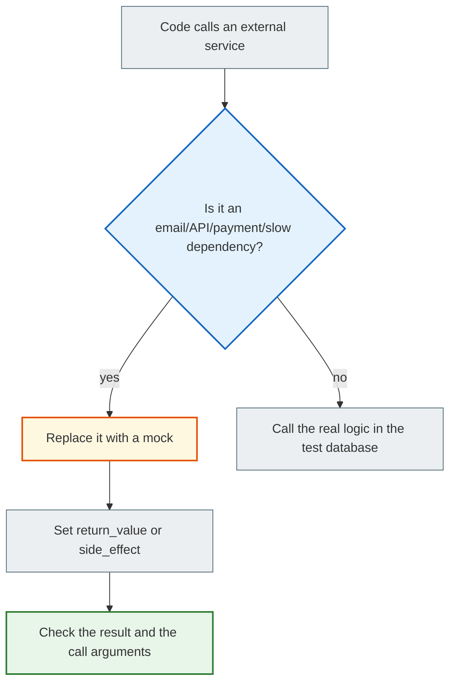

# Mock and patch: how to substitute email, APIs, and payments in tests

> After this file you will understand what a mock is, when you need one, how `patch` works, why it matters to mock the right path, and how not to turn your tests into a fake show.

---

## 1. Why you need this

In a real Django project, code often interacts with the outside world:

- sends email;
- calls a payment gateway;
- makes HTTP requests to an API;
- writes a file;
- reads the current time;
- calls a slow service.

In tests we don't want to:

- send real emails;
- charge real money;
- wait on a slow network;
- depend on someone else's server;
- have a test break because of an unstable internet connection.

A mock lets you replace a real dependency with a controlled object.

---

## 2. Mental model

A mock is a stunt double for an actor at a rehearsal.

In the real movie, the actor jumps off a roof. At a rehearsal that is dangerous, so a stunt double is used.

The same goes for a test:

- we don't call the real email service;
- we don't touch the payment gateway;
- but we check that our code correctly called the "stunt double."

---

## 3. The simplest example

`app/services.py`:

```python
def send_email(email):
    print(f"Sending email to {email}")


def register_user(email):
    # the user creation logic could be here
    send_email(email)
```

Test:

```python
from unittest.mock import patch

from app.services import register_user


@patch("app.services.send_email")
def test_registration_sends_email(mock_send_email):
    register_user("student@example.com")

    mock_send_email.assert_called_once_with("student@example.com")
```

What happens:

| Line | Explanation |
|---|---|
| `@patch("app.services.send_email")` | Temporarily replaces `send_email` |
| `mock_send_email` | A fake function instead of the real one |
| `register_user(...)` | We run the code that should trigger the email |
| `assert_called_once_with(...)` | We check that the call happened exactly once and with the right argument |

---

## 4. The most important rule: patch where used

This is where beginners trip up most often.

You must mock not where the function is defined, but where it is used.

Example:

`app/email.py`:

```python
def send_email(email):
    ...
```

`app/services.py`:

```python
from app.email import send_email


def register_user(email):
    send_email(email)
```

Here `register_user` uses the name `send_email` inside `app.services`.

The correct patch:

```python
@patch("app.services.send_email")
def test_registration_sends_email(mock_send_email):
    ...
```

Not this one:

```python
@patch("app.email.send_email")
def test_registration_sends_email(mock_send_email):
    ...
```

Why? Because `app.services` has already imported the function into its namespace. The code under test looks at `app.services.send_email`.

---

## 5. Mock return value

A payment gateway example:

`shop/services.py`:

```python
class PaymentGateway:
    def charge(self, amount):
        # a real request to the payment system
        ...


def checkout(amount):
    gateway = PaymentGateway()
    success = gateway.charge(amount)

    if not success:
        return "payment_failed"

    return "paid"
```

Test:

```python
from unittest.mock import patch

from shop.services import checkout


@patch("shop.services.PaymentGateway.charge")
def test_checkout_success(mock_charge):
    mock_charge.return_value = True

    result = checkout(50)

    assert result == "paid"
    mock_charge.assert_called_once_with(50)


@patch("shop.services.PaymentGateway.charge")
def test_checkout_payment_failed(mock_charge):
    mock_charge.return_value = False

    result = checkout(50)

    assert result == "payment_failed"
```

Here we don't call the real payment service. We check how our code reacts to success and failure.

---

## 6. Mock side effect: simulating an error

Sometimes an external service fails.

```python
from unittest.mock import patch

import pytest

from shop.services import checkout


@patch("shop.services.PaymentGateway.charge")
def test_checkout_gateway_error(mock_charge):
    mock_charge.side_effect = TimeoutError("gateway timeout")

    with pytest.raises(TimeoutError):
        checkout(50)
```

Or, if your code is supposed to handle the error:

```python
def checkout(amount):
    gateway = PaymentGateway()

    try:
        success = gateway.charge(amount)
    except TimeoutError:
        return "payment_unavailable"

    if not success:
        return "payment_failed"

    return "paid"
```

Test:

```python
@patch("shop.services.PaymentGateway.charge")
def test_checkout_handles_gateway_timeout(mock_charge):
    mock_charge.side_effect = TimeoutError("gateway timeout")

    result = checkout(50)

    assert result == "payment_unavailable"
```

---

## 7. Mocking Django email

Django has a test email backend, but sometimes you want to check the call to your own service.

`notes/services.py`:

```python
from django.core.mail import send_mail


def send_note_created_email(email, title):
    send_mail(
        subject="Note created",
        message=f"Your note '{title}' was created.",
        from_email="noreply@example.com",
        recipient_list=[email],
    )
```

Test:

```python
from unittest.mock import patch

from notes.services import send_note_created_email


@patch("notes.services.send_mail")
def test_send_note_created_email_calls_django_send_mail(mock_send_mail):
    send_note_created_email("student@example.com", "My note")

    mock_send_mail.assert_called_once_with(
        subject="Note created",
        message="Your note 'My note' was created.",
        from_email="noreply@example.com",
        recipient_list=["student@example.com"],
    )
```

---

## 8. When a mock is useful and when it is harmful

| Situation | Mock? | Why |
|---|---|---|
| Email | Yes | We don't want real emails |
| Payment gateway | Yes | We don't want real payments |
| Weather API | Yes | We don't depend on the network |
| `Note.objects.create()` | No | Better checked through the test database |
| Form validation | Usually not | This is your real logic |
| A small pure function | No | It's cheaper to call it for real |

The rule:

> Mock the external boundaries of the system, not the whole system.

A bad test:

```python
@patch("notes.views.NoteForm")
@patch("notes.views.Note")
@patch("notes.views.send_email")
def test_note_create(mock_email, mock_note, mock_form):
    ...
```

Almost everything is mocked here. Such a test can pass even if the real form, model, and view don't work together.

Better:

- check the form and model for real through the test database;
- mock the email.

---

## 9. Mermaid diagram



---

## 10. Common beginner mistakes

| Mistake | Why it happens | How to fix it |
| ------- | ------------ | ------------ |
| Mocking the wrong path | They didn't understand the import namespace | Patch where used |
| Mocking everything in sight | They want to "isolate" | Mock only the external boundaries |
| Not checking the arguments | They look only at `called` | Use `assert_called_once_with` |
| A mock makes the test green but meaningless | All the logic has been replaced | Keep the real model/form/view where possible |
| Not testing API errors | They only checked success | Add a `side_effect` |

---

## 11. Practice

1. Create `notifications.py` with a function `send_welcome_email(email)`.
2. Create `services.py` with a function `register_user(email)` that calls `send_welcome_email`.
3. Write a test that mocks the email.
4. Deliberately mock the wrong path and see what happens.
5. Write a payment example:
   - success;
   - failed;
   - timeout.

---

## 12. Self-check questions

1. What is a mock?
2. Why can't you call a real payment gateway in a test?
3. What does "patch where used" mean?
4. How does `return_value` differ from `side_effect`?
5. Why shouldn't a mock be used for everything?
