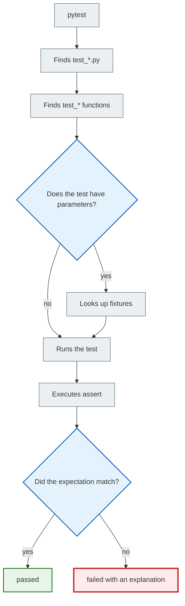

# pytest: short tests, fixtures, and pytest-django

> After this file you will be able to write tests with `pytest`, run them, use fixtures and parametrization, and hook pytest up to a Django project.

---

## 1. Why you need this

`pytest` is often chosen because it lets you write tests more simply:

```python
def test_add_two_numbers():
    assert add(2, 3) == 5
```

No class, no `self.assertEqual`, no extra boilerplate.

But simpler syntax does not mean "less thinking." A good pytest test still needs a clear expectation, an understandable name, and sensible test data.

Installation:

```bash
pip install pytest
```

Running:

```bash
pytest
```

---

## 2. Mental model

`pytest` is a test runner that is very good at finding tests and supplying them with the data they need.

Imagine a test says:

```python
def test_user_has_email(user_data):
    ...
```

`pytest` sees the `user_data` parameter and asks:

> "Do I have a fixture with that name?"

If it does, it runs the fixture and passes the result into the test.

---

## 3. A first example from scratch

Structure:

```text
testing_playground/
├── math_utils.py
└── test_math_utils.py
```

`math_utils.py`:

```python
def add(a, b):
    return a + b


def is_even(number):
    return number % 2 == 0
```

`test_math_utils.py`:

```python
from math_utils import add, is_even


def test_add_two_numbers():
    result = add(2, 3)

    assert result == 5


def test_four_is_even():
    assert is_even(4)


def test_five_is_not_even():
    assert not is_even(5)
```

Running:

```bash
pytest
```

Result:

```text
3 passed in 0.03s
```

---

## 4. How pytest finds tests

The usual rules:

| What | Rule | Example |
|---|---|---|
| File | `test_*.py` or `*_test.py` | `test_math_utils.py` |
| Function | `test_*` | `test_add_two_numbers` |
| Class | `Test*` without `__init__` | `class TestCart:` |

pytest can also run unittest tests, but while learning it's better not to mix styles in one file without a reason.

---

## 5. A plain `assert`

pytest uses the ordinary Python `assert`.

```python
def test_add_two_numbers():
    assert add(2, 3) == 5
```

If a test fails, pytest shows the details.

Example:

```text
E       assert -1 == 5
```

This is convenient: you can see the actual result and the expected value.

Comparison:

| unittest | pytest |
|---|---|
| `self.assertEqual(result, 5)` | `assert result == 5` |
| `self.assertTrue(user.is_active)` | `assert user.is_active` |
| `self.assertFalse(form.is_valid())` | `assert not form.is_valid()` |
| `self.assertIn("title", errors)` | `assert "title" in errors` |

---

## 6. Fixtures: test data without duplication

The problem:

```python
def test_user_has_email():
    user = {"username": "student", "email": "student@example.com"}

    assert user["email"] == "student@example.com"


def test_user_has_username():
    user = {"username": "student", "email": "student@example.com"}

    assert user["username"] == "student"
```

The data is duplicated.

The solution:

```python
import pytest


@pytest.fixture
def user_data():
    return {
        "username": "student",
        "email": "student@example.com",
    }


def test_user_has_email(user_data):
    assert user_data["email"] == "student@example.com"


def test_user_has_username(user_data):
    assert user_data["username"] == "student"
```

What happens:

1. pytest sees the `user_data` parameter;
2. looks for a fixture named `user_data`;
3. runs the fixture;
4. passes the result into the test.

---

## 7. `conftest.py`: shared fixtures

If a fixture is needed by many files, it is often placed in `conftest.py`.

```text
tests/
├── conftest.py
├── test_users.py
└── test_notes.py
```

`conftest.py`:

```python
import pytest


@pytest.fixture
def note_data():
    return {
        "title": "Test note",
        "content": "Hello",
    }
```

`test_notes.py`:

```python
def test_note_has_title(note_data):
    assert note_data["title"] == "Test note"
```

You don't need to import `note_data`. pytest finds the fixture by itself.

---

## 8. Parametrization: many scenarios without copy-paste

Bad:

```python
def test_empty_title_is_invalid():
    ...


def test_empty_content_is_invalid():
    ...


def test_long_title_is_invalid():
    ...
```

Better:

```python
import pytest


@pytest.mark.parametrize(
    "title, content",
    [
        ("", "Text"),
        ("Valid title", ""),
        ("x" * 256, "Text"),
    ],
)
def test_note_form_invalid_data(title, content):
    form = NoteForm(data={"title": title, "content": content})

    assert not form.is_valid()
```

pytest will run this test three times with different data.

When parametrization is useful:

| Situation | Example |
|---|---|
| Several invalid inputs | `""`, `None`, a very long string |
| Several expected results | slug generation |
| Checking edge cases | `0`, `-1`, max value |

---

## 9. pytest-django

For Django you need a plugin:

```bash
pip install pytest-django
```

Usually a `pytest.ini` file is added:

```ini
[pytest]
DJANGO_SETTINGS_MODULE = notes_project.settings
python_files = tests.py test_*.py *_tests.py
```

A test with the database:

```python
import pytest

from notes_app.models import Note


@pytest.mark.django_db
def test_note_str_returns_title(django_user_model):
    user = django_user_model.objects.create_user(username="student", password="pw")
    note = Note.objects.create(user=user, title="Pytest note", content="Hello")

    assert str(note) == "Pytest note"
```

Without `@pytest.mark.django_db`, pytest won't allow access to the database. This isn't a whim. It's a safeguard: a test must state explicitly that it needs the database.

---

## 10. pytest or unittest

| Question | unittest | pytest |
|---|---|---|
| Needs installing? | No | Yes |
| Style | Classes and methods | Functions, fixtures |
| Assertions | `self.assertEqual` | `assert` |
| Django by default | Yes | Via `pytest-django` |
| Convenient for | Django built-in style | Quick tests, fixtures, parametrization |

Conclusion:

- if the course or team uses the Django default — learn `unittest`/`TestCase`;
- if you want shorter syntax and flexible fixtures — learn `pytest`;
- in real projects you can come across both styles.

---

## 11. Mermaid diagram



---

## 12. Common beginner mistakes

| Mistake | Why it happens | How to fix it |
| ------- | ------------ | ------------ |
| The fixture is named differently from the parameter | pytest looks up fixtures by name | Make the names match |
| Forgot `@pytest.mark.django_db` | The test reaches into the DB without permission | Add the marker |
| A parametrized test has become unreadable | Too much data in one place | Split it up or give it clear ids |
| A fixture does everything at once | You want a "ready-made world" | Make small fixtures |
| Mixing unittest and pytest without a reason | Copied from different sources | Pick one style per file |

---

## 13. Practice

1. Create `math_utils.py` with a function `is_even(number)`.
2. Write pytest tests for `2`, `3`, `0`, `-4`.
3. Rewrite these tests using `@pytest.mark.parametrize`.
4. Create a `note_data` fixture.
5. If you have a Django project, install `pytest-django` and write a test for `Note.__str__`.

A parametrization example:

```python
@pytest.mark.parametrize(
    "number, expected",
    [
        (2, True),
        (3, False),
        (0, True),
        (-4, True),
    ],
)
def test_is_even(number, expected):
    assert is_even(number) is expected
```

---

## 14. Self-check questions

1. How does pytest differ from unittest in writing style?
2. How does pytest find fixtures?
3. What is `conftest.py` for?
4. When is parametrization better than several separate tests?
5. Why do you need `@pytest.mark.django_db`?
