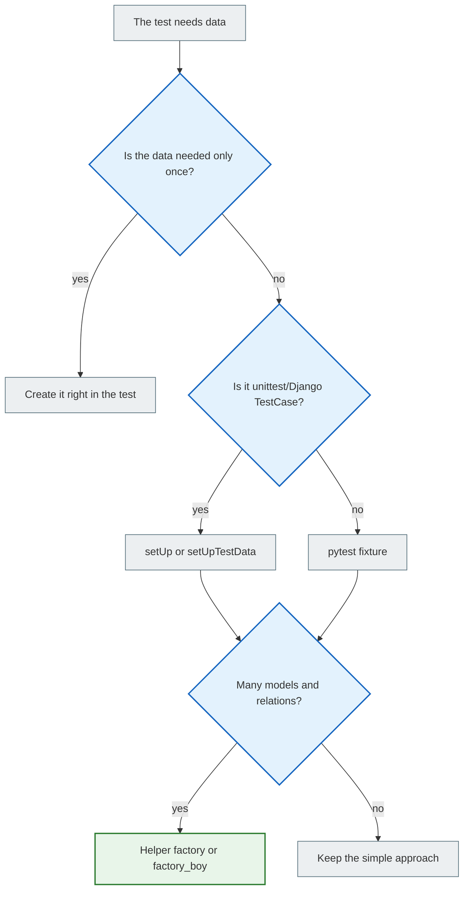

# Test data and fixtures: how to prepare state for tests

> After this file, you will understand how to create data for tests, and when to use an object right inside the test, `setUp()`, `setUpTestData()`, pytest fixtures, and factories.

---

## 1. Why you need this

A test almost never lives in a vacuum.

To check a list of notes, you need a note. To check permissions, you need two users. To check a form, you need data that looks like a POST request.

A bad approach:

> “I already have a user `student` in my local database, so let the test use it.”

Such a test will break:

- on another computer;
- in CI;
- after the database is cleared;
- if someone changes the local data.

The right approach:

> Each test creates the minimal data it needs by itself.

---

## 2. Mental model

Test data is a prop for a scene.

If a scene needs a chair, the director does not hope that a chair just happens to already be on stage. It is placed there before the scene and removed afterwards.

The same goes for tests:

- before the test, we created a user/note/category;
- the test checked the behavior;
- Django cleaned up the test database.

---

## 3. The simplest way: create data right in the test

```python
def test_note_str_returns_title(self):
    user = User.objects.create_user(username="student", password="pw")
    note = Note.objects.create(
        owner=user,
        title="First note",
        content="Hello",
    )

    self.assertEqual(str(note), "First note")
```

This is fine if:

- there is little data;
- there is only one test;
- everything important is visible right in the test.

Pro: the test is easy to read.

Con: if there are 20 such tests, copy-paste begins.

---

## 4. `setUp()`: data before each test

```python
class NoteModelTest(TestCase):
    def setUp(self):
        self.user = User.objects.create_user(username="student", password="pw")
        self.note = Note.objects.create(
            owner=self.user,
            title="First note",
            content="Hello",
        )

    def test_note_str_returns_title(self):
        self.assertEqual(str(self.note), "First note")

    def test_note_belongs_to_user(self):
        self.assertEqual(self.note.owner, self.user)
```

`setUp()` runs before each test method.

This is good when each test should get clean, new objects.

But do not put everything into `setUp()`. If a test does not need a `category`, do not create it just “in case”.

---

## 5. `setUpTestData()`: data once per class

Django has an optimization:

```python
class NoteModelTest(TestCase):
    @classmethod
    def setUpTestData(cls):
        cls.user = User.objects.create_user(username="student", password="pw")
        cls.note = Note.objects.create(
            owner=cls.user,
            title="First note",
            content="Hello",
        )

    def test_note_str_returns_title(self):
        self.assertEqual(str(self.note), "First note")
```

`setUpTestData()` creates the data once for the whole class, not before each test.

When to use which:

| Approach | When |
|---|---|
| `setUp()` | The test changes the data or needs a clean object |
| `setUpTestData()` | The data is the same and must not change |

If a test changes shared data from `setUpTestData()`, be careful. Do not let one test affect another.

---

## 6. A helper factory without extra libraries

You can create a simple helper function:

```python
def make_user(username="student"):
    return User.objects.create_user(username=username, password="pw")


def make_note(owner=None, title="Test note", content="Hello"):
    if owner is None:
        owner = make_user()

    return Note.objects.create(
        owner=owner,
        title=title,
        content=content,
    )
```

Then the test:

```python
def test_note_str_returns_title(self):
    note = make_note(title="Readable note")

    self.assertEqual(str(note), "Readable note")
```

Advantage: less duplication.

Danger: a helper can hide important details. If the owner matters for the test, it is better to show it explicitly in the test.

---

## 7. pytest fixtures for Django

```python
import pytest

from notes.models import Note


@pytest.fixture
def user(db, django_user_model):
    return django_user_model.objects.create_user(
        username="student",
        password="pw",
    )


@pytest.fixture
def note(user):
    return Note.objects.create(
        owner=user,
        title="Fixture note",
        content="Hello",
    )


def test_note_str_returns_title(note):
    assert str(note) == "Fixture note"
```

What matters:

- `db` allows the fixture to work with the database;
- `django_user_model` gives you the correct User model;
- the `note` fixture can depend on the `user` fixture.

---

## 8. Factory libraries

Large projects often use `factory_boy`.

Example:

```python
import factory

from notes.models import Note


class UserFactory(factory.django.DjangoModelFactory):
    class Meta:
        model = "auth.User"

    username = factory.Sequence(lambda n: f"user{n}")


class NoteFactory(factory.django.DjangoModelFactory):
    class Meta:
        model = Note

    owner = factory.SubFactory(UserFactory)
    title = factory.Sequence(lambda n: f"Note {n}")
    content = "Hello"
```

Test:

```python
def test_note_str_returns_title():
    note = NoteFactory(title="Factory note")

    assert str(note) == "Factory note"
```

For a beginner, a factory library is not required. First learn to create objects by hand and through helpers.

---

## 9. Comparing the approaches

| Method | When to use | Pro | Con |
|---|---|---|---|
| Object right in the test | One simple test | Everything is visible | Copy-paste |
| `setUp()` | Several tests in a class | Clean state for each test | Can grow bloated |
| `setUpTestData()` | Shared immutable data | Faster | You must not corrupt shared state |
| Helper factory | Repeated creation | Simple and flexible | Can hide important fields |
| pytest fixture | pytest projects | Composition of fixtures | You need to understand the mechanics |
| `factory_boy` | Many models and relations | Powerful | An extra library |

---

## 10. Mermaid diagram



---

## 11. Common beginner mistakes

| Mistake | Why it happens | How to fix it |
| ------- | ------------ | ------------ |
| The test depends on the local DB | “But I have that data” | Create the data in the test |
| `setUp()` creates a whole world | You want everything ready | Create the minimum |
| A helper factory hides important fields | Too many defaults | Pass what matters explicitly |
| One test changes another test's data | Shared state | Do not rely on test order |
| Using a factory library too early | You want it “like in production” | Start with simple helpers |

---

## 12. Practice

1. Write `make_user()` and `make_note()`.
2. Rewrite two model tests using `make_note()`.
3. Write an ownership test:
   - User A has their own note;
   - User B has their own note;
   - User A's list does not contain User B's note.
4. Rewrite the same scenario using `setUp()`.
5. If you use pytest, create `user` and `note` fixtures.

---

## 13. Self-check questions

1. Why should a test not depend on the real database?
2. When is it better to create an object right in the test?
3. How does `setUp()` differ from `setUpTestData()`?
4. How does a helper factory differ from a pytest fixture?
5. Why can overly “clever” factories make a test harder to read?
