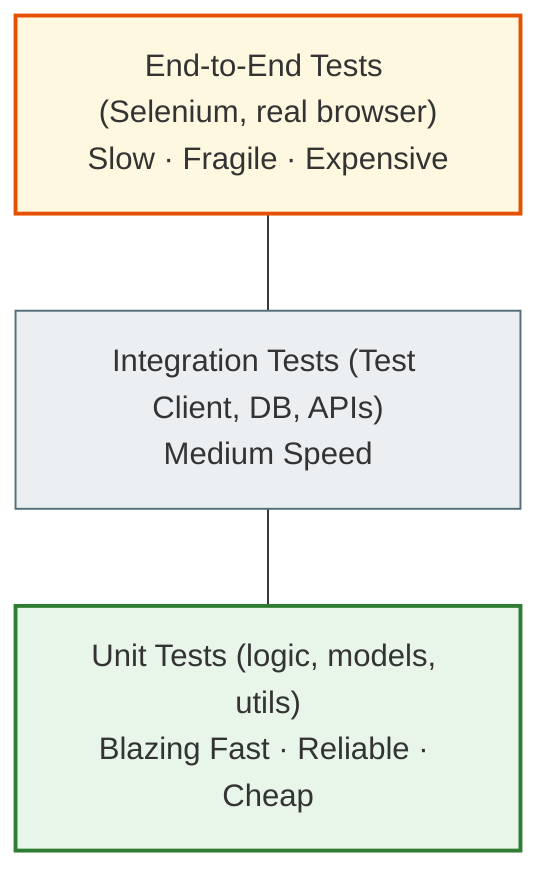
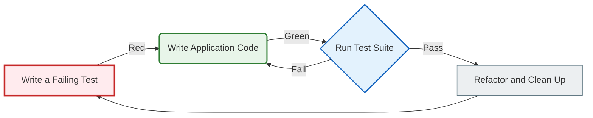
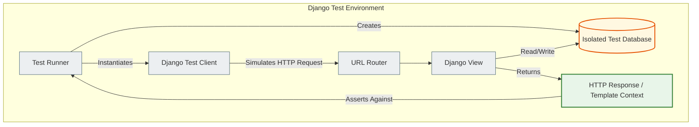
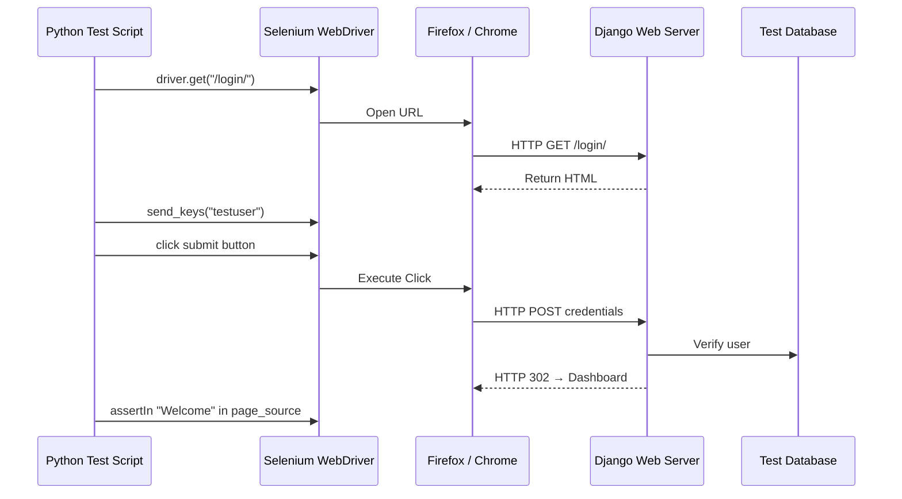
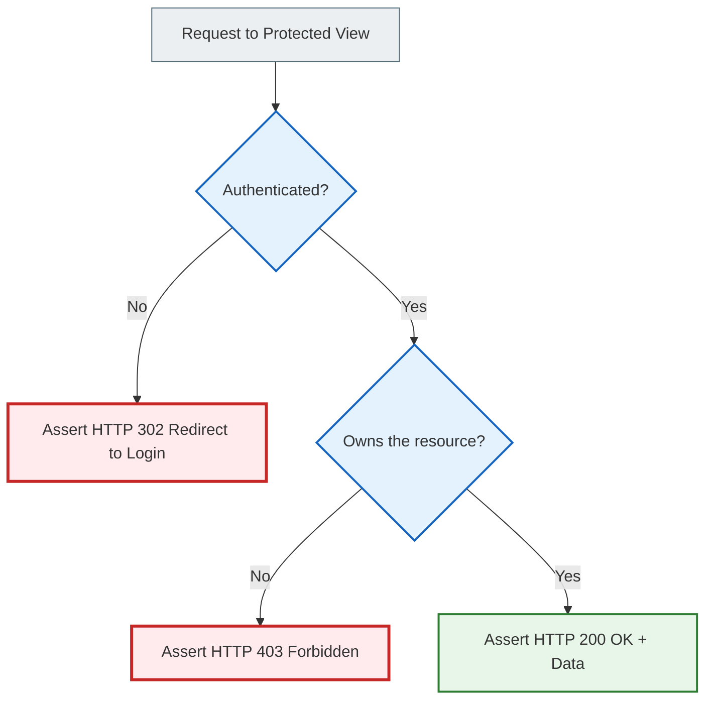
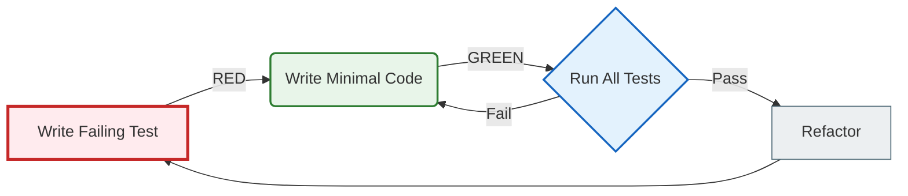

# Testing foundations: a complete study guide

> This file is a self-contained reference on the philosophy, tools, and practice of testing.
> From the first `assert` to Selenium → it is all here.
>
> Covers: why tests exist, mental models, `unittest`, `pytest`, Django `TestCase`, Selenium, TDD, misconceptions, debugging, architecture diagrams.

---

## Contents

**Philosophy and mindset**
- [1. Why testing exists](#1-why-testing-exists)
- [2. Fear of change and technical debt](#2-fear-of-change-and-technical-debt)
- [3. The core philosophy: confidence, not proof](#3-the-core-philosophy-confidence-not-proof)
- [4. Mental models](#4-mental-models)
- [5. What an invariant is](#5-what-an-invariant-is)

**Structure and methodology**
- [6. The AAA pattern and scientific thinking](#6-the-aaa-pattern-and-scientific-thinking)
- [7. Types of tests](#7-types-of-tests)
- [8. The testing pyramid](#8-the-testing-pyramid)
- [9. The nature of bugs](#9-the-nature-of-bugs)

**Tools**
- [10. unittest.TestCase — Python's base framework](#10-unittesttestcase)
- [11. pytest — the modern approach](#11-pytest)
- [12. Django TestCase — testing with a DB](#12-django-testcase)
- [13. Selenium — testing through a browser](#13-selenium)

**Deep understanding**
- [14. Misconceptions about testing](#14-misconceptions-about-testing)
- [15. Debugging failing tests](#15-debugging-failing-tests)
- [16. Testing and architecture](#16-testing-and-architecture)
- [17. Developer psychology](#17-developer-psychology)
- [18. Real-world context: risk and cost](#18-real-world-context-risk-and-cost)
- [19. Manual check vs automated test](#19-manual-check-vs-automated-test)

**Practice**
- [20. Common beginner mistakes](#20-common-beginner-mistakes)
- [21. Architecture diagrams](#21-architecture-diagrams)
- [22. A basic example for practice](#22-a-basic-example-for-practice)
- [23. Questions for deep reflection](#23-questions-for-deep-reflection)

---

## 1. Why testing exists

### The problem testing solves

Bugs in code are an unavoidable reality. Not because programmers are bad. But because people naturally make mistakes, and in software systems the number of interactions between components grows faster than a human can comprehend.

When there is one function, it is easy to check in your head. When there are thousands of functions and they are connected to each other, it is not.

Every time you change code, add a feature, or fix a bug, you risk breaking something else. Even if you do not intend to. Even if you read the code carefully.

**What does testing solve?** It is a systematic, repeatable mechanism for checking that the system behaves correctly, regardless of what you changed.

### Four reasons to write tests

**1. Preventing regressions**

A regression is when a new feature or a bug fix breaks existing functionality. Tests leave a "trail" of verified behavior. If a regression appears, a test will immediately show where.

**2. Reducing the fear of change**

Changes break things. Without tests, developers are naturally afraid to touch legacy code. A full test suite lets you refactor and optimize without fear: if something breaks, the tests will tell you.

**3. Living documentation**

Tests are executable documentation. They do not go stale the way written text does. The test name `test_create_notebook_default_unsets_previous_default` explains a business rule better than any comment.

**4. Improving design**

Writing tests, especially before the implementation (TDD), forces you to think about the interface and write more modular, loosely coupled code.

### A down-to-earth example

```python
def calculate_total(price, quantity):
    return price * quantity
```

You can check it by hand: `print(calculate_total(10, 2))` → you see `20` — "looks good".

But you also need to check: `quantity=0`, a negative value, rounding, a discount, large numbers.
And running `print()` every time is inconvenient. Plus `print()` will not automatically tell you that the result is wrong.

A test does this for you, automatically, on every `git push`:

```python
def test_calculate_total_two_items():
    assert calculate_total(10, 2) == 20

def test_calculate_total_zero_quantity():
    assert calculate_total(10, 0) == 0

def test_calculate_total_rejects_negative_quantity():
    with pytest.raises(ValueError):
        calculate_total(10, -1)
```

---

## 2. Fear of change and technical debt

> **This is probably the most important section.** This is where we explain why large projects without tests slowly die.

### Why developers are afraid of change

In a system without tests, every change is a leap into the unknown:

```
You change the discount calculation function...
  → Does the orders API suddenly break?
  → Could it affect invoicing?
  → What about the mobile app?
  → What if there are users in the system with old data?
```

Nobody knows. So nobody changes anything. Or they change things very carefully, very slowly.

### Technical debt born of fear

When confidence is lacking, developers:

- **refuse to refactor** — "it somehow works, better not to touch it"
- **copy code** instead of extracting it into a shared function — "extracted it → broke something else"
- **work around old code** instead of fixing it — "I'll write a new function next to it"
- **postpone deploys** — "we'll check it manually once more after the weekend"

Over time, the codebase becomes a maze of warning notes: `# DO NOT TOUCH`, `# MAGIC, NO IDEA HOW IT WORKS`, `# TODO for three years already`.

This is **architectural degradation** — not because of bad intentions, but because there is no safety net.

### What tests change

```
WITHOUT TESTS                           WITH TESTS
─────────────────────────────────────── ───────────────────────────────────────
"Don't touch it, it somehow works"      "Refactor freely, tests will show if it broke"
Deploy once a month (scary)             Deploy several times a day (confidently)
Customers find the bug a week later     A test finds the bug in 30 seconds
Refactoring is a risky operation        Refactoring is ordinary work
1 year: "we need to rewrite everything" 1 year: "we keep growing calmly"
```

---

## 3. The core philosophy: confidence, not proof

> **"Testing is a process of accumulating confidence, not proving perfection."**

### Why it is impossible to prove the absence of bugs

This has been proven mathematically. In any non-trivial program, the number of possible execution paths approaches infinity.

**Edsger W. Dijkstra** put it concisely:

> *"Testing can demonstrate the presence of bugs, but never their absence."*
> ("Testing can prove that bugs are present, but never that they are absent.")

Imagine a simple function with one `if`:

```python
def process(x):
    if x > 0:
        return x * 2
    return -x
```

There are 2³² input values of type `int`. We test five of them. The remaining 4 billion are unchecked.

Real systems have thousands of such conditions. Database states come in countless combinations.

### So what do tests give us?

```
Test passed → we could not prove the code is broken in this scenario → confidence grew
Test failed → we proved there is a bug in this scenario → we fix it
```

Tests collect **empirical evidence** that the system correctly handles specific, anticipated scenarios. Each additional test reduces uncertainty.

---

## 4. Mental models

### The safety net

```
        [Developer]
            | changes code at height
            |
    ════════════════════════  ← test suite
            |
         (ground)
```

With tests, you can perform complex operations confidently: a large refactoring, replacing a library, changing the DB schema.

### A scientific experiment

| Science | Testing |
|-------|-----------|
| Hypothesis | "The function should return 20" |
| Setting up conditions | `price = 10, quantity = 2` |
| Running the experiment | `result = calculate_total(price, quantity)` |
| Observation | `result = 20` |
| Conclusion | Hypothesis confirmed / refuted |

### Living documentation

Ordinary documentation goes stale. A test is documentation that cannot be ignored: if the behavior changed but the test was not updated, it will fail.

```python
def test_create_notebook_default_unsets_previous_default(self):
    # This name = a living document of the business rule:
    # "each user can have only one default notebook"
```

### A contract between components

A test pins down the agreement between parts of the system:

```python
def test_create_note_returns_note_with_correct_user(self):
    note = services.create_note(user=alice, title='Test')
    self.assertEqual(note.user, alice)

def test_create_note_saves_to_database(self):
    services.create_note(user=alice, title='Test')
    self.assertEqual(Note.objects.count(), 1)
```

If someone changes `services.create_note()` and breaks the contract, the test will show it immediately.

### A regression prevention system

```
Bug found → Write a test that reproduces the bug (it fails)
          → Fix the bug (the test turns green)
          → The test stays in the suite forever
          → A year later: refactoring → the same bug → test fails → fixed immediately
```

---

## 5. What an invariant is

An **invariant** is a property of the system that must remain true no matter how the internal state changes.

| Invariant | Where it breaks without a test |
|-----------|--------------------------|
| 1 `is_default` notebook per user | `create_notebook(is_default=True)` without resetting the old one |
| A user sees only their own notes | A wrong ORM filter |
| `quantity` cannot be negative | Removing a `CheckConstraint` |
| Tag labels are unique per user | Removing `unique_together` |
| Deleting a group does not delete notes | Changing `on_delete=SET_NULL` to `CASCADE` |

```python
# A test of the invariant (not of the implementation):
def test_only_one_default_notebook_per_user(self):
    services.create_notebook(user=alice, title='Old', is_default=True)
    services.create_notebook(user=alice, title='New', is_default=True)
    defaults = Notebook.objects.filter(user=alice, is_default=True)
    self.assertEqual(defaults.count(), 1)  # ← the rule, not the way it is done
```

---

## 6. The AAA pattern and scientific thinking

Every test = three clear steps. This is the standard across all languages and frameworks.

```text
Arrange → Act → Assert
```

| Step | What it means | Ask yourself |
|------|-----------|-------------|
| **Arrange** | Prepare the system state | "What does this test need?" |
| **Act** | Perform what we are testing | "Which single action is being examined?" |
| **Assert** | Check the expected result | "What must be true afterwards?" |

### A simple example

```python
def test_calculate_total_for_two_items():
    # Arrange
    price    = 10
    quantity = 2

    # Act
    result = calculate_total(price, quantity)

    # Assert
    assert result == 20
```

### A Django example

```python
def test_note_list_page_returns_200(self):
    # Arrange: create a user, log in
    user = User.objects.create_user(username='student', password='pw')
    self.client.login(username='student', password='pw')

    # Act: perform one action — a GET request
    response = self.client.get(reverse('note_list'))

    # Assert: check the result
    self.assertEqual(response.status_code, 200)
```

### A service example with two asserts

```python
def test_create_note_assigns_tags(self):
    # Arrange
    tag1 = Tag.objects.create(user=self.alice, name='work')
    tag2 = Tag.objects.create(user=self.alice, name='python')

    # Act
    note = services.create_note(
        user=self.alice, title='Tagged', tag_ids=[tag1.id, tag2.id]
    )

    # Assert
    note_tags = list(note.tags.all())
    self.assertIn(tag1, note_tags)
    self.assertIn(tag2, note_tags)
```

---

## 7. Types of tests

| Type | What it checks | Example | When to write it |
|-----|------------|---------|-------------|
| **Unit** | One function / method / class in isolation | `calculate_tax()` | Constantly during development |
| **Integration** | Several components together | Form + Model + DB | When the interaction matters |
| **Functional** | One feature / business function | A user creates a note | For business requirements |
| **E2E** | The whole path through a browser | Selenium: login → create note | For critical user flows |
| **Regression** | A specific old bug | "An empty title must not be saved" | After fixing a bug |
| **Smoke** | Whether the app is alive after a deploy | Home page → 200 | Before a deploy |
| **Acceptance** | Whether the product meets business requirements | Checkout flow | Sign-off with the product owner |

---

## 8. The testing pyramid

```
              ╱╲
             ╱E2E╲          Selenium / Cypress
            ╱──────╲        Slow, brittle, expensive
           ╱Integration╲    Django Client, API tests
          ╱──────────────╲  Medium complexity and speed
         ╱     Unit        ╲ pytest, TestCase
        ╱────────────────────╲ Fast, reliable, cheap

     ~70% Unit | ~20% Integration | ~10% E2E
```



### Why not do everything through E2E?

```
E2E test: 15 seconds per test × 100 tests = 25 minutes per run
Unit test: 0.05 seconds × 100 tests = 5 seconds per run

E2E: if it breaks — where exactly? view? service? template? JS? CSS?
Unit: if it breaks — we know exactly where, because we test in isolation
```

---

## 9. The nature of bugs

### Types of bugs

| Type | What it looks like | Which test helps |
|-----|------------|---------------------|
| **Logic error** | `+` instead of `-`, `>=` instead of `>` | A unit test with concrete values |
| **Boundary error** | Breaks on `0`, `""`, `None` | Parametrized tests |
| **Integration failure** | The parts work separately but not together | Integration test |
| **Permission bug** | User B sees user A's data | A security test with two users |
| **Requirement bug** | The code correctly implements a wrong requirement | A test derived from business requirements |
| **Heisenbug** | Disappears as soon as you start debugging | Deterministic tests, atomic() |

### Cognitive traps

- **Confirmation bias** — you see what you meant to write, not what is written
- **The author's blind spot** — your own mistakes are harder to see
- **Happy path testing** — we test what "should work" and avoid unpleasant scenarios

A test is free of these traps. It checks exactly what is written. Without fatigue, without bias.

---

## 10. unittest.TestCase

Python has a built-in `unittest` — an object-oriented framework based on Java's JUnit.

### Structure

```python
import unittest


class TestMathOperations(unittest.TestCase):

    def setUp(self):
        """Runs BEFORE each test. We prepare the state."""
        self.x = 10

    def test_divide_normal(self):
        """Happy path — the normal case."""
        self.assertEqual(divide(self.x, 2), 5.0)

    def test_divide_edge_case(self):
        """Edge case — a boundary case."""
        self.assertTrue(divide(self.x, self.x) == 1.0)

    def test_divide_by_zero(self):
        """Wrong input — we expect an exception."""
        with self.assertRaises(ValueError):
            divide(self.x, 0)

    def test_divide_not_equal(self):
        """assertFalse — we make sure the result is NOT equal."""
        self.assertFalse(divide(self.x, 5) == 99.0)

    def tearDown(self):
        """Runs AFTER each test. We clean up the state."""
        self.x = None
```

### Main rules

- **Test discovery**: the framework automatically finds `test*.py` files
- **Naming**: every test method MUST start with `test_`
- **setUp / tearDown**: `setUp` runs BEFORE each test, `tearDown` runs AFTER

### Table of assert methods

| Method | Checks | Example |
|-------|-----------|---------|
| `assertEqual(a, b)` | `a == b` | `assertEqual(result, 20)` |
| `assertNotEqual(a, b)` | `a != b` | `assertNotEqual(result, 0)` |
| `assertTrue(x)` | `bool(x) is True` | `assertTrue(note.is_active)` |
| `assertFalse(x)` | `bool(x) is False` | `assertFalse(note.is_pinned)` |
| `assertIsNone(x)` | `x is None` | `assertIsNone(note.group)` |
| `assertIsNotNone(x)` | `x is not None` | `assertIsNotNone(note.created_at)` |
| `assertIn(a, b)` | `a in b` | `assertIn(tag, note.tags.all())` |
| `assertNotIn(a, b)` | `a not in b` | `assertNotIn(bob_nb, queryset)` |
| `assertRaises(exc)` | an exception of type `exc` | `assertRaises(ValueError)` |
| `assertAlmostEqual(a, b)` | floating-point numbers | `assertAlmostEqual(1.1+2.2, 3.3)` |
| `assertIsInstance(obj, cls)` | `isinstance(obj, cls)` | `assertIsInstance(note, Note)` |
| `assertGreaterEqual(a, b)` | `a >= b` | `assertGreaterEqual(updated, old)` |

### setUpClass / tearDownClass

If `setUp` is expensive, use `setUpClass` (it runs once for the whole class):

```python
class TestExpensiveSetup(unittest.TestCase):

    @classmethod
    def setUpClass(cls):
        """Runs ONCE for the whole class. For example, a DB connection."""
        cls.db_connection = create_expensive_connection()

    @classmethod
    def tearDownClass(cls):
        """Runs ONCE after the whole class."""
        cls.db_connection.close()

    def test_something(self):
        # cls.db_connection is available via self.db_connection
        ...
```

### A complete example: `notes.py` + `test_notes.py`

```python
# notes.py
class ValidationError(Exception):
    pass

def create_note(title, content):
    if not title:
        raise ValidationError("Title cannot be empty")
    if len(content) > 500:
        raise ValidationError("Content exceeds maximum length of 500 characters")
    return {"title": title.upper(), "content": content, "status": "saved"}
```

```python
# test_notes.py
import unittest
from notes import create_note, ValidationError


class TestNoteCreation(unittest.TestCase):

    def test_create_note_success(self):
        # Arrange
        title   = "Meeting"
        content = "Discuss project timeline."
        # Act
        result = create_note(title, content)
        # Assert — check the status and the title transformation
        self.assertEqual(result["status"], "saved")
        self.assertEqual(result["title"], "MEETING")

    def test_create_note_empty_title(self):
        # Empty title → ValidationError
        with self.assertRaises(ValidationError):
            create_note("", "Some content")

    def test_create_note_exceeds_length(self):
        # Content > 500 characters → ValidationError
        long_content = "A" * 501
        with self.assertRaises(ValidationError):
            create_note("Long Note", long_content)
```

---

## 11. pytest

Although `unittest` is built into Python, most teams use `pytest`.

### Why pytest?

| Feature | unittest | pytest |
|-------------|----------|--------|
| Syntax | A class + `self.assertEqual` | A plain function + `assert` |
| Error messages | Basic | Detailed, colored diff |
| Fixtures | `setUp/tearDown` (rigid) | `@pytest.fixture` (flexible) |
| Parametrization | Manual | `@pytest.mark.parametrize` |
| Plugins | Limited | A huge ecosystem |

### A simple pytest test

```python
# No class needed, no TestCase needed
def test_calculate_total():
    assert calculate_total(10, 2) == 20  # ← just assert, not self.assertEqual
```

### @pytest.fixture — flexible setup

Fixtures are state-preparation functions that are injected into tests through arguments:

```python
import pytest

@pytest.fixture
def sample_user():
    """Returns a dictionary with user data."""
    return {"id": 1, "name": "Alice", "email": "alice@example.com"}

@pytest.fixture
def empty_db():
    """A yield fixture: setup + cleanup in one function."""
    db = Database()
    db.connect()
    yield db          # ← the test runs here
    db.close()        # ← runs after the test (teardown)

def test_user_has_name(sample_user):           # ← pytest injects it automatically
    assert sample_user["name"] == "Alice"

def test_db_starts_empty(empty_db):
    assert empty_db.count() == 0
```

### scope='module' — one fixture for the whole module

```python
@pytest.fixture(scope='module')
def db_connection():
    """Created ONCE for the whole module — for expensive resources."""
    conn = create_connection()
    yield conn
    conn.close()
```

### @pytest.mark.parametrize

```python
@pytest.mark.parametrize("a, b, expected", [
    (10,  2,   20),
    (0,   5,    0),
    (3,   3,    9),
    (-1,  4,   -4),
])
def test_multiply(a, b, expected):
    assert calculate_total(a, b) == expected
# ↑ Automatically generates 4 separate tests
```

---

## 12. Django TestCase

### How it differs from a regular TestCase

```python
import unittest
from django.test import TestCase

class PureUnitTest(unittest.TestCase):
    def test_math(self):
        assert 2 + 2 == 4   # ← no DB, fast

class DjangoTest(TestCase):
    def test_with_db(self):
        user = User.objects.create_user('alice')   # ← needs the test DB
        self.assertEqual(user.username, 'alice')
```

### Lifecycle — what happens automatically

```
┌─────────────────────────────────────────────────────────────────┐
│  Before ALL tests of the class:                                 │
│    → Creates the test DB (test_<db_name> or SQLite in-memory)   │
│    → Applies all migrations                                     │
│                                                                 │
│  Before EACH test:                                              │
│    → Opens a transaction                                        │
│    → Calls setUp()                                              │
│                                                                 │
│    ┌─── THE TEST RUNS ─────────────────────────────────────┐   │
│    │  User.objects.create(...)  ← rows in the test DB      │   │
│    │  Note.objects.create(...)  ← isolated from the real DB│   │
│    └───────────────────────────────────────────────────────┘   │
│                                                                 │
│  After EACH test:                                               │
│    → ROLLBACK of the transaction (all rows disappear!)          │
│    → Calls tearDown()                                           │
│                                                                 │
│  After ALL tests:                                               │
│    → Deletes the test DB                                        │
└─────────────────────────────────────────────────────────────────┘
```

### Three levels of isolation

```
1. ISOLATION FROM THE REAL DB:
   db.sqlite3 (yours) ≠ test DB (separate, temporary)
   Tests cannot break real data.

2. ISOLATION BETWEEN TESTS:
   Each test has its own transaction → rollback.
   Test A does not see Test B's data.

3. ISOLATION FROM EXTERNAL SYSTEMS:
   EMAIL_BACKEND = console (nothing is actually sent)
   Files are not changed in production
```

### Testing views with the Django Test Client

```python
from django.test import TestCase, Client
from django.contrib.auth.models import User
from .models import Note


class NoteApplicationTests(TestCase):

    def setUp(self):
        self.client = Client()
        self.user1 = User.objects.create_user(username='alice', password='pass123')
        self.user2 = User.objects.create_user(username='bob',   password='pass123')
        self.note  = Note.objects.create(
            user=self.user1, title="Alice's Note", content="Secret"
        )

    def test_anonymous_user_redirected_to_login(self):
        """Not logged in → redirect 302."""
        response = self.client.get('/notes/1/')
        self.assertEqual(response.status_code, 302)

    def test_user_can_access_own_notes(self):
        """Alice sees her own note."""
        self.client.login(username='alice', password='pass123')
        response = self.client.get('/notes/1/')
        self.assertEqual(response.status_code, 200)
        self.assertContains(response, "Alice's Note")

    def test_user_cannot_edit_another_users_note(self):
        """Bob cannot edit Alice's note — 403 Forbidden."""
        self.client.login(username='bob', password='pass123')
        response = self.client.post('/notes/1/edit/', {'title': 'Hacked'})
        self.assertEqual(response.status_code, 403)

    def test_form_rejects_empty_title(self):
        """Empty title → a validation error in the form."""
        self.client.login(username='alice', password='pass123')
        response = self.client.post('/notes/new/', {'title': '', 'content': 'Body'})
        self.assertFormError(response.context['form'], 'title', 'This field is required.')
```

### BaseTestCase — avoiding duplication

```python
class BaseServiceTest(TestCase):
    """Shared setUp for all classes in test_services.py."""
    def setUp(self):
        self.alice = User.objects.create_user('alice', password='pass123')
        self.bob   = User.objects.create_user('bob',   password='pass123')


class NoteServiceTest(BaseServiceTest):
    # setUp() inherited — self.alice and self.bob are available automatically

    def test_create_note_sets_correct_user(self):
        note = services.create_note(user=self.alice, title='Test')
        self.assertEqual(note.user, self.alice)
```

---

## 13. Selenium

### What is Selenium?

Selenium is a framework for controlling a real browser from Python. Instead of an HTTP request (like the Django Test Client), Selenium:

1. Opens Firefox / Chrome
2. Navigates to a URL
3. Finds HTML elements
4. Clicks, types text, presses Enter
5. Checks that the correct data appeared in the DOM

### Key concepts

```python
from selenium import webdriver
from selenium.webdriver.common.by import By
from selenium.webdriver.common.keys import Keys

driver = webdriver.Firefox()
driver.implicitly_wait(5)   # wait up to 5 sec for elements to appear

driver.get("http://localhost:8000/login")

# Finding elements
username_input = driver.find_element(By.NAME, "username")
password_input = driver.find_element(By.NAME, "password")
submit_button  = driver.find_element(By.ID, "login-btn")

# Interaction
username_input.send_keys("testuser")
password_input.send_keys("secret123")
submit_button.click()

# Check
assert "Welcome" in driver.page_source

driver.quit()
```

### A full test: login + creating a note

```python
import unittest
from selenium import webdriver
from selenium.webdriver.common.by import By
from selenium.webdriver.common.keys import Keys


class TestNoteApplicationFlow(unittest.TestCase):

    def setUp(self):
        self.driver = webdriver.Firefox()
        self.driver.implicitly_wait(5)

    def test_login_and_create_note(self):
        driver = self.driver

        # 1. Open the login page
        driver.get("http://localhost:8000/login")

        # 2. Fill in the form
        driver.find_element(By.NAME, "username").send_keys("testuser")
        driver.find_element(By.NAME, "password").send_keys("secret123")
        driver.find_element(By.ID,   "login-btn").click()

        # 3. Go to the note form
        driver.get("http://localhost:8000/notes/new")
        title_input = driver.find_element(By.NAME, "title")
        title_input.send_keys("My First Note")
        title_input.send_keys(Keys.RETURN)

        # 4. Check the result
        self.assertIn("My First Note", driver.page_source)

    def tearDown(self):
        self.driver.quit()
```

### Selenium vs Django Test Client

| Criterion | Django Test Client | Selenium |
|----------|-------------------|---------|
| **What it tests** | Backend: views, permissions, API | Frontend: DOM, UI, clicks |
| **Speed** | Milliseconds | Seconds (waits for rendering) |
| **Brittleness** | Stable | Breaks on CSS changes |
| **Closeness to the user** | Far | Exactly like a real user |
| **When to use** | All the time | Only for critical flows |

---

## 14. Misconceptions about testing

### "Tests prove the program has no bugs"

**False.** Tests prove that specific described scenarios behave correctly. All other scenarios remain unchecked.

### "Testing is only for big projects"

**False.** Even a 50-line script can break when a dependency is updated or unexpected data arrives. If the code matters, it is worth a test.

### "Selenium replaces unit tests"

**False.** Selenium tests the whole stack. If a test fails, where exactly? view? service? JS? CSS? Unknown.
A unit test shows the exact place. Besides, 100 Selenium tests = 25 minutes. 100 unit tests = 5 seconds.

### "More tests = better quality"

**False.** Tests are code. Code needs maintenance. A test that:
- checks trivial Django ORM behavior
- tests implementation details instead of behavior
- is written incorrectly (always green)

— raises the cost of maintenance, not the quality.

### "Testing slows down development"

**False in the long run:**

```
Month 1 without tests: +20% speed
Month 3: first regressions, fear of change
Month 6: deploy once a week, most of the time spent debugging
Month 12: "we need to rewrite it"

Month 1 with tests: a bit slower
Month 3: refactoring freely
Month 12: deploy daily, trust is high
```

### "Testing is QA's responsibility"

**False.** Quality cannot be "bolted on from the outside". If a developer writes code without tests → the architecture naturally becomes untestable. The right way: the developer writes unit/integration tests, QA writes acceptance and E2E tests.

### "One big test is better than many small ones"

**False.** If the first of 20 asserts fails, the test stops. You know nothing about the other 19. Small tests = precise diagnostics.

---

## 15. Debugging failing tests

> A failing test is not a punishment. It is a system that protects you from regressions.

### Reading pytest messages

pytest rewrites `assert` and shows a detailed diff:

```
FAILED test_services.py::test_create_note_assigns_tags
AssertionError: assert <Tag: #work> in []
E       assert <Tag: #work> in []
E         where [] = <built-in method all of ManyRelatedManager object at 0x...>()

→ The test says: expected the tag to be in note.tags.all(), but the list is empty
→ We look in services.create_note() for why the tags were not attached
```

### Isolating a failing test

```bash
# Don't run all 500 tests every time:
pytest tests/test_services.py::NoteServiceTest::test_create_note_assigns_tags

# Stop after the first failure:
pytest -x            # or --exitfirst

# Verbose — see every test:
pytest -v
```

### TDD for fixing bugs

```
1. A user reported a bug in production
2. We do NOT touch the application code right away
3. We write a test that reproduces the bug → it fails (RED)
4. We fix the code → the test turns green (GREEN)
5. The test stays in the suite — the bug will never come back
```

### When to fix the test rather than the code

Ask yourself: "Did the application logic break, or did the business requirements change?"

- The logic broke → we fix the code
- The requirements changed → we fix the test (it is outdated)

**Never delete a test just to stop it from failing.** A failing test is information, not an inconvenience.

---

## 16. Testing and architecture

### Testability as a design signal

If code is hard to test, it is a symptom of poor architecture:

```python
# Hard to test (hidden dependencies):
def send_welcome_email():
    user = User.objects.get(id=settings.CURRENT_USER_ID)  # ← global state
    smtp.send(user.email, "Welcome!")                       # ← side effect

# Easy to test (dependencies are explicit):
def send_welcome_email(user, email_backend):
    email_backend.send(user.email, "Welcome!")
    # ← in the test: email_backend = MockEmailBackend()
```

If a test needs 10+ mocks, that is a signal that the function has too many responsibilities.

### TDD — design through tests

```
[Write a failing test] → RED
        ↓
[Write the minimal code that passes] → GREEN
        ↓
[Refactor without changing behavior] → REFACTOR
        ↓
[Write the next failing test] → RED
```



### Layered architecture (CrispyNotes)

```
domain / services  ← pure logic, no I/O → unit tests directly
    ↑
infrastructure     ← DB, email, API → integration tests or mocks
    ↑
api / views        ← HTTP → integration tests via self.client
```

---

## 17. Developer psychology

### Overconfidence bias

After writing a complex algorithm, you want to see that it works, so you test the happy path. A test written with the intent to **try to break** the code is the opposite stance. That is the stance that finds real bugs.

### The team's collective memory

```python
def test_create_note_ignores_other_users_tags(self):
    """
    Mass Assignment vulnerability: an attacker sends another user's tag_id.
    We filter by user before set() to block it.
    """
```

A new developer reads the name → understands the security rule → does not break the protection while refactoring.

---

## 18. Real-world context: risk and cost

| System type | Risk from a bug | Testing focus |
|-------------|----------------|------------------|
| Prototype, MVP | Low | Minimal or none |
| SaaS web application | Medium | Unit + integration tests |
| Note app with many users | **Authorization** | Security tests with alice + bob |
| Financial system | High — users' money | Exhaustive testing + audit |
| Medical / Aerospace | Critical — people's lives | Formal verification |

**The law of diminishing returns:**

```
Test #1 ~~~~~~~~~~~~~~~~    ← maximum value: catches the biggest risks
Test #10 ~~~~~~~~~~~~~~
Test #100 ~~~           ← less value: rare edge cases
Test #1000 ~            ← marginal: cost > benefit
```

---

## 19. Manual check vs automated test

| Criterion | Manual check | Automated test |
|----------|----------------|-------------------|
| First run | Instant (nothing to write) | You need to write code |
| Repeatability | Slow, you can forget a step | Instant, identical |
| Regressions | Easy to miss | Catches them well |
| Edge cases | Limited by time | Exhaustive |
| UX research | Irreplaceable | Not suitable |

**Rule:** A manual check is irreplaceable for new behavior and UX. But if you check the same thing manually more than twice, it is time to write a test.

---

## 20. Common beginner mistakes

| Mistake | How to fix it |
|---------|-------------|
| A test without a clear expectation | Phrase it: "should return X under condition Y" |
| One huge test | Split it: each test covers one behavior |
| Testing implementation details | Check behavior and invariants, not internal details |
| Only the happy path | Deliberately look for boundary + edge + error cases |
| A test that is "always green" | Make sure the test FAILS when the code is wrong |
| Mocking everything | Mock = an echo chamber. Mock only external I/O, not your own logic |
| Testing Django internals | Do not test `.save()` to the DB — Django has already done that |
| A bad name | `test_1` → `test_delete_group_sets_note_group_to_null` |

### Especially: a test that is "always green"

```python
# DANGEROUS — always passes, guarantees nothing:
def test_create_note(self):
    try:
        note = services.create_note(user=self.user, title='Test')
    except Exception:
        pass   # ← we ignore errors!

# CORRECT:
def test_create_note(self):
    note = services.create_note(user=self.user, title='Test')
    self.assertIsNotNone(note)
    self.assertEqual(note.title, 'Test')
```

**Rule:** Temporarily "break" the code and make sure the test really fails.

---

## 21. Architecture diagrams

### A. Django Testing Architecture



### B. Unit vs Integration vs E2E

```mermaid
graph TD
    subgraph Unit Testing
    U1[Test Function] -->|Mocks external data| U2[Python Function / Service]
    end

    subgraph Integration Testing
    I1[Test Function] --> I2[Django View / Service]
    I2 --> I3[(Real Test Database)]
    end

    subgraph End-to-End Testing
    E1[Selenium WebDriver] --> E2[Real Web Browser]
    E2 --> E3[Frontend UI]
    E3 --> E4[Backend Server]
    E4 --> E5[(Database)]
    end

    classDef step     fill:#eceff1,stroke:#546e7a,stroke-width:1px;
    classDef success  fill:#e8f5e9,stroke:#2e7d32,stroke-width:2px;
    classDef warning  fill:#fff8e1,stroke:#e65100,stroke-width:2px;
    class U1,I1,E1,E2,E3,E4 step;
    class U2,I2 success;
    class I3,E5 warning;
```



### C. Selenium E2E Flow



### D. Authentication Testing Flow



### E. TDD Cycle



---

## 22. A basic example for practice

Do it now — two files, 5 minutes:

**`cart.py`:**

```python
def calculate_total(price, quantity):
    if quantity < 0:
        raise ValueError("quantity cannot be negative")
    return price * quantity
```

**`test_cart.py`:**

```python
import pytest
from cart import calculate_total


def test_two_items():
    assert calculate_total(10, 2) == 20       # happy path

def test_zero_quantity():
    assert calculate_total(10, 0) == 0         # edge case

def test_negative_quantity_raises():
    with pytest.raises(ValueError):
        calculate_total(10, -1)                # error case

def test_large_values():
    assert calculate_total(1_000_000, 1_000) == 1_000_000_000  # boundary
```

**Steps:**

```bash
# 1. Run it — all green
pytest test_cart.py -v

# 2. Break the function: return price + quantity
# 3. Run it — you will see a failing test (that's correct!)
# 4. Restore the function → green again
```

Seeing a test fail on wrong code is the best confirmation that the test is real.

---

## 23. Questions for deep reflection

**On the limits of testing:**
1. If all tests pass, what do we know with confidence? What remains unknown?
2. What can tests NOT check: UX, business value, performance under load?

**On cost:**
3. When does the cost of maintaining a test exceed its value? How do you determine that?
4. At what level of coverage does it become "confident enough" to deploy to production?
5. Why does 100% code coverage not guarantee the absence of bugs?

**On architecture:**
6. Why does hard-to-test code almost always mean poor architecture?
7. If you cannot write a unit test without 10 mocks, what does that say about the function's design?

**On the real world:**
8. Why do catastrophic bugs sometimes survive thousands of tests and careful code review?
9. How do you tell a "bug in the implementation" from a "bug in the requirements"? Which is more dangerous?
10. How will you decide which behavior to test when you have to choose among 100 possible scenarios?

---

## Summary

```
Without tests:  "Seems like everything is fine"  ← emotional confidence
With tests:     "82/82 tests passed"             ← evidence-based confidence
```

Testing is an engineering discipline for managing uncertainty. It gives you:

| What | How |
|----|-----|
| A safety net | Refactoring without fear |
| Living documentation | Test name = business rule |
| Catching regressions | Old bugs do not come back |
| A security guard | IDOR and Mass Assignment become impossible |
| Architectural pressure | Poor design is hard to test → you can see where the problem is |

**Next step:** `basics/01_first_test.py` → your first test that runs.
