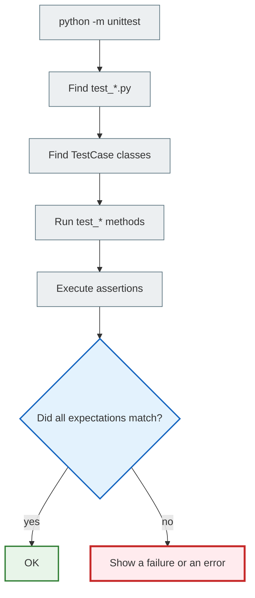

# unittest: first tests with standard Python tools

> After this file, you will be able to create a test file, write a `unittest.TestCase` class, run tests with `python -m unittest`, and understand the basic assert methods.

---

## 1. Why you need this

`unittest` is Python's standard library for testing. You do not need to install it.

Why learn it if `pytest` exists?

1. Django's `TestCase` is built on the ideas of `unittest`.
2. Many older and larger projects use exactly this style.
3. `unittest` shows the structure of a test well: class, method, assertion.
4. Once you understand `unittest`, Django tests become much clearer.

---

## 2. Mental model

A `unittest.TestCase` is a separate lab room for a group of similar checks.

The class `TestMathFunctions` means:

> “Checks for math functions live here.”

The method `test_add_two_numbers` means:

> “Here is a specific experiment: adding two numbers.”

---

## 3. A first example from scratch

Folder structure:

```text
testing_playground/
├── math_utils.py
└── test_math_utils.py
```

The file `math_utils.py`:

```python
def add(a, b):
    return a + b


def divide(a, b):
    return a / b
```

The file `test_math_utils.py`:

```python
import unittest

from math_utils import add, divide


class TestMathFunctions(unittest.TestCase):
    def test_add_two_numbers(self):
        result = add(2, 3)

        self.assertEqual(result, 5)

    def test_divide_by_zero_raises_error(self):
        with self.assertRaises(ZeroDivisionError):
            divide(10, 0)


if __name__ == "__main__":
    unittest.main()
```

Running all tests in the folder:

```bash
python -m unittest
```

Running a specific file:

```bash
python -m unittest test_math_utils.py
```

A possible result:

```text
..
----------------------------------------------------------------------
Ran 2 tests in 0.001s

OK
```

What the two dots mean:

| Symbol | Meaning |
|---|---|
| `.` | One test passed |
| `F` | Assertion failed |
| `E` | An error in the test code or in the code under test |

---

## 4. How `unittest` finds tests

`unittest` looks for:

| What | Rule | Example |
|---|---|---|
| File | Usually `test_*.py` | `test_math_utils.py` |
| Class | Inherits from `unittest.TestCase` | `class TestMathFunctions(unittest.TestCase)` |
| Method | Starts with `test_` | `def test_add_two_numbers(self):` |

If you name a method like this:

```python
def check_add_two_numbers(self):
    ...
```

`unittest` will not run it.

This is a common mistake: the test code exists, but the test runner does not see it.

---

## 5. Arrange -> Act -> Assert in unittest

A poor version:

```python
def test_add_two_numbers(self):
    self.assertEqual(add(2, 3), 5)
```

It is short, but a beginner cannot see the steps.

Better for learning:

```python
def test_add_two_numbers(self):
    a = 2
    b = 3

    result = add(a, b)

    self.assertEqual(result, 5)
```

| Step | Lines |
|---|---|
| Arrange | `a = 2`, `b = 3` |
| Act | `result = add(a, b)` |
| Assert | `self.assertEqual(result, 5)` |

---

## 6. The main assert methods

| Method | What it checks | Example |
|---|---|---|
| `assertEqual(a, b)` | `a == b` | `self.assertEqual(result, 5)` |
| `assertNotEqual(a, b)` | `a != b` | `self.assertNotEqual(status, "error")` |
| `assertTrue(value)` | The value is truthy | `self.assertTrue(user.is_active)` |
| `assertFalse(value)` | The value is falsy | `self.assertFalse(form.is_valid())` |
| `assertIn(a, b)` | `a` is inside `b` | `self.assertIn("title", form.errors)` |
| `assertIsNone(value)` | The value is `None` | `self.assertIsNone(result)` |
| `assertRaises(Error)` | The code must raise an error | `with self.assertRaises(ValueError): ...` |

An example with `assertIn`:

```python
def test_error_message_contains_field_name(self):
    errors = {"title": ["This field is required."]}

    self.assertIn("title", errors)
```

An example with `assertRaises`:

```python
def parse_age(value):
    age = int(value)

    if age < 0:
        raise ValueError("age cannot be negative")

    return age


class TestParseAge(unittest.TestCase):
    def test_negative_age_raises_error(self):
        with self.assertRaises(ValueError):
            parse_age("-5")
```

---

## 7. `setUp()`: preparing data before each test

If several tests use the same data, you can add `setUp()`.

```python
class TestCart(unittest.TestCase):
    def setUp(self):
        self.cart = []

    def test_cart_starts_empty(self):
        self.assertEqual(self.cart, [])

    def test_can_add_item_to_cart(self):
        self.cart.append("Book")

        self.assertIn("Book", self.cart)
```

`setUp()` runs before each test.

This matters: each test gets a clean state.

Bad:

```python
cart = []


class TestCart(unittest.TestCase):
    def test_add_book(self):
        cart.append("Book")

    def test_cart_is_empty(self):
        self.assertEqual(cart, [])
```

The second test may fail because the first one left data behind.

---

## 8. What a failing test looks like

Suppose the test is:

```python
def test_add_two_numbers(self):
    result = add(2, 3)

    self.assertEqual(result, 5)
```

And the function is:

```python
def add(a, b):
    return a - b
```

Result:

```text
AssertionError: -1 != 5
```

How to read it:

| Part | Meaning |
|---|---|
| `-1` | The actual result |
| `5` | The expected result |
| `AssertionError` | The expectation did not match |

There is no need to panic after this. You need to answer:

1. Is the code wrong?
2. Is the test wrong?
3. Did the expectation change because of a new requirement?

---

## 9. Mermaid diagram



---

## 10. Common beginner mistakes

| Mistake | Why it happens | How to fix it |
| ------- | ------------ | ------------ |
| The method is named without `test_` | The test runner does not see it | Start the name with `test_` |
| The class does not inherit from `unittest.TestCase` | It is just a class, not a test case | Add `(unittest.TestCase)` |
| One test depends on another | Shared mutable state | Use `setUp()` |
| Writing `assert result == 5` in unittest style | Mixing pytest and unittest | In `unittest`, prefer `self.assertEqual(result, 5)` |
| Checking a lot of logic in one method | You want to go faster | One test — one behavior |

---

## 11. Practice

1. Create a file `string_utils.py`.
2. Write the function:

```python
def normalize_email(email):
    return email.strip().lower()
```

3. Create `test_string_utils.py`.
4. Write tests:

```text
" STUDENT@EXAMPLE.COM " -> "student@example.com"
"test@example.com" -> "test@example.com"
```

5. Add a test for an empty string. First decide what should happen: return `""` or raise an error.

---

## 12. Self-check questions

1. Why must a test method start with `test_`?
2. What is `unittest.TestCase` for?
3. How does a `failure` differ from an `error`?
4. When should you use `setUp()`?
5. Why must tests not depend on the order in which they run?
