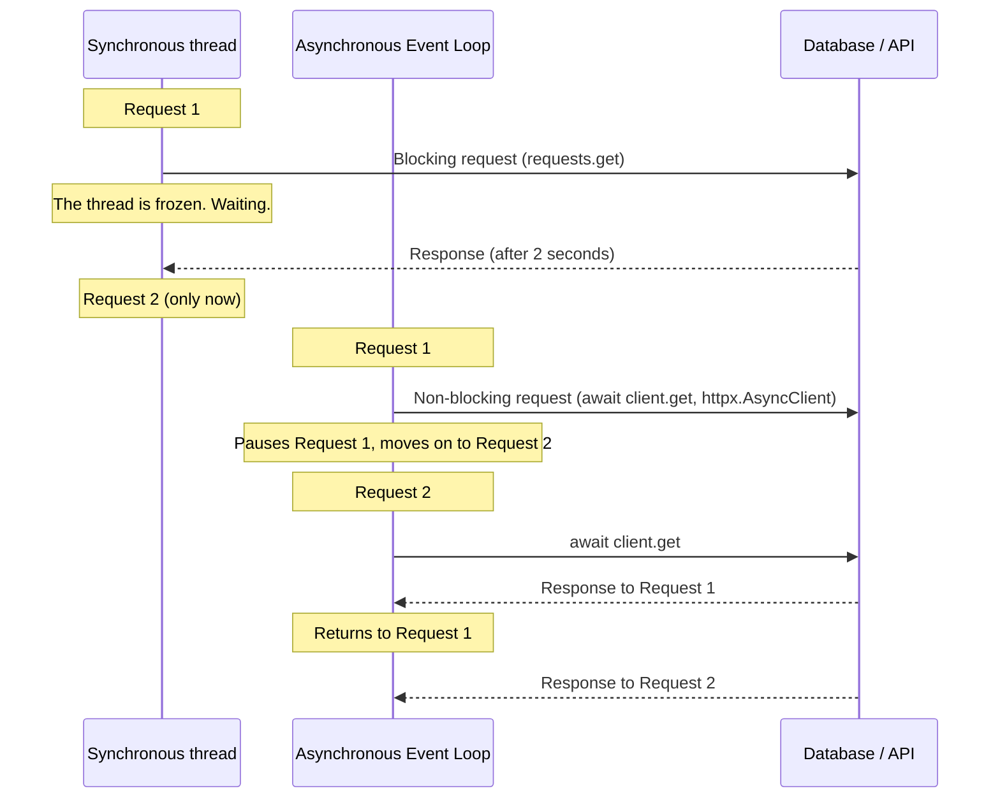
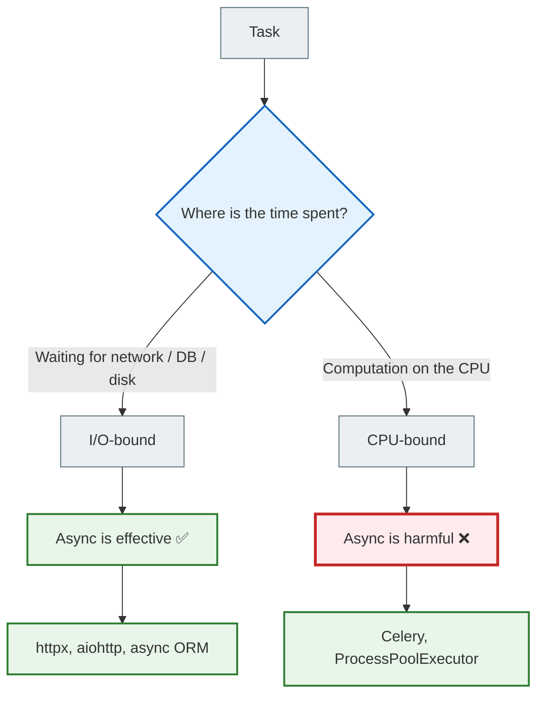

# 01 — Synchronous and asynchronous execution

## Why you need this

Before writing any async code in Django, you need to understand one simple thing: **why did the idea of asynchrony appear at all?**

The answer is not in the syntax — it is in how computers wait.

---

## 🧠 Mental model

Imagine a cook in a restaurant.

**The synchronous cook:** puts water on the stove, stands there watching it until it boils. Only then does he chop the carrots. Then he waits again.

**The asynchronous cook:** puts water on the stove, and while the water heats up, chops the carrots. Hears the signal and returns to the stove.

There is one cook. There is no parallel kitchen. But the second cook gets much more done in the same time — because he does not wait in vain.

That is the essence of asynchronous programming.

---

## Key terms

| Term | What it means |
|--------|-----------|
| **Synchronous execution** | The program performs operations strictly in order. The next one starts only after the previous one finishes |
| **Asynchronous execution** | The program can pause one operation and run another while the first one is waiting |
| **Blocking operation** | An operation that completely stops the thread of execution until it finishes |
| **Non-blocking operation** | An operation that starts in the background without stopping the thread |
| **I/O-bound task** | A task where most of the time is spent waiting for input/output: network, disk, DB |
| **CPU-bound task** | A task where most of the time is spent on CPU computation |
| **Concurrency** | A program's ability to have several tasks "in progress" at the same time (not necessarily in parallel) |
| **Parallelism** | Physically running several tasks at the same time on different CPU cores |
| **Cooperative multitasking** | A task voluntarily "steps aside" on its own and hands control to the next one |
| **Event loop** | An infinite loop that tracks which task is ready to continue |

---

## Why asynchrony exists: the blocking problem

### Let's look at the speeds

If we introduce a human time scale (L1 cache = 3 seconds):

| Operation | Real time | "Human" equivalent |
|----------|-------------|----------------------|
| L1 cache hit | ~1 ns | 3 seconds |
| RAM access | ~100 ns | 5 minutes |
| SSD read | ~100 µs | 3.5 days |
| Network request | ~150 ms | 14 years |

When a Django view makes a request to an external API, the OS thread simply **stands there waiting for 14 notional years**. It does nothing else. It just waits.

If 100 users hit such an endpoint at the same time, the server will freeze 100 threads. That quickly exhausts memory.

Asynchrony solves this problem: instead of freezing the thread, the program **does other work** while it waits.

---

## Sync vs Async: a comparison table

| Characteristic | Synchronous code | Asynchronous code |
|---------------|---------------|-----------------|
| Execution | Strictly sequential | Can switch between tasks |
| Blocking | Blocks the thread during I/O | Does not block — hands over control |
| Code complexity | Simpler | A bit more complex |
| Number of threads | One thread = one task | One thread = many tasks |
| Ideal task | CPU-bound | I/O-bound |
| Dangerous task | Slow parallel I/O | CPU-bound (blocks the event loop) |

---

## How it works: the execution sequence



In the synchronous version it takes 4 seconds (2 + 2). In the asynchronous one, ~2 seconds, because both requests run "at the same time".

---

## The difference between concurrency and parallelism

This is an important difference that people often confuse.

**Parallelism** is physically simultaneous execution on different CPU cores:

```
Core 1: [Task A =========]
Core 2: [Task B =========]
```

**Concurrency** is switching between tasks on a single thread:

```
Thread: [Task A ----][Task B ----][Task A ----][Task B ----]
```

`asyncio` is concurrency, not parallelism. One thread, many tasks. While one task waits on the network, another runs.

---

## CPU-bound vs I/O-bound



---

## Example: blocking vs non-blocking code

### ❌ Synchronous code — blocks the thread

```python
import time

def fetch_user():
    time.sleep(2)  # Simulates a DB query
    return {"id": 1, "name": "Alice"}

def fetch_posts():
    time.sleep(2)  # Simulates an API request
    return [{"title": "Post 1"}]

# Takes 4 seconds (2 + 2)
user = fetch_user()
posts = fetch_posts()
```

### ✅ Asynchronous code — does not block

```python
import asyncio

async def fetch_user():
    await asyncio.sleep(2)  # Does not block! Hands over control
    return {"id": 1, "name": "Alice"}

async def fetch_posts():
    await asyncio.sleep(2)
    return [{"title": "Post 1"}]

async def main():
    # Run concurrently — ~2 seconds instead of 4
    user, posts = await asyncio.gather(fetch_user(), fetch_posts())

asyncio.run(main())
```

The key difference: unlike `time.sleep()`, `asyncio.sleep()` **does not block the thread** — it hands control to the event loop while it waits.

---

## A common beginner mistake

### ❌ "Async is always faster"

```python
# This is NOT faster code — it is just async syntax wrapped around CPU work
async def compute():
    result = sum(range(10_000_000))  # CPU-bound! Blocks the event loop
    return result
```

**The problem:** `sum(range(10_000_000))` is a CPU-bound operation. It does not "wait" — it actively computes. Wrapping it in `async def` changes nothing — the event loop is frozen for the entire computation.

**Rule:** Async only helps when there is real **waiting** (I/O): network, database, file system.

---

### ❌ "Async = parallelism"

```python
# The two functions do NOT run simultaneously on different CPU cores
# This is switching within a single thread
async def task_a():
    await asyncio.sleep(1)

async def task_b():
    await asyncio.sleep(1)

# Concurrency, not parallelism
await asyncio.gather(task_a(), task_b())
```

---

## Practical exercise

### Task 1

Write a synchronous function `fetch_three_urls()` that calls `time.sleep(1)` three times and prints a message after each call. Measure the execution time with `time.time()`.

Then rewrite it as an asynchronous version with `asyncio.sleep(1)` and `asyncio.gather()`. Compare the times.

### Task 2

Explain in your own words: why is `asyncio` concurrency and not parallelism? Give a real-life analogy (not the cook).

### Task 3

Determine whether each task is I/O-bound or CPU-bound:
- Downloading an image from the internet
- Compressing a video file
- A query to a PostgreSQL database
- Computing the Fibonacci number for a large n
- Sending an email via SMTP

### Self-check

- [ ] I understand what a blocking operation is
- [ ] I can explain the difference between sync and async code
- [ ] I know the difference between concurrency and parallelism
- [ ] I understand that async is effective only for I/O-bound tasks
- [ ] I can write a simple `asyncio.gather()` example

---

## Summary

Asynchronous programming exists because of the huge difference in speed between the CPU and external operations (network, disk, DB). Synchronous code forces the thread to sit idle while waiting — async code switches to another task during that time.

Async is **concurrency** (switching between tasks), not **parallelism** (simultaneous execution on different cores). It is a good fit for I/O-bound tasks and harmful for CPU-bound ones.

In the next document, we will look at how Python implements this idea with `asyncio`.

→ [02_asyncio.md](async_02_asyncio_full.md)
