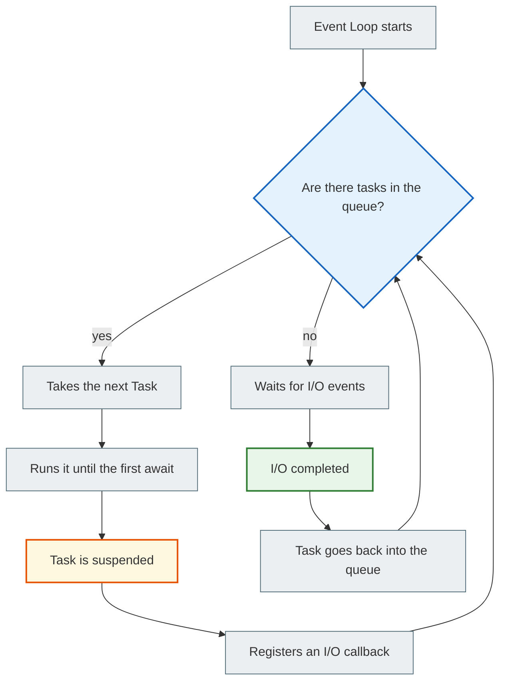
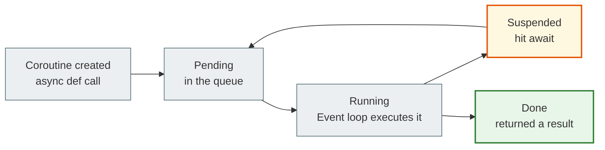
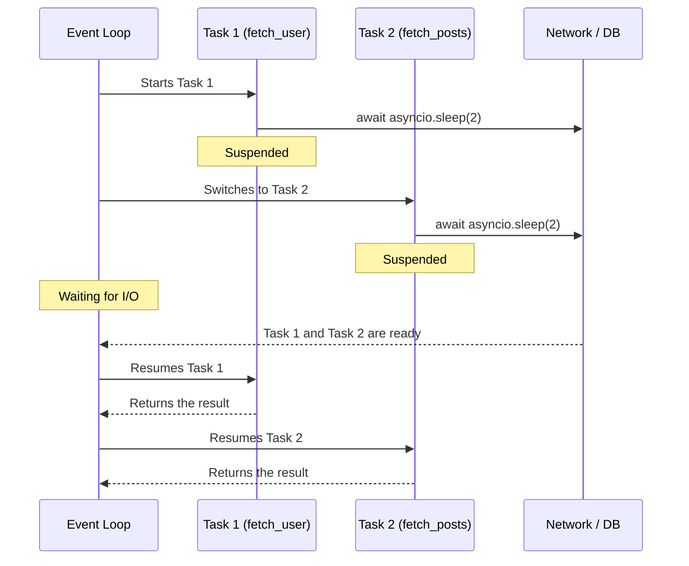

# 02 — Python asyncio: how async code runs

## Why you need this

You already know that async is needed for I/O-bound tasks. But how exactly does Python run this code?

What happens when you write `async def`? What is `await`? Why does calling an async function not start anything?

This document explains the mechanics from the inside.

---

## 🧠 Mental model

Imagine a waiter in a restaurant.

The waiter (the event loop) goes around the tables (coroutines). Each table may have an order in the "being cooked in the kitchen" state or the "ready to serve" state.

The waiter does not stand by the stove and wait. He goes around all the tables in a circle: if a dish is not ready, he moves on. When the kitchen signals "ready", he returns to exactly that table.

`await` is the moment when the waiter hands the order to the kitchen and goes to the next table.

---

## Key terms

| Term | What it means |
|--------|-----------|
| `async def` | Declares a coroutine function — a function that can pause |
| **Coroutine object** | The object returned when you call an async function (not the result!) |
| `await` | Pauses the coroutine and hands control to the event loop |
| **Event loop** | The central scheduler — an infinite loop that manages tasks |
| **Task** | A coroutine wrapped in an object so the event loop can schedule it |
| `asyncio.create_task()` | Schedules a coroutine to run in the background without waiting for it to finish |
| `asyncio.gather()` | Runs several coroutines in parallel and waits for all of them |
| **Cooperative multitasking** | Each coroutine decides for itself when to hand over control (via `await`) |

---

## How it works: step by step

### 1. `async def` is not an ordinary function

```python
async def fetch_data():
    await asyncio.sleep(1)
    return {"data": "result"}

# Calling it does NOT run the function!
coro = fetch_data()
print(type(coro))  # <class 'coroutine'>

# To run it, you need an event loop or await
result = await fetch_data()  # only inside an async context
```

When you call an `async def` function, you get a **coroutine object**. It is like a recipe, not a finished dish. The event loop will execute this recipe when its turn comes.

### 2. `await` — a suspension point

```python
async def view_handler():
    # await: the coroutine pauses here
    # the event loop can run other tasks while we wait
    data = await fetch_from_database()
    return data
```

`await` does two things:
1. Hands control to the event loop
2. Resumes execution when the operation is complete — from the very same place

### 3. The event loop — the heart of asyncio



The event loop never sleeps aimlessly. It either runs a task or waits for a signal from the OS ("I/O completed").

---

## Coroutine lifecycle



---

## Sequential async vs concurrent async

### ❌ Sequential — gives no advantage

```python
import asyncio

async def fetch_user():
    await asyncio.sleep(2)  # Wait 2 sec
    return {"id": 1}

async def fetch_posts():
    await asyncio.sleep(2)  # Wait another 2 sec
    return [{"title": "Post 1"}]

async def main():
    # await one after another — 4 seconds
    user = await fetch_user()
    posts = await fetch_posts()
    print(user, posts)

asyncio.run(main())
# Total time: ~4 seconds
```

### ✅ Concurrent with gather — gives an advantage

```python
import asyncio

async def fetch_user():
    await asyncio.sleep(2)
    return {"id": 1}

async def fetch_posts():
    await asyncio.sleep(2)
    return [{"title": "Post 1"}]

async def main():
    # Run both at the same time — 2 seconds
    user, posts = await asyncio.gather(fetch_user(), fetch_posts())
    print(user, posts)

asyncio.run(main())
# Total time: ~2 seconds
```

`gather` starts all the coroutines and waits until **all** of them finish. The results are returned in the same order as the arguments.

---

## create_task vs gather: the difference

```python
import asyncio

async def background_task(name, delay):
    await asyncio.sleep(delay)
    print(f"{name} finished")
    return name

async def main():
    # create_task — schedule in the background, don't wait right away
    task_a = asyncio.create_task(background_task("A", 2))
    task_b = asyncio.create_task(background_task("B", 1))

    print("Tasks scheduled, continuing work...")
    
    # Now we wait for the results
    result_a = await task_a  # "A"
    result_b = await task_b  # "B"
```

| | `create_task` | `gather` |
|--|--------------|---------|
| When it starts | Immediately, in the background | Immediately, all together |
| Returns | A `Task` object | A list of results |
| When to wait | You can await later | Waits for all at once |
| Use case | Background logic + main logic | Parallel requests |

---

## How the event loop manages several tasks



---

## Common beginner mistakes

### ❌ Mistake 1: forgot `await`

```python
async def get_data():
    return "result"

async def main():
    # Without await, this is a coroutine object, not the result!
    data = get_data()
    print(data)  # <coroutine object get_data at 0x...>
```

```python
# ✅ Correct
async def main():
    data = await get_data()
    print(data)  # "result"
```

### ❌ Mistake 2: `time.sleep()` inside an async function

```python
import time

async def my_view():
    time.sleep(2)  # BLOCKS the event loop for 2 seconds!
    return "ok"
```

**What happens:** `time.sleep()` is a synchronous function. It blocks the whole thread — including the event loop. All other requests hang.

```python
# ✅ Correct
import asyncio

async def my_view():
    await asyncio.sleep(2)  # Hands control to the event loop
    return "ok"
```

### ❌ Mistake 3: CPU-bound work in an async function

```python
async def process():
    # This blocks the event loop for the entire computation!
    result = [x**2 for x in range(10_000_000)]
    return result
```

CPU-bound tasks should be moved to a `ProcessPoolExecutor` or Celery — not into async functions.

---

## Practical exercise

### Task 1

Write three async functions: `fetch_weather()`, `fetch_news()`, `fetch_stock_price()` — each one "waits" 1 second with `asyncio.sleep(1)`.

Run them:
- sequentially (with three separate `await`s) — measure the time
- in parallel (with `asyncio.gather`) — measure the time

Compare the results.

### Task 2

Write a function `run_with_tasks()` that:
1. Schedules three tasks with `asyncio.create_task()`
2. Prints "Tasks scheduled" after scheduling (before they finish)
3. Waits for the result of each task

### Task 3

Explain: what happens if you write `time.sleep(5)` inside an async function? Why is it bad? How do you fix it?

### Self-check

- [ ] I understand that `async def` returns a coroutine object, not a result
- [ ] I know what `await` does
- [ ] I can explain how the event loop manages several tasks
- [ ] I understand the difference between `gather()` and `create_task()`
- [ ] I know why `time.sleep()` is dangerous in async code

---

## Summary

`async def` declares a coroutine function; calling it returns a coroutine object — not the result. `await` is a suspension point: the coroutine stops and hands control to the event loop, which runs other tasks.

`asyncio.gather()` lets you run several coroutines at the same time and significantly reduce the execution time of I/O-bound operations. `create_task()` schedules a task in the background without waiting for it immediately.

The main danger: `time.sleep()` and CPU-bound code block the event loop — async does not save you from that.

→ [03_asgi.md](async_03_asgi_full.md)
