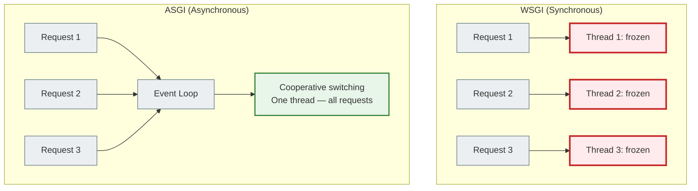
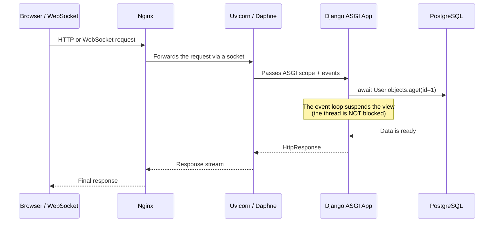

# 03 — WSGI and ASGI: how Django got async support

## Why this matters

You already know how to write `async def` functions. But if you simply write an `async def` Django view and deploy it on a regular server, nothing special will happen.

For Django to truly serve thousands of concurrent connections, it needs the right infrastructure. That infrastructure is called **ASGI**.

---

## 🧠 Mental model

Imagine a call center.

**WSGI call center:** For every incoming call there is one operator who deals only with that customer. While the customer is thinking or waiting for an answer, the operator just sits silently and waits along with them. If 100 more customers call, you need 100 operators.

**ASGI call center:** One operator can handle several conversations at once. While one customer "puts the call on hold" to check something, the operator answers another one. A single operator efficiently serves dozens of connections.

WSGI is the first call center. ASGI is the second.

---

## Key terms

| Term | What it means |
|--------|-----------|
| **WSGI** | Web Server Gateway Interface — the standard for synchronous Python applications |
| **ASGI** | Asynchronous Server Gateway Interface — the standard for async Python applications |
| **Gunicorn** | A popular WSGI server (multiple OS threads/processes) |
| **Uvicorn** | A fast ASGI server based on `uvloop` |
| **Daphne** | An ASGI server from the Django team (supports WebSockets) |
| **Hypercorn** | An ASGI server with HTTP/2 and HTTP/3 support |
| **wsgi.py** | Django's entry point for WSGI servers |
| **asgi.py** | Django's entry point for ASGI servers |

---

## WSGI: the classic standard and its limitations

WSGI appeared in 2003 as a single standard for Python web applications. It is simple and reliable — for its time.

How WSGI works:
1. The client sends an HTTP request
2. The server allocates a separate OS thread (or process) for that request
3. Django processes the request synchronously
4. The response is sent to the client
5. The thread is released

**The problem:** every request = one blocked thread. While Django waits for a response from the database or an API, the thread just sits there. For 100 concurrent requests you get 100 frozen threads. Memory and resources are wasted.

WSGI is a good fit for:
- Standard CRUD applications
- Fast requests (< 100ms)
- Low load

WSGI is a poor fit for:
- WebSockets (persistent connections)
- Streaming (large files, SSE)
- High concurrency (thousands of simultaneous requests)

---

## ASGI: the modern standard

ASGI (2018) is the async successor to WSGI. Instead of allocating a thread per connection, an ASGI server uses an **event loop**.

A single event loop can "juggle" thousands of connections at the same time — because while one is waiting for the database, another one is being processed.



---

## WSGI vs ASGI: comparison table

| Characteristic | WSGI | ASGI |
|---------------|------|------|
| Year introduced | 2003 | 2018 |
| Execution type | Synchronous | Asynchronous |
| Threads | 1 thread = 1 request | 1 event loop = N requests |
| WebSockets | ❌ Not supported | ✅ Supported |
| Streaming | Limited support | ✅ Full support |
| Async views | Emulation (one loop per request) | ✅ Native support |
| Servers | Gunicorn, uWSGI | Uvicorn, Daphne, Hypercorn |
| Django support | Standard (since 1.0) | Since Django 3.0+ |

---

## Why Django needs ASGI for real async

Technically, Django can run an `async def` view even under a WSGI server. But this is how it does it:

> For every request to an async view, Django creates a **temporary event loop** inside an OS thread, runs the view, and destroys the loop.

This:
- Wastes resources creating/destroying the event loop
- Keeps the thread blocked (the WSGI thread is not released)
- Gives no concurrency benefit at all

Real asynchrony is when the ASGI server itself manages the event loop and Django runs views natively, without extra threads.

---

## ASGI Request Lifecycle



---

## ASGI servers: Uvicorn, Daphne, Hypercorn

### Uvicorn

```bash
pip install uvicorn
uvicorn myproject.asgi:application --host 0.0.0.0 --port 8000 --workers 4
```

- The fastest option for plain HTTP and WebSocket
- Built on `uvloop` (a faster replacement for the standard asyncio event loop)
- Recommended for production with Gunicorn as the process manager

### Daphne

```bash
pip install daphne
daphne -b 0.0.0.0 -p 8000 myproject.asgi:application
```

- The official ASGI server from Django/Channels
- Ideal for WebSocket applications
- Since Channels 4 it is not installed automatically: use `pip install daphne` or `pip install "channels[daphne]"` (our `requirements.txt` has `daphne>=4.0`)

### Hypercorn

```bash
pip install hypercorn
hypercorn myproject.asgi:application --bind 0.0.0.0:8000
```

- Supports HTTP/2 and HTTP/3
- A good choice if you need HTTP/2

---

## The asgi.py file in Django

When you create a Django project with the `django-admin startproject` command, an `asgi.py` file is generated automatically:

```python
# myproject/asgi.py
import os
from django.core.asgi import get_asgi_application

os.environ.setdefault('DJANGO_SETTINGS_MODULE', 'myproject.settings')

# Entry point for the ASGI server
application = get_asgi_application()
```

This file is the equivalent of `wsgi.py`, but for ASGI servers. Uvicorn, Daphne and Hypercorn look for exactly the `application` object in this file.

If you use Django Channels for WebSockets, `asgi.py` is extended:

```python
# myproject/asgi.py (with Channels)
import os
from django.core.asgi import get_asgi_application
from channels.routing import ProtocolTypeRouter, URLRouter

os.environ.setdefault('DJANGO_SETTINGS_MODULE', 'myproject.settings')

application = ProtocolTypeRouter({
    "http": get_asgi_application(),
    "websocket": URLRouter([...]),
})
```

---

## A common beginner mistake

### ❌ Running async Django under Gunicorn without ASGI

```bash
# This is WSGI — async views get no benefit
gunicorn myproject.wsgi:application
```

```bash
# ✅ Correct for async — ASGI via Uvicorn
uvicorn myproject.asgi:application --workers 4
```

### ❌ Thinking any server will do

Django will not raise an error if you run an async view under WSGI. The code will simply run slower and without any concurrency benefit.

---

## Practical exercise

### Task 1

Find the `asgi.py` file in your Django project. Read it. Which function does it import from Django? What does `get_asgi_application()` return?

### Task 2

Install `uvicorn` and run your Django project via ASGI:

```bash
pip install uvicorn
uvicorn myproject.asgi:application --reload
```

Compare it with `python manage.py runserver`. What changed in the logs?

### Task 3

Explain in your own words: why is a WSGI server a poor fit for WebSocket connections? What happens to the thread if a client stays connected over WebSocket for 10 minutes?

### Self-check

- [ ] I understand what WSGI is and why it was created
- [ ] I understand how ASGI differs from WSGI
- [ ] I know what the `asgi.py` file is for
- [ ] I can name at least two ASGI servers and their differences
- [ ] I understand why an async view under WSGI gives no benefit

---

## Summary

WSGI is a synchronous standard: one thread per request. Under heavy load and with I/O-bound tasks, threads are wasted.

ASGI solves this problem: one event loop serves thousands of connections. While one is waiting for the database, another is being processed. Django has supported ASGI since version 3.0.

To deploy ASGI Django, people use Uvicorn (speed), Daphne (WebSockets), or Hypercorn (HTTP/2). The entry point is the `asgi.py` file.

→ [04_django_async_views.md](async_04_django_async_views_full.md)
