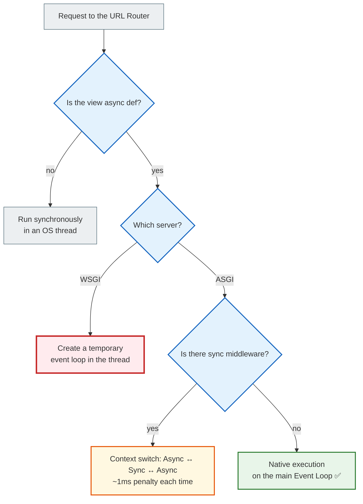
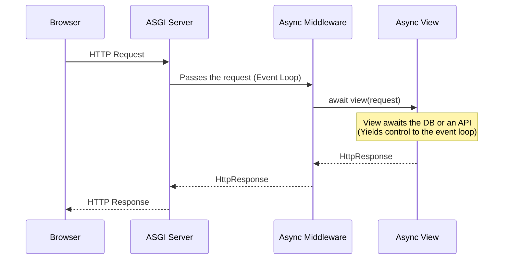
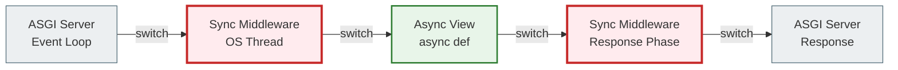

# 04 — Django Async Views: how to write them and when to use them

## Why this matters

Now you have the foundation: you know asyncio, you understand the event loop, and you know what ASGI is. Time to move on to Django itself.

What does an async view look like? How does Django run it? When is it actually useful?

---

## 🧠 Mental model

A regular sync view is a waiter who takes an order, goes to the kitchen, stands there waiting for the dish to be ready, then returns to the customer. Everything stops.

An async view is a waiter who takes an order, passes it to the kitchen and immediately returns to the dining room. When the dish is ready, they bring it out. Meanwhile, they have served three more customers.

But there is a catch: if the cook (the ORM) still works synchronously, the waiter is still forced to wait. `async def` is only half the job.

---

## Key terms

| Term | What it means |
|--------|-----------|
| **Sync view** | A regular `def` function — runs in an OS thread |
| **Async view** | An `async def` function — can suspend itself and not block the event loop |
| **Middleware** | Layers that process the request/response before and after the view |
| **Context switch** | Switching between the async event loop and a sync OS thread |
| **SynchronousOnlyOperation** | A Django error raised when sync code runs in an async context |

---

## What an async view looks like

### Sync view (regular)

```python
from django.http import JsonResponse

def my_sync_view(request):
    # Runs synchronously in an OS thread
    return JsonResponse({"status": "ok", "mode": "sync"})
```

### Async view (minimal)

```python
from django.http import JsonResponse

async def my_async_view(request):
    # Runs on the event loop (under ASGI)
    return JsonResponse({"status": "ok", "mode": "async"})
```

The only difference is `async def`. Django automatically detects the view type and runs it accordingly.

---

## How Django runs an async view

The result depends on which server you use:



---

## Pure Async Lifecycle (maximum performance)



The whole path goes through the event loop. No context switches. Maximum efficiency.

---

## Mixed Sync/Async: the switching penalty



Each `switch` costs about **1 millisecond** of penalty. If the middleware is synchronous, Django has to switch back and forth between the event loop and an OS thread on every request.

---

## An async view with a real example: an external API

```python
import httpx
from django.http import JsonResponse

async def weather_view(request):
    city = request.GET.get("city", "Kyiv")
    
    async with httpx.AsyncClient() as client:
        # await: the view is suspended, the event loop serves others
        response = await client.get(
            f"https://api.example.com/weather?city={city}",
            timeout=5.0
        )
        data = response.json()
    
    return JsonResponse({
        "city": city,
        "temperature": data["temp"],
        "description": data["desc"]
    })
```

While `client.get()` is waiting for a response from the external server, Django can serve other users. That is exactly the advantage of an async view.

---

## An async view with several parallel requests

```python
import asyncio
import httpx
from django.http import JsonResponse

async def dashboard_view(request):
    async with httpx.AsyncClient() as client:
        # Start three requests at the same time
        weather_task = client.get("https://api.example.com/weather")
        news_task = client.get("https://api.example.com/news")
        stocks_task = client.get("https://api.example.com/stocks")

        # Wait for all three — time = time of the slowest request
        weather, news, stocks = await asyncio.gather(
            weather_task, news_task, stocks_task
        )

    return JsonResponse({
        "weather": weather.json(),
        "news": news.json(),
        "stocks": stocks.json()
    })
```

Instead of 3 seconds (1+1+1) we get ~1 second — the time of the slowest of the three.

---

## When async views are useful

✅ **Several external API requests** — run in parallel via `gather` instead of sequentially

✅ **Long-lived connections** — WebSockets, long polling, Server-Sent Events

✅ **High concurrency** — thousands of simultaneous requests with low CPU load

✅ **Streaming responses** — sending large data in chunks

---

## When async views are NOT useful

| Situation | Reason |
|----------|---------|
| WSGI server | The thread is blocked anyway — no benefit |
| Sync middleware in the stack | Context switches wipe out any gain |
| Standard CRUD | ORM + a fast query — a sync view is simpler and sufficient |
| CPU-bound computation | Blocks the event loop — worse than sync |
| Database transactions | `transaction.atomic()` is not natively supported in async |

---

## Important

> **Don't make a view async just because you can.**
>
> An async view adds complexity: you need an ASGI server, async middleware, and async ORM methods.
> If your view makes one database query and returns a template, a sync view is simpler, clearer and perfectly sufficient.
>
> An async view is justified when there is a **real I/O bottleneck**: several external API requests, WebSockets, or high concurrency.

---

## A common beginner mistake

### ❌ Sync ORM in an async view

```python
from django.http import JsonResponse
from myapp.models import User

async def user_view(request):
    # ERROR! A standard ORM call in an async context
    user = User.objects.get(id=1)  # Will raise SynchronousOnlyOperation!
    return JsonResponse({"name": user.username})
```

### ✅ Correct — an async ORM method

```python
async def user_view(request):
    user = await User.objects.aget(id=1)  # The asynchronous variant
    return JsonResponse({"name": user.username})
```

More on the async ORM in the next document.

---

## Testing async views

Django provides `AsyncRequestFactory` for testing:

```python
from django.test import AsyncRequestFactory, TestCase
from myapp.views import my_async_view

class MyAsyncViewTest(TestCase):
    async def test_async_view(self):
        factory = AsyncRequestFactory()
        request = factory.get('/async-url/')
        
        # await — because the view is asynchronous
        response = await my_async_view(request)
        
        self.assertEqual(response.status_code, 200)
```

---

## Practical exercise

### Task 1

Create a Django app and write two views:
- `sync_view` — returns `JsonResponse({"type": "sync"})`
- `async_view` — the same, but `async def`

Run it with `uvicorn` and check both in a browser or with `curl`.

### Task 2

Write `async def aggregator_view(request)` that runs two `await asyncio.sleep(1)` calls in parallel via `asyncio.gather()`. Measure the execution time (you can use `time.time()`).

### Task 3

Explain: what happens if sync middleware sits in front of an async view under ASGI? How many context switches happen per request?

### Self-check

- [ ] I can write an async def view in Django
- [ ] I understand the difference between running an async view under WSGI and under ASGI
- [ ] I know what a context switch is and why it costs ~1ms
- [ ] I understand when an async view is appropriate and when it is not
- [ ] I know that the standard `User.objects.get()` cannot be called in an async view

---

## Summary

An async view in Django is simply `async def` instead of `def`. But to get real benefits you need an ASGI server and async middleware. Under WSGI, an async view runs with no concurrency benefit.

Async views are useful for I/O-bound tasks: several external API requests, WebSockets, streaming. For standard CRUD, a sync view is simpler and perfectly sufficient.

The main trap: sync ORM in an async view will raise `SynchronousOnlyOperation`. More on that in the next document.

→ [05_async_orm.md](async_05_async_orm_full.md)
