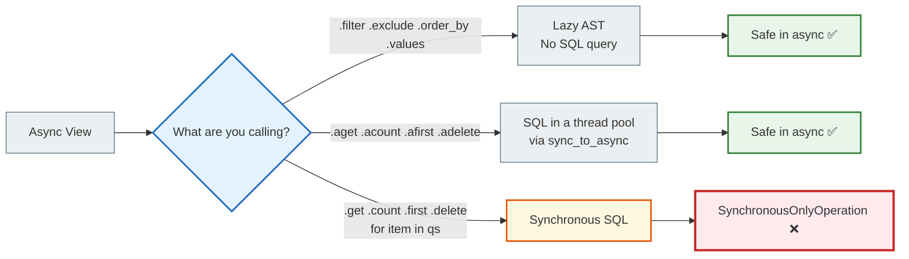
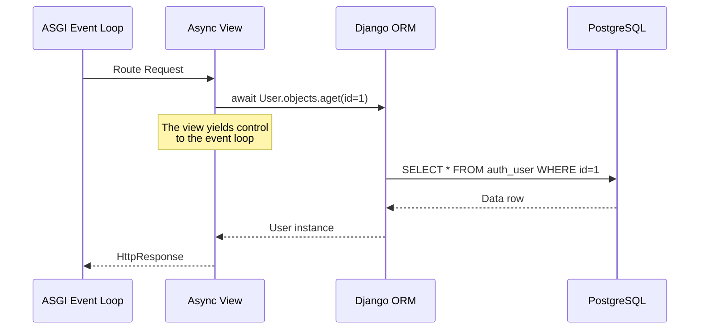

# 05 — Async ORM: why an async view does not make the database asynchronous

## Why this matters

You wrote an `async def view`. Well done. But inside it you used a regular `User.objects.get(id=1)` — and Django crashed with a `SynchronousOnlyOperation` error.

Why? Isn't the view async?

This document explains: **`async def` does not magically make the ORM asynchronous**. And what to do about it.

---

## 🧠 Mental model

Imagine an async view as a modern asynchronous office where everyone communicates via a messenger — nobody waits by the phone.

But the database is an old archive in the basement, where everything is on paper and synchronous. To get a document, you have to physically go there, stand in line and bring the paper back.

If you write messages through the messenger (async) but fetch documents in person (sync ORM), the whole office waits until you come back.

The async ORM is a courier: you send a request, the courier goes to the archive, and meanwhile you keep working.

---

## Key terms

| Term | What it means |
|--------|-----------|
| **Lazy QuerySet** | A QuerySet that does NOT hit the database when it is created |
| **Evaluation** | The moment a QuerySet actually runs the SQL query |
| **SynchronousOnlyOperation** | A Django exception: sync code is running in an async context |
| `aget()` | Async version of `get()` |
| `acount()` | Async version of `count()` |
| `afirst()` | Async version of `first()` |
| `adelete()` | Async version of `delete()` |
| `asave()` | Async version of `save()` |
| `async for` | Async iteration over a QuerySet without blocking |

---

## The problem: why the sync ORM blocks an async view

The standard database adapters (psycopg2, mysqlclient) are **purely synchronous**. They make a network request to PostgreSQL and block the thread until they get a response.

If you call such an adapter from inside the async event loop, you block the entire event loop. All other requests "hang".

Django protects you from this: if it detects an async context, it raises an exception:

```python
from django.http import JsonResponse
from myapp.models import Article

async def article_view(request):
    # ❌ ERROR! Sync ORM in an async context
    article = Article.objects.get(id=1)
    return JsonResponse({"title": article.title})
```

```
django.core.exceptions.SynchronousOnlyOperation:
You cannot call this from an async context - use a thread or sync_to_async.
```

Django literally says: "You can't do this here. Either use a thread or sync_to_async."

---

## Important: `filter()` is safe, `get()` is not

The most common confusion among beginners is that `filter()` does not run SQL.



---

## filter() is not an SQL query yet

```python
async def view(request):
    # This is SAFE — filter() only builds a QuerySet, it does not run SQL
    qs = Article.objects.filter(published=True).order_by("-created_at")

    # This will run SQL — the async version is needed
    count = await qs.acount()

    return JsonResponse({"count": count})
```

`filter()`, `exclude()`, `order_by()`, `values()`, `annotate()` are all **lazy** operations. They only build a description of the query (an AST). SQL runs only when you **ask for the data**: `get()`, `first()`, `list()`, `for item in qs`.

---

## Table: sync ORM → async ORM

| Synchronous method | Asynchronous counterpart | What it does |
|-----------------|-------------------|-----------|
| `.get(...)` | `.aget(...)` | Returns a single object |
| `.first()` | `.afirst()` | The first one or None |
| `.last()` | `.alast()` | The last one or None |
| `.count()` | `.acount()` | Number of records |
| `.exists()` | `.aexists()` | Whether there is at least one |
| `.delete()` | `.adelete()` | Delete |
| `.update(...)` | `.aupdate(...)` | Update |
| `obj.save()` | `await obj.asave()` | Save the object |
| `for obj in qs` | `async for obj in qs` | Iterate over a QuerySet |
| `list(qs)` | `await sync_to_async(list)(qs)` or `[o async for o in qs]` | Get a list |

---

## Examples of correct async ORM usage

### Get a single object

```python
from myapp.models import User

async def user_detail_view(request, user_id):
    # ✅ aget instead of get
    try:
        user = await User.objects.aget(id=user_id)
    except User.DoesNotExist:
        return JsonResponse({"error": "Not found"}, status=404)

    return JsonResponse({"id": user.id, "name": user.username})
```

### Iterating over a QuerySet

```python
async def articles_view(request):
    # ✅ async for instead of for
    articles = []
    async for article in Article.objects.filter(published=True):
        articles.append({"id": article.id, "title": article.title})

    return JsonResponse({"articles": articles})
```

### List comprehension with async for

```python
async def articles_view(request):
    # ✅ Async list comprehension
    articles = [
        {"id": a.id, "title": a.title}
        async for a in Article.objects.filter(published=True).order_by("-created_at")[:10]
    ]
    return JsonResponse({"articles": articles})
```

### Save an object

```python
async def create_article_view(request):
    article = Article(
        title="New article",
        published=True
    )
    await article.asave()  # ✅

    return JsonResponse({"id": article.id})
```

---

## ORM Execution Model



---

## Async ORM limitations

### Transactions

`transaction.atomic()` is not yet natively supported in async mode:

```python
# ❌ Does not work directly in an async view
async def view(request):
    with transaction.atomic():
        ...
```

```python
# ✅ Via sync_to_async (details in the next document)
from asgiref.sync import sync_to_async

@sync_to_async
def create_with_transaction():
    with transaction.atomic():
        user = User.objects.create(username="new_user")
        Profile.objects.create(user=user)
    return user

async def view(request):
    user = await create_with_transaction()
```

### CONN_MAX_AGE

In async mode it is recommended to disable `CONN_MAX_AGE` (persistent connections) or use dedicated connection poolers:

```python
# settings.py
DATABASES = {
    "default": {
        "ENGINE": "django.db.backends.postgresql",
        # ...
        "CONN_MAX_AGE": 0,  # Disable persistent connections
    }
}
```

---

## A common beginner mistake

### ❌ Iterating with a regular `for`

```python
async def view(request):
    # ERROR! A regular for runs synchronous SQL
    for article in Article.objects.all():
        print(article.title)  # SynchronousOnlyOperation!
```

### ✅ Correct — `async for`

```python
async def view(request):
    async for article in Article.objects.all():
        print(article.title)  # ✅
```

---

## Practical exercise

### Task 1

Write an async view that:
1. Filters `Article.objects.filter(published=True)` (lazy — safe)
2. Counts the results via `acount()`
3. Gets the first 5 articles via `async for`
4. Returns a `JsonResponse` with the count and the list

### Task 2

Deliberately call `User.objects.get(id=1)` in an async view and read the full text of the `SynchronousOnlyOperation` error. Understand what Django suggests doing instead.

### Task 3

Write a function `create_article_async(title, content)` that:
- Creates an `Article` object
- Saves it via `asave()`
- Returns `article.id`

### Self-check

- [ ] I understand why the sync ORM blocks the async event loop
- [ ] I know that `filter()` is lazy and safe
- [ ] I can name 5 async counterparts of sync ORM methods
- [ ] I can iterate over a QuerySet with `async for`
- [ ] I know why transactions require separate handling

---

## Summary

An `async def` view does not magically make the ORM asynchronous. Standard ORM methods (`get`, `count`, `for`) block the event loop and lead to `SynchronousOnlyOperation`.

Django provides async counterparts: `aget`, `acount`, `afirst`, `adelete`, `asave`, `async for`. `filter()` and similar "builder" methods are lazy and safe in an async context.

Transactions and some other operations require `sync_to_async` — more on that in the next document.

→ [06_sync_to_async.md](async_06_sync_to_async_full.md)
