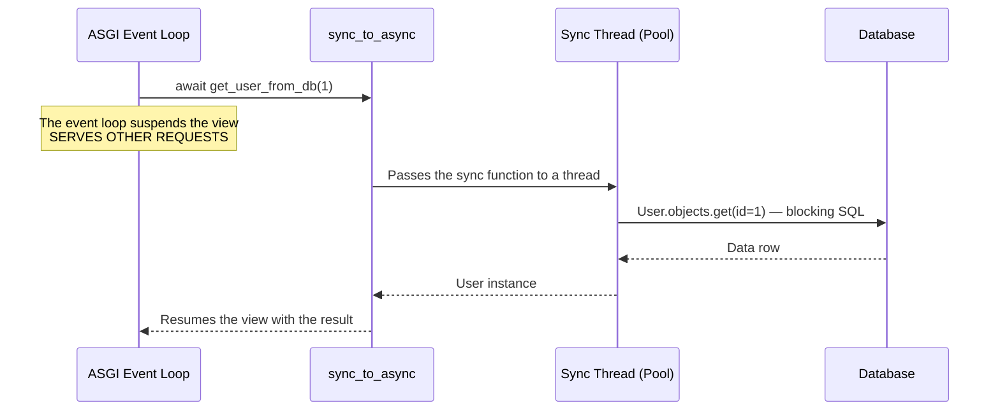
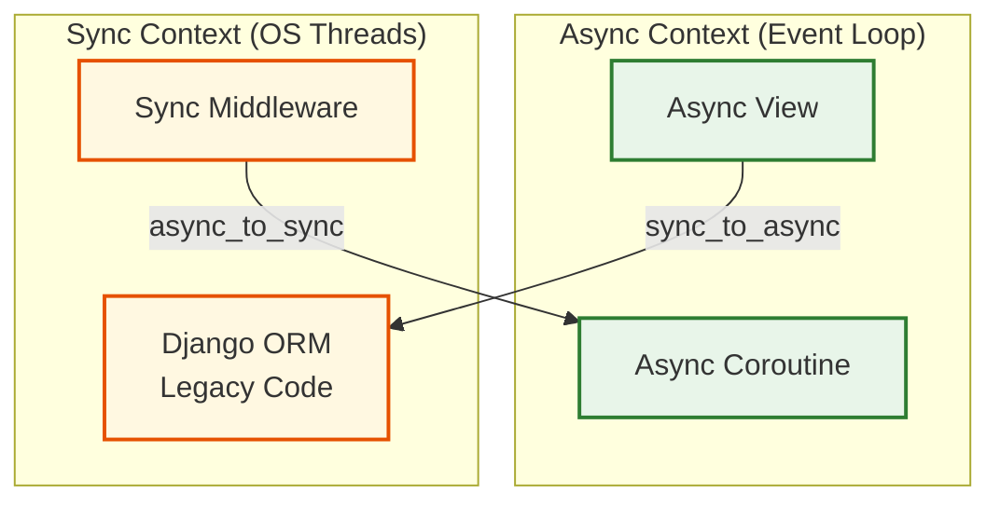
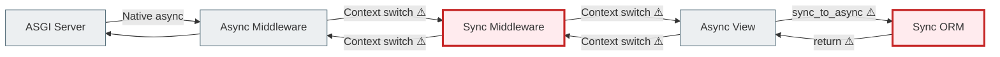

# 06 — sync_to_async: the bridge between sync and async code

## Why this matters

Not all code can simply be "made async". Some libraries work only synchronously. There are database transactions. There is legacy code.

`sync_to_async` and `async_to_sync` are two "bridges" that let you safely run sync code in an async context (and vice versa) without blocking the event loop.

---

## 🧠 Mental model

Imagine an international airport.

There is terminal A (the async zone) and terminal B (the sync zone). Passengers can't just run across the runway — there are dedicated transfers.

`sync_to_async` is a shuttle from the async terminal to the sync one. The async view "puts" the sync code on the shuttle, it travels to the sync terminal, does the work and comes back. Meanwhile, the async terminal serves other passengers.

`async_to_sync` is a shuttle in the opposite direction: for sync code that needs to "reach" an async function.

---

## Key terms

| Term | What it means |
|--------|-----------|
| `sync_to_async` | Wraps a sync function so it can be safely called from an async context |
| `async_to_sync` | Wraps an async function so it can be called from a sync context |
| **Thread-sensitive mode** | The default mode: sync code runs in one fixed thread |
| **Thread pool** | A pool of OS threads for running sync code in the background |
| **Context switch** | Switching between the event loop and an OS thread |
| **Zigzag anti-pattern** | Constant sync↔async switching that wipes out any benefit |

---

## `sync_to_async`: running sync code from an async view

### Basic syntax

```python
from asgiref.sync import sync_to_async

# Option 1: decorator
@sync_to_async
def get_user_from_db(user_id):
    from myapp.models import User
    return User.objects.get(id=user_id)  # Sync ORM — OK here

async def my_view(request):
    user = await get_user_from_db(1)  # Safe call
    return JsonResponse({"name": user.username})
```

```python
# Option 2: inline
from asgiref.sync import sync_to_async
from myapp.models import User

async def my_view(request):
    # Wrap the sync function inline
    user = await sync_to_async(User.objects.get)(id=1)
    return JsonResponse({"name": user.username})
```

---

## How it works internally



The event loop is **not blocked** while the sync code runs. It keeps serving other users while the thread executes the synchronous database query.

---

## Thread-sensitive mode: why it exists

By default, `sync_to_async` runs in `thread_sensitive=True` mode.

**Why this matters:** Database libraries (psycopg2, SQLite) require the connection to be opened and used in **the same thread**. If each call lands in a different thread, errors occur.

Thread-sensitive mode guarantees that all sync code from one request runs in one dedicated thread.

```python
# thread_sensitive=True (default) — one fixed thread
@sync_to_async(thread_sensitive=True)
def db_operation():
    return User.objects.get(id=1)

# thread_sensitive=False — a new thread for every call
@sync_to_async(thread_sensitive=False)
def isolated_operation():
    return do_something_thread_safe()
```

---

## Wrapping ORM transactions

Transactions (`transaction.atomic()`) are not natively supported in async mode — they need to be run via `sync_to_async`:

```python
from django.db import transaction
from asgiref.sync import sync_to_async
from myapp.models import User, Profile

@sync_to_async
def create_user_with_profile(username, email):
    with transaction.atomic():
        user = User.objects.create_user(username=username, email=email)
        Profile.objects.create(user=user, bio="")
        return user

async def register_view(request):
    if request.method == "POST":
        user = await create_user_with_profile(
            username=request.POST["username"],
            email=request.POST["email"]
        )
        return JsonResponse({"id": user.id, "created": True})
```

All the transactional logic lives inside the sync function. The async view just calls it through the bridge.

---

## `async_to_sync`: async code in a sync context

Sometimes you need the reverse: a regular sync view has to call an async function (for example, an async HTTP client):

```python
from asgiref.sync import async_to_sync
import httpx

async def fetch_data_async(url):
    async with httpx.AsyncClient() as client:
        response = await client.get(url)
        return response.json()

# A regular sync view
def my_sync_view(request):
    # Call the async function from a sync context
    data = async_to_sync(fetch_data_async)("https://api.example.com/data")
    return JsonResponse(data)
```

`async_to_sync` creates a temporary event loop, runs the async function in a separate thread, waits for the result and returns it to the sync context.

---

## Sync/Async Bridge: architecture diagram



---

## Zigzag Anti-Pattern: what not to do



Each ⚠️ is a ~1ms penalty. Under heavy load, this adds up.

**Rule:** minimize the number of sync/async boundary crossings. If most of your code is sync, keep it sync. Don't turn the whole stack async for the sake of a few async operations.

---

## A common beginner mistake

### ❌ Constant switching instead of isolation

```python
async def view(request):
    # Bad: each call is a separate context switch
    user = await sync_to_async(User.objects.get)(id=1)
    profile = await sync_to_async(Profile.objects.get)(user=user)
    articles = await sync_to_async(list)(Article.objects.filter(author=user))
    await sync_to_async(Log.objects.create)(action="view", user=user)
```

### ✅ Better: gather all the sync work into one function

```python
@sync_to_async
def get_user_data(user_id):
    user = User.objects.get(id=user_id)
    profile = Profile.objects.get(user=user)
    articles = list(Article.objects.filter(author=user))
    Log.objects.create(action="view", user=user)
    return user, profile, articles

async def view(request):
    user, profile, articles = await get_user_data(1)
```

One boundary crossing instead of four. The code is cleaner and more efficient.

---

## Practical exercise

### Task 1

Write an async view that:
1. Uses `sync_to_async` to get the list of all active users (`User.objects.filter(is_active=True)`)
2. Returns a `JsonResponse` with the list of names

### Task 2

Write a `@sync_to_async` function `create_order(user_id, product_id, quantity)` that:
- Uses `transaction.atomic()`
- Checks that the product exists
- Creates an `Order` object
- Updates the stock quantity

Call it from an async view.

### Task 3

Explain: why is `thread_sensitive=True` the default? What can go wrong if ORM queries run in different threads?

### Self-check

- [ ] I understand why `sync_to_async` is needed
- [ ] I can wrap sync ORM logic to call it from an async view
- [ ] I know why `thread_sensitive=True` is needed
- [ ] I understand the zigzag anti-pattern and can avoid it
- [ ] I know when to use `async_to_sync`

---

## Summary

`sync_to_async` is a bridge: it lets you safely run sync code (the ORM, transactions, legacy libraries) from an async context without blocking the event loop. The sync code runs in a dedicated thread.

`async_to_sync` is the reverse bridge: for calling async functions from a sync context.

The main rule: minimize the number of sync/async boundary crossings. Gather all the sync work into one function and make a single call instead of several.

→ [07_async_http_clients.md](async_07_async_http_clients_full.md)
