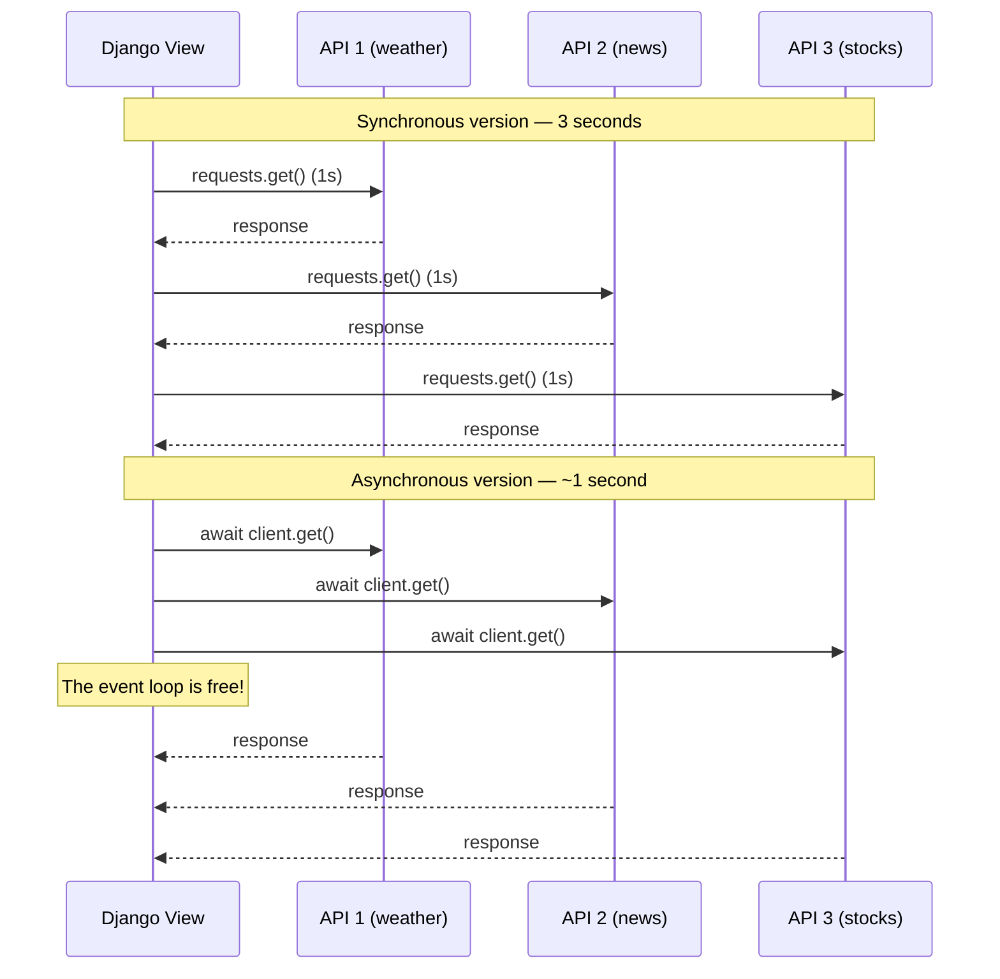
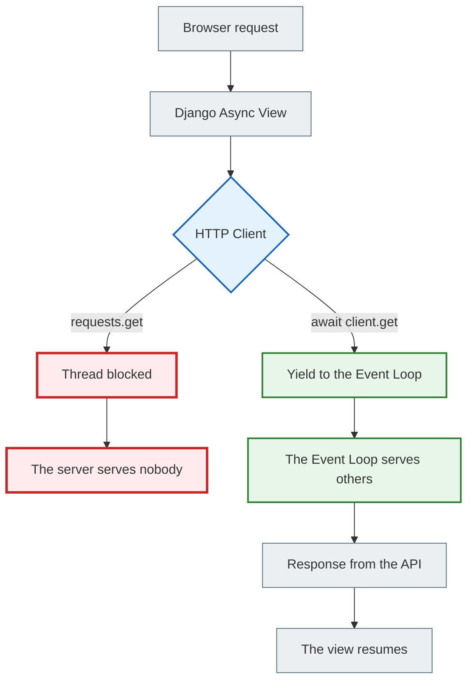

# 07 — Async HTTP Clients: making external requests the right way

## Why this matters

You already know how to write async views and you know about `sync_to_async`. Now for the most common real-world use case: **external HTTP requests**.

Every Django backend sooner or later calls external APIs: payment gateways, weather services, microservices. And this is where the problem starts — if you use `requests`, you block the event loop.

---

## 🧠 Mental model

Imagine a courier delivering letters.

**Sync courier (requests):** drives to the first address, stands at the door and waits until the owner opens it. Only after that does the courier go to the second address. The third comes only after the second.

**Async courier (httpx):** drops letters into all the mailboxes at once. Doesn't wait for anyone to open the door. Just drops the letter into the mailbox and rushes on to the next one.

One async courier gets more done than three sync couriers.

---

## Key terms

| Term | What it means |
|--------|-----------|
| `requests` | Python's standard sync HTTP library |
| `httpx` | A modern HTTP client: supports both sync and async modes |
| `aiohttp` | An async-only HTTP client (fully asynchronous) |
| `httpx.AsyncClient` | The async variant of the httpx client |
| `asyncio.gather` | Running several async operations in parallel |
| **Connection pool** | A cache of open connections for reuse |

---

## Why `requests` blocks an async view

`requests` is a great library for sync code. But inside an async view it is dangerous:

```python
import requests
from django.http import JsonResponse

async def weather_view(request):
    # ❌ WRONG: requests.get blocks the entire event loop!
    response = requests.get("https://api.example.com/weather")
    return JsonResponse(response.json())
```

**What happens:**
1. `requests.get()` is a synchronous function
2. It blocks the OS thread until it gets a response
3. But that OS thread is our event loop!
4. All other async requests "hang" for the entire wait

If the external API takes 3 seconds to respond, your whole server is frozen for 3 seconds for all users.

---

## Table: requests vs httpx vs aiohttp

| Characteristic | `requests` | `httpx` | `aiohttp` |
|---------------|-----------|---------|-----------|
| Mode | Sync only | Sync and async | Async only |
| API similarity | — | Almost identical to `requests` | Its own API |
| ASGI compatibility | ❌ Blocks the event loop | ✅ Full | ✅ Full |
| HTTP/2 | ❌ | ✅ | Partial |
| Migration effort | — | Minimal | Requires learning |
| Recommendation | Legacy WSGI apps | Modern ASGI Django | High-performance async |

**Recommendation for ASGI Django:** use `httpx.AsyncClient`. The API is almost identical to `requests` — a minimal learning curve.

---

## A single request: sync vs async

### ❌ Synchronous request (blocking)

```python
import requests
from django.http import JsonResponse

def sync_weather_view(request):
    # Sync view + sync client — the right pair for WSGI
    response = requests.get("https://api.example.com/weather?city=Kyiv")
    return JsonResponse(response.json())
```

Under WSGI this is fine. Under ASGI in an async view it is dangerous.

### ✅ Asynchronous request (non-blocking)

```python
import httpx
from django.http import JsonResponse

async def async_weather_view(request):
    city = request.GET.get("city", "Kyiv")
    
    async with httpx.AsyncClient() as client:
        # await: the view is suspended, the event loop serves others
        response = await client.get(
            f"https://api.example.com/weather?city={city}",
            timeout=10.0
        )
        data = response.json()
    
    return JsonResponse({
        "city": city,
        "temperature": data.get("temp"),
        "description": data.get("desc")
    })
```

`async with httpx.AsyncClient() as client` is the right way. The client:
- automatically reuses connections (connection pooling)
- is closed after the `async with` block
- does not keep resources open

---

## Several parallel requests via gather

The biggest advantage of async HTTP is parallel requests:



### Code for parallel requests

```python
import asyncio
import httpx
from django.http import JsonResponse

async def dashboard_view(request):
    async with httpx.AsyncClient(timeout=10.0) as client:
        # Define all the requests
        weather_req = client.get("https://api.example.com/weather?city=Kyiv")
        news_req = client.get("https://api.example.com/news?lang=uk")
        stocks_req = client.get("https://api.example.com/stocks?ticker=AAPL")

        # Run all three at the same time
        # Time = time of the slowest of the three (not the sum!)
        weather, news, stocks = await asyncio.gather(
            weather_req,
            news_req,
            stocks_req,
            return_exceptions=True  # Don't fail if one API is unavailable
        )

    return JsonResponse({
        "weather": weather.json() if not isinstance(weather, Exception) else None,
        "news": news.json() if not isinstance(news, Exception) else None,
        "stocks": stocks.json() if not isinstance(stocks, Exception) else None,
    })
```

`return_exceptions=True` is very important: if one of the three APIs is unavailable, `gather` returns the exception as a value instead of stopping everything.

---

## Event Loop Diagram: Sync vs Async HTTP



---

## Using AsyncClient correctly

### ✅ Context manager (recommended)

```python
async def view(request):
    async with httpx.AsyncClient() as client:
        response = await client.get("https://api.example.com/data")
    # client is closed automatically
    return JsonResponse(response.json())
```

### ✅ Reusing the client (for production)

If the view is called often, it is better to keep a single client for the whole lifetime of the application:

```python
# services/http_client.py
import httpx

# One client for the whole application
_client = None

async def get_client() -> httpx.AsyncClient:
    global _client
    if _client is None:
        _client = httpx.AsyncClient(timeout=10.0)
    return _client
```

```python
# views.py
from services.http_client import get_client

async def my_view(request):
    client = await get_client()
    response = await client.get("https://api.example.com/data")
    return JsonResponse(response.json())
```

---

## A common beginner mistake

### ❌ `requests` in an async view without a wrapper

```python
import requests

async def bad_view(request):
    # Blocks the whole server!
    data = requests.get("https://api.example.com/data").json()
    return JsonResponse(data)
```

### ✅ If you can't use httpx, wrap it in sync_to_async

```python
import requests
from asgiref.sync import sync_to_async

@sync_to_async
def fetch_data_sync():
    return requests.get("https://api.example.com/data").json()

async def view(request):
    # Now the sync call runs in a separate thread — the event loop is free
    data = await fetch_data_sync()
    return JsonResponse(data)
```

This is not as efficient as `httpx`, but it is safe.

---

## Practical exercise

### Task 1

Install `httpx` (`pip install httpx`) and write an async view that:
1. Makes a GET request to `https://httpbin.org/get`
2. Returns a `JsonResponse` with the `url` and `headers` fields from the response

### Task 2

Write a `dashboard_view` that requests three URLs in parallel via `asyncio.gather()`:
- `https://httpbin.org/delay/1`
- `https://httpbin.org/delay/1`
- `https://httpbin.org/delay/1`

Measure the execution time. It should be ~1 second, not 3.

### Task 3

Explain: why is `return_exceptions=True` in `asyncio.gather()` important for production code? What happens without this flag if one of the three APIs is unavailable?

### Self-check

- [ ] I understand why `requests` is dangerous in an async view
- [ ] I can write an async view with `httpx.AsyncClient`
- [ ] I can run several HTTP requests in parallel via `gather`
- [ ] I know that `return_exceptions=True` prevents a crash when one of the requests fails
- [ ] I know how to safely call `requests` from an async view via `sync_to_async`

---

## Summary

`requests` is a synchronous library. Inside an async view it blocks the entire event loop. The right alternative is `httpx.AsyncClient` with `await`.

The main advantage of async HTTP: `asyncio.gather()` lets you run several requests in parallel. Three APIs at 1 second each → ~1 second total instead of 3.

For production: use `return_exceptions=True` in gather so that one unavailable API does not break the whole response.

→ [08_benchmarking.md](async_08_benchmarking_full.md)
