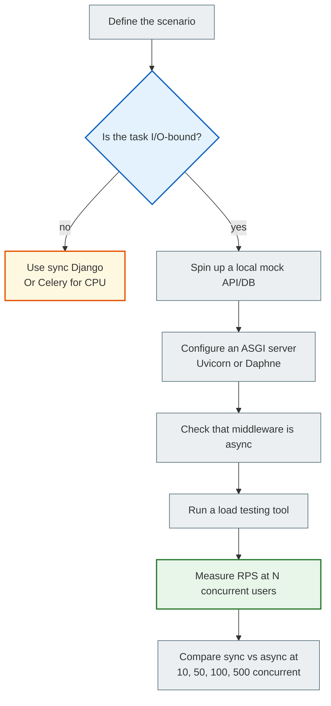
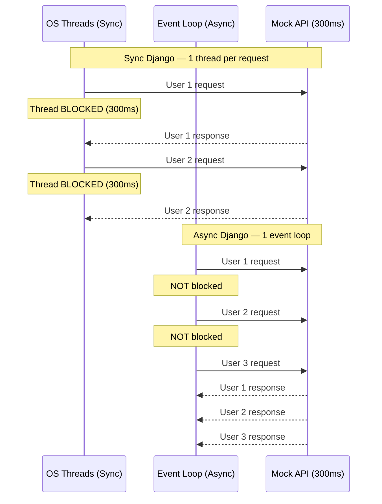

# 08 — Benchmarking: how to compare sync and async Django objectively

## Why this matters

"Async is faster" — you've heard that already. But how do you prove it? How do you measure it?

Most beginners compare things the wrong way: they test a single request and are surprised that async is not faster. Or they test against public APIs and get 429 Too Many Requests.

This document is about **what** to measure and **how** to measure it correctly.

---

## 🧠 Mental model

Imagine two checkouts in a supermarket.

**Old checkout (sync):** one customer — the cashier serves them, everyone else waits in line.

**New checkout (async):** the cashier starts scanning the first customer's items, and while the system is "thinking", starts scanning the second customer's items. No idle time.

If **one** customer comes, both checkouts handle it equally well. The difference shows only when **50 people arrive at once**.

Benchmarking a single request is testing with one customer. It proves nothing.

---

## Key terms

| Term | What it means |
|--------|-----------|
| **Latency** | Time from sending a request to receiving the response (milliseconds) |
| **Throughput** | Number of requests the server handles per second (RPS) |
| **Concurrency** | Number of simultaneous connections/requests |
| **IO-bound workload** | A workload where most of the time is spent waiting for I/O |
| **Load testing** | Testing under load (many simultaneous requests) |
| **Mock API** | A local fake server for tests without a real external API |

---

## What you should measure

### ✅ Throughput (RPS) under load

How many requests per second the server handles with **N concurrent** clients.

This is the main metric for async. Async does not make a single request faster — it lets you serve more requests at the same time.

### ✅ Latency as concurrency grows

How response time changes as you go from 1 → 10 → 100 → 500 concurrent clients.

A sync server will start degrading under heavy load (a queue of threads). Async holds up much longer.

### ✅ Maximum concurrency before degradation

The number of concurrent clients at which latency starts to grow. This is the server's "threshold".

---

## What you should NOT measure

### ❌ A single request

```
Sync view: 45ms
Async view: 47ms
```

Async may be slightly **slower** for a single request — because of the event loop overhead. This is normal and not important.

### ❌ CPU-bound operations

```python
async def bad_benchmark(request):
    # CPU-bound in async — blocks the event loop
    result = sum(range(10_000_000))
    return JsonResponse({"result": result})
```

Here async loses unconditionally. This is not a scenario for async.

### ❌ Tests against public APIs

```python
# Don't do this — the public API will block you due to its rate limit
response = await client.get("https://api.openweathermap.org/...")
```

During load testing you send hundreds of requests per second. Public APIs have rate limits and block such requests. The results will be wrong.

---

## The correct methodology



---

## A local Mock API for tests

Never test against real external APIs. Spin up a local mock:

```python
# mock_api.py — a simple mock server with FastAPI or aiohttp
from fastapi import FastAPI
import asyncio

app = FastAPI()

@app.get("/weather")
async def weather():
    await asyncio.sleep(0.3)  # Simulate a 300ms response
    return {"temp": 22, "desc": "Sunny"}

@app.get("/news")
async def news():
    await asyncio.sleep(0.5)  # Simulate a 500ms response
    return {"items": ["News 1", "News 2"]}
```

```bash
# Start the mock API
uvicorn mock_api:app --port 8002   # 8001 is already taken by the web service
```

Now test your Django views against `http://localhost:8002` — no rate limits, controlled latency.

---

## Load testing: an example with locust

```python
# locustfile.py
from locust import HttpUser, task, between

class DjangoUser(HttpUser):
    wait_time = between(0.1, 0.5)

    @task
    def sync_view(self):
        self.client.get("/api/sync-weather/")

    @task
    def async_view(self):
        self.client.get("/api/async-weather/")
```

```bash
pip install locust
locust -f locustfile.py --host=http://localhost:8000
# Open http://localhost:8089 and start the test
```

Test parameters:
- Users: 100–500
- Spawn rate: 10 users/sec
- Duration: 60 seconds

---

## Sync vs Async: a typical timeline



---

## Benchmarking Checklist

Before each test, check:

- [ ] You are testing an IO-bound workload (not CPU-bound)
- [ ] You are using a local mock API (not a public one)
- [ ] For sync — `gunicorn` with `--workers` or WSGI
- [ ] For async — `uvicorn` or `daphne` (ASGI)
- [ ] Middleware in the async stack — all async (verify it!)
- [ ] You use `asyncio.sleep()` to simulate latency (not `time.sleep()`)
- [ ] You test concurrency from 10 to 500+ simultaneous users
- [ ] You measure RPS (not only the latency of a single request)
- [ ] You checked the database connection pool — is it exhausted?

---

## Why the database connection pool is a critical bottleneck

Async allows thousands of simultaneous requests. But if the database allows at most 20 connections, 980 requests will wait in a queue regardless of async.

```python
# settings.py
DATABASES = {
    "default": {
        "ENGINE": "django.db.backends.postgresql",
        # ...
        "OPTIONS": {
            # Django 5.1+ built-in connection pool (requires psycopg 3: psycopg[pool])
            "pool": {
                "min_size": 2,      # Minimum open connections
                "max_size": 20,     # Maximum simultaneous connections
            },
        },
        "CONN_MAX_AGE": 0,          # Must be 0 with a pool (persistent connections are incompatible)
    }
}
```

Our project uses `psycopg2-binary`, so the built-in pool is not enabled here: it requires switching to `psycopg` 3.

Under async load: monitor `pg_stat_activity` in PostgreSQL — if the connection count is close to the maximum, that is the bottleneck, not your code.

---

## A common beginner mistake

### ❌ Testing one request and drawing a conclusion

```bash
# One request — proves nothing
curl http://localhost:8000/api/weather/
# Sync: 45ms
# Async: 48ms
# "Async is slower!" — a wrong conclusion
```

### ✅ Testing under concurrent load

```bash
# Apache Bench: 1000 requests, 50 concurrent
ab -n 1000 -c 50 http://localhost:8000/api/weather/

# Sync result: ~15 RPS (threads get exhausted)
# Async result: ~200+ RPS (the event loop copes)
```

---

## Practical exercise

### Task 1

Spin up a simple mock API (you can use `python -m http.server` or FastAPI). Write two Django endpoints:
- `/sync/` — a sync view with `requests.get()` to the mock API
- `/async/` — an async view with `httpx.AsyncClient()`

Run both under `uvicorn`. Test them with Apache Bench or locust.

### Task 2

Write two Django views, one with `asyncio.sleep(0.5)` and one with `time.sleep(0.5)`. Run a load test and compare RPS. Explain the result.

### Task 3

Check your Django project: are all the middleware in the `MIDDLEWARE` list async-compatible? How can you check this?

### Self-check

- [ ] I understand the difference between latency and throughput
- [ ] I know that the benefits of async show only under concurrent load
- [ ] I understand why you must not test against public APIs
- [ ] I know that `time.sleep()` in async is a benchmarking mistake
- [ ] I understand the role of the database connection pool under async load

---

## Summary

Async Django outperforms sync not for a single request, but for hundreds of simultaneous ones. You need to test throughput (RPS) as concurrency grows, not the latency of a single request.

Always use a local mock API instead of a public one. Check that the whole stack (middleware, ORM) is async-compatible. Don't forget about the database connection pool — it can become the real bottleneck sooner than the event loop.

→ [09_async_use_cases.md](async_09_async_use_cases_full.md)
