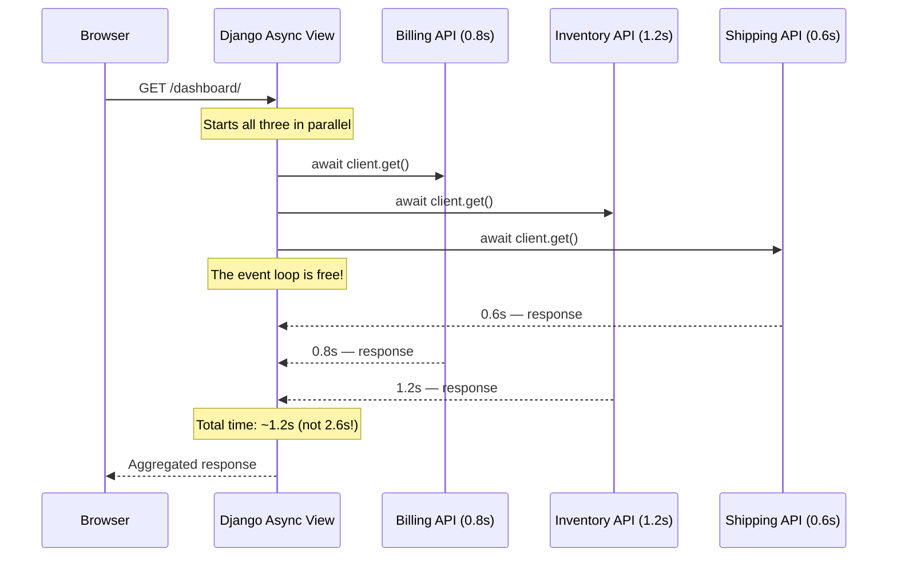
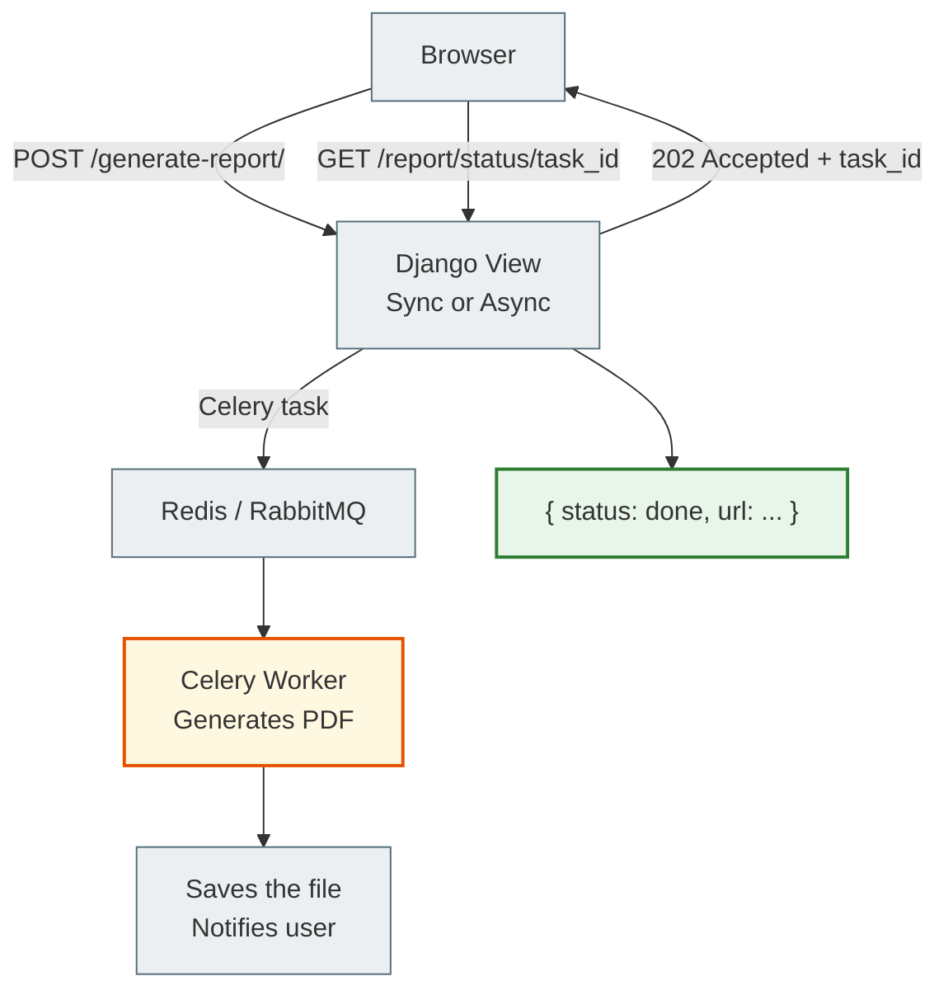
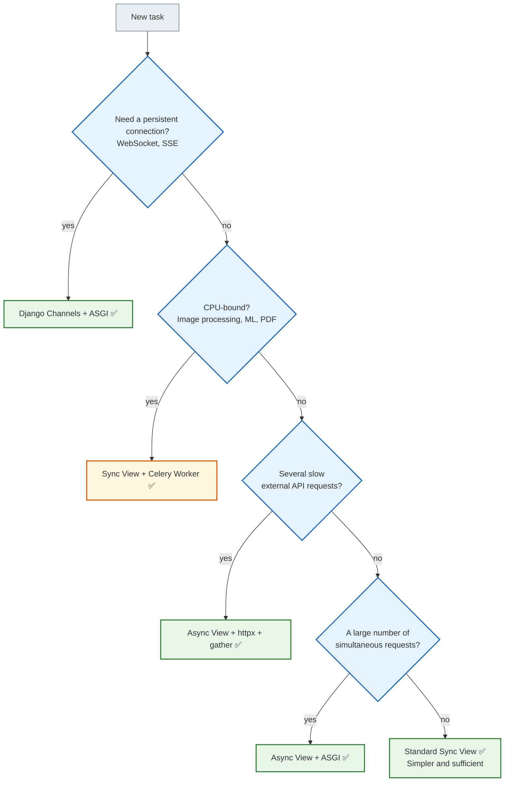
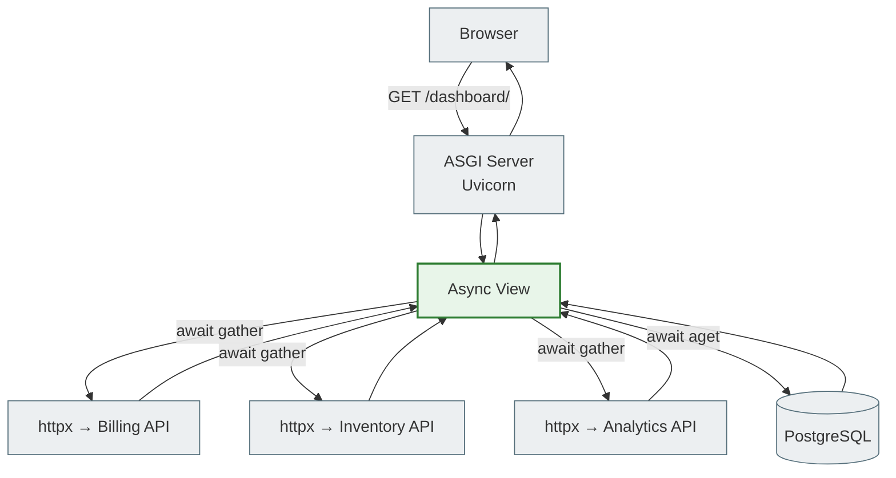
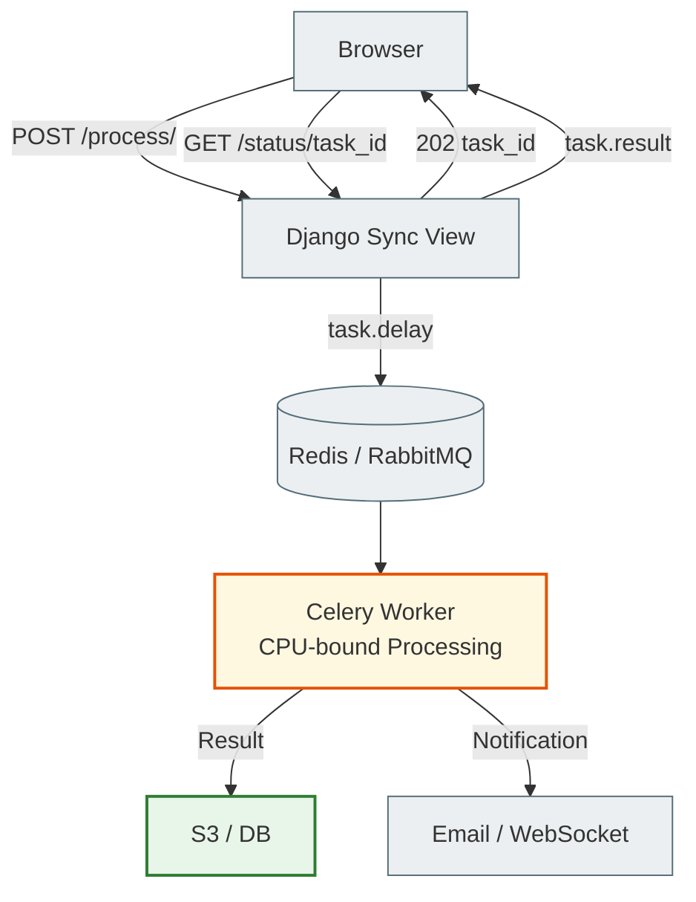

# 09 — Real-World Use Cases: when async Django is really needed

## Why this matters

You have gone the whole way: asyncio, ASGI, async views, async ORM, sync_to_async, httpx, benchmarking.

The last question: **when is all this actually worth using?**

Async is a tool. Like a hammer: perfect for nails and useless for screws. This document is a map: where the nails are and where the screws are.

---

## 🧠 Mental model

Imagine an emergency services dispatcher.

**Synchronous dispatcher:** takes one call, fully resolves the situation (sends a vehicle, waits for confirmation, closes the case), then takes the next one.

**Asynchronous dispatcher:** takes 10 calls at once. Tells each caller "got it, a vehicle is on the way" and keeps them updated. Doesn't wait for each vehicle to arrive — just coordinates.

For complex cases that require full attention (CPU-bound), the synchronous dispatcher is better. For coordinating many simultaneous connections, the asynchronous one is.

---

## Async Suitability Matrix

| Task type | Example | Architecture | Reason |
|-----------|---------|------------|---------|
| **Concurrent I/O** | Aggregating data from 5 APIs | ASGI + Async View + httpx | `await` frees the event loop between requests |
| **Persistent connections** | Chat, live dashboard, WebSockets | Django Channels + ASGI | One event loop holds thousands of open connections |
| **High-volume webhooks** | Stripe, GitHub webhooks | Async View + ASGI | Instantly accepts and acknowledges without blocking |
| **Streaming responses** | CSV/JSON streaming, SSE | Async + StreamingHttpResponse | Sends data in chunks without blocking the server |
| **Standard CRUD** | Article list, user profile | Sync View (WSGI or ASGI) | The ORM is fast enough, async adds complexity |
| **Image/Video processing** | Avatar resizing, video conversion | Celery Worker | CPU-bound: blocks the event loop, better in the background |
| **ML inference** | Text classification, recommendations | Celery + GPU Worker | Heavy CPU/GPU, not for the event loop |
| **PDF/report generation** | Reports, invoices | Celery Worker | CPU-bound + I/O, runs for a long time |

---

## When async is really useful

### 1. Aggregating from several external APIs

The classic use case: a dashboard that collects data from several sources.



```python
import asyncio
import httpx
from django.http import JsonResponse

async def dashboard_view(request):
    async with httpx.AsyncClient(timeout=10.0) as client:
        billing, inventory, shipping = await asyncio.gather(
            client.get("https://billing.internal/summary"),
            client.get("https://inventory.internal/status"),
            client.get("https://shipping.internal/active"),
            return_exceptions=True
        )

    return JsonResponse({
        "billing": billing.json() if not isinstance(billing, Exception) else None,
        "inventory": inventory.json() if not isinstance(inventory, Exception) else None,
        "shipping": shipping.json() if not isinstance(shipping, Exception) else None,
    })
```

### 2. WebSockets and chat systems

Django Channels with ASGI lets one event loop hold thousands of open WebSocket connections:

```python
# consumers.py (Django Channels)
from channels.generic.websocket import AsyncWebsocketConsumer
import json

class ChatConsumer(AsyncWebsocketConsumer):
    async def connect(self):
        self.room_name = self.scope["url_route"]["kwargs"]["room_name"]
        await self.channel_layer.group_add(self.room_name, self.channel_name)
        await self.accept()

    async def disconnect(self, close_code):
        await self.channel_layer.group_discard(self.room_name, self.channel_name)

    async def receive(self, text_data):
        data = json.loads(text_data)
        # Broadcast the message to the whole group
        await self.channel_layer.group_send(
            self.room_name,
            {"type": "chat_message", "message": data["message"]}
        )

    async def chat_message(self, event):
        await self.send(text_data=json.dumps({"message": event["message"]}))
```

### 3. High-volume webhooks

Endpoints that receive thousands of webhook requests (Stripe, GitHub):

```python
from django.http import JsonResponse
from django.views.decorators.csrf import csrf_exempt
from asgiref.sync import sync_to_async

@csrf_exempt
async def stripe_webhook_view(request):
    if request.method != "POST":
        return JsonResponse({"error": "Method not allowed"}, status=405)

    payload = request.body
    
    # Quickly acknowledge receipt (Stripe expects < 30s)
    # The real processing happens in a Celery task
    await sync_to_async(enqueue_webhook_processing)(payload)

    return JsonResponse({"status": "received"})
```

### 4. Server-Sent Events (Live updates)

```python
import asyncio
from django.http import StreamingHttpResponse

async def live_updates(request):
    async def event_stream():
        count = 0
        while True:
            count += 1
            yield f"data: {{\"update\": {count}}}\n\n"
            await asyncio.sleep(2)  # Update every 2 seconds

    return StreamingHttpResponse(
        event_stream(),
        content_type="text/event-stream"
    )
```

---

## When async is NOT needed

### CPU-bound tasks: the event loop freezes

```python
# ❌ DON'T do this — it blocks the whole server
async def generate_report_view(request):
    # PDF generation — CPU-bound!
    pdf_bytes = generate_pdf_report(request.user.id)  # 10 seconds
    return HttpResponse(pdf_bytes, content_type="application/pdf")
```

While the PDF is being generated, the server responds to nobody.

### The right architecture: a Celery Worker



```python
# tasks.py (Celery)
from celery import shared_task

@shared_task
def generate_pdf_report(user_id):
    # CPU-bound — safe in a Celery worker
    user = User.objects.get(id=user_id)
    pdf = create_pdf(user)  # Takes as long as it needs
    save_to_storage(pdf, user_id)
    notify_user(user_id)

# views.py
from django.http import JsonResponse
from .tasks import generate_pdf_report

def request_report_view(request):
    # Start the task and return a response immediately
    task = generate_pdf_report.delay(request.user.id)
    return JsonResponse({"task_id": str(task.id), "status": "processing"}, status=202)
```

---

## Decision Tree: when to choose async



---

## Architecture diagram: an async dashboard



---

## Architecture diagram: Celery for CPU-bound work



---

## A common beginner mistake

### ❌ Async everywhere for no reason

```python
# You have a regular CRUD view — why async?
async def article_list_view(request):
    articles = [a async for a in Article.objects.all()[:20]]
    return JsonResponse({"articles": [...]})
```

If a view simply reads from its own database and returns JSON, a sync view is simpler, clearer and doesn't require ASGI, the async ORM and the whole stack.

### ✅ Async only where there is a real need

```python
# Async is justified: three external APIs at the same time
async def dashboard_view(request):
    weather, news, stocks = await asyncio.gather(
        fetch_weather(), fetch_news(), fetch_stocks()
    )
    return JsonResponse({...})
```

---

## Practical exercise

### Task 1

Review your latest or current Django project. Determine:
- Which endpoints are currently sync — and is it worth converting them to async?
- Which tasks currently run in a view and need Celery?
- Are there any external API calls that could run in parallel?

### Task 2

Write an async view `/api/summary/` that:
1. Uses `httpx.AsyncClient` + `gather` to make two parallel requests to mock endpoints
2. Uses `await User.objects.acount()` to count the users in the database
3. Returns everything in a single `JsonResponse`

### Task 3

Draw (or describe) the architecture of a Django application that processes uploaded videos:
- The user uploads a video
- The server accepts the file
- The conversion task goes to Celery
- The user gets a link to the task status
- After completion — a link to the finished file

### Self-check

- [ ] I know when async views are really useful
- [ ] I know why CPU-bound tasks are not suitable for async
- [ ] I understand the Celery architecture for heavy operations
- [ ] I can decide: async view or sync + Celery?
- [ ] I will not add async "just because I can"

---

## Final summary of the whole lesson

You have gone the full way from the basics to practice:

**01 — Sync vs Async:** Asynchrony exists because of the huge speed difference between the CPU and external operations. Async is concurrency (switching), not parallelism (simultaneous execution).

**02 — asyncio:** `async def` returns a coroutine object. `await` is a suspension point. The event loop manages all tasks. `gather()` runs several coroutines concurrently.

**03 — ASGI:** WSGI — one thread per request. ASGI — an event loop serves thousands. Uvicorn, Daphne, Hypercorn are ASGI servers for Django.

**04 — Async Views:** `async def view` under ASGI — native execution. Sync middleware adds context switch penalties. An async view does not automatically mean better performance.

**05 — Async ORM:** `filter()` is lazy and safe. `get()` and `for` are blocking and will raise `SynchronousOnlyOperation`. Use `aget()`, `acount()`, `async for`.

**06 — sync_to_async:** A bridge between the sync and async worlds. Sync code runs in a dedicated thread, the event loop stays free. Minimize the number of boundary crossings.

**07 — Async HTTP Clients:** `requests` blocks the event loop. `httpx.AsyncClient` + `gather` is the right pair for parallel API requests.

**08 — Benchmarking:** The benefits of async show only under concurrent load. Test RPS, not the latency of a single request. Use a local mock API.

**09 — Use Cases:** Async for I/O-bound concurrent tasks. Celery for CPU-bound. A sync view for standard CRUD.

---

> **The main rule:** async is a tool for specific problems. If there is no problem, you don't need the tool. Start with regular sync Django, and add async only where there is a real bottleneck.

← [08_benchmarking.md](async_08_benchmarking_full.md) | [INDEX.md](../reference/legacy_indexes/index_7.md) ↑
