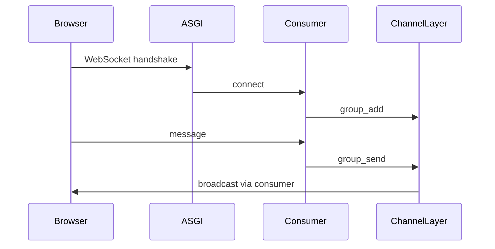

# Channels and WebSocket

> A WebSocket connection lives longer than an HTTP request, so it is handled by a Consumer.

## What the student will learn

- the basic mental model of the topic;
- how the topic works in Django;
- where to see it in the final project;
- how to check that the understanding is not just theoretical.

## Prerequisites

- Be able to open the repository.
- Understand that all paths in the documentation are relative to the `notes_chat_app` root.

## Flow

## Channel layer

If `REDIS_URL` is set, Redis is used. If not, `InMemoryChannelLayer` is used, which is suitable for a single process only.

## Where to find it in the final project

| File | What to look at |
| --- | --- |
| `notes_app/consumers.py` | connect, receive, disconnect |
| `notes_app/static/notes_app/js/group_chat.js` | browser WebSocket client |
| `notes_app/models.py` | ChatMessage |

## Practical exercise

Create a group, open the chat page in two browser sessions and check the broadcast.

## Review questions

- What is the input to this process?
- What result is expected?
- Where does an error most often occur?
- Which command or test helps verify the change?

## Next

Next: [Linux and DevOps](../10_linux_and_devops/README.md).
