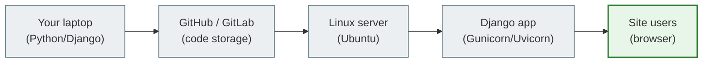
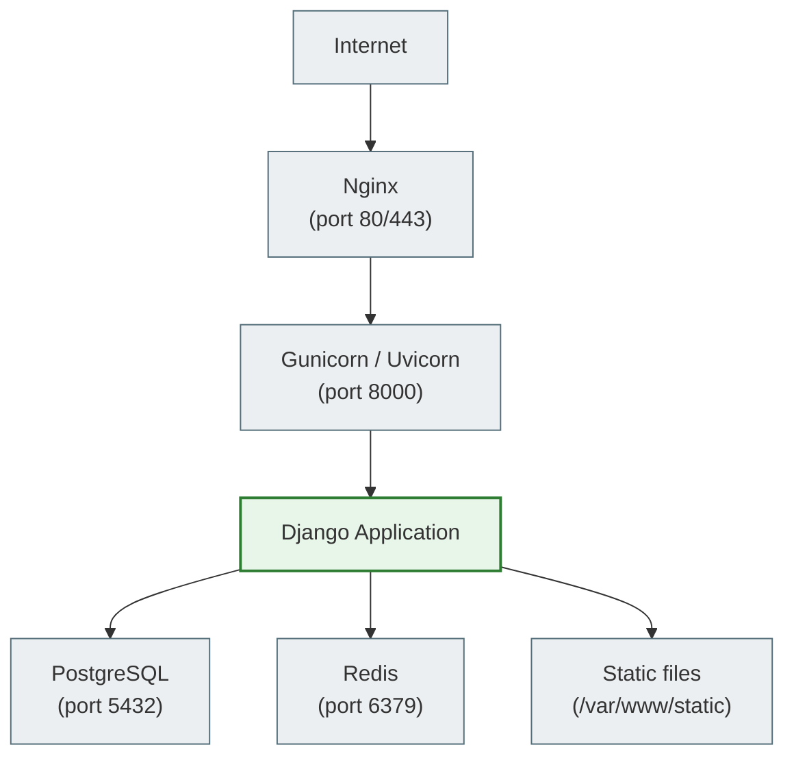

# 01. The Linux Mental Model

## Why this matters

Before running any command, you need to understand: **what is Linux, and why does it matter to a backend developer?**

Most of the world's Django applications, API services, databases, and web servers run on Linux. If you write Python/Django code, sooner or later you'll have to run it not only on your laptop but on a real server. That server will almost certainly be Linux.

---

## A simple explanation

> A Linux server is like a rented room in a data center where your Django application lives permanently, even when your laptop is turned off.

Your laptop is your personal machine. You turn it on when you need it and turn it off when you're done. But a website has to be available 24/7. That requires a **server** — a computer that never shuts down and is always connected to the internet.

Most of these servers run Linux. Not because it's perfect, but because it is:

- **free** — you can install it without a license;
- **stable** — it can run for years without a reboot;
- **flexible** — it can be configured for any task;
- **efficient** — it needs fewer resources than Windows Server;
- **open** — thousands of developers around the world keep improving it.

---

## Key terms

| Term | What it means |
|---|---|
| **Operating system (OS)** | A program that manages the hardware and lets you run other programs |
| **Linux** | An operating system kernel, written by Linus Torvalds in 1991 |
| **Distribution** | The Linux kernel + a set of tools + a package manager. For example: Ubuntu, Debian, CentOS |
| **Ubuntu** | The most popular distribution for servers and for beginners |
| **WSL** | Windows Subsystem for Linux — a Linux terminal inside Windows |
| **Server** | A computer (or cloud VM) that is permanently connected to the network and runs services |
| **Deployment** | The process of moving code from development to a server |
| **Terminal** | A text interface for working with the operating system |

---

## How Linux is structured

Linux consists of several layers:

```text
+---------------------------------------------------+
|           Your programs (User Space)               |
|   Django, PostgreSQL, Nginx, Python, pip...        |
+---------------------------------------------------+
|              Shell (bash, zsh, sh)                 |
|   The interface between you and the kernel         |
+---------------------------------------------------+
|              Linux Kernel                          |
|   Manages memory, processes, files, network        |
+---------------------------------------------------+
|              Hardware                              |
|   CPU, RAM, disk, network card                     |
+---------------------------------------------------+
```

The **kernel** is the heart of the system. It talks directly to the hardware. Your programs never access the hardware directly — they ask the kernel via system calls (syscalls).

The **shell** is like a translator between you and the kernel. You type commands in the terminal → the shell understands them → the shell asks the kernel to do something.

**User Space** is where all programs live: Django, PostgreSQL, Nginx, your Python scripts.

---

## How Linux differs from Windows

| | Linux | Windows |
|---|---|---|
| Price | Free | Paid license |
| Management | Mostly via the terminal | Mostly via a GUI |
| Servers | ~70% of the world's servers | A smaller share |
| Filesystem | Case-sensitive (`File.txt` ≠ `file.txt`) | Case-insensitive |
| Updates | Without a reboot (mostly) | Often requires a restart |
| Docker | Native | Requires WSL or a VM |

---

## What a distribution is

Linux is just the kernel. But to use it, you also need tools, a file manager, a package manager, and command-line utilities. The kernel + tools bundle = a **distribution**.

Popular distributions:

| Distribution | What it's used for |
|---|---|
| **Ubuntu** | Servers, development, the easiest start |
| **Debian** | Stable servers, long-term support |
| **CentOS / Rocky Linux** | Enterprise servers |
| **Arch Linux** | Experienced users, maximum control |
| **Alpine Linux** | Docker images (very small size) |

In this lesson we'll use **Ubuntu** — the most common choice for Django developers and cloud servers.

---

## What WSL is

If you're on Windows, you can install **WSL** — Windows Subsystem for Linux. It is a full Linux environment inside Windows.

```bash
# Install WSL (in Windows PowerShell with administrator rights)
wsl --install

# Start Ubuntu
wsl
```

WSL gives you a real Ubuntu terminal without having to buy a separate server or install a VM. It's the easiest way to start practicing Linux on a Windows machine.

---

## The path of code from laptop to user



Here is what a typical path looks like:

1. You write code on your laptop.
2. You push it to a Git repository (GitHub/GitLab).
3. On the server you run `git pull` — downloading the new version.
4. You start Django via Gunicorn or Uvicorn.
5. Nginx accepts requests from users and passes them to Django.
6. Users see your site.

---

## Linux server architecture for Django



Each component is a separate program on the server. They all run in parallel and communicate with each other via the network or the filesystem.

---

## Common beginner mistakes

**Mistake 1:** Thinking that Linux and the terminal are the same thing.
> Linux is an operating system. The terminal is just one of the ways to control it.

**Mistake 2:** Being afraid that you'll "break something".
> You can practice freely on your own WSL or a test server. For important operations there are always backups and confirmation prompts.

**Mistake 3:** Thinking you need to memorize all the commands.
> In reality you need to understand the logic and know where to look (`man`, `--help`, Google). Over time, the commands you need will stick on their own.

**Mistake 4:** Running `runserver` in production.
> `python manage.py runserver` is for local development only. On a server you need Gunicorn/Uvicorn + Nginx.

---

## Practical exercise

### Task 1
Open WSL or an Ubuntu terminal and enter:
```bash
uname -a
```
Read the output and find: which Linux kernel do you have installed?

### Task 2
Enter:
```bash
cat /etc/os-release
```
Which Ubuntu are you using?

### Task 3
Draw by hand or in your notes a diagram: how your Django project gets from your laptop to the user's browser. Use the terms: laptop, Git, server, Nginx, Django, database.

---

## Self-check

- [ ] I can explain what Linux is and why it is used on servers
- [ ] I understand the difference between the Linux kernel and a distribution
- [ ] I know what Ubuntu and WSL are
- [ ] I can describe the path of code from the laptop to the user
- [ ] I understand why `runserver` must not be used in production

---

## Short summary

Linux is the foundation of most modern servers. As a Python/Django developer, you'll regularly connect to Linux servers, start services, read logs, and deploy your applications. The next file is about the terminal and the shell: how to talk to Linux in the first place.
