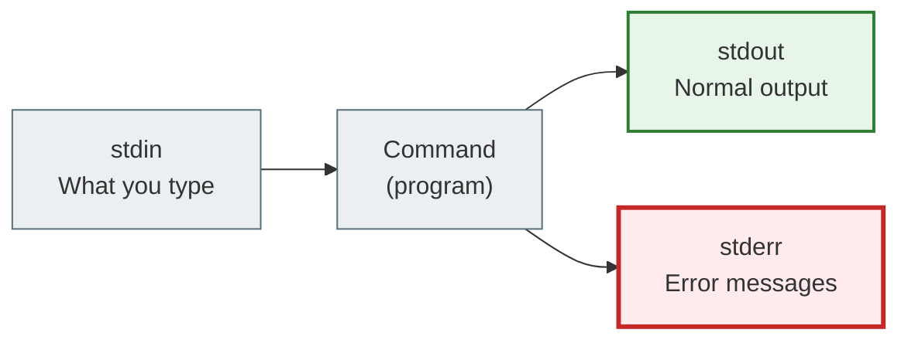

# 02. The Terminal and the Shell

## Why this matters

The terminal is your main tool for working with Linux. Everything you'll do on a server — connecting, running programs, viewing files, managing services — happens through the terminal.

There's no need to be afraid of the "black screen". It's just a different way of interacting with a computer: text commands instead of mouse clicks.

---

## A simple explanation

> The terminal is the window through which you talk to the operating system. The shell is the language you speak.

An analogy: imagine you're calling customer support. The terminal is the phone (the device). The shell is the language of the conversation (for example, Ukrainian or English).

A **terminal** (terminal, console) is a program that displays a text interface. On your laptop it might be:
- Windows Terminal (for WSL)
- iTerm2 (macOS)
- GNOME Terminal (Ubuntu)

A **shell** is an interpreter program that reads your commands and executes them. The most popular shell is **Bash** (Bourne Again Shell).

---

## Key terms

| Term | What it means |
|---|---|
| **Terminal / Console** | A program that shows a text interface |
| **Shell** | A command interpreter (bash, zsh, sh, fish) |
| **Bash** | The most common shell on Linux |
| **Prompt** | The invitation to type a command (`$` or `#`) |
| **Command** | The name of the program we run |
| **Option / Flag** | Extra settings for a command (`-l`, `--all`) |
| **Argument** | The data we pass to a command (a path, a file name) |
| **stdin** | Standard input (what you type) |
| **stdout** | Standard output (the command's result) |
| **stderr** | Standard error output |
| **Exit code** | The numeric result of running a command (0 = success) |

---

## What the prompt looks like

When you open a terminal, you see something like this:

```text
student@ubuntu:~$
```

This means:
- `student` — your username
- `ubuntu` — the server name (hostname)
- `~` — the current directory (tilde = home directory)
- `$` — a regular user
- `#` — the root user (superuser)

> If you see `#` instead of `$`, you're working as root. That's dangerous for everyday work. Leave root with `exit`.

---

## Command structure

```bash
ls -la /home/user
```

```text
ls        -la       /home/user
^          ^            ^
command   options    argument
```

- `ls` — the command (the `list` program): show a list of files
- `-la` — two options together: `-l` (detailed view) and `-a` (show hidden files)
- `/home/user` — the argument: which directory to show

Options can be written in different ways:
```bash
ls -l -a         # separately
ls -la           # combined (short form)
ls --all         # long form
```

---

## Basic commands to get started

```bash
# Where am I right now?
pwd
```
`pwd` — Print Working Directory. Shows the full path to the current directory.

```bash
# Who am I?
whoami
```
Prints the current user's name.

```bash
# What's the current date and time?
date
```

```bash
# Clear the screen
clear
```
Or press `Ctrl+L` — same effect.

```bash
# Print text to the screen
echo "Hello Linux"
```

```bash
# View a command's documentation
man ls
```
`man` — manual. Shows the full documentation. Press `q` to exit.

```bash
# Short help for commands
ls --help
```

```bash
# View recently entered commands
history
```

---

## What stdin, stdout, stderr are

Every program in Linux has three standard data streams:



**Example:**
```bash
ls /home          # stdout: a list of files
ls /не-існує      # stderr: the error "No such file or directory"
```

### Redirecting output

```bash
ls > files.txt        # write stdout to a file
ls >> files.txt       # append stdout to the end of a file
ls 2> errors.txt      # write stderr to a file
```

### Pipe

```bash
ls -la | grep ".py"
```

`|` (pipe) — takes the stdout of one command and passes it as stdin to another.

This command:
1. `ls -la` — prints a list of files
2. `|` — passes that list on
3. `grep ".py"` — filters the lines that contain `.py`

---

## What an exit code is

After it runs, every command returns an **exit code** — a numeric result:

- `0` — success
- `1` or another non-zero number — an error

```bash
ls /home
echo $?      # 0 — all good

ls /не_існує
echo $?      # 2 — error
```

`$?` is a special variable that holds the exit code of the previous command. This matters for Bash scripts.

---

## Useful shortcuts

| Shortcut | What it does |
|---|---|
| `Ctrl+C` | Stop the current command |
| `Ctrl+Z` | Suspend it and send it to the background |
| `Ctrl+D` | End the session (logout) |
| `Ctrl+L` | Clear the screen |
| `Tab` | Autocomplete a command or path |
| `↑ / ↓` | Navigate through the command history |
| `Ctrl+R` | Search the history |
| `Ctrl+A` | Jump to the start of the line |
| `Ctrl+E` | Jump to the end of the line |

> `Tab` is the most useful shortcut. Press it twice if you don't know how to continue a command — Linux will show you the options.

---

## An example with a Django project

```bash
# Start the Django server
python manage.py runserver
```

While the server is running, you see its output in the terminal (stdout). Press `Ctrl+C` to stop it.

```bash
# Start it and see the output right away
python manage.py runserver 2>&1 | tee server.log
```

This command:
- `2>&1` — redirects stderr to stdout
- `| tee server.log` — saves the output to a file and shows it on screen at the same time

---

## Common beginner mistakes

**Mistake 1:** `command not found`
> The program isn't installed or isn't in PATH. Check: did you install it? Is your virtualenv activated?

**Mistake 2:** `Permission denied`
> Not enough permissions. Check the file's permissions or use `sudo` (but carefully).

**Mistake 3:** I ran a heavy command and don't know how to stop it.
> Press `Ctrl+C`. If that doesn't help — `Ctrl+Z`, then `kill %1`.

**Mistake 4:** Mixing up `>` and `>>`.
> `>` overwrites the file. `>>` appends to the end. If you use `>`, the previous contents will be gone.

---

## Practical exercise

### Task 1
Open a terminal and run:
```bash
whoami
pwd
date
uname -r
```
What does each result mean?

### Task 2
Run:
```bash
echo "Hello, $(whoami)!"
```
What happened? Why was `$(whoami)` executed inside the string?

### Task 3
Run:
```bash
ls /tmp
echo $?
ls /not_existing_dir
echo $?
```
Compare the exit codes. What does the difference mean?

### Task 4
Enter:
```bash
history | tail -10
```
What did this command do? Break down its structure: where is the command, where is the pipe, where is the argument?

---

## Self-check

- [ ] I understand the difference between a terminal and a shell
- [ ] I can explain what Bash is
- [ ] I can read the structure of a command: command, options, arguments
- [ ] I understand stdin, stdout, stderr
- [ ] I know what exit code 0 and a non-zero code mean
- [ ] I can stop a running program with `Ctrl+C`

---

## Short summary

The terminal isn't scary. It's just a text-based way to control Linux. The shell reads your commands and executes them. The structure of a command is always the same: name + options + arguments. The next step is learning to find your way around the filesystem.
