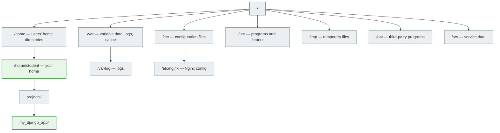

# 03. The Filesystem and Navigation

## Why this matters

On a server there are no folders with icons and no files you can drag with the mouse. There is only the terminal. To find a config file, go into the project directory, copy or delete a file — you need to know the basic navigation commands.

This is the foundation. Without understanding the filesystem, you can't deploy projects, read logs, or configure services.

---

## A simple explanation

> The Linux filesystem is one big tree that starts at the root `/`. Everything is a node in this tree: directories, files, even devices.

Windows has drives: `C:\`, `D:\`. Linux has no drives — there is one root directory `/`, and everything else is inside it.

---

## Filesystem structure



### The most important directories

| Directory | Purpose |
|---|---|
| `/` | The root of the filesystem. Everything starts here |
| `/home` | Users' home directories |
| `/home/student` | Your personal directory |
| `/etc` | Configuration files for the system and services |
| `/var/log` | Logs: Nginx, system logs, your services' logs |
| `/tmp` | Temporary files (deleted after a reboot) |
| `/usr/bin` | System programs (python, git, nginx) |
| `/opt` | Third-party programs you install manually |
| `/srv` | Web service data (Django static, media) |

---

## Key path symbols

| Symbol | What it means |
|---|---|
| `/` | The root — when at the start of a path |
| `/` | The separator between parts of a path |
| `~` | The current user's home directory |
| `.` | The current directory |
| `..` | The parent directory (one level up) |

**Examples:**
```bash
/home/student/projects   # absolute path
~/projects               # the same (via ~)
./manage.py              # a file in the current directory
../settings.py           # a file one level up
```

---

## Navigation

### Find out where you are
```bash
pwd
```
Print Working Directory. Shows the full current path.

### Change directory
```bash
cd /home/student/projects   # absolute path
cd projects                  # relative path (from the current one)
cd ..                        # one level up
cd ~                         # to the home directory
cd -                         # to the previous directory
```

### List files and directories
```bash
ls                   # simple list
ls -l                # detailed list (permissions, size, date)
ls -a                # including hidden files (starting with .)
ls -la               # detailed + hidden
ls /etc              # list a specific directory
```

**Example output of `ls -la`:**
```text
drwxr-xr-x 3 student student 4096 Jun 10 12:00 projects
-rw-r--r-- 1 student student  234 Jun 10 11:50 manage.py
-rw-r--r-- 1 student student   98 Jun 10 11:45 requirements.txt
```

```bash
# Directory tree
tree
tree -L 2            # only 2 levels deep
```

---

## Working with files and directories

### Creating
```bash
mkdir my_project             # create a directory
mkdir -p a/b/c               # create nested directories

touch file.txt               # create an empty file
touch settings.py            # or update the modification date of an existing one
```

### Viewing file contents
```bash
cat file.txt                 # show the entire contents
less file.txt                # view page by page (q — quit)
head -20 file.txt            # first 20 lines
tail -20 file.txt            # last 20 lines
tail -f /var/log/nginx/access.log   # follow a file in real time
```

### Copying
```bash
cp file.txt copy.txt             # copy a file
cp -r my_project/ backup/        # copy a directory recursively
```

### Moving and renaming
```bash
mv file.txt new_name.txt         # rename
mv file.txt /tmp/                # move
mv old_dir/ new_dir/             # rename a directory
```

### Deleting

> ⚠️ Linux has no recycle bin. You can't get a deleted file back.

```bash
rm file.txt                  # delete a file
rm -r my_project/            # delete a directory recursively
rmdir empty_dir/             # delete an EMPTY directory
```

### The danger of `rm -rf`

```bash
rm -rf /            # NEVER DO THIS
```

`-r` — recursively (all files and subfolders), `-f` — without confirmation (force). If you run this at the root of the filesystem, you'll destroy the entire system without any warning.

**Safety rules:**
- Always check the path before `rm -rf`
- Use `ls` first to see what will be deleted
- On production servers, never run `rm -rf` without a backup

---

## Finding files

```bash
find . -name "settings.py"              # find a file by name
find /var/log -name "*.log"             # find all .log files
find . -type f -name "*.py"             # files only (not directories)
find . -type d -name "migrations"       # directories only

grep -r "SECRET_KEY" .                  # find text in files
grep -rn "def create_user" .            # with line numbers
```

---

## Useful commands for Python/Django

```bash
# Where is python?
which python3

# Where are the packages installed?
pip show django

# View the project structure
tree my_django_project/ -L 2

# Find all migration files
find . -path "*/migrations/*.py" -not -name "__init__.py"
```

---

## Absolute vs relative path

```text
Absolute path — always starts with /
  /home/student/projects/my_app/settings.py

Relative path — relative to the current directory
  (if you are in /home/student/)
  projects/my_app/settings.py
  or ./projects/my_app/settings.py
```

**When to use which:**
- Absolute — in scripts and configs (reliable, independent of cd)
- Relative — in the terminal for quick navigation

---

## Common beginner mistakes

**Mistake 1:** `No such file or directory`
> Check: is the name spelled correctly? Linux is case-sensitive: `manage.py` ≠ `Manage.py`

**Mistake 2:** Deleted the wrong thing.
> Always check with `ls` before `rm`. There's no recycle bin.

**Mistake 3:** `Permission denied` when entering a directory.
> You don't have the `x` (execute) permission on the directory. Check the permissions with `ls -la`.

**Mistake 4:** Mixing up `/` and `~`.
> `/` is the system root. `~` is your home directory `/home/student`.

---

## Practical exercise

### Task 1
```bash
mkdir -p ~/practice/django_project
cd ~/practice/django_project
touch manage.py requirements.txt .env
mkdir app templates static
ls -la
```
Explain what you created and where it is located.

### Task 2
```bash
echo "DEBUG=True" > .env
cat .env
echo "SECRET_KEY=test123" >> .env
cat .env
```
Explain the difference between `>` and `>>`.

### Task 3
```bash
cp -r ~/practice/django_project ~/practice/django_project_backup
ls ~/practice/
```
What happened?

### Task 4
```bash
find ~/practice -name "*.py"
grep -r "DEBUG" ~/practice
```
What did these commands find?

---

## Self-check

- [ ] I can explain the structure of `/home`, `/etc`, `/var/log`
- [ ] I understand the difference between an absolute and a relative path
- [ ] I can navigate with `cd` and see a listing with `ls -la`
- [ ] I can create, copy, move, and delete files
- [ ] I understand the danger of `rm -rf` and check the path before deleting
- [ ] I can find a file with `find` and text with `grep`

---

## Short summary

The Linux filesystem is a tree starting at the root `/`. Each directory has its own purpose: `/etc` for configs, `/var/log` for logs, `/home` for your files. Basic commands: `pwd`, `cd`, `ls`, `mkdir`, `touch`, `cp`, `mv`, `rm`. The next step is permissions and users.
