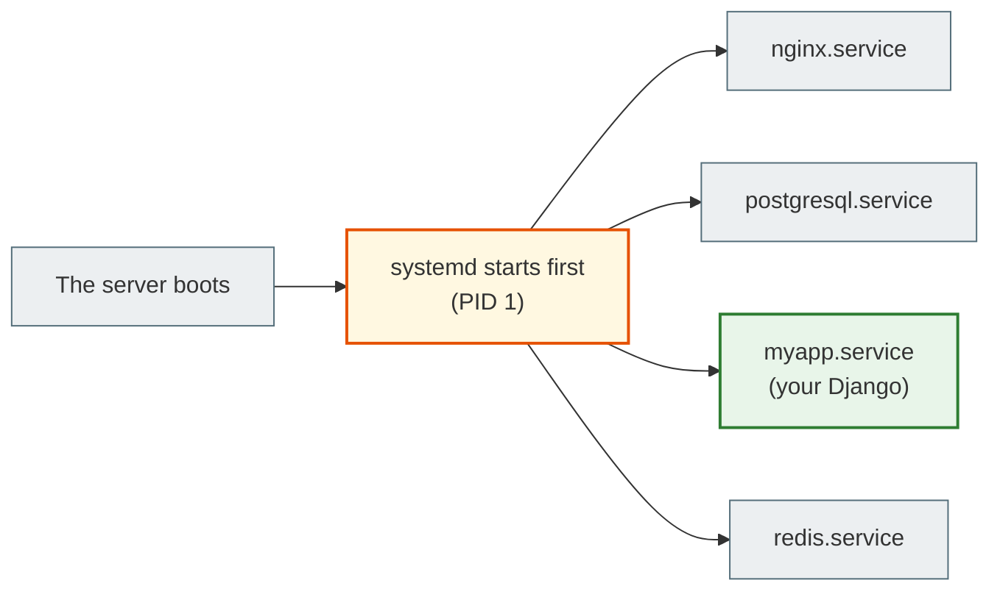

# 05. Processes, Ports, and Services

## Why this matters

When you run `python manage.py runserver`, a **process** starts — Django listens on **port** 8000. When you deploy to a server, Nginx and Gunicorn are processes too. To understand why "the site won't open" or "the port is already in use", you need to know how to manage processes and services.

---

## Key terms

| Term | What it means |
|---|---|
| **Process** | A running program in memory. It has its own PID |
| **PID** | Process ID — the unique number of a process |
| **Foreground** | The process occupies the terminal. Ctrl+C stops it |
| **Background** | The process runs in the background. The terminal is free |
| **Daemon** | A background service process without a terminal |
| **Port** | A numeric address (0–65535) for a network connection |
| **Service** | A program managed by systemd (start, stop, autostart) |
| **systemd** | The service management system in Ubuntu/Debian |

---

## Processes

### View running processes

```bash
ps aux
```
`ps` — process status. Shows all processes on the system.

```text
USER   PID  %CPU %MEM   COMMAND
root     1   0.0  0.1   /sbin/init
student 1234  2.1  1.5   python manage.py runserver
www-data 5678  0.1  0.3   nginx: worker process
```

```bash
ps aux | grep python        # find Python processes
ps aux | grep nginx         # find Nginx processes
```

### Interactive monitor

```bash
top         # updates in real time
htop        # a better version (needs installing: sudo apt install htop)
```

In `top`/`htop`: press `q` to quit, `k` to terminate a process by PID.

### Terminate a process

```bash
kill 1234           # send the SIGTERM signal (ask it to exit)
kill -9 1234        # SIGKILL (force kill, no chance to clean up)
killall python      # terminate all processes named python
pkill -f "manage.py runserver"   # find and terminate by pattern
```

> `kill -9` is a last resort. The process won't have time to save its data. Try a plain `kill` first.

---

## Foreground and Background

```bash
python manage.py runserver          # foreground — blocks the terminal
python manage.py runserver &        # background — & at the end

jobs                                # show background jobs
fg                                  # bring back the last background job
fg %1                               # bring back job #1
bg                                  # resume a suspended job in the background
```

If you press `Ctrl+Z` while a foreground process is running, it is suspended and goes to the background (status Stopped).

---

## Ports

> A port is like a room number in a hotel. The IP address is the hotel's address, the port is the room number.

When Django listens on port `8000`, it means: anyone who connects to this server on port 8000 gets a response from Django.

### Well-known ports

| Port | Service |
|---|---|
| 22 | SSH |
| 80 | HTTP |
| 443 | HTTPS |
| 5432 | PostgreSQL |
| 6379 | Redis |
| 8000 | Django runserver (default) |
| 8080 | Alternative HTTP |

### Check open ports

```bash
ss -tulpn                   # all open ports and processes
ss -tulpn | grep :8000      # a specific port

lsof -i :8000               # which process is using port 8000
lsof -i :5432               # is PostgreSQL running?
```

**Example output of `ss -tulpn`:**
```text
Netid  State  Local Address:Port   Process
tcp    LISTEN 0.0.0.0:8000         python manage.py runserver
tcp    LISTEN 0.0.0.0:80           nginx
tcp    LISTEN 127.0.0.1:5432       postgres
```

---

## Services and systemd



`systemd` is the first process started after the system boots (PID 1). It is responsible for starting and managing all services.

### systemctl commands

```bash
# Service status
systemctl status nginx
systemctl status postgresql

# Start / stop / restart
sudo systemctl start nginx
sudo systemctl stop nginx
sudo systemctl restart nginx
sudo systemctl reload nginx        # re-read the config without stopping

# Autostart at boot
sudo systemctl enable nginx        # add to autostart
sudo systemctl disable nginx       # remove from autostart

# List all services
systemctl list-units --type=service
```

### Viewing service logs

```bash
journalctl -u nginx                 # all Nginx logs
journalctl -u nginx -f              # follow the logs in real time
journalctl -u nginx --since today   # today's logs
journalctl -u myapp -n 50          # last 50 lines
```

---

## The full request chain

```mermaid
flowchart LR
    User["User<br>opens the site"] --> Port80["Port 80/443<br>HTTPS"]
    Port80 --> Nginx["Nginx process<br>(nginx.service)"]
    Nginx --> Port8000["Port 8000<br>PROXY PASS"]
    Port8000 --> Gunicorn["Gunicorn process<br>(myapp.service)"]
    Gunicorn --> Django["Django Application"]
    Django --> DB["PostgreSQL<br>Port 5432"]

    classDef step     fill:#eceff1,stroke:#546e7a,stroke-width:1px;
    classDef success  fill:#e8f5e9,stroke:#2e7d32,stroke-width:2px;
    classDef warning  fill:#fff8e1,stroke:#e65100,stroke-width:2px;
    class User,Nginx,Gunicorn,DB step;
    class Django success;
    class Port80,Port8000 warning;
```



---

## Common beginner mistakes

**Mistake 1:** `Address already in use` on startup
> The port is already taken by another process. Find it: `lsof -i :8000`, and terminate the old process.

**Mistake 2:** You ran `python manage.py runserver` and closed the terminal — the server stopped.
> A foreground process is tied to the terminal. For production, use systemd or Docker.

**Mistake 3:** Nginx is running, but the site won't open.
> Check: `systemctl status nginx` and `journalctl -u nginx -n 20`. The config may be invalid.

**Mistake 4:** Confusing a port with a PID.
> A PID is a process identifier (for example 1234). A port is a network address (for example 8000).

---

## Practical exercise

### Task 1
```bash
python manage.py runserver &
ps aux | grep manage
jobs
kill %1
```
Start Django in the background, find its process, then stop it.

### Task 2
```bash
ss -tulpn
lsof -i :8000
```
Which ports are open right now? Which processes are listening on them?

### Task 3
```bash
sudo systemctl status nginx
sudo systemctl start nginx
sudo systemctl status nginx
```
What changed after `start`?

---

## Self-check

- [ ] I can find the PID of a running process with `ps aux`
- [ ] I understand the difference between foreground and background
- [ ] I can stop a process with `kill`
- [ ] I know the main ports: SSH (22), HTTP (80), Django (8000), PostgreSQL (5432)
- [ ] I can check what is listening on a port with `ss -tulpn` or `lsof`
- [ ] I can check the status of a service and restart it with `systemctl`

---

## Short summary

A process is a running program with a unique PID. A port is a network address on which a process listens for connections. A service is a process managed by systemd (autostart, restart, logs). Understanding these three concepts means understanding how your Django lives on a server.
