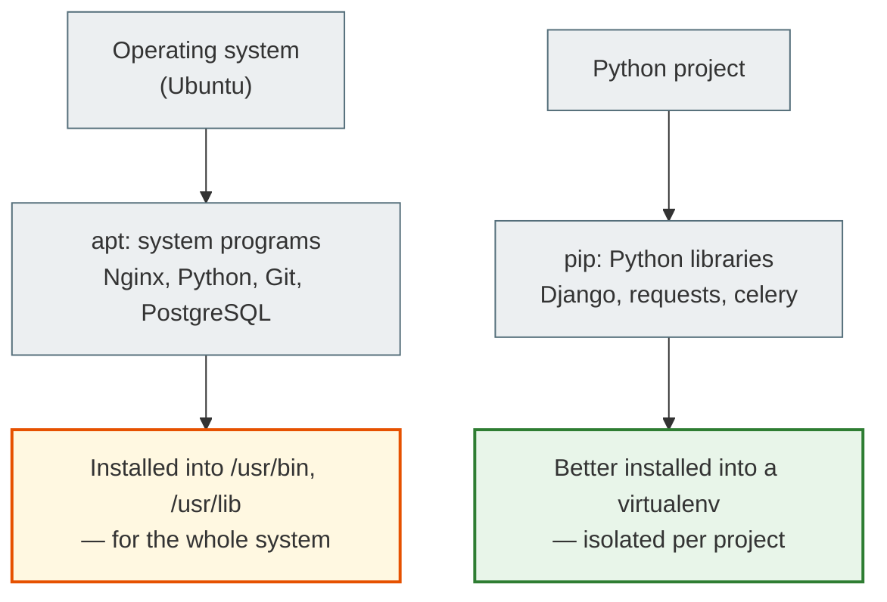
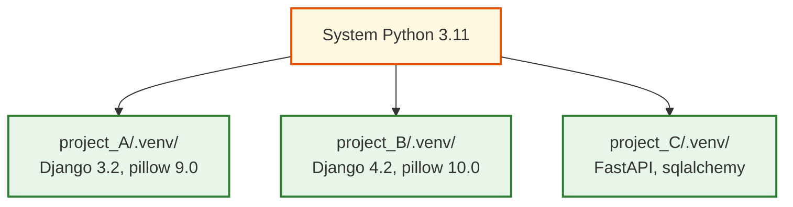

# 06. Package Managers and Installing Software

## Why this matters

A server has no App Store and no `.exe` files. To install Nginx, Python, PostgreSQL, or any other program, you use a **package manager**. For Python libraries — `pip`.

Understanding the difference between system packages and Python packages matters so you don't break your environment and don't get confused about where a particular version of Python or Django comes from.

---

## Two levels of packages



> `apt` installs programs for the operating system.
> `pip` installs Python libraries for a Python project.

---

## apt — the system package manager

### Updating the package list

```bash
sudo apt update
```
It doesn't install anything — it only downloads the current list of available packages from the repositories. Always run it before `install`.

### Upgrading installed packages

```bash
sudo apt upgrade
```
Upgrades all installed packages to newer versions.

### Installing packages

```bash
sudo apt install nginx
sudo apt install python3
sudo apt install python3-venv
sudo apt install python3-pip
sudo apt install git
sudo apt install postgresql
sudo apt install redis-server
sudo apt install htop curl wget tree
```

### Removing packages

```bash
sudo apt remove nginx            # remove the program
sudo apt purge nginx             # remove + configuration files
sudo apt autoremove              # remove unneeded dependencies
```

### Searching for a package

```bash
apt search nginx
apt show nginx                   # detailed information about the package
dpkg -l | grep nginx             # is the package installed?
```

---

## pip — the Python package manager

### Installing libraries

```bash
pip install django
pip install django==4.2.0        # a specific version
pip install "django>=4.0,<5.0"  # a version range
pip install django psycopg2-binary celery redis
```

### Working with requirements.txt

```bash
pip freeze                       # list all installed packages
pip freeze > requirements.txt    # save to a file

pip install -r requirements.txt  # install from a file
```

### Package information

```bash
pip show django                  # version, dependencies, location
pip list                         # all installed packages
pip list --outdated              # what can be upgraded
```

---

## virtualenv — an isolated Python environment

### Why virtualenv matters

Without a virtualenv, every `pip install` goes into the system Python. That's a problem:

- Project A requires `Django==3.2`, Project B — `Django==4.2`. A conflict.
- You upgraded a library for one project — and broke another.
- The production server has the wrong version installed.

A virtualenv isolates the libraries of each project:



### virtualenv commands

```bash
# Create a virtualenv
python3 -m venv .venv

# Activate (Linux/Mac)
source .venv/bin/activate

# Deactivate
deactivate

# After activation — install the dependencies
pip install -r requirements.txt
```

After activation you'll see `(.venv)` before the prompt:
```text
(.venv) student@ubuntu:~/myproject$
```

### Where to keep the virtualenv

- Always in the project directory: `.venv/`
- Add it to `.gitignore` — don't commit it

```bash
# .gitignore
.venv/
__pycache__/
*.pyc
.env
```

---

## A typical sequence on a new server

```bash
# 1. Update the system
sudo apt update && sudo apt upgrade -y

# 2. Install system dependencies
sudo apt install python3 python3-venv python3-pip git nginx -y

# 3. Clone the project
git clone https://github.com/you/myproject.git
cd myproject

# 4. Create a virtualenv
python3 -m venv .venv
source .venv/bin/activate

# 5. Install Python dependencies
pip install -r requirements.txt
```

---

## Common beginner mistakes

**Mistake 1:** Running `pip install` without an activated virtualenv
> The library will be installed into the system Python. Check: `which pip` should point to `.venv/bin/pip`.

**Mistake 2:** `pip: command not found`
> Use `pip3` or `python3 -m pip`, or install it via `sudo apt install python3-pip`.

**Mistake 3:** Not adding `.venv` to `.gitignore`
> A virtualenv contains thousands of files and weighs 100+ MB. It doesn't belong in Git.

**Mistake 4:** Forgetting `sudo apt update` before `install`
> Without updating, you may install an old version or get a "package not found" error.

---

## Practical exercise

### Task 1
```bash
sudo apt update
sudo apt install tree htop -y
tree --version
htop --version
```
Make sure both programs were installed.

### Task 2
```bash
mkdir ~/test_project && cd ~/test_project
python3 -m venv .venv
source .venv/bin/activate
pip install django
python -c "import django; print(django.__version__)"
pip freeze > requirements.txt
cat requirements.txt
deactivate
```
Follow each step. Explain what is happening.

### Task 3
Open two terminals. In one, activate the virtualenv and enter `which python`. In the other — without the virtualenv. Compare the results.

---

## Self-check

- [ ] I understand the difference between `apt` and `pip`
- [ ] I can install a system program with `apt install`
- [ ] I can create and activate a virtualenv
- [ ] I understand why each project needs a virtualenv
- [ ] I can save and restore dependencies with `pip freeze` and `requirements.txt`

---

## Short summary

`apt` is for system programs (Nginx, PostgreSQL, Git). `pip` is for Python libraries (Django, requests). A virtualenv isolates each project's libraries. Always activate `.venv` before working on a project. The next step is SSH and connecting to a server.
