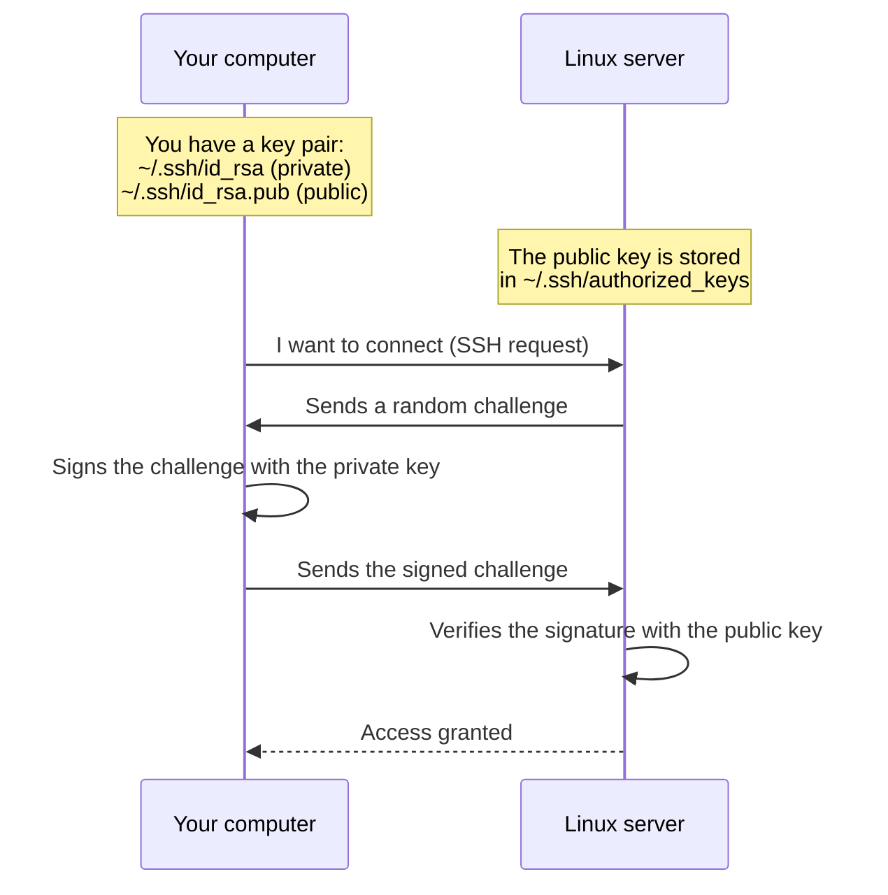

# 07. SSH and Connecting to a Server

## Why this matters

The server sits in a data center thousands of kilometers away. To work on it, you need **SSH** (Secure Shell). It is a protocol that lets you securely connect to a remote server and control it through the terminal, as if you were sitting right next to it.

SSH is the main tool of DevOps engineers and backend developers. Without it you can't deploy, read logs, or configure a service.

---

## A simple explanation

> SSH is like a secure tunnel between your laptop and the server. Everything you type is encrypted and sent to the server. The response comes back encrypted.

Connecting over SSH looks like this: you open a terminal on your laptop, type one command — and you get a terminal on the server. As if you "jumped" over there.

---

## Basic connection

```bash
ssh user@server_ip
```

Where:
- `ssh` — the program used to connect
- `user` — the username on the server
- `server_ip` — the server's IP address or domain

**Examples:**
```bash
ssh student@192.168.1.10
ssh deploy@mysite.com
ssh ubuntu@ec2-54-123-45.compute.amazonaws.com
```

### First login — the fingerprint

On the first connection, SSH will ask:
```text
The authenticity of host '192.168.1.10' can't be established.
ECDSA key fingerprint is SHA256:abc123...
Are you sure you want to continue connecting (yes/no)?
```

Enter `yes`. The server will be recorded in `~/.ssh/known_hosts`. On later connections there will be no check.

> If the fingerprint has changed and you get the warning "WARNING: REMOTE HOST IDENTIFICATION HAS CHANGED", it may mean an attack or that the server was recreated. Find out the reason before connecting.

---

## SSH keys

### Why keys are better than a password

- A password can be brute-forced
- A key is mathematically hard to crack
- With a key you don't need to type a password every time
- You can block a specific key without changing the password

### How SSH keys work



> SSH keys work as a pair: the private key stays on your computer, and the public key is placed on the server. The server recognizes you not by a password, but by the fact that you have the right private key.

**The golden rule:** the private key (`id_rsa`) — **never** give it to anyone. The public key (`id_rsa.pub`) — you can put it anywhere.

### Generating keys

```bash
ssh-keygen -t ed25519 -C "your_email@example.com"
```

Prompts:
```text
Enter file in which to save the key (/home/student/.ssh/id_ed25519): [Enter]
Enter passphrase (empty for no passphrase): [your passphrase or Enter]
```

After that, two files will appear:
```bash
~/.ssh/id_ed25519        # private key — NEVER SHOW IT TO ANYONE
~/.ssh/id_ed25519.pub    # public key — can be shared
```

```bash
cat ~/.ssh/id_ed25519.pub   # view the public key
```

### Copying the public key to the server

```bash
ssh-copy-id user@server_ip
```

Or manually:
```bash
# View the public key
cat ~/.ssh/id_ed25519.pub

# On the server — add it to authorized_keys
echo "ssh-ed25519 AAAA... your@email" >> ~/.ssh/authorized_keys
chmod 600 ~/.ssh/authorized_keys
chmod 700 ~/.ssh/
```

### SSH file permissions (important!)

```bash
chmod 700 ~/.ssh/
chmod 600 ~/.ssh/id_ed25519          # private key
chmod 644 ~/.ssh/id_ed25519.pub      # public key
chmod 600 ~/.ssh/authorized_keys
```

SSH will refuse to connect if the permissions on the key are too open.

---

## Copying files to the server

### scp — a simple copy

```bash
# Copy a file to the server
scp file.txt user@server:/home/user/

# Copy a file from the server
scp user@server:/home/user/file.txt ./

# Copy a directory
scp -r ./myproject/ user@server:/home/user/
```

### rsync — smart synchronization

```bash
rsync -av ./project/ user@server:/home/user/project/
```

`-a` — preserve permissions and attributes, `-v` — verbose (show what is being synced).

`rsync` copies only the changed files — faster than `scp` for repeated syncs.

---

## SSH Config — so you don't have to type long commands

Instead of:
```bash
ssh -i ~/.ssh/my_key deploy@192.168.1.50 -p 2222
```

Add to `~/.ssh/config`:
```text
Host myserver
    HostName 192.168.1.50
    User deploy
    Port 2222
    IdentityFile ~/.ssh/my_key
```

Now you can do:
```bash
ssh myserver
scp file.txt myserver:/home/deploy/
```

---

## Safe practices

- Disable password login after setting up keys (`PasswordAuthentication no` in `/etc/ssh/sshd_config`)
- Don't run SSH on port 22 on public servers (use a non-standard port)
- Use `ed25519` instead of `rsa` — it's more modern and more secure
- Never put a private key in Git or send it by email
- Add a passphrase to the key for extra protection

---

## Common beginner mistakes

**Mistake 1:** `Permission denied (publickey)`
> Check: has the public key been copied to the server? Are the permissions on `~/.ssh/` correct?

**Mistake 2:** Sent the private key instead of the public one
> `id_rsa` is private. `id_rsa.pub` is public (with `.pub`). Always send only the `.pub` file.

**Mistake 3:** `WARNING: REMOTE HOST IDENTIFICATION HAS CHANGED`
> Remove the line with the server's old key: `ssh-keygen -R server_ip`

**Mistake 4:** `ssh: connect to host ... port 22: Connection refused`
> SSH isn't running or uses a different port. Check: `sudo systemctl status ssh`

---

## Practical exercise

### Task 1
```bash
ls -la ~/.ssh/
```
If the directory doesn't exist, it is created automatically when you generate a key.

### Task 2
```bash
ssh-keygen -t ed25519 -C "test_key"
ls -la ~/.ssh/
cat ~/.ssh/id_ed25519.pub
```
What is inside the public key?

### Task 3
If you have access to a server or can use localhost:
```bash
ssh-copy-id student@localhost
ssh student@localhost
```
Try connecting with the key.

### Task 4
Add an entry to `~/.ssh/config` for an imaginary server and explain what each line means.

---

## Self-check

- [ ] I can connect to a server with `ssh user@ip`
- [ ] I understand the difference between a private and a public key
- [ ] I can generate an SSH key with `ssh-keygen`
- [ ] I know how to copy the public key to a server
- [ ] I can copy files with `scp` and `rsync`
- [ ] I understand why the private key must never be given to anyone

---

## Short summary

SSH is an encrypted tunnel for working with a remote server. A key pair (private + public) replaces the password and is more secure. The public key goes on the server. The private key stays only with you. The next step is environment variables and secrets.
