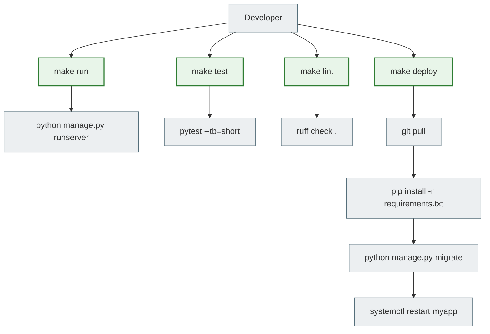

# 10. Makefile

## Why this matters

Every Python/Django project has commands you run all the time: `pip install -r requirements.txt`, `python manage.py migrate`, `python manage.py runserver`, `pytest`, `ruff check .`...

A Makefile is a "button panel" for your project. Instead of long commands, you get short aliases. Instead of remembering `gunicorn myapp.wsgi:application --workers 4 --bind 0.0.0.0:8000`, you just type `make run`.

---

## Simple explanation

> A Makefile is like a restaurant menu. You do not write out the recipe every time; you just say "I want pizza" and the kitchen knows what to do.

Instead of:
```bash
python -m pytest --cov=. --cov-report=term-missing -v
```

You write:
```bash
make test
```

---

## Makefile structure

```makefile
target: dependencies
	recipe
```

- `target` is the command name (what you type after `make`)
- `dependencies` are what must run first (optional)
- `recipe` is the commands to execute

> **Important:** the indentation before a recipe is a **Tab**, not spaces. Make will not accept spaces.

---

## A basic Makefile for a Django project

```makefile
.PHONY: install migrate makemigrations run shell test pytest lint format collectstatic superuser clean setup

install:
	pip install -r requirements.txt

migrate:
	python manage.py migrate

makemigrations:
	python manage.py makemigrations

run:
	python manage.py runserver

shell:
	python manage.py shell

test:
	python manage.py test

pytest:
	pytest --tb=short

lint:
	ruff check .

format:
	ruff format .

collectstatic:
	python manage.py collectstatic --noinput

superuser:
	python manage.py createsuperuser

clean:
	find . -name "*.pyc" -delete
	find . -name "__pycache__" -type d -exec rm -rf {} +

setup: install migrate collectstatic
	@echo "Project is set up!"
```

---

## .PHONY: an important detail

```makefile
.PHONY: install migrate run test
```

Make was originally a tool for building files (C/C++). It checks whether a file with the target's name exists. If there is a file called `install`, Make will say "nothing to be done".

`.PHONY` tells Make: "these targets are not files; always run them".

---

## Dependencies between targets

```makefile
.PHONY: setup install migrate collectstatic

install:
	pip install -r requirements.txt

migrate: install
	python manage.py migrate

collectstatic:
	python manage.py collectstatic --noinput

setup: install migrate collectstatic
	@echo "=== Project is ready! ==="
```

```bash
make setup
```

This runs: `install` → `migrate` → `collectstatic` → the message.

`@echo`: the `@` suppresses printing the command itself and shows only the result.

---

## Passing variables

```makefile
PORT ?= 8000
WORKERS ?= 4

run:
	python manage.py runserver 0.0.0.0:$(PORT)

gunicorn:
	gunicorn myapp.wsgi:application --workers $(WORKERS) --bind 0.0.0.0:$(PORT)
```

```bash
make run                   # PORT=8000 by default
make run PORT=9000         # a different port
make gunicorn WORKERS=8    # more workers
```

---

## Makefile with Docker

```makefile
.PHONY: build up down logs shell-web migrate collectstatic restart

build:
	docker compose build

up:
	docker compose up -d

down:
	docker compose down

logs:
	docker compose logs -f

shell-web:
	docker compose exec web bash

migrate:
	docker compose exec web python manage.py migrate

collectstatic:
	docker compose exec web python manage.py collectstatic --noinput

restart:
	docker compose restart web
```

Now deployment comes down to:
```bash
make build
make up
make migrate
```

---

## Visualization



---

## Common beginner mistakes

**Mistake 1:** `Makefile:3: *** missing separator. Stop.`
> You used spaces instead of a Tab. Check your editor and configure it to use Tabs instead of spaces for Makefiles.

**Mistake 2:** `make: 'install' is up to date.`
> You forgot `.PHONY`. There is a file named `install`.

**Mistake 3:** The command runs, but nothing is shown
> You used `@` where it is not needed, or the other way around. `@` hides the command, but not its output.

---

## Practical exercise

### Task 1
Create a Makefile for your Django project with these targets: `install`, `run`, `migrate`, `test`, `lint`, `clean`.

### Task 2
Add a `setup` target that depends on `install` and `migrate`.

### Task 3
Run `make --dry-run migrate`. What does this option print? When is it useful?

---

## Self-check

- [ ] I understand the structure of a Makefile: target, dependencies, recipe
- [ ] I know the indentation is a Tab, not spaces
- [ ] I understand why `.PHONY` is needed
- [ ] I can write a Makefile for a Django project with the main commands
- [ ] I know how to pass variables to make: `make run PORT=9000`

---

## Short summary

A Makefile is a "button panel" for your project. Instead of long commands, you get short aliases. Use `.PHONY` for targets that are not files. Tabs, not spaces. The next step is deploying Django to a real Linux server.
