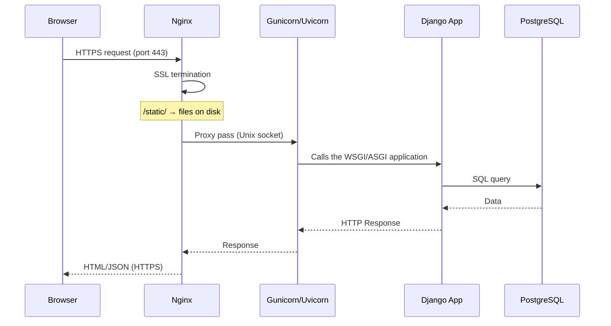

# 12. Nginx, Gunicorn and Uvicorn

## Why you need this

Django on its own is just a Python application. For it to handle thousands of requests in parallel, serve static files quickly, and communicate over HTTPS, you need a combination: **Nginx + Gunicorn/Uvicorn**.

Understanding this architecture means understanding how your site actually runs on a server.

---

## The overall picture



---

## Nginx

> Nginx is like a doorman at the entrance to a building. It greets every visitor, checks their requests, hands out simple things (static files) right away, and passes complex tasks further inside (to Django).

### What Nginx does:

1. **Accepts HTTP/HTTPS requests** on ports 80 and 443
2. **SSL termination** — decrypts HTTPS and passes it on internally as HTTP
3. **Serves static files** (`/static/`, `/media/`) directly from disk — without Django
4. **Reverse proxy** — forwards dynamic requests to Gunicorn/Uvicorn
5. **Load balancing** — can distribute requests across several app servers
6. **Rate limiting** — basic-level DDoS protection

### Minimal Nginx configuration

```nginx
# /etc/nginx/sites-available/myapp

server {
    listen 80;
    server_name example.com www.example.com;

    # Django static files
    location /static/ {
        alias /var/www/myapp/staticfiles/;
        expires 30d;                          # cache for 30 days
        add_header Cache-Control "public";
    }

    # Media files (uploaded by users)
    location /media/ {
        alias /var/www/myapp/media/;
    }

    # Everything else goes to Django through Gunicorn
    location / {
        proxy_pass http://unix:/run/myapp.sock;
        proxy_set_header Host $host;
        proxy_set_header X-Real-IP $remote_addr;
        proxy_set_header X-Forwarded-For $proxy_add_x_forwarded_for;
        proxy_set_header X-Forwarded-Proto $scheme;
    }
}
```

### Checking and restarting

```bash
sudo nginx -t                      # check the config syntax
sudo systemctl reload nginx        # re-read the config without stopping
sudo systemctl restart nginx       # full restart
```

---

## Gunicorn

> Gunicorn is like a team of waiters. Nginx (the doorman) passes on the orders, and Gunicorn runs several "waiters" (workers), each of which can handle its own request at the same time.

**Gunicorn** (Green Unicorn) is a Python WSGI HTTP Server. It implements the WSGI protocol to run Django.

### Running Gunicorn

```bash
gunicorn myapp.wsgi:application \
    --workers 3 \
    --bind unix:/run/myapp.sock \
    --log-level info \
    --access-logfile /var/log/myapp/access.log \
    --error-logfile /var/log/myapp/error.log
```

### Parameters

| Parameter | What it means |
|---|---|
| `myapp.wsgi:application` | Path to Django's WSGI object |
| `--workers 3` | Number of parallel processes |
| `--bind unix:/run/myapp.sock` | Listen on a Unix socket |
| `--bind 0.0.0.0:8000` | Or on a TCP port |
| `--timeout 30` | Request timeout in seconds |

### How many workers?

The general rule: `workers = 2 * CPU_cores + 1`

```bash
nproc           # number of CPU cores
```

On a server with 2 CPUs: 5 workers. Too many workers = too little RAM for each one.

---

## Uvicorn

**Uvicorn** is an ASGI server. It is used instead of Gunicorn when a Django project uses async views, WebSocket, or Django Channels.

```bash
pip install uvicorn
```

```bash
uvicorn myapp.asgi:application \
    --workers 4 \
    --host 0.0.0.0 --port 8000 \
    --log-level info
```

### Gunicorn + Uvicorn workers

A popular combination: Gunicorn as the process manager + Uvicorn as the ASGI worker:

```bash
gunicorn myapp.asgi:application \
    -k uvicorn.workers.UvicornWorker \
    --workers 4 \
    --bind unix:/run/myapp.sock
```

---

## WSGI vs ASGI

| | WSGI | ASGI |
|---|---|---|
| What it is | Web Server Gateway Interface | Async Server Gateway Interface |
| Synchronous/async | Synchronous | Supports async |
| Django | `myapp.wsgi:application` | `myapp.asgi:application` |
| Server | Gunicorn | Uvicorn, Daphne |
| When to use | Standard Django without async | Django async views, WebSocket, Channels |

---

## Why Nginx serves static files, not Django

Django can serve static files with `DEBUG=True` during development. In production this is a disaster:

- Django loads the file into Python memory and sends it byte by byte
- Nginx reads the file from disk and sends it at the OS level — 10–100 times faster
- Every static file request through Django occupies a worker, which is then unavailable for real requests

That is why `collectstatic` + Nginx for `/static/` is mandatory practice.

---

## Common beginner mistakes

**Mistake 1:** `502 Bad Gateway`
> Gunicorn is not running or the socket is not accessible. `systemctl status myapp`

**Mistake 2:** CSS does not load (404 for `/static/`)
> `collectstatic` was not run, or the path in the Nginx `alias` is wrong

**Mistake 3:** Gunicorn started, but Nginx does not see the socket
> Check the socket path. The Nginx worker and Gunicorn must have permissions on the `/run/` directory

**Mistake 4:** `ModuleNotFoundError` in Gunicorn
> The virtualenv is not activated. Use the full path: `/var/www/myapp/.venv/bin/gunicorn`

---

## Practical exercise

### Task 1
Draw the diagram by hand: browser → Nginx → Gunicorn → Django → PostgreSQL. Explain what each component does.

### Task 2
```bash
gunicorn myapp.wsgi:application --bind 0.0.0.0:8000 --workers 3 --log-level debug
```
Run it and look at the output. How many worker processes started?

### Task 3
Add `location /static/` to the Nginx config and check that static files open directly (without Django).

---

## Self-check

- [ ] I can explain the difference between Nginx and Gunicorn
- [ ] I understand what a reverse proxy is
- [ ] I know why Nginx serves static files rather than Django
- [ ] I understand the difference between WSGI and ASGI
- [ ] I can write a minimal Nginx config for Django

---

## Short summary

Nginx is the doorman: it accepts requests, serves static files, and proxies to Gunicorn. Gunicorn is the team of workers: it handles requests in parallel and runs Django. Uvicorn is for async Django. Together they provide production-ready operation of the site.
