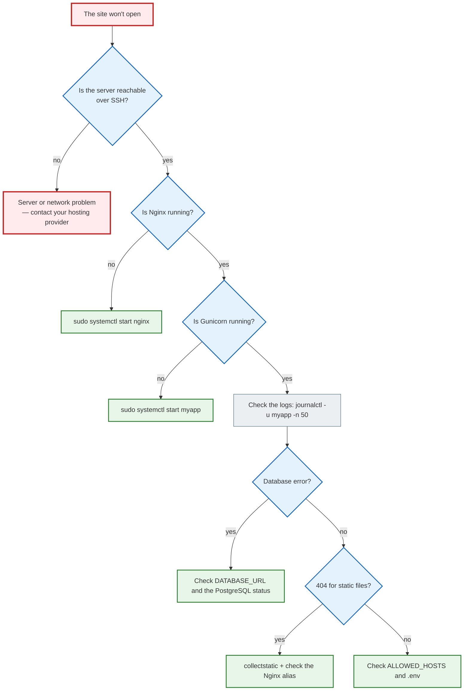

# 13. Logs, monitoring and debugging

## Why you need this

The site is down. What do you do? Without logs you are blind — you don't know where the error happened, at what time, or why. With logs, you have answers.

Being able to read logs and look for a problem systematically is one of the most important skills in working with a server.

---

## A simple explanation

> Logs are an event journal. Every time someone opens a page, an error occurs, or a service stops, it is written to the log. Later you can read this journal and understand what happened.

---

## Where to look for logs

| Logs | Where they are |
|---|---|
| System logs | `journalctl` or `/var/log/syslog` |
| Nginx access log | `/var/log/nginx/access.log` |
| Nginx error log | `/var/log/nginx/error.log` |
| Your Django service | `journalctl -u myapp` or `/var/log/myapp/` |
| PostgreSQL | `/var/log/postgresql/` |
| Django debug | The terminal where Gunicorn is running |

---

## Commands for reading logs

### tail — the last lines

```bash
tail /var/log/nginx/error.log           # last 10 lines
tail -n 50 /var/log/nginx/error.log     # last 50 lines
tail -f /var/log/nginx/access.log       # follow in real time
```

`-f` (follow) is the most useful option. The terminal updates and shows new lines as they appear. Open a second terminal and make requests to the site — you will see them in the logs in real time.

### journalctl — systemd logs

```bash
journalctl -u myapp                     # all logs of the service
journalctl -u myapp -f                  # follow in real time
journalctl -u myapp -n 100             # last 100 lines
journalctl -u myapp --since today       # for today
journalctl -u myapp --since "1 hour ago"
journalctl -u nginx -p err             # errors only
```

### grep — filtering logs

```bash
grep "ERROR" /var/log/nginx/error.log
grep "500" /var/log/nginx/access.log
grep -i "traceback" /var/log/myapp/gunicorn.log
tail -f /var/log/nginx/access.log | grep "POST"
```

---

## Reading logs

### Nginx access log

```text
192.168.1.1 - - [10/Jun/2026:12:34:56 +0000] "GET /api/notes/ HTTP/1.1" 200 1234 "-" "Mozilla/5.0..."
```

| Part | What it means |
|---|---|
| `192.168.1.1` | Client IP |
| `10/Jun/2026:12:34:56` | Date and time |
| `GET /api/notes/` | HTTP method and URL |
| `200` | HTTP status code |
| `1234` | Response size in bytes |

### HTTP status codes

| Code | What it means |
|---|---|
| `200` | OK |
| `301`/`302` | Redirect |
| `400` | Bad Request (client error) |
| `403` | Forbidden (no permission) |
| `404` | Not Found |
| `500` | Internal Server Error (Django error) |
| `502` | Bad Gateway (Gunicorn unavailable) |
| `503` | Service Unavailable |

### Django stack trace

```text
[2026-06-10 12:34:56 +0000] [1234] [ERROR] Exception in application

Traceback (most recent call last):
  File "/var/www/myapp/.venv/lib/.../django/db/models/sql/compiler.py", line 456
    return super().execute_sql(result_type)
  File "..."
    ...
django.db.utils.OperationalError: could not connect to server: Connection refused
```

Read from the bottom up: the last error is `OperationalError: could not connect to server`. Django cannot connect to PostgreSQL.

---

## Checklist: "the site won't open"



### The full checklist in text form

```markdown
## If the site won't open

- [ ] Is the server reachable over SSH?
- [ ] Is Nginx running? → `systemctl status nginx`
- [ ] Is the Nginx config valid? → `nginx -t`
- [ ] Is the Gunicorn/Django service running? → `systemctl status myapp`
- [ ] Are there errors in the Nginx logs? → `journalctl -u nginx -n 50`
- [ ] Are there errors in the Django logs? → `journalctl -u myapp -n 50`
- [ ] Is PostgreSQL running? → `systemctl status postgresql`
- [ ] Have the migrations been applied? → `python manage.py migrate`
- [ ] Has collectstatic been run?
- [ ] Is .env configured? (`DEBUG=False`, `ALLOWED_HOSTS`, `DATABASE_URL`)
- [ ] Are the ports open? → `ss -tulpn | grep -E ':80|:443|:8000'`
- [ ] Is the firewall not blocking? → `sudo ufw status`
```

---

## Logging in Django

```python
# settings.py
LOGGING = {
    'version': 1,
    'disable_existing_loggers': False,
    'handlers': {
        'file': {
            'level': 'ERROR',
            'class': 'logging.FileHandler',
            'filename': '/var/log/myapp/django.log',
        },
    },
    'loggers': {
        'django': {
            'handlers': ['file'],
            'level': 'ERROR',
            'propagate': True,
        },
    },
}
```

```python
# In your own code
import logging

logger = logging.getLogger(__name__)

def create_note(request):
    logger.info(f"User {request.user} creates a note")
    try:
        # ...
    except Exception as e:
        logger.error(f"Failed to create note: {e}", exc_info=True)
```

---

## Common beginner mistakes

**Mistake 1:** Looking for the error "at random" without reading the logs
> Always start with the logs. 90% of problems are visible right away.

**Mistake 2:** Reading logs from the top
> The latest events are at the bottom. Read `tail -n 50`, not the whole file.

**Mistake 3:** `journalctl` shows nothing
> Check the service name: `systemctl list-units --type=service | grep myapp`

---

## Practical exercise

### Task 1
```bash
sudo tail -f /var/log/nginx/access.log &
curl http://localhost/
```
Explain what appeared in the logs after the request.

### Task 2
Deliberately break DATABASE_URL in `.env` and start Django. Find the error in the logs.

### Task 3
Write a command that shows all lines with code `500` in the Nginx access log for the last day.

---

## Self-check

- [ ] I know where the Nginx and systemd logs are
- [ ] I can use `tail -f` to follow logs in real time
- [ ] I can read a stack trace and find the cause of an error
- [ ] I understand the meaning of HTTP status codes (200, 404, 500, 502)
- [ ] I know the systematic checklist for diagnosing "the site won't open"

---

## Short summary

Logs are the first place to look when there are problems. `tail -f` for real time, `journalctl -u` for systemd services, `grep` for filtering. A systematic checklist helps you find the problem quickly. The next step is Docker.
