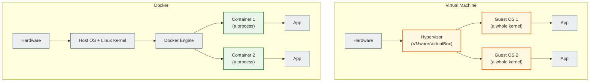

# 14. Docker: the basics

## Why you need this

"It works on my laptop" is a classic phrase that destroys a team's productivity. The laptop has Python 3.11, the server has 3.9. The laptop has PostgreSQL 15, CI has 13. The result: bugs that are impossible to reproduce.

Docker solves this problem: the whole project, together with its dependencies, is packaged into a **container** that works the same way everywhere.

---

## A simple explanation

> A Docker image is like a recipe plus a box with everything needed to run the application. A container is an already running instance of that box. You can start 10 containers from one image — and they will all be identical.

**Without Docker:**
```text
Developer laptop:      Python 3.11, Django 4.2, PostgreSQL 15
CI server:             Python 3.9,  Django 4.2, PostgreSQL 13
Production server:     Python 3.10, Django 4.1, PostgreSQL 14
```
Different environments → unexpected bugs.

**With Docker:**
```text
Laptop / CI / Production: one and the same image → identical behavior
```

---

## Key terms

| Term | What it means |
|---|---|
| **Image** | A template (frozen snapshot) of a file system + metadata |
| **Container** | A running instance of an image (a process with an isolated environment) |
| **Dockerfile** | Instructions for building an image |
| **Registry** | A store of images (Docker Hub, GitHub Container Registry) |
| **Volume** | Persistent data storage outside the container |
| **Port mapping** | Binding a container port to a host port |

---

## Container vs Virtual Machine



| | VM | Docker Container |
|---|---|---|
| Isolation | A full OS | A process in an isolated namespace |
| Size | Gigabytes | Megabytes |
| Startup | Minutes | Seconds |
| Resources | Heavy | Light |

---

## Dockerfile

A Dockerfile is a text file with instructions for building an image.

```dockerfile
# Base image
FROM python:3.12-slim

# Install system dependencies
RUN apt-get update && apt-get install -y \
    libpq-dev \
    && rm -rf /var/lib/apt/lists/*

# Directory inside the container
WORKDIR /app

# Copy requirements first (Docker cache)
COPY requirements.txt .
RUN pip install --no-cache-dir -r requirements.txt

# Then copy all the code
COPY . .

# Environment variables
ENV PYTHONDONTWRITEBYTECODE=1
ENV PYTHONUNBUFFERED=1

# The port it will listen on
EXPOSE 8000

# Startup command
CMD ["gunicorn", "myapp.wsgi:application", "--bind", "0.0.0.0:8000"]
```

### Why COPY requirements.txt first?

Docker caches every layer. If `requirements.txt` has not changed, Docker does not reinstall the dependencies but takes them from the cache. This speeds up the build when the code changes.

---

## Basic Docker commands

### Building an image

```bash
docker build -t myapp:latest .
docker build -t myapp:v1.2.3 .
```

`-t` — the image name and tag. `.` — the directory containing the Dockerfile.

### Running a container

```bash
docker run myapp:latest
docker run -p 8000:8000 myapp:latest
docker run -p 8000:8000 -d myapp:latest        # -d = detached (background)
docker run -p 8000:8000 --name mycontainer myapp
docker run --env-file .env -p 8000:8000 myapp
```

`-p 8000:8000` — bind the container's port 8000 to the host's port 8000.

### Managing containers

```bash
docker ps                           # running containers
docker ps -a                        # all, including stopped ones
docker stop mycontainer             # stop
docker start mycontainer            # start a stopped one
docker rm mycontainer               # remove
docker rm -f mycontainer            # force remove
```

### Logs and running commands

```bash
docker logs mycontainer             # container logs
docker logs -f mycontainer          # follow the logs
docker exec -it mycontainer bash    # enter the container
docker exec mycontainer python manage.py migrate
```

### Images

```bash
docker images                       # list of images
docker rmi myapp:latest             # remove an image
docker pull python:3.12-slim        # download from Docker Hub
```

---

## Volumes — persisting data

A container is isolated. If you stop and remove a container, all the data inside it disappears. **Volumes** are used to persist data.

```bash
# Mount a host directory into the container
docker run -v /var/data/postgres:/var/lib/postgresql/data postgres:16

# Or a named volume
docker volume create myapp_data
docker run -v myapp_data:/var/lib/postgresql/data postgres:16
```

---

## .dockerignore

The Docker equivalent of `.gitignore` — so that unnecessary files are not copied into the image:

```text
# .dockerignore
.venv/
__pycache__/
*.pyc
.env
.git/
*.log
node_modules/
```

---

## Common beginner mistakes

**Mistake 1:** Code changes do not appear after `docker run`
> You need to rebuild the image: `docker build -t myapp . && docker run myapp`

**Mistake 2:** The container stops immediately after starting
> The process exited. Check: `docker logs mycontainer`

**Mistake 3:** PostgreSQL data disappears after a restart
> No volume is attached. Add `-v postgres_data:/var/lib/postgresql/data`

**Mistake 4:** `Cannot connect to the Docker daemon`
> Docker is not running. `sudo systemctl start docker`

---

## Practical exercise

### Task 1
Write a `Dockerfile` for a Django project: python:3.12-slim, install the dependencies, copy the code.

### Task 2
```bash
docker build -t django-test .
docker run -p 8000:8000 -e DEBUG=True django-test
```
Does `http://localhost:8000` open?

### Task 3
```bash
docker exec -it <container_id> bash
ls -la
cat requirements.txt
exit
```
Explain where you ended up after `docker exec -it ... bash`.

---

## Self-check

- [ ] I understand the difference between a Docker image and a container
- [ ] I can write a basic Dockerfile for Django
- [ ] I know the commands: `build`, `run`, `ps`, `logs`, `exec`, `stop`, `rm`
- [ ] I understand why volumes are needed and that without them data will disappear
- [ ] I know what `.dockerignore` is

---

## Short summary

Docker packages an application together with its dependencies — the same environment everywhere. A Dockerfile is the build instruction. `docker build` → image, `docker run` → container. Volumes are for persisting data between restarts. The next step is Docker Compose for running several containers together.
