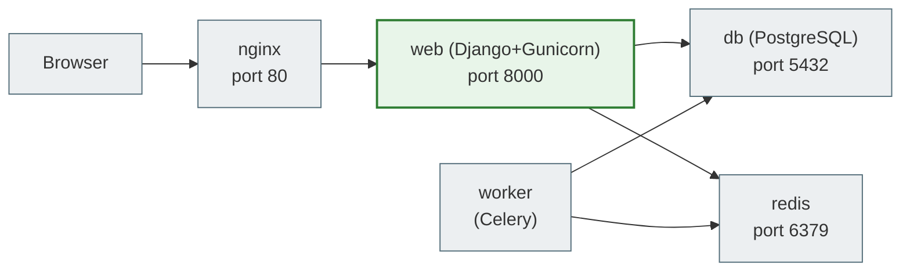

# 15. Docker Compose

## Why you need this

A Django project is not a single container. It usually consists of:
- Django app (Gunicorn)
- PostgreSQL
- Redis (for Celery or caching)
- Celery worker
- Nginx

Starting each one manually via `docker run` with long parameters is complicated and inconvenient. **Docker Compose** lets you describe the whole stack in one file and start everything with a single command.

---

## A simple explanation

> Docker Compose is like an orchestra conductor. You describe which "musicians" (containers) should play, and one command starts them all together in the right order.

---

## A minimal docker-compose.yml for Django

```yaml
services:
  web:
    build: .
    command: python manage.py runserver 0.0.0.0:8000
    ports:
      - "8000:8000"
    volumes:
      - .:/app
    env_file:
      - .env
    depends_on:
      db:
        condition: service_healthy

  db:
    image: postgres:16
    environment:
      POSTGRES_DB: app_db
      POSTGRES_USER: app_user
      POSTGRES_PASSWORD: app_password
    volumes:
      - postgres_data:/var/lib/postgresql/data
    healthcheck:
      test: ["CMD-SHELL", "pg_isready -U app_user -d app_db"]
      interval: 5s
      timeout: 5s
      retries: 5

volumes:
  postgres_data:
```

---

## A production docker-compose.yml

```yaml
services:
  web:
    build:
      context: .
      dockerfile: Dockerfile
    command: gunicorn myapp.wsgi:application --bind 0.0.0.0:8000 --workers 3
    expose:
      - "8000"
    volumes:
      - static_files:/app/staticfiles
      - media_files:/app/media
    env_file:
      - .env
    depends_on:
      db:
        condition: service_healthy
      redis:
        condition: service_started
    restart: always

  db:
    image: postgres:16-alpine
    volumes:
      - postgres_data:/var/lib/postgresql/data
    env_file:
      - .env.db
    restart: always
    healthcheck:
      test: ["CMD-SHELL", "pg_isready -U $POSTGRES_USER -d $POSTGRES_DB"]
      interval: 10s
      timeout: 5s
      retries: 5

  redis:
    image: redis:7-alpine
    restart: always

  worker:
    build: .
    command: celery -A myapp worker --loglevel=info
    env_file:
      - .env
    depends_on:
      - db
      - redis
    restart: always

  nginx:
    image: nginx:alpine
    ports:
      - "80:80"
      - "443:443"
    volumes:
      - ./nginx/conf.d:/etc/nginx/conf.d
      - static_files:/var/www/static
      - media_files:/var/www/media
    depends_on:
      - web
    restart: always

volumes:
  postgres_data:
  static_files:
  media_files:
```

---

## Key fields of docker-compose.yml

### services

Each key inside `services:` is a container name:

```yaml
services:
  web:      # Django app
  db:       # PostgreSQL
  redis:    # Redis
```

### build vs image

```yaml
# Build from a Dockerfile
build: .

# Or use a ready-made image
image: postgres:16
```

### ports vs expose

```yaml
ports:
  - "8000:8000"      # HOST:CONTAINER — accessible from outside

expose:
  - "8000"           # only between containers in the Compose network
```

In production: `expose` for web (only Nginx has access), `ports: "80:80"` for Nginx.

### volumes

```yaml
volumes:
  - .:/app                    # bind mount: host directory → container
  - postgres_data:/var/lib/postgresql/data    # named volume
```

A bind mount (`.:/app`) is convenient in development: code changes are immediately visible in the container without a rebuild.

### depends_on

```yaml
depends_on:
  db:
    condition: service_healthy   # wait until PostgreSQL is ready
```

Without `condition: service_healthy`, Django may start before PostgreSQL is ready to accept connections.

### restart

```yaml
restart: always          # always restart on failure
restart: unless-stopped  # except when explicitly stopped
restart: on-failure      # only on error
```

---

## Basic Docker Compose commands

```bash
# Start the whole stack
docker compose up
docker compose up -d           # in the background (detached)
docker compose up --build      # rebuild the images before starting

# Stopping
docker compose down
docker compose down -v         # stop and remove volumes (data!)

# Logs
docker compose logs
docker compose logs -f         # follow in real time
docker compose logs web        # logs of a specific service

# Run a command in a container
docker compose exec web bash
docker compose exec web python manage.py migrate
docker compose exec web python manage.py createsuperuser
docker compose exec web python manage.py shell

# Status
docker compose ps

# Restart one service
docker compose restart web
```

---

## Networking between containers

Docker Compose automatically creates a network, and all services are on it. They communicate by **service name**:

```python
# settings.py (or .env)
DATABASES = {
    'default': {
        'ENGINE': 'django.db.backends.postgresql',
        'HOST': 'db',        # service name from docker-compose.yml
        'PORT': '5432',
        'NAME': 'app_db',
        'USER': 'app_user',
        'PASSWORD': 'app_password',
    }
}
```

Instead of `localhost` — `db`. Instead of `localhost:6379` for Redis — `redis:6379`.



---

## Common beginner mistakes

**Mistake 1:** `could not connect to server: Connection refused` when starting Django
> PostgreSQL has not started yet. Add a `healthcheck` and `condition: service_healthy` in `depends_on`.

**Mistake 2:** Code changes are not reflected
> In dev mode you need a bind mount: `- .:/app`. Or rebuild: `docker compose up --build`.

**Mistake 3:** `docker compose down -v` deleted the database data
> `-v` removes volumes! To stop without losing data, just use `docker compose down`.

**Mistake 4:** `HOST=localhost` for the database in Docker
> In the Compose network it is `HOST=db` (the service name), not `localhost`.

---

## Practical exercise

### Task 1
Write a `docker-compose.yml` for Django + PostgreSQL. Start it and check:
```bash
docker compose up --build
docker compose exec web python manage.py migrate
```

### Task 2
```bash
docker compose exec web python manage.py shell
```
Inside the shell: `from django.contrib.auth.models import User; User.objects.all()`

### Task 3
Check that the services can see each other:
```bash
docker compose exec web ping db
```

---

## Self-check

- [ ] I understand the structure of `docker-compose.yml`: services, volumes, ports
- [ ] I know the difference between `ports` and `expose`
- [ ] I understand that containers communicate by service name, not via localhost
- [ ] I can start the stack with `docker compose up --build`
- [ ] I know the commands: `exec`, `logs`, `down`, `ps`

---

## Short summary

Docker Compose lets you describe the whole stack in YAML and start it with one command. Containers in one Compose file form a shared network and find each other by service name. For dev — a bind mount of the code. For prod — named volumes for data. The next step is the DevOps workflow.
