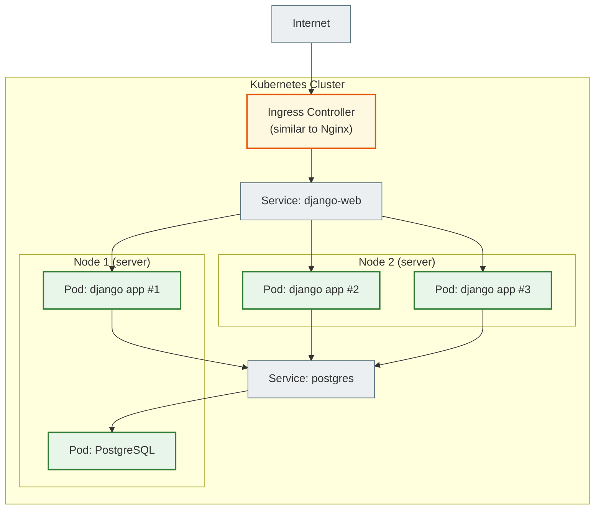
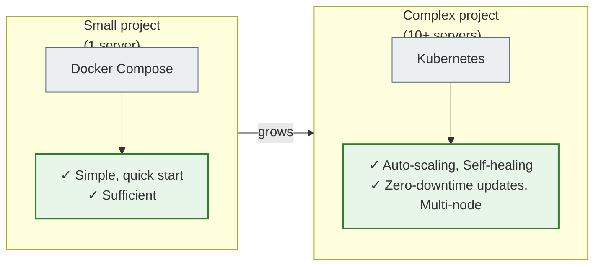

# 17. Kubernetes: an overview

## Why you need this

You have mastered Docker and Docker Compose. One server, one `docker compose up` — and everything works. But what if you have 50 containers, 10 servers, and the system has to restart itself on failure, scale under load, and update without stopping?

That is what **Kubernetes** exists for.

> This file is only an overview. Kubernetes is a large course of its own. Here you will get a mental model: why it exists and when it becomes necessary.

---

## A simple explanation

> Docker Compose is convenient when you have one server or a small project. Kubernetes is needed when there are many containers and many servers, and the system has to restart, scale, and distribute the load between them on its own.

Docker Compose is a remote control for a single TV. Kubernetes is a management system for a whole cinema with hundreds of screens, each showing a different film, and if one screen breaks, the system itself moves the audience to another one.

---

## When Docker Compose is no longer enough

| Situation | Docker Compose | Kubernetes |
|---|---|---|
| 1 server, 5 containers | Excellent | Overkill |
| 3+ servers | Difficult | Designed for this |
| Auto-scaling | No | Yes |
| Self-healing (auto-restart) | Partially | Yes, automatically |
| Zero-downtime deployment | Difficult | Built in |
| 100+ microservices | Hard to manage | This is what it exists for |

---

## Key terms

| Term | What it means |
|---|---|
| **Cluster** | A set of servers (nodes) managed by Kubernetes |
| **Node** | One server in the cluster (physical or VM) |
| **Pod** | The smallest unit in Kubernetes. Contains 1+ containers |
| **Deployment** | Describes the desired state of Pods (how many replicas, which image) |
| **Service** | A stable address for a set of Pods (load balancing) |
| **Namespace** | Logical isolation inside the cluster |
| **ConfigMap** | Configuration (without secrets) for Pods |
| **Secret** | Encrypted data (passwords, keys) for Pods |
| **Ingress** | The cluster's equivalent of an Nginx reverse proxy |

---

## Cluster architecture



Kubernetes automatically:
- Places Pods on free Nodes
- Restarts a Pod if it crashes
- Balances traffic between Pods
- Replaces Pods during an update (one at a time, without downtime)

---

## Basic manifests (for familiarization)

### Deployment

```yaml
# deployment.yaml
apiVersion: apps/v1
kind: Deployment
metadata:
  name: django-web
spec:
  replicas: 3             # 3 copies of Django
  selector:
    matchLabels:
      app: django-web
  template:
    metadata:
      labels:
        app: django-web
    spec:
      containers:
        - name: django
          image: myapp:v1.2.3
          ports:
            - containerPort: 8000
          env:
            - name: SECRET_KEY
              valueFrom:
                secretKeyRef:
                  name: myapp-secrets
                  key: secret-key
```

### Service

```yaml
# service.yaml
apiVersion: v1
kind: Service
metadata:
  name: django-service
spec:
  selector:
    app: django-web
  ports:
    - port: 80
      targetPort: 8000
```

---

## Self-healing — automatic recovery

If a Pod crashes, Kubernetes notices it through **health checks** and automatically starts a new one:

```yaml
livenessProbe:
  httpGet:
    path: /health/
    port: 8000
  initialDelaySeconds: 10
  periodSeconds: 30
```

The Django endpoint `/health/` returns `200 OK`, which means everything is fine. If it returns an error several times in a row, Kubernetes restarts the container.

---

## Horizontal Pod Autoscaler

```yaml
apiVersion: autoscaling/v2
kind: HorizontalPodAutoscaler
metadata:
  name: django-hpa
spec:
  scaleTargetRef:
    apiVersion: apps/v1
    kind: Deployment
    name: django-web
  minReplicas: 2
  maxReplicas: 10
  metrics:
    - type: Resource
      resource:
        name: cpu
        target:
          type: Utilization
          averageUtilization: 70
```

When CPU load is > 70%, Kubernetes automatically increases the number of Pods. When the load drops, it decreases it.

---

## Kubernetes vs Docker Compose



---

## Managed Kubernetes

If you don't want to maintain a cluster manually, cloud providers offer Kubernetes as a service:

| Provider | Service |
|---|---|
| Google Cloud | GKE (Google Kubernetes Engine) |
| AWS | EKS (Elastic Kubernetes Service) |
| Azure | AKS (Azure Kubernetes Service) |
| DigitalOcean | DOKS |

You describe Deployments and Services → the cloud manages the Nodes, networking, and master updates.

---

## What to learn before Kubernetes

Kubernetes is a complex system. Starting with it without a foundation is a waste of time.

```text
1. ✅ Linux and the terminal
2. ✅ Docker and Dockerfile
3. ✅ Docker Compose
4. ✅ Manual deployment (without Kubernetes)
5. ✅ Basic CI/CD
    ↓
6. → Kubernetes
```

---

## Practical exercise

### Task 1
Explain in your own words: how does Kubernetes differ from Docker Compose? Give 3 concrete situations where Kubernetes is needed.

### Task 2
Draw a diagram of a Kubernetes cluster for a typical Django project: what will be Pods, what will be Services, what will be Ingress.

### Task 3
Install Minikube (local Kubernetes for learning):
```bash
# Install minikube
curl -LO https://storage.googleapis.com/minikube/releases/latest/minikube-linux-amd64
sudo install minikube-linux-amd64 /usr/local/bin/minikube

minikube start
kubectl get nodes
kubectl get pods --all-namespaces
```

---

## Self-check

- [ ] I can explain what Kubernetes is and why it is needed
- [ ] I understand the difference between a Cluster, a Node and a Pod
- [ ] I know when Docker Compose is enough and when Kubernetes is needed
- [ ] I understand the concepts of self-healing and auto-scaling
- [ ] I know the next steps for learning Kubernetes

---

## Short summary

Kubernetes is a container orchestrator for complex systems with many servers. It automatically restarts, scales and updates Pods. For small projects, Docker Compose is enough. Kubernetes becomes relevant when you outgrow a single server. The next file is the roadmap and where to go next.
