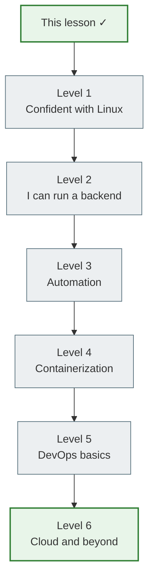
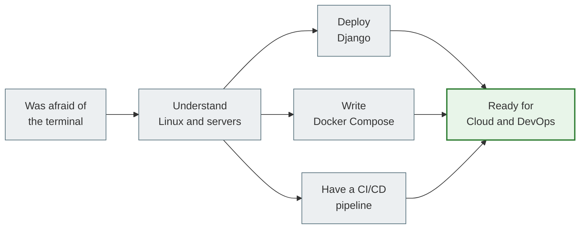

# 18. Roadmap and next steps

## You have completed this lesson

If you've reached this file and worked through the whole lesson — congratulations. You are no longer afraid of Linux. You understand how your Python code lives on a real server.

But this is not the end — it is the beginning. DevOps and server-side development are a huge field of knowledge. This roadmap will help you understand where you are now and where to go next.

---

## Where you are now



---

## Level 1. Using Linux with confidence

**What you can do after this lesson:**

- [ ] Navigate the file system (`cd`, `ls`, `pwd`, `find`)
- [ ] Work with files (`cp`, `mv`, `rm`, `chmod`, `chown`)
- [ ] Understand access permissions (`rwx`, `755`, `644`, `600`)
- [ ] Manage processes (`ps`, `kill`, `top`, `jobs`)
- [ ] Connect over SSH (`ssh`, `ssh-keygen`, `scp`)
- [ ] Read logs (`tail -f`, `journalctl`, `grep`)

**What to practice next:**
- Work in the terminal every day instead of a GUI
- Learn `vim` or `nano` for editing files on the server
- Get to know `tmux` or `screen` for persistent sessions

---

## Level 2. Being able to run a backend project

**What you can do after this lesson:**

- [ ] Install dependencies via `apt` and `pip`
- [ ] Set up a `virtualenv`
- [ ] Configure `.env` for production
- [ ] Run `migrate` and `collectstatic`
- [ ] Start Gunicorn/Uvicorn
- [ ] Configure basic Nginx

**What to practice next:**
- Deploy a real Django project to a VPS (DigitalOcean, Hetzner)
- Set up HTTPS with Let's Encrypt + Certbot
- Study Django `check --deploy` — recommendations for production

---

## Level 3. Automating your work

**What you can do after this lesson:**

- [ ] Write Bash scripts with variables, conditions, and loops
- [ ] Use `set -e` and exit codes
- [ ] Write a `Makefile` for the project
- [ ] Read and filter logs
- [ ] Set up a systemd service

**What to practice next:**
- Write a complete `deploy.sh` for your project
- Learn `cron` for scheduled tasks
- Get to know `logrotate` for log rotation

---

## Level 4. Containerization

**What you can do after this lesson:**

- [ ] Write a `Dockerfile` for Django
- [ ] Build and run Docker images
- [ ] Write a `docker-compose.yml` for the stack
- [ ] Run Django + PostgreSQL + Redis via Compose
- [ ] Run `migrate` and `shell` via `docker compose exec`

**What to practice next:**
- Optimize the Dockerfile: multi-stage builds, minimal image size
- Study Docker volumes and networks in more detail
- Deploy a production stack with Nginx + Gunicorn in Docker Compose

---

## Level 5. DevOps basics

**What you can do after this lesson:**

- [ ] Understand a CI/CD pipeline
- [ ] Write a basic GitHub Actions workflow
- [ ] Know the difference between Staging and Production
- [ ] Understand rollback strategies
- [ ] Have a mental model of DevOps culture

**What to practice next:**
- Set up a full CI/CD pipeline for your project
- Study GitHub Actions in more detail: secrets, caching, matrix
- Get to know automated E2E tests in CI

---

## Level 6. Next — cloud and specialization

After Levels 1–5 you are ready to move in any direction:

### Cloud Platforms

| Platform | Why learn it |
|---|---|
| **DigitalOcean** | An easy start with VPS and managed databases |
| **AWS** | The largest platform: EC2, S3, RDS, Lambda |
| **GCP** | GKE (Kubernetes), Cloud Run, BigQuery |
| **Hetzner** | Cheap and reliable VPS for learning |

### Infrastructure as Code

```text
Terraform → describing cloud infrastructure as code
Ansible   → automating server configuration
Pulumi    → IaC with Python/TypeScript
```

### Kubernetes

```text
Basic concepts → kubectl → Helm charts
→ Operators → Service Mesh (Istio) → GitOps (ArgoCD)
```

### Monitoring and Observability

```text
Prometheus → metrics collection
Grafana    → visualization
Loki       → log aggregation
Jaeger     → distributed tracing
```

### Security

```text
Firewall (ufw, iptables)
SSL/TLS and certificates
Secrets management (HashiCorp Vault)
OWASP top 10 for the web
```

---

## Recommended resources

### For practice
- [OverTheWire: Bandit](https://overthewire.org/wargames/bandit/) — learning Linux commands through a game
- [Linux Journey](https://linuxjourney.com/) — an interactive Linux course
- [Play with Docker](https://labs.play-with-docker.com/) — Docker in the browser for free

### For reading
- "The Linux Command Line" — William Shotts (free online)
- "Docker Deep Dive" — Nigel Poulton
- Official Django deployment docs: docs.djangoproject.com/en/stable/howto/deployment/

### For video
- TechWorld with Nana (YouTube) — Docker, Kubernetes, DevOps
- Hussein Nasser (YouTube) — Backend engineering, Nginx

---

## Your first real project

The best way to consolidate your knowledge is to deploy a real project:

### A minimal plan

1. Rent a VPS (DigitalOcean $5/month, Hetzner €4/month)
2. Install Ubuntu 22.04
3. Connect over SSH with a key
4. Deploy your Django project: git + virtualenv + Gunicorn + Nginx
5. Set up HTTPS with Certbot (free)
6. Add a systemd service for automatic restarts
7. Set up GitHub Actions for automatic deployment

After that you have a real production server and hands-on deployment experience. That is worth more than 10 books you have read.

---

## Summary of the whole lesson



---

## A final thought

You have come all the way from "what is Linux" to understanding CI/CD, Docker Compose and Kubernetes. This is the foundation on which all modern backend development is built.

The most important thing now is practice. Open a terminal, rent a VPS, deploy your project. Every command you type by hand becomes part of your experience.

> Linux stops being scary once you start using it every day.

---

## Self-check (final)

- [ ] I can connect to a server over SSH and find my way around the file system
- [ ] I can deploy a Django project from git clone to a running Gunicorn
- [ ] I can write a basic Bash script and a Makefile
- [ ] I can run Django + PostgreSQL with Docker Compose
- [ ] I understand a CI/CD pipeline and can write a GitHub Actions workflow
- [ ] I know why Kubernetes exists and when it is needed
- [ ] I have a plan for further learning
