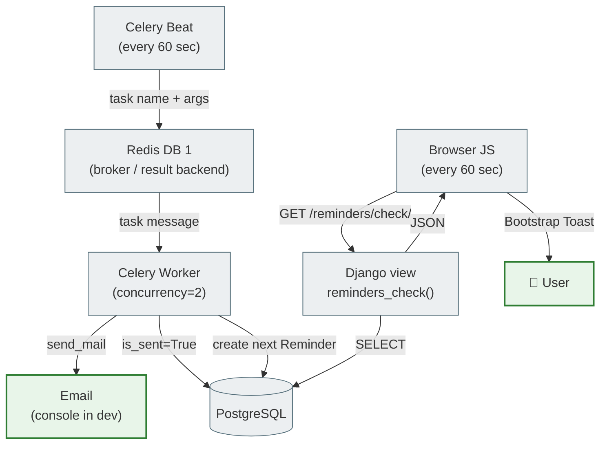

# Background Tasks and Browser Notifications

`notes_chat_app` implements its reminder system on two levels: a background email worker (Celery) and browser polling with a Bootstrap Toast.

---

## The problem and the solution

A Django view cannot send an email exactly at the scheduled time: it runs only in response to an HTTP request. If the browser is not open, the reminder will not fire.

**Solution:** the Celery Worker, a separate process that is always active and runs tasks independently of the browser.

---

## Architecture



---

## Files

| File | Role |
|------|------|
| `notes_project/celery.py` | Initializes the Celery app, autodiscovers tasks |
| `notes_project/__init__.py` | Registers `celery_app` when Django starts |
| `notes_project/settings.py` | `CELERY_BROKER_URL`, `CELERY_BEAT_SCHEDULE`, `CELERY_*` |
| `notes_app/tasks.py` | `@shared_task send_reminder_notifications()` |
| `notes_app/selectors.py` | `get_due_reminders_for_browser(user)` |
| `notes_app/views.py` | `reminders_check(request)` → `JsonResponse` |
| `notes_app/urls.py` | `path('reminders/check/', ...)` |
| `notes_app/static/notes_app/js/reminders.js` | fetch polling + Bootstrap Toast |
| `templates/base.html` | toast-container + `<script>` for authenticated users |
| `docker-compose.yml` | the `celery-worker` and `celery-beat` services |
| `notes_app/tests/test_tasks.py` | unit tests for the task and the view |
| `notes_app/tests/test_selenium.py` | E2E test for the Toast appearing |

---

## Celery Flow

### 1. Initialization

```python
# notes_project/celery.py
import os
from celery import Celery

os.environ.setdefault('DJANGO_SETTINGS_MODULE', 'notes_project.settings')
app = Celery('notes_project')
app.config_from_object('django.conf:settings', namespace='CELERY')
app.autodiscover_tasks()
```

```python
# notes_project/__init__.py
from .celery import app as celery_app
__all__ = ('celery_app',)
```

### 2. The task

```python
# notes_app/tasks.py
@shared_task
def send_reminder_notifications():
    from .models import Reminder
    now = timezone.now()
    pending = (
        Reminder.objects
        .select_related('note__user')
        .filter(remind_at__lte=now, is_sent=False)
    )
    for reminder in pending:
        user = reminder.note.user
        if user.email:
            send_mail(...)
        reminder.is_sent = True
        reminder.save(update_fields=['is_sent'])
        _schedule_next(reminder)
```

### 3. Repeating reminders

```python
def _schedule_next(reminder):
    if reminder.repeat_pattern == 'none':
        return
    from dateutil.relativedelta import relativedelta
    delta_map = {
        'daily':   relativedelta(days=1),
        'weekly':  relativedelta(weeks=1),
        'monthly': relativedelta(months=1),  # preserves the correct month length
    }
    delta = delta_map.get(reminder.repeat_pattern)
    if delta:
        Reminder.objects.create(
            note=reminder.note,
            remind_at=reminder.remind_at + delta,
            message=reminder.message,
            is_sent=False,
            repeat_pattern=reminder.repeat_pattern,
        )
```

`relativedelta` (from `python-dateutil`) correctly handles different month lengths, unlike `timedelta(days=30)`.

### 4. The schedule (Beat)

```python
# notes_project/settings.py
CELERY_BEAT_SCHEDULE = {
    "send-reminders-every-minute": {
        "task": "notes_app.tasks.send_reminder_notifications",
        "schedule": 60.0,
    },
}
```

### 5. Docker services

```yaml
celery-worker:
  build: .
  command: celery -A notes_project worker -l info --concurrency=2

celery-beat:
  build: .
  command: celery -A notes_project beat -l info
```

There is always exactly one Beat instance. The Worker can scale horizontally.

---

## Redis DB allocation

| Service | URL | Usage |
|--------|-----|-------------|
| Django Channels | `redis://redis:6379/0` | channel layer (WebSocket) |
| Celery | `redis://redis:6379/1` | broker + result backend |

```python
# settings.py
_CELERY_REDIS = _REDIS_URL.replace("/0", "/1") if _REDIS_URL else "redis://localhost:6379/1"
CELERY_BROKER_URL = _CELERY_REDIS
CELERY_RESULT_BACKEND = _CELERY_REDIS
```

Separate DBs rule out conflicts between Channels and Celery.

---

## Browser Notification Flow

### Selector

```python
# notes_app/selectors.py
def get_due_reminders_for_browser(user):
    now = timezone.now()
    return list(
        Reminder.objects
        .filter(
            note__user=user,
            remind_at__lte=now,
            remind_at__gte=now - timedelta(hours=1),   # display window: 1 hour
        )
        .select_related('note')
        .order_by('remind_at')
        .values('id', 'message', 'remind_at', 'note__title')
    )
```

The 1-hour window: a user who opens the browser 40 minutes after a reminder will still see the Toast.

### View

```python
# notes_app/views.py
@login_required
def reminders_check(request):
    data = selectors.get_due_reminders_for_browser(request.user)
    for item in data:
        item['remind_at'] = item['remind_at'].strftime('%d.%m.%Y %H:%M')
    return JsonResponse({'reminders': data})
```

### JS module

| Component | Purpose |
|-----------|-------------|
| `POLL_INTERVAL = 60_000` | check every minute |
| `sessionStorage` | deduplication: a Toast is not repeated within the current session |
| `escapeHtml()` | XSS protection before inserting into the DOM |
| `checkReminders()` | async fetch → parse → showToast for new ones |
| `DOMContentLoaded` | the first check runs immediately on page load |
| `bootstrap.Toast` | Bootstrap 5 API: `new bootstrap.Toast(el, {delay: 8000}).show()` |

---

## WebSocket vs Polling comparison

| Criterion | WebSocket (chat) | HTTP Polling (reminders) |
|----------|-----------------|--------------------------|
| Persistent connection | yes | no |
| Ideal for | a live data stream | rare events (1/min) |
| Complexity | higher (ASGI, consumer) | lower (one endpoint) |
| Server load | low (push) | depends on the interval |
| Suitable for reminders | overkill | yes |

---

## Testing

### The task

```python
# test_tasks.py — key tests
@override_settings(EMAIL_BACKEND='django.core.mail.backends.locmem.EmailBackend')
def test_marks_due_reminder_as_sent(self):
    r = self._reminder(offset_minutes=-5)
    send_reminder_notifications()
    r.refresh_from_db()
    self.assertTrue(r.is_sent)

def test_ignores_future_reminders(self):
    r = self._reminder(offset_minutes=+10)
    send_reminder_notifications()
    r.refresh_from_db()
    self.assertFalse(r.is_sent)

def test_daily_repeat_creates_next_reminder(self):
    r = self._reminder(offset_minutes=-5, repeat='daily')
    original_at = r.remind_at
    send_reminder_notifications()
    next_r = Reminder.objects.filter(note=self.note, is_sent=False).first()
    diff = (next_r.remind_at - original_at).total_seconds()
    self.assertAlmostEqual(diff, 86400, delta=60)
```

`override_settings(EMAIL_BACKEND='...locmem...')` captures emails in `django.core.mail.outbox` without an SMTP server.

### Selenium E2E

```python
def test_toast_appears_for_due_reminder(self):
    Reminder.objects.create(
        note=self.note,
        remind_at=timezone.now() - timedelta(minutes=30),
        message='JS toast test',
    )
    self._login_via_cookie()
    self.driver.get(f'{self.live_server_url}/notes/')

    # JS calls checkReminders() immediately on DOMContentLoaded
    toast = WebDriverWait(self.driver, 10).until(
        EC.presence_of_element_located((By.CSS_SELECTOR, '.toast.show'))
    )
    self.assertIn('Selenium Reminder Note', toast.text)
```

The test does not wait 60 seconds: `checkReminders()` runs right after the DOM loads.

### Coverage

| File | Class | Count | What it tests |
|------|------|-----------|-----------|
| `test_tasks.py` | `SendReminderTaskTest` | 8 | the task, email, repeat_pattern |
| `test_tasks.py` | `RemindersCheckViewTest` | 5 | JSON endpoint, auth, isolation |
| `test_selenium.py` | `SeleniumReminderToastTest` | 4 | the Toast appears / does not appear |

**Running:**

```bash
# Unit
docker compose run --rm web python manage.py test notes_app.tests.test_tasks -v 2

# Selenium (requires the running stack)
docker compose up -d
docker compose exec web python manage.py test \
  notes_app.tests.test_selenium.SeleniumReminderToastTest -v 2
```

---

## Common pitfalls

| Situation | Error | Solution |
|----------|---------|---------|
| Two `celery-beat` instances | every reminder is sent twice | Beat must be exactly 1 process |
| Celery and Channels in Redis DB 0 | key conflicts | Celery → DB 1 |
| `timedelta(days=30)` for a month | January 31 + 30 days = March 1 in a leap year (March 2 in a common year) — February is skipped | `relativedelta(months=1)` |
| Lazy QuerySet in `get_due_reminders_for_browser` | `SynchronousOnlyOperation` when called from async code | `list(queryset.values(...))` |
| Emails in tests go to a real server | unexpected sends during CI | `@override_settings(EMAIL_BACKEND='...locmem...')` |
| The Toast appears several times | the interval fires before it is hidden | `sessionStorage` deduplication by `id` |

---

## Related sections

- [Tutorial 09 — Celery and background tasks](../tutorials/09_celery.md)
- [Celery Tasks — theory](../06_application_architecture/django_tasks_full.md)
- [Async and Chat](async_and_chat.md)
- [Testing Strategy](testing_strategy.md)
