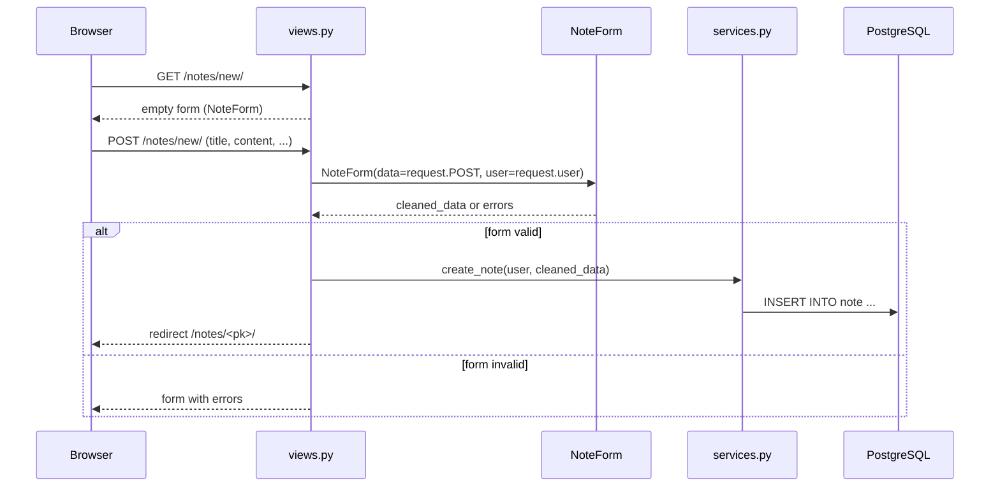
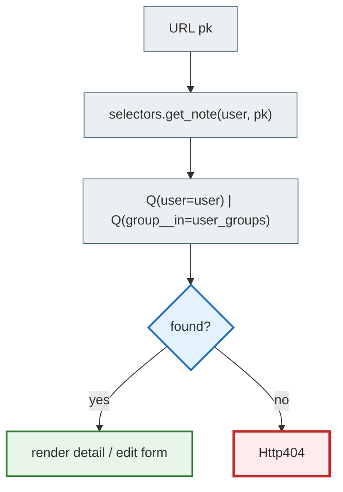
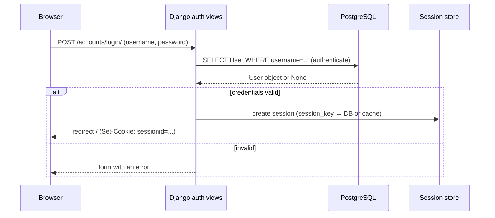
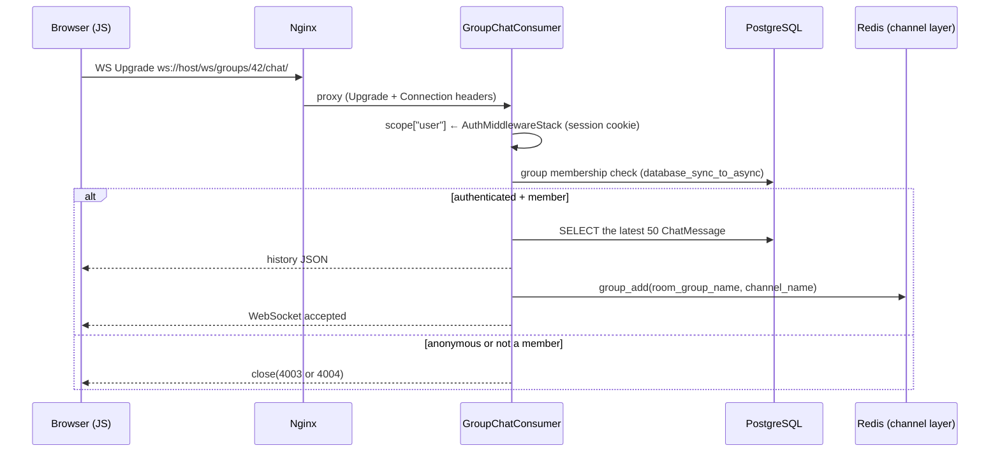
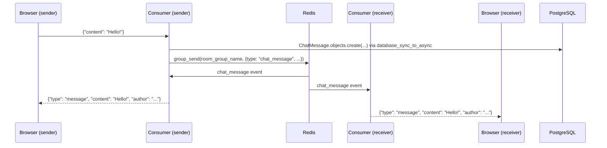

# Request Flows

End-to-end scenarios: from the browser to the database and back.

---

## Creating a note (HTTP POST)



---

## Checking access to an object (IDOR protection)



Mutating operations (edit/delete) are allowed only for the owner (`Q(user=user)`).
Read access is for the owner **or** group members (`Q(group__in=user_groups)`).

---

## Login / session



---

## WebSocket: connecting to the chat



---

## WebSocket: sending a message



---

## Docker startup

```text
Docker Compose up
  ↓ db healthcheck (pg_isready)
  ↓ redis healthcheck
  ↓ web: entrypoint.sh
      → manage.py migrate
      → manage.py collectstatic
      → manage.py seed_demo_data --force  (if SEED_DEMO_DATA=1)
      → exec python -m uvicorn notes_project.asgi:application --host 0.0.0.0 --port 8001 --reload
  ↓ nginx: forward :80 → web:8001
  ↓ celery-worker, celery-beat (after the db and redis healthchecks)
  ↓ ngrok (dev tunnel, profile tunnel)
  ↓ selenium, selenium-tests (E2E tests, profile test)
```
